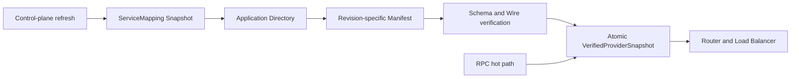
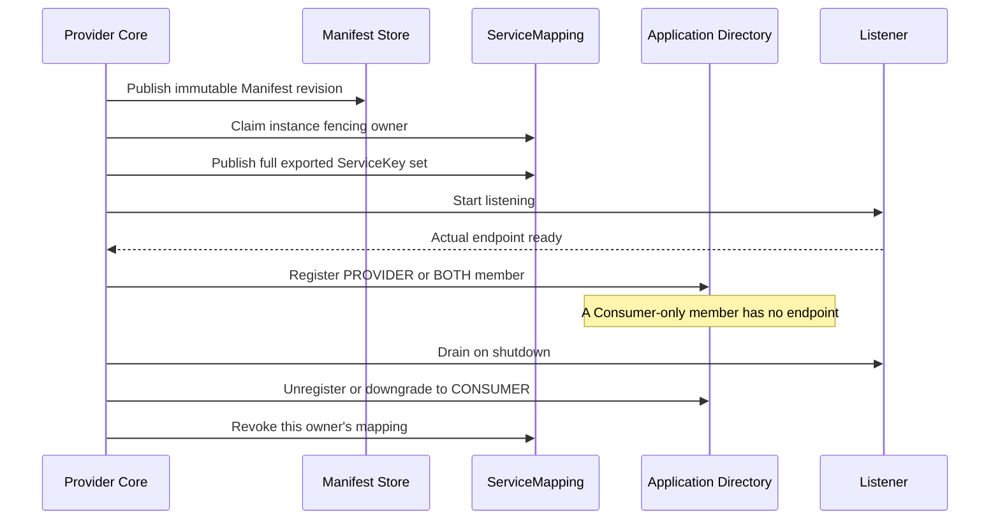

# OTRYX V2：应用级注册身份与 SPI 契约

> **当前状态：V2-01～05 Core 应用级注册/发现已实现；#133 开始交付 Etcd V2 后端；Spring Starter、Quickstart 与其余远端 Adapter 仍待迁移。**
>
> 总控 Issue [#127](https://github.com/Ryan-Guizhou/otryx-rpc/issues/127)，当前工作包 [#133](https://github.com/Ryan-Guizhou/otryx-rpc/issues/133)。
> 版本 JDK 21、Spring Boot 3.5.4、1.0.0-SNAPSHOT、Wire v1 均保持不变。

## 1. 核心决策

Provider 和 Consumer **都必须使用 Application 为注册身份**。一个进程实例的实际 RPC 监听端点只对应一条应用成员记录，接口数量不增加注册记录数。纯 Consumer 必须存在于应用成员目录，但没有可供 RPC 调用的 Endpoint，不能进入 Provider 负载均衡池。BOTH 同时表达消费和提供角色。

ServiceKey 继续描述 interface/version/group，维持原有 Method ID、Schema Fingerprint、协议和业务调用模型，但不能作为新的 Registry 实例主键。

目标调用链：ServiceKey → ServiceMapping → Application Directory → 实例 Manifest → Contract/Schema/Health 校验 → Router/LoadBalancer → Unary Transport。调用热路径不得进行远端 Registry IO。

**不保留长期接口级注册或发现、兼容模式、双读双写以及旧 Registry Key/Path。**

## 2. V2-01 新模型及限制

| Java 类型 | 意义 |
| --- | --- |
| ApplicationKey | namespace + applicationName，最长 128，限定可安全编码字符 |
| ApplicationRole | PROVIDER / CONSUMER / BOTH |
| ApplicationInstance | instanceId + ApplicationKey + Role + 可选真实 Endpoint + Weight + ManifestRevision + 有界 Attributes |
| ApplicationDirectorySnapshot | 同一应用、唯一 instanceId、不可变实例列表和单调 revision |
| ApplicationRegistryListener | 独立的目录更新、同步成功、同步失败事件 |
| ApplicationDiscovery | 按 ApplicationKey 查询或订阅完整成员快照 |
| ApplicationRegistrar | 注册/更新/注销应用实例，要求幂等和实例级隔离 |
| ApplicationRegistry | 能力声明、可选 Registrar、关闭与资源归还 |

应用身份 namespace / name 去首尾空白后均非空，仅允许英文数字及点、短横线、下划线，最长 128；instanceId 不允许控制字符，最长 256。

Provider/BOTH 必须包含实际 RPC Endpoint、正整数权重及 Manifest Revision。Consumer-only 的 Endpoint 和 ManifestRevision 必须是 null，权重为 0。实例扩展属性最多 64 项，key 最多 128，value 最多 1024 字符；构造后不可被外部修改。这些 Attributes 仅是路由标签，**不构成认证或授权证据**。

目录快照不接受跨 ApplicationKey 的成员、重复 instanceId、负 revision；成功健康通知不得作为清空实例的命令。接口契约与 Manifest 的校验将在后续 Issue 完成。

## 3. 分阶段开发约束

当前旧 Registry / ServiceRegistrar / ServiceDiscovery(ServiceKey) 同时被 Core Client/Server、ServiceDirectory 和所有 Registry Adapter 使用。由于 #129–#138 尚未实现，直接在 #128 删除所有旧类型会导致多模块 Maven 编译失败，违反每个独立 Issue 必须可验证地合并的规则。

**该现存代码只是分阶段开发期间的临时待替换实现，绝不是最终兼容或双模式支持。** 后续严格按以下顺序完成：

1. **#128**：新身份、强类型 SPI、快照、校验及测试（本 PR 目标）。
2. **#129–#130**：真实 Manifest Repository 和 ServiceMapping。
3. **#131–#132**：Memory Registry、Provider 和 Consumer 全面切换，验证 Consumer-only 入册。
4. **#133–#136**：Etcd、Nacos、Consul、Eureka 原生应用注册和元数据适配。
5. **#137–#138**：唯一 Starter、Quickstart 与双角色启动生命周期。
6. **#139**：仓库级强制清除**所有**旧接口级 Registry SPI、Key/Path、配置、测试和文案。未通过这一门禁不得宣布 V2 应用级注册完成。

不允许任何新代码调用旧接口级 SPI；不得增加运行时双模式开关。对于底层 Registry 不具备 Metadata KV 的能力，后续使用独立仓库并 fail fast，不能回退。

## 4. 质量验证

- 核验三种角色模型、Provider Endpoint/Manifest 约束、Consumer-only 不可路由；
- 核验命名空间、应用名、实例 ID、Attribute 等无效输入和最大边界；
- 核验 Snapshot 不可变、应用隔离、重复成员 ID、Revision；
- 核验 ApplicationRegistry REGISTRATION capability 与实际实现不一致时拒绝；
- 不改变 Unary Wire v1，也不增加 Core 对外部 Adapter 的依赖；
- 按 AGENTS.md 运行相关 Maven/JUnit、Java 格式/文档门禁。

后续任何 Agent 应当根据当前源码和 Issue 的真实状态判断完成度，不得把已提交的接口定义误报为 Provider/Consumer 已经使用应用级注册。

## 5. V2-02：版本化 Manifest 与元数据仓库（Core 契约已实现）

> **当前状态：Core API、二进制编解码和单元测试已实现；运行时/后端尚未接入。**
> 关联 [Issue #129](https://github.com/Ryan-Guizhou/otryx-rpc/issues/129)。
> 应用映射 #130、Memory #131 和其它 Registry #133–#136 负责后续接入。

### 5.1 模型与职责

| 类型 | 当前实际职责 |
| --- | --- |
| ApplicationManifest | 单应用的不可变导出服务快照，确定性排序 |
| ExportedService | ServiceKey、serviceId、methodIds、Schema Fingerprint |
| ApplicationManifestCodec | Manifest 专用确定性二进制格式，完全独立于 Unary Wire v1 |
| ApplicationManifestRepository | 异步不可变发布、读取及严格身份验证 SPI |

Provider 在完成 Service Binding 后，可通过 ExportedService.fromContract(serviceKey, api)
创建真实导出项，使用 ApplicationManifest.create(applicationKey, exports)
组成完整清单。服务和方法 ID 沿用 RpcContractMethods / RpcIds 的现有规则。
同一个接口的不同版本、group 可以共存；重复 ServiceKey 和 Service ID 冲突必须拒绝。
多个实例可以共享一个 Revision，也可以在灰度和滚动发布期间指向不同 Revision。

**Manifest 不内联进应用实例注册元数据。** Provider 的 ApplicationInstance 只发布
manifestRevision；纯 Consumer 不发布 Manifest，更不会成为 RPC 可路由 Provider。

### 5.2 标准编码及容量

独立 Metadata 格式采用 Big Endian int32 和 int32 长度前缀 UTF-8，字段顺序为：

1. Magic = 0x4f4d464d，Manifest 格式版本 = 1，当前 Wire 协议版本 = 1、RpcSchemaFingerprint 规范版本 = 1；
2. Application namespace、applicationName、serviceCount；
3. 按 ServiceKey(interface/version/group) 排序的 interfaceName、version、group、serviceId、
   schemaFingerprint、methodCount、排序后的 methodIds。

Revision = SHA-256 对**完整标准二进制**计算后的 sha256: + 64 位小写十六进制；
内容、接口版本、分组、应用身份、Wire/Schema/Manifest 格式的变更均会影响 Revision。
此格式版本不修改原有 Wire v1。

- 每份 Manifest 最多 512 个接口，每接口最多 1024 个方法；标准编码总量不超过 256 KiB；
- 接口名称最长 256 字符，版本和分组各不超过 128 字符；指纹必须为 64 个小写 hex；
- ServiceKey 在 Manifest 中要求安全的接口二进制名称、版本和分组，拒绝路径字符或冒号造成的 Key 歧义；
- 不存在递归任意对象图，所有集合计数、字段长度、解码空间都有固定上限；
- 解码拒绝未知版本、错误 Magic、截断、额外尾部字节、非标准排序、
  重复 ServiceKey/Service ID/Method ID、错误 UTF-8 和超限字段；
- Manifest 单对象容量限制不等于总缓存容量。后续 Consumer Directory /
  Registry Adapter **必须**增加总缓存大小、SingleFlight、并发队列与 TTL/LKG 限制。

### 5.3 Repository 的一致性与安全

publish 必须幂等创建，不得以同一个 ApplicationKey + Revision 覆盖不同字节。
lookup 缺失返回 Optional.empty；失败必须异常完成而不是误报不存在。
lookupVerified 必须校验请求的 ApplicationKey 和完整 Revision；
即使仓库返回内容存在，但不能匹配期望身份，也必须拒绝，不得退回接口级发现或其他 Revision。

SHA-256 只提供内容一致性，**不是发布方身份验证机制**；
实际后端需可信配置源、鉴权、ACL、命名空间隔离与审计。

### 5.4 多 Revision 与安全回收策略

本阶段有意不提供任意删除 Manifest 的方法。在新的 Registrar/Mapping 尚未具有
可靠的跨进程引用所有权和原子版本校验之前，简单 TTL 或 LRU 删除会破坏滚动升级与回滚，
因此**保留已发布 Revision 是当前的安全默认行为**，不是自动 GC 已实现。

后续 Registry Adapter 如果实现 GC，必须证明：
- 从权威成员目录和部署状态确认没有存活实例、进行中的发布或回滚流程引用；
- 超过可配置保留窗口，该窗口覆盖 Lease、发现缓存最大陈旧期及回滚保护期；
- 原子引用复核或 generation fencing 防止检查与删除之间出现新的引用；
- 删除失败时保持保留，存储空间不足则拒绝新发布，不能删除仍在使用的 Revision；
- 具备并发发布、重启、灰度和异常回滚的真实存储集成测试。

### 5.5 验证覆盖

- ApplicationManifestTest：方法 ID / Schema 规则、版本和 group、确定性顺序、
  深拷贝、非法输入、冲突与总体大小边界。
- ApplicationManifestCodecTest：标准二进制往返、未知版本、截断/尾随、
  非标准方法/服务次序、重复方法及畸形 UTF-8。
- ApplicationManifestRepositoryTest：独立 Revision 并存、并发幂等、
  未命中返回空、错误应用或修订号 fail closed。

**注意：** Repository 测试使用隔离的测试存储；Memory、Nacos、Etcd、Consul、Eureka
真实元数据后端和安全 GC 将分别由后续 Issue 交付，不能宣称已经上线。

## 6. V2-03：ServiceMapping 与本地严格 Provider 解析

> 关联 [#130](https://github.com/Ryan-Guizhou/otryx-rpc/issues/130)。本阶段只交付 Core SPI、
> Memory 控制面仓库及 Resolver，不声称 MemoryRegistry/Client/Server 已切换；后续工作依赖 #131–#139。

### 6.1 真实应用映射及所有权

- `ServiceMappingKey(namespace, ServiceKey)` 保持 ServiceKey 的业务标识语义，与 Registry ApplicationKey 分离。
- `ServiceMappingRepository.claim(application, instanceId)` 原子取得由仓库颁发的 fencing generation；
  `publish(owner, fullExportSet)` 原子替换**该实例**接口集合；
  `revoke(owner)` 只能撤销完全一致 generation 的实例发布，不能误删其他活跃实例或应用。
- `lookupVerified` 严格验证命名空间、返回映射 Key 和原子快照。
  多应用可以提供相同 ServiceKey；健康空映射与远端错误有严格区别。
- `MemoryServiceMappingRepository` 实现上述原子语义；Etcd/Nacos/Consul/Eureka 的真正
  跨进程 CAS、租约、ACL、owner fencing 和持久化由后续 Issue 提供，不能复用内存锁宣称分布式一致。

### 6.2 Consumer 控制面与 RPC 数据面分离

- 控制面使用 `ServiceMappingCache.refresh` 与 `ApplicationServiceResolver.refresh`。
  `ServiceMappingCache.current` / `ApplicationServiceResolver.current` 不执行远端 IO；
  最后一步成功才一次性发布完整不可变 Provider 快照。未就绪、合法空、限期 LKG、超时陈旧、关闭可区分。
- 目录实例必须属于该 Application。纯 Consumer、无 RPC Endpoint、0 端口或通配监听地址
  不得进入候选池；每个实例的 Manifest Revision 必须存在、归属匹配，
  且确实导出目标 ServiceKey + 预期 Schema Fingerprint + 当前 Wire 版本。
- `ManifestSnapshotCache` 单飞按 (ApplicationKey,Revision) 缓存：最多 256 Key、
  32 并行获取、16 MiB 已缓存字节；正缓存 10 分钟、负缓存 2 秒，
  单次未决获取 15 秒超时。失败不伪装成缓存空结果；
  未被引用的 Revision 不通过此缓存直接删除远端仓库数据。
- 本地 Resolver 上限为 512 个 Service/Schema 组合、32 并行刷新、单次最多 1024 候选节点，
  30 秒本地刷新上限。失联是否继续使用快照由配置 `maxStale` 决定；
  这是独立控制面 API，尚**没有**接线到旧 `OtryxRpcClient`。
- 当前 Manifest 内容寻址只验证完整性，不构成身份认证与运行时授权。
  远端 ACL、身份、真实证书授权仍属 #133–#140，不可弱化。

### 6.3 回归与后续边界

`ApplicationServiceResolverTest` 验证多 Application / 多 Revision、纯 Consumer 排除、
Schema 失配、健康空映射、Manifest 缺失、LKG 失效与关闭竞态；
`ApplicationMappingCacheTest` 验证 SingleFlight、负缓存过期、失败缓存与取消；
`ServiceMappingV2Test` 验证多实例共享所有权与旧代数隔离。

可在 JDK 21 环境执行 `./mvnw -B -ntp -pl otryx-core -am test` 与
`./mvnw -B -ntp clean verify -Pquality`；CI 通过前不得标记 #130 完成。

## 7. V2-04：Memory Application Registry 控制面

> [Issue #131](https://github.com/Ryan-Guizhou/otryx-rpc/issues/131)。
> 本阶段完成无网络控制面契约及测试，不将旧 MemoryRegistry/Client/Server
> 的接口级注册路径误称为已经切换；真正的运行时与 Starter 生命周期分别由 #132、#137 实施。

### 7.1 本地应用目录

- `MemoryApplicationRegistry` 直接实现 `ApplicationRegistry` + `ApplicationRegistrar`：
  Provider、Consumer、BOTH 均以 `ApplicationKey + instanceId` 登记，纯 Consumer
  必须有应用成员而没有 RPC Endpoint。一个实例导出三个服务仍只有一条应用成员记录。
- 内部同步保护原子成员更新与 Revision；`lookup` 返回完整不可变快照。
  同值重复注册幂等，旧内容注销不删除新修订记录，关闭后所有操作明确失败。
- `subscribe` 首次发送真实快照，随后按 Revision 去重通知，
  使用幂等关闭的 `RegistrySubscription`，回调异常与数据修改隔离。
  Memory 适配器通知目前在控制面调用线程同步发送，**不得在 EventLoop 阻塞使用**；
  异步应用协调与调度边界在 #132 统一。
- 容量限制：最大 512 Application、4,096 成员、每 Application 256 实例、2,048 订阅。
  满容量拒绝，不进行未经验证的随机逐出。

### 7.2 元数据与工厂

- `MemoryApplicationManifestRepository` 按应用和内容 Revision 幂等保存字节；
  同一 Revision 禁止改写、跨 Namespace 不泄漏、支持滚动多 Revision。
  限制 1,024 份 Manifest、合计 32 MiB；关闭释放内存。安全 GC 不属于本模块。
- `MemoryServiceMappingRepository` 继续采用 #130 的实例代数 fencing 和一对多 ServiceKey
  映射，不以 `ServiceKey` 作为应用成员 Key。
- `ApplicationRegistryFactory` 是应用级新扩展点；Memory 默认工厂由 ServiceLoader 装载。
  每次 `create` 返回独立生命周期实例；同一 Runtime 内 Provider 和 Consumer
  必须共享此实例。多次创建互相隔离的 MemoryRegistry 不会神奇地跨 JVM 发现服务。
- 实现仍限于 JVM 内存，不提供网络可达性、真实租约、KV CAS、ACL 或生产持久性；
  各远端 Adapter 在 #133–#136 实现，不能用本实现替代真实 E2E。

### 7.3 验收

`MemoryApplicationRegistryTest` 覆盖角色成员、幂等与失效注销、并发 96 实例、
关闭拒绝、命名空间隔离、单应用导出三个接口、独立 Consumer 注册、
三条业务 ServiceKey 经 Mapping/Directory/Manifest/Schema 解析为真实 Provider，
Manifest 多修订号与 SPI ServiceLoader 工厂。

验证命令：`./mvnw -B -ntp -pl otryx-core -am test`，
`./mvnw -B -ntp clean verify -Pquality`。CI 全绿后再合并，并验证合并后 main 检查。

## 8. V2-05：Provider / Consumer 双向应用注册运行时

> 对应 [#132](https://github.com/Ryan-Guizhou/otryx-rpc/issues/132)。
> **本 PR 仅使 Core 编程式 Client/Server 具有可操作的新路径；不宣称 Spring Starter
> 已自动装配，也不宣称真实注册中心 Adapter 或 Quickstart 已切换。**
> 运行时换代与最终删除旧 SPI 分别受 #137–#139 约束。

### 8.1 生命周期与顺序

- `ApplicationMembershipCoordinator` 为同一应用进程的唯一成员控制面协调器：
  `ApplicationKey + instanceId` 在该生命周期内保持稳定。Consumer-only 也必须调用
  `startConsumer` 并完成真实目录入册；Provider/BOTH 在 Listener Ready 前不能暴露可路由 Endpoint。
- 一个监听 Endpoint 对应一个实例发布域；同一应用若有多个 Listener，应分别配置稳定、不同的
  instanceId 和协调器，不能让不同端点对同一实例互相覆盖。服务数量只增加 Manifest 中导出项，
  不增加同一监听实例的注册记录。
- 启动顺序：绑定业务服务 → 发布不可变 Manifest → claim 带 fencing 的映射 owner
  → 原子替换该实例完整服务集合 → 启动 Transport → 得到真实对外 Endpoint
  → 注册应用成员。任一步失败必须回滚已发布的映射、关闭 Transport，并返回异常。
  Manifest 内容 Revision 因滚动发布与回滚可能仍被引用，不做危险删除。
- Consumer-only → BOTH、BOTH → CONSUMER、BOTH → PROVIDER 均修改同一个成员实例，
  无重复注册。Provider 撤销不能删除另一个实例的共享 ServiceKey 映射。
  Provider 关闭采用已有 Drain + 受限注销预算；Consumer 关闭独立移除消费成员，
  两者共同使用同一个 Coordinator 的串行有界控制面。
- 每次后端异步操作超时上限 30 秒，可配置更小的单步骤预算。协调队列
  和新命令数均有限额，关闭后拒绝新命令、重复关闭复用同一 Future，
  外部后端失败/超时必须有异常终态而不是伪造清理成功。

### 8.2 Client 解析与数据面

- `OtryxRpcClient.Builder.applicationControlPlane(resolver, membership, namespace)`
  使 Consumer 使用新的应用级目录，不走旧 `ServiceDiscovery(ServiceKey)`；
  Client 构造期间启动本应用 Consumer-only 成员注册，`membershipReady()` 可作为就绪门禁。
  未入册或已关闭，业务调用 fail closed，不发送 Transport。
- 对每个业务接口提前计算 `ServiceKey + RpcSchemaFingerprint`；
  后台有界调度器刷新 Mapping → Application Directory → Revision Manifest
  → Wire/Schema 校验后更新内存快照。一次 RPC 的负载均衡只读取本地 `ServiceInstance[]`
  端点投影，不进行注册中心 IO，也绝不把纯 Consumer 端点纳入候选。
- 应用级目录默认强制有限的 LKG：未显式配置时为 30 秒，
  显式配置无界策略直接拒绝；可通过
  `directoryFreshnessOptions(new RpcDirectoryFreshnessOptions(Duration.ofSeconds(...)))`
  调整。缓存的 `ApplicationServiceResolver.maxStale` 也是有限预算；网络异常
  与健康空目录必须区分，不得因缓存错误而发布非法空快照。
- `OtryxRpcServer.Builder.applicationMembership(membership)` 选择新 Provider
  发布路径。必须向 Client/Server 传入同一个应用生命周期实例才能正确得到 BOTH，
  且注册中心、Manifest/Mapping 后端需是同一控制面部署域。
  **这不是允许长期保留接口级旧路径的兼容开关**：旧 Builder/SPIs 仅为分阶段的
  暂留代码，最终 #139 强制删除。

### 8.3 验证及明确剩余边界

- `ApplicationMembershipCoordinatorTest`：纯 Consumer 无端口、升级 BOTH、
  降级与独立注销、不同 owner 共存、失败注册和元数据回滚、并发关闭、后端挂起超时。
- `ApplicationRuntimeEndToEndTest`：使用真实 Core Client/Server、
  三个不同接口的业务实现、Wire v1 Header/Method ID/Codec、真实 Mapping/Manifest 及
  进程内 Registry；只用测试 LoopbackTransport 替换 Socket。覆盖 Provider-only、
  Consumer-only、同进程 BOTH、三服务同一实例、Listener 启动失败回滚与关闭注销。
- Spring Starter、公开 Quickstart 仍在旧运行时；远端 Adapter 的 lease/CAS/watch、
  独立 JVM、真实 TCP、mTLS/Method authorization、10k soak 和故障注入
  必须在 #133–#139 及发布门禁中重新验收。
  不得将这个进程内 E2E 当作外部 Registry 的网络稳定性证明。

## 9. V2-06：Etcd 原生应用成员与映射（#133）

新增 `EtcdApplicationRegistry`、`EtcdApplicationRegistryFactory`、`EtcdApplicationManifestRepository`、`EtcdServiceMappingRepository`。成员按 ApplicationKey 注册，纯 Consumer 保持租约而无 RPC Endpoint；Manifest 内容寻址不可变，Mapping 以每实例 Owner 单键存储服务全集，用 Etcd CAS 防止旧代写入。Watch 从 Range revision+1 建立，Compaction/断线显式健康恢复。旧 EtcdRegistry 仍待 #139 最终删除。

本阶段按真实后端上限约束 Mapping Owner 扫描（512 个 Owner、8 MiB），并检查活跃 Member Lease，不能把共享 CI smoke 当生产控制面规模证据。详细键空间、限制、接口示例及测试参见 [Etcd V2 文档](../reference/registry-etcd.md)。
