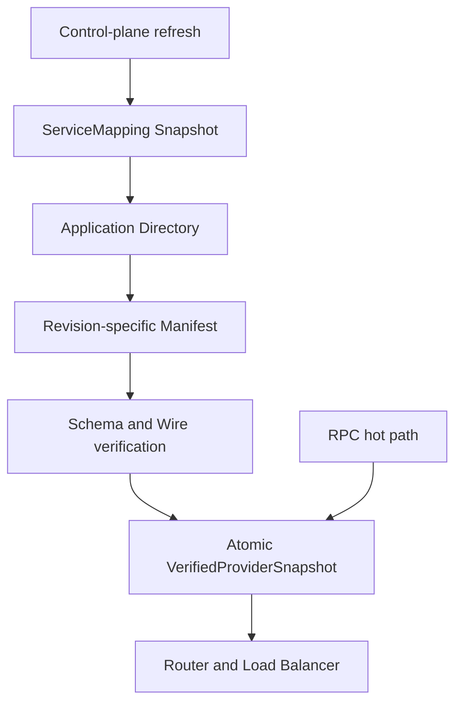
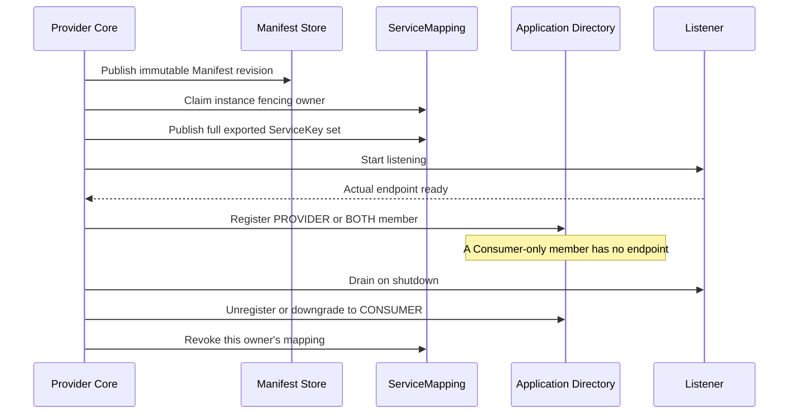
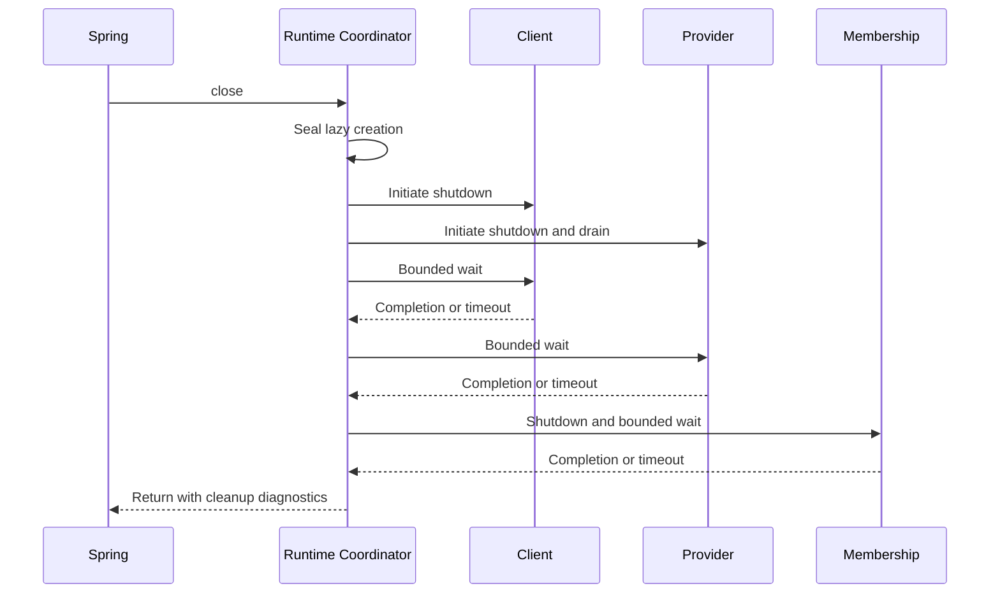

# OTRYX V2：应用级注册身份与 SPI 契约

> **当前源码采用唯一应用级注册模型。#139 已由 PR #160 合入 main `783bf8115c9523e5667023678dafe659315b2b66`，该合并提交的 main 门禁已核验。#140 安全加固仍在实现与验证；本文记录当前工作树契约，不宣称新安全端到端场景已经通过。**
>
> 总控 [#127](https://github.com/Ryan-Guizhou/otryx-rpc/issues/127)，当前工作包 [#140](https://github.com/Ryan-Guizhou/otryx-rpc/issues/140)。#138 由 [PR #159](https://github.com/Ryan-Guizhou/otryx-rpc/pull/159) 合并，#139 由 [PR #160](https://github.com/Ryan-Guizhou/otryx-rpc/pull/160) 完成；当前验收与剩余限制见[断点记录](../engineering/agent-governance-checkpoint.md)。历史阶段说明保留当时交付边界，当前安全契约见第 16 节。
> 版本 JDK 21、Spring Boot 3.5.4、1.0.0-SNAPSHOT、Wire v1 均保持不变。

## 1. 核心决策

Provider 和 Consumer **都必须使用 Application 为注册身份**。一个进程实例的实际 RPC 监听端点只对应一条应用成员记录，接口数量不增加注册记录数。纯 Consumer 必须存在于应用成员目录，但没有可供 RPC 调用的 Endpoint，不能进入 Provider 负载均衡池。BOTH 同时表达消费和提供角色。

ServiceKey 继续描述 interface/version/group，维持原有 Method ID、Schema Fingerprint、协议和业务调用模型，但不能作为新的 Registry 实例主键。

目标调用链：ServiceKey → ServiceMapping → Application Directory → 实例 Manifest → Contract/Schema/Health 校验 → Router/LoadBalancer → Unary Transport。调用热路径不得进行远端 Registry IO。

**不保留长期接口级注册或发现、兼容模式、双读双写以及旧 Registry Key/Path。**

## 2. V2-01 新模型及限制

| Java 类型 | 意义 |
| --- | --- |
| ApplicationKey | namespace + applicationName，最长 128，限定可安全编码字符 |
| ApplicationRole | PROVIDER / CONSUMER / BOTH |
| ApplicationInstance | instanceId + ApplicationKey + Role + 可选真实 Endpoint + Weight + ManifestRevision + 有界 Attributes |
| ApplicationDirectorySnapshot | 同一应用、唯一 instanceId、不可变实例列表和单调 revision |
| ApplicationRegistryListener | 独立的目录更新、同步成功、同步失败事件 |
| ApplicationDiscovery | 按 ApplicationKey 查询或订阅完整成员快照 |
| ApplicationRegistrar | 注册/更新/注销应用实例，要求幂等和实例级隔离 |
| ApplicationRegistry | 能力声明、可选 Registrar、关闭与资源归还 |

应用身份 namespace / name 去首尾空白后均非空，仅允许英文数字及点、短横线、下划线，最长 128；instanceId 不允许控制字符，最长 256。

Provider/BOTH 必须包含实际 RPC Endpoint、正整数权重及 Manifest Revision。Consumer-only 的 Endpoint 和 ManifestRevision 必须是 null，权重为 0。实例扩展属性最多 64 项，key 最多 128，value 最多 1024 字符；构造后不可被外部修改。这些 Attributes 仅是路由标签，**不构成认证或授权证据**。

目录快照不接受跨 ApplicationKey 的成员、重复 instanceId、负 revision；成功健康通知不得作为清空实例的命令。接口契约与 Manifest 的校验已由 #129–#130 接入，见后文。

## 3. 实现范围与验收约束

| 范围 | 当前职责 |
| --- | --- |
| Core | 应用身份、Manifest、ServiceMapping、Resolver、有界缓存、共享成员生命周期 |
| Registry | Memory 与 Etcd/Nacos/Consul/Eureka 应用成员，原生或显式外置元数据 |
| Starter / Quickstart | 唯一 Starter、四模块示例、真实成员诊断、多个 Manifest revision 与 mTLS 授权 |
| #139，已合并 | 删除过渡代码与注册路径，统一共享契约，完成对应完整五组 rolling 和四真实后端独立 JVM 门禁 |
| #140，当前实现验证 | 显式安全意图、实际能力预检、有限应用身份/授权、Registry 来源保护与安全代次 |

不保留接口注册模式、运行时双模式开关或双读双写。缺少必需成员注册、元数据能力或配置时直接失败。ServiceKey 只表示业务契约，ServiceInstance 只表示本地负载均衡候选，RegistrySubscription 仍是应用订阅的关闭句柄。

#139 的完整纵向交付已随 PR #160 合并，并核验对应 main。此后的变更仍须绑定自己的准确 PR Head 与合并后 main，不能沿用旧结果。共享测试计数和实际后端、进程边界详见[应用级注册验收](../reference/application-registry-acceptance.md)。

## 4. 质量验证

- 核验三种角色模型、Provider Endpoint/Manifest 约束、Consumer-only 不可路由；
- 核验命名空间、应用名、实例 ID、Attribute 等无效输入和最大边界；
- 核验 Snapshot 不可变、应用隔离、重复成员 ID、Revision；
- 核验 ApplicationRegistry REGISTRATION capability 与实际实现不一致时拒绝；
- 不改变 Unary Wire v1，也不增加 Core 对外部 Adapter 的依赖；
- 按 AGENTS.md 运行相关 Maven/JUnit、Java 格式/文档门禁。

后续任何 Agent 应当根据当前源码和 Issue 的真实状态判断完成度，不得把已提交的接口定义误报为 Provider/Consumer 已经使用应用级注册。

## 5. V2-02：版本化 Manifest 与元数据仓库（Core 契约已实现）

> **历史阶段边界（#129）：** 本阶段交付 Core API、二进制编解码和仓库契约；当时尚未接入运行时/后端。
> 关联 [Issue #129](https://github.com/Ryan-Guizhou/otryx-rpc/issues/129)。
> 当前应用映射 #130、Memory #131、Core 运行时 #132 和其它 Registry #133–#136 已完成对应接入。

### 5.1 模型与职责

| 类型 | 当前实际职责 |
| --- | --- |
| ApplicationManifest | 单应用的不可变导出服务快照，确定性排序 |
| ExportedService | ServiceKey、serviceId、methodIds、Schema Fingerprint |
| ApplicationManifestCodec | Manifest 专用确定性二进制格式，完全独立于 Unary Wire v1 |
| ApplicationManifestRepository | 异步不可变发布、读取及严格身份验证 SPI |

Provider 在完成 Service Binding 后，可通过 ExportedService.fromContract(serviceKey, api)
创建真实导出项，使用 ApplicationManifest.create(applicationKey, exports)
组成完整清单。服务和方法 ID 沿用 RpcContractMethods / RpcIds 的现有规则。
同一个接口的不同版本、group 可以共存；重复 ServiceKey 和 Service ID 冲突必须拒绝。
多个实例可以共享一个 Revision，也可以在灰度和滚动发布期间指向不同 Revision。

**Manifest 不内联进应用实例注册元数据。** Provider 的 ApplicationInstance 只发布
manifestRevision；纯 Consumer 不发布 Manifest，更不会成为 RPC 可路由 Provider。

### 5.2 标准编码及容量

独立 Metadata 格式采用 Big Endian int32 和 int32 长度前缀 UTF-8，字段顺序为：

1. Magic = 0x4f4d464d，Manifest 格式版本 = 1，当前 Wire 协议版本 = 1、RpcSchemaFingerprint 规范版本 = 1；
2. Application namespace、applicationName、serviceCount；
3. 按 ServiceKey(interface/version/group) 排序的 interfaceName、version、group、serviceId、
   schemaFingerprint、methodCount、排序后的 methodIds。

Revision = SHA-256 对**完整标准二进制**计算后的 sha256: + 64 位小写十六进制；
内容、接口版本、分组、应用身份、Wire/Schema/Manifest 格式的变更均会影响 Revision。
此格式版本不修改原有 Wire v1。

- 每份 Manifest 最多 512 个接口，每接口最多 1024 个方法；标准编码总量不超过 256 KiB；
- 接口名称最长 256 字符，版本和分组各不超过 128 字符；指纹必须为 64 个小写 hex；
- ServiceKey 在 Manifest 中要求安全的接口二进制名称、版本和分组，拒绝路径字符或冒号造成的 Key 歧义；
- 不存在递归任意对象图，所有集合计数、字段长度、解码空间都有固定上限；
- 解码拒绝未知版本、错误 Magic、截断、额外尾部字节、非标准排序、
  重复 ServiceKey/Service ID/Method ID、错误 UTF-8 和超限字段；
- Manifest 单对象容量限制不等于总缓存容量。Consumer 控制面另有总缓存大小、
  SingleFlight、并发队列与 TTL/LKG 限制，见第 6 节；各 Registry Adapter 还须约束后端容量。

### 5.3 Repository 的一致性与安全

publish 必须幂等创建，不得以同一个 ApplicationKey + Revision 覆盖不同字节。
lookup 缺失返回 Optional.empty；失败必须异常完成而不是误报不存在。
lookupVerified 必须校验请求的 ApplicationKey 和完整 Revision；
即使仓库返回内容存在，但不能匹配期望身份，也必须拒绝，不得退回接口级发现或其他 Revision。

SHA-256 只提供内容一致性，**不是发布方身份验证机制**；
实际后端需可信配置源、鉴权、ACL、命名空间隔离与审计。

### 5.4 多 Revision 与安全回收策略

Manifest 仓库有意不提供任意删除 Revision 的方法。仅凭 TTL 或 LRU 删除无法证明
所有存活实例、进行中的发布和回滚都已解除引用，可能破坏滚动升级与回滚。
因此**保留已发布 Revision 是当前的安全默认行为**，不能将已有 Mapping fencing 等同于自动安全 GC。

后续 Registry Adapter 如果实现 GC，必须证明：

- 从权威成员目录和部署状态确认没有存活实例、进行中的发布或回滚流程引用；
- 超过可配置保留窗口，该窗口覆盖 Lease、发现缓存最大陈旧期及回滚保护期；
- 原子引用复核或 generation fencing 防止检查与删除之间出现新的引用；
- 删除失败时保持保留，存储空间不足则拒绝新发布，不能删除仍在使用的 Revision；
- 具备并发发布、重启、灰度和异常回滚的真实存储集成测试。

### 5.5 验证覆盖

- ApplicationManifestTest：方法 ID / Schema 规则、版本和 group、确定性顺序、
  深拷贝、非法输入、冲突与总体大小边界。
- ApplicationManifestCodecTest：标准二进制往返、未知版本、截断/尾随、
  非标准方法/服务次序、重复方法及畸形 UTF-8。
- ApplicationManifestRepositoryTest：独立 Revision 并存、并发幂等、
  未命中返回空、错误应用或修订号 fail closed。

**验证边界：** 本节 Repository 测试使用隔离的测试存储；Memory 与真实远端后端分别由
#131、#133–#136 实现和验证，不能从 Core 单元测试推断后端网络行为。自动安全 GC 仍未实现。

## 6. V2-03：ServiceMapping 与本地严格 Provider 解析

> **历史阶段边界（#130）：** 该阶段只交付 Core SPI、Memory 控制面仓库及 Resolver。
> 后续 #131–#132 已将 Memory 与 Core Client/Server 接入；当前 Starter 迁移见第 13 节。

### 6.1 真实应用映射及所有权

- `ServiceMappingKey(namespace, ServiceKey)` 保持 ServiceKey 的业务标识语义，与 Registry ApplicationKey 分离。
- `ServiceMappingRepository.claim(application, instanceId)` 原子取得由仓库颁发的 fencing generation；
  `publish(owner, fullExportSet)` 原子替换**该实例**接口集合；
  `revoke(owner)` 只能撤销完全一致 generation 的实例发布，不能误删其他活跃实例或应用。
- `lookupVerified` 严格验证命名空间、返回映射 Key 和原子快照。
  多应用可以提供相同 ServiceKey；健康空映射与远端错误有严格区别。
- `MemoryServiceMappingRepository` 实现上述进程内原子语义；远端 CAS、租约、ACL、
  owner fencing 与持久化由 #133–#136 的实际后端提供，不能复用内存锁宣称分布式一致。

### 6.2 Consumer 控制面与 RPC 数据面分离



- 控制面使用 `ServiceMappingCache.refresh` 与 `ApplicationServiceResolver.refresh`。
  `ServiceMappingCache.current` / `ApplicationServiceResolver.current` 不执行远端 IO；
  最后一步成功才一次性发布完整不可变 Provider 快照。未就绪、合法空、限期 LKG、超时陈旧、
  安全拒绝与关闭可区分；当前安全拒绝不会沿用普通 LKG 宽限。
- 目录实例必须属于该 Application。纯 Consumer、无 RPC Endpoint、0 端口或通配监听地址
  不得进入候选池；每个实例的 Manifest Revision 必须存在、归属匹配，
  且确实导出目标 ServiceKey + 预期 Schema Fingerprint + 当前 Wire 版本。
- `ManifestSnapshotCache` 单飞按 (ApplicationKey,Revision) 缓存：最多 256 Key、
  32 并行获取、16 MiB 已缓存字节；正缓存 10 分钟、负缓存 2 秒，
  单次未决获取 15 秒超时。失败不伪装成缓存空结果；
  未被引用的 Revision 不通过此缓存直接删除远端仓库数据。
- 本地 Resolver 上限为 512 个 Service/Schema 组合、32 并行刷新、单次最多 1024 候选节点，
  30 秒本地刷新上限。普通失联是否继续使用快照由配置 `maxStale` 决定；
  安全拒绝使旧验证代次立即失效。Core Client 的应用级路径由 #132 接入，Starter 由 #137 接入。
- 当前 Manifest 内容寻址只验证完整性，不构成身份认证与运行时授权。
  远端 ACL、身份和真实证书授权必须按后端与安全 Profile 分别配置和验证，不能由 Metadata 替代。

### 6.3 回归与后续边界

`ApplicationServiceResolverTest` 验证多 Application / 多 Revision、纯 Consumer 排除、
Schema 失配、健康空映射、Manifest 缺失、LKG 失效与关闭竞态；
`ApplicationMappingCacheTest` 验证 SingleFlight、负缓存过期、失败缓存与取消；
`ServiceMappingV2Test` 验证多实例共享所有权与旧代数隔离。

可在 JDK 21 环境执行 `./mvnw -B -ntp -pl otryx-core -am test` 与
`./mvnw -B -ntp clean verify -Pquality`；这些是验证入口，不代表当前分支已通过检查。

## 7. V2-04：Memory Application Registry 控制面

> **历史阶段边界（[#131](https://github.com/Ryan-Guizhou/otryx-rpc/issues/131)）：**
> 该阶段完成无网络控制面契约及测试；Core 运行时接入随后由 #132 完成，Starter 接入由已合并的 #137 完成。

### 7.1 本地应用目录

- `MemoryApplicationRegistry` 直接实现 `ApplicationRegistry` + `ApplicationRegistrar`：
  Provider、Consumer、BOTH 均以 `ApplicationKey + instanceId` 登记，纯 Consumer
  必须有应用成员而没有 RPC Endpoint。一个实例导出三个服务仍只有一条应用成员记录。
- 内部同步保护原子成员更新与 Revision；`lookup` 返回完整不可变快照。
  同值重复注册幂等，旧内容注销不删除新修订记录，关闭后所有操作明确失败。
- `subscribe` 首次发送真实快照，随后按 Revision 去重通知，
  使用幂等关闭的 `RegistrySubscription`，回调异常与数据修改隔离。
  Memory 适配器通知目前在控制面调用线程同步发送，**不得在 EventLoop 阻塞使用**；
  #132 的运行时应用协调器负责异步调度边界。
- 容量限制：最大 512 Application、4,096 成员、每 Application 256 实例、2,048 订阅。
  满容量拒绝，不进行未经验证的随机逐出。

### 7.2 元数据与工厂

- `MemoryApplicationManifestRepository` 按应用和内容 Revision 幂等保存字节；
  同一 Revision 禁止改写、跨 Namespace 不泄漏、支持滚动多 Revision。
  限制 1,024 份 Manifest、合计 32 MiB；关闭释放内存。安全 GC 不属于本模块。
- `MemoryServiceMappingRepository` 继续采用 #130 的实例代数 fencing 和一对多 ServiceKey
  映射，不以 `ServiceKey` 作为应用成员 Key。
- `ApplicationRegistryFactory` 是应用级新扩展点；Memory 默认工厂由 ServiceLoader 装载。
  每次 `create` 返回独立生命周期实例；同一 Runtime 内 Provider 和 Consumer
  必须共享此实例。多次创建互相隔离的 MemoryApplicationRegistry 无法跨 JVM 发现服务。
- 实现仍限于 JVM 内存，不提供网络可达性、真实租约、KV CAS、ACL 或生产持久性；
  各远端 Adapter 在 #133–#136 实现，不能用本实现替代真实 E2E。

### 7.3 验收

`MemoryApplicationRegistryTest` 覆盖角色成员、幂等与失效注销、并发 96 实例、
关闭拒绝、命名空间隔离、单应用导出三个接口、独立 Consumer 注册、
三条业务 ServiceKey 经 Mapping/Directory/Manifest/Schema 解析为真实 Provider，
Manifest 多修订号与 SPI ServiceLoader 工厂。

验证命令：`./mvnw -B -ntp -pl otryx-core -am test`，
`./mvnw -B -ntp clean verify -Pquality`。CI 全绿后再合并，并验证合并后 main 检查。

## 8. V2-05：Provider / Consumer 双向应用注册运行时

> **历史阶段边界（[#132](https://github.com/Ryan-Guizhou/otryx-rpc/issues/132)）：**
> 该阶段仅交付 Core 编程式 Client/Server 的应用级运行路径。真实 Adapter 随后由 #133–#136 接入；
> Starter 与 Quickstart 已复用相同应用控制面；#139 的统一契约、源码清理与真实四后端独立 JVM 验收见[验收入口](../reference/application-registry-acceptance.md)。

### 8.1 生命周期与顺序



- `ApplicationMembershipCoordinator` 为同一应用进程的唯一成员控制面协调器：
  `ApplicationKey + instanceId` 在该生命周期内保持稳定。Consumer-only 也必须调用
  `startConsumer` 并完成真实目录入册；Provider/BOTH 在 Listener Ready 前不能暴露可路由 Endpoint。
- 一个监听 Endpoint 对应一个实例发布域；同一应用若有多个 Listener，应分别配置稳定、不同的
  instanceId 和协调器，不能让不同端点对同一实例互相覆盖。服务数量只增加 Manifest 中导出项，
  不增加同一监听实例的注册记录。
- 当前启动前先验证显式 Profile、最终安全能力和必需授权器；BOTH 的已启用两端都通过预检后，
  才进入业务启动顺序：绑定业务服务 → 发布不可变 Manifest → claim 带 fencing 的映射 owner
  → 原子替换该实例完整服务集合 → 启动 Transport → 得到真实对外 Endpoint
  → 注册应用成员。任一步失败必须回滚已发布的映射、关闭 Transport，并返回异常。
  Manifest 内容 Revision 因滚动发布与回滚可能仍被引用，不做危险删除。
- Consumer-only → BOTH、BOTH → CONSUMER、BOTH → PROVIDER 均修改同一个成员实例，
  无重复注册。Provider 撤销不能删除另一个实例的共享 ServiceKey 映射。
  Provider 关闭采用已有 Drain + 受限注销预算；Consumer 关闭独立移除消费成员，
  两者共同使用同一个 Coordinator 的串行有界控制面。
- 每次后端异步操作超时上限 30 秒，可配置更小的单步骤预算。协调队列
  和新命令数均有限额，关闭后拒绝新命令、重复关闭复用同一 Future，
  外部后端失败/超时必须有异常终态而不是伪造清理成功。

### 8.2 Client 解析与数据面

- `OtryxRpcClient.Builder.applicationControlPlane(resolver, membership, namespace)`
  是 Consumer 的必需应用控制面入口；
  Client 构造期间启动本应用 Consumer-only 成员注册，`membershipReady()` 可作为就绪门禁。
  未入册或已关闭，业务调用 fail closed，不发送 Transport。
- 对每个业务接口提前计算 `ServiceKey + RpcSchemaFingerprint`；
  后台有界调度器刷新 Mapping → Application Directory → Revision Manifest
  → Wire/Schema 校验后更新内存快照。一次 RPC 的负载均衡读取本地 `ServiceInstance[]`
  及其对应的原始验证候选，attempt 发送前本地复核同一候选，不进行注册中心 IO，
  也绝不把纯 Consumer 端点纳入候选。`RpcTarget` 同时携带目标 ApplicationKey 与 Endpoint。
- 应用级目录默认强制有限的 LKG：未显式配置时为 30 秒，
  显式配置无界策略直接拒绝；可通过
  `directoryFreshnessOptions(new RpcDirectoryFreshnessOptions(Duration.ofSeconds(...)))`
  调整。缓存的 `ApplicationServiceResolver.maxStale` 也是有限预算；网络异常
  与健康空目录必须区分，不得因缓存错误而发布非法空快照。TLS、认证、授权或完整性拒绝
  使用类型化安全失败，不能转换成普通网络不可用后继续发送旧候选。
- `OtryxRpcServer.Builder.applicationMembership(membership)` 选择新 Provider
  发布路径。必须向 Client/Server 传入同一个应用生命周期实例才能正确得到 BOTH，
  且注册中心、Manifest/Mapping 后端需是同一控制面部署域。
  缺少该入口或有效成员能力时启动失败，不允许直接伪造注册候选。

### 8.3 验证及明确剩余边界

- `ApplicationMembershipCoordinatorTest`：纯 Consumer 无端口、升级 BOTH、
  降级与独立注销、不同 owner 共存、失败注册和元数据回滚、并发关闭、后端挂起超时。
- `ApplicationRuntimeEndToEndTest`：使用真实 Core Client/Server、
  三个不同接口的业务实现、Wire v1 Header/Method ID/Codec、真实 Mapping/Manifest 及
  进程内 Registry；只用测试 LoopbackTransport 替换 Socket。覆盖 Provider-only、
  Consumer-only、同进程 BOTH、三服务同一实例、Listener 启动失败回滚与关闭注销。
- 以上是 #132 的进程内验证范围。远端 Adapter 的 lease/CAS/watch 及故障行为见
  #133–#136 的后端文档；Starter 由 #137 验收，完整 Quickstart 由 #138 验收。
  独立 JVM、真实 TCP、mTLS/方法授权与 10k soak 等门禁仍须用对应实际环境验证，
  不能将本节进程内 E2E 当作外部 Registry 的网络稳定性证明。

## 9. V2-06：Etcd 原生应用成员与映射（#133）

新增 `EtcdApplicationRegistry`、`EtcdApplicationRegistryFactory`、`EtcdApplicationManifestRepository`、`EtcdServiceMappingRepository`。成员按 ApplicationKey 注册，纯 Consumer 保持租约而无 RPC Endpoint；Manifest 内容寻址不可变，Mapping 以每实例 Owner 单键存储服务全集，用 Etcd CAS 防止旧代写入。Watch 从 Range revision+1 建立，Compaction/断线显式健康恢复。成员主键与业务 ServiceKey 分离，目录只接受应用成员。

本阶段按真实后端上限约束 Mapping Owner 扫描（512 个 Owner、8 MiB），并检查活跃 Member Lease，不能把共享 CI smoke 当生产控制面规模证据。详细键空间、限制、接口示例及测试参见 [Etcd V2 文档](../reference/registry-etcd.md)。

## 10. V2-07：Nacos 应用级 Naming 和 Config（#134）

实现 `NacosApplicationRegistry`、`NacosApplicationRegistryFactory`、`NacosApplicationManifestRepository` 与 `NacosServiceMappingRepository`，Naming 使用应用 ServiceName，Provider/Consumer/BOTH 均有真实应用成员；纯 Consumer 借助 Nacos 允许的 0 端口与真实主机 IP 表示心跳，不能进入 RPC Endpoint 列表。Config 采用内容寻址 Manifest 与分片 MD5-CAS Mapping Generation，严格容量和权威 MD5，所有阻塞 SDK 调用在有界控制面线程执行。配置和限制详见 [Nacos V2](../reference/registry-nacos-v2.md)。

Nacos 只使用应用成员与 Config 元数据，Starter 复用同一套控制面。首次使用某个 Nacos namespace/group，须在所有业务应用启动前独占运行 `NacosV2MetadataBootstrap`；普通应用不并发补建 Mapping 分片。#138 的独立进程脚本为每轮隔离 group 自动执行初始化。

## 11. V2-08：Consul 应用成员与 KV 元数据（#135）

实现 `ConsulApplicationRegistry`、`ConsulApplicationRegistryFactory`、`ConsulApplicationManifestRepository` 与 `ConsulServiceMappingRepository`。ApplicationKey 决定原生 ServiceName，一个进程实例只注册一个应用成员；Provider/BOTH 发布真实 RPC Address/Port，纯 Consumer 不发布 RPC Endpoint，原生端口为 0。Agent TTL Check 负责健康，TTL Session 与 KV Acquire 声明实例归属；Manifest 按 Revision 不可变创建，Mapping 以实例 Owner 保存完整服务集合，并使用 CAS、Generation 和进程 Token 拒绝旧代写入。

Consul 必须使用单个本地 Agent，不能跨 Agent 漫游续期。轮询与 KV 操作在有界控制面执行，故障明确通知 Core；Manifest 与 Mapping Generation 墓碑没有自动安全 GC。默认 Starter Consul 工厂拒绝旧 `registry.consul.datacenter`，应通过 `registry.endpoints` 选择本地 Agent。配置、容量与故障边界见 [Consul V2](../reference/registry-consul-v2.md)。

## 12. V2-09：Eureka 应用成员与外置 CAS 元数据（#136）

实现 `EurekaApplicationRegistry` 与 `EurekaApplicationRegistryFactory`。Eureka 负责原生应用成员及 Lease；显式选定的 Etcd、Nacos 或 Consul 后端提供 Manifest/Mapping，并通过 `ServiceMappingCandidateSource` 提供包含 Owner instanceId 的候选，不额外注册业务成员。Eureka Mapping View 将候选与同一实例的真实 UP Provider/BOTH 成员交叉校验，Core 再校验 Manifest、Schema 和实际导出服务。

纯 Consumer 使用真实 Host/IP，Eureka 原生 `port=0` 且端口 disabled，没有 RPC Endpoint。原生实例 ID 包含进程 Token，避免同名进程互相覆盖；发现重复逻辑 instanceId 时拒绝目录。租约续期收到 404 会重新注册，注销仅作用于本进程原生 ID，轮询故障明确通知 Core。默认 Starter Eureka 工厂必须配置 `registry.eureka.metadata-backend` 和 `registry.eureka.metadata-endpoints`；不能从缺少元数据的 Eureka 回退到接口级发现。配置、后端选项和一致性边界见 [Eureka V2](../reference/registry-eureka-v2.md)。

## 13. V2-10：单一 Starter 装配（#137，已合并）

### 13.1 身份、角色与就绪

Spring 复用 Core `ApplicationMembershipCoordinator` 和 `ApplicationServiceResolver`。`spring.application.name` 提供默认应用名，`otryx.rpc.registry.application-name` 可显式覆盖；两者均为空则启动失败。Namespace 默认为 `default`，`instance-id` 默认在启动时生成一次 UUID，也可由部署显式指定。同一进程内 Provider/Consumer 共享唯一 ApplicationRegistry、固定身份和有界 Mapping/Manifest Cache。

没有实际引用、或引用所属 lazy Bean 尚未实例化时，不创建 Client 或虚构 Consumer 成员。首次获取 Client 会在 Spring 初始化或业务控制线程等待 `membershipReady()`，Registry 拒绝、异常或未按时确认入册均导致创建失败，并触发已分配资源的有界回收；该入口不得在 EventLoop 调用。入册确认不代表目标 Provider 的异步路由刷新已完成。Provider 在真实监听 Endpoint Ready 后入册，BOTH 更新同一成员，而非创建第二条记录。

新增 `otryx.rpc.registry.control-plane-timeout`，默认 `3s`，必须大于零且不超过 `30s`，用于共享成员的单次控制面操作及 Consumer 入册等待。它独立于 `server.enabled` 和 `otryx.rpc.server.control-plane-timeout`；失败后的资源回收另有受限等待，不应将此值解释为整个 Spring 启动的总预算。

### 13.2 关闭顺序与并发创建

`SmartLifecycle` 负责已启动 Provider 的异步排空；运行时销毁先发起已创建 Client 和 Provider 的关闭，再先后等待两端，最后关闭共享 Membership。因此慢 Consumer Transport 不会延迟 Provider 开始排空。关闭标记与懒创建互斥，关闭后不允许补建一个此前未使用的 Client/Server。



图中不存在的运行时直接跳过。各等待共享总预算：已有 Provider 时采用 `server.shutdown-timeout`，否则采用 Core 默认 35 秒。超时或失败仍触发剩余清理并记录不完整结果，不伪造外部资源已全部释放；具有租约的远端成员仍受后端最终收敛约束。

并发或重复 `close()` 共享第一次关闭尝试的完成信号和原始绝对截止时间，不重置预算。发起线程的同步重入不等待自己，由最外层调用完成清理和通知；并发等待到期或中断时报告不完整，中断标记保留。完成信号表示本次有界关闭尝试已结束，不能替代外部资源全部释放的证明。

### 13.3 严格装配与覆盖

Starter 要求自定义扩展实现应用级成员与元数据 SPI，并严格检查自己拥有的配置键；未知键与已移除选项不能被静默忽略。`otryx.rpc.observability.*` 和 `otryx.rpc.quickstart.*` 由各自模块校验；`otryx.rpc.enabled=false` 跳过 Starter 自动装配及其前置检查。

自定义 ApplicationRegistry Bean 可替代默认工厂，但须提供 ApplicationRegistrar 与非空 ApplicationMetadataBackend 仓库。此时不会校验未使用的默认 Consul/Eureka 后端专属设置；通用配置与有效安全 Profile 仍须满足。默认 Eureka 工厂缺少外置元数据后端或地址时，错误明确列出 `otryx.rpc.registry.eureka.metadata-backend` / `otryx.rpc.registry.eureka.metadata-endpoints`。默认 Consul 工厂的旧 Datacenter 配置错误则要求改用单个本地 Agent。

Starter 默认依赖仍仅为 AutoConfiguration、Core/Memory、JDK Proxy、Fory、Vert.x；外部 Registry SDK 按需加入。配置与实现入口详见 [Starter](../reference/starter.md)。

当前安全预检要求每个入口显式选择 Profile，实际 Codec/Method Codec、Transport Client/Server 和 Coordinator/Resolver 均提供能力描述。网络 Profile 的默认 Fory 要求严格 allowlist，自定义 Codec 使用同等有限契约检查，不靠实现类名取得许可。NETWORK 且 server.enabled=true 时缺少 RpcAuthorizer 会在工厂/运行时创建前失败；BOTH 必须先完成两端 validate，再启动任一角色。

### 13.4 迁移矩阵与每次变更的验收

滚动检查要求两个 checkout 的 Starter 工厂、Consumer 发现和 Provider 成员装配全部为应用级。未知、历史接口模式、双模式或不一致装配直接失败；应用级 N/N、N+1/N、N/N+1、N+1/N+1 和回滚五组必须全部执行。旧基线不能触发缩减矩阵，参见[迁移指南](../migration.md)。

在 JDK 21、仓库根目录运行 Starter 回归：

```bash
./mvnw -B -ntp -pl otryx-spring-boot/otryx-spring-boot-autoconfigure -am test
```

此命令、源码中的测试和矩阵选择都不是某个新提交已经通过的声明；每次变更须核验准确 PR Head 的真实执行结果，合并后再核对 main CI。#139 的仓库清理、共享契约和四真实后端纵向门禁已随 PR #160 完成；#140 需要自己的安全验证记录。

## 14. V2-11：应用级 Quickstart 与独立进程证据（#138）

### 14.1 四模块复用与只读观察

继续使用 API、Provider、Consumer、Memory 四个模块和唯一 Starter，复用 Core 的 MembershipCoordinator、Resolver、Manifest 与 Mapping，不创建另一套演示注册协议。逐步命令见 [中文 Quickstart](../../otryx-quickstart/README.md) / [English Quickstart](../../otryx-quickstart/README.en-US.md)。

`QuickstartRegistrySnapshot` 从 Provider 可执行 JAR 作为独立 CLI 运行，不启动 Spring、不注册自己的成员。输入是后端类型、endpoints、共享 namespace、Nacos group（其他后端用 `-`）、Eureka 的 Consul metadata endpoints（其他后端用 `-`）、新输出路径及 1–16 个明确应用名。当前 Starter 将 registry.namespace 同时用于后端和 ApplicationKey；Nacos 采用 public 与每轮隔离 group，其他后端采用每轮隔离 namespace。SDK 创建、读取和关闭受外层进程总预算约束。

JSON 白名单包含指定应用成员的 instanceId、role、真实可选 Endpoint、weight、manifestRevision；关联 Manifest 的 ServiceKey、serviceId、methodIds、schemaFingerprint；以及三个已知 Quickstart 服务的 mappedApplications 和 verifiedProviders。服务视图使用真实 Mapping/Resolver，可能包含同 scope 中未列名却导出这些契约的应用；它不枚举整个注册中心、不输出任意实例 attributes。所有读取成功后才写文件，并拒绝覆盖；跨成员/元数据的读取不是事务快照，故脚本有界等待状态收敛，不能把读取错误当作空目录。

### 14.2 必须由真实进程证明的行为

| 场景 | 注册、路由与调用断言 |
| --- | --- |
| Memory | 单 JVM 中通过同一 Starter 运行 Provider/Consumer，以真实 Vert.x loopback 完成 RPC |
| 双进程 | 独立 Provider/Consumer JVM；Provider 停止后 Consumer 成员仍在且无可路由 Provider；同一 Consumer 在恢复后重新调用成功 |
| 三进程链 | A 为 Consumer-only，B 为一个 BOTH 成员，C 为 Provider；5 秒上游 Deadline 不被 B 的 10 秒本地配置扩展，Metadata 随调用传播 |
| 双 revision | 同一 JAR、ApplicationName、ServiceKey version/group；实际导出 `{Greeting}` 与 `{Greeting, Details}` 得到不同 Manifest revision，验证共存、升级、回滚与 Provider 全停后的 Consumer-only 状态 |
| mTLS（当前 #140 路径） | 自管 Etcd TLS/RBAC、独立 RPC/Registry CA、完整应用证书绑定、轮换证书保持同一应用、有限 Greeting hello 许可、Details 拒绝、启动前缺策略拒绝及只读观察权限 |

Details 不是标签模拟：新增 `GreetingDetailsService.details(GreetingRequest)` 契约，Provider 由 `otryx.rpc.quickstart.details-enabled=true` 条件装配真实 Bean，返回 `GreetingReply("DETAILS_OK")`。相同服务的 version/group 保持 `1.0.0`/`default`；revision 变化来自真实导出集合。这一场景验证当前应用级路径内的变化，不扩大为历史注册代际的混合互通承诺。

当前 `mtls` Profile 把证书指纹用于 Transport 的完整应用绑定，业务策略使用 `allowed-consumer.namespace`、`allowed-consumer.application-name` 与 `policy-valid-until`。同一应用的轮换证书不改变方法授权对象；示例按完整来源 ApplicationKey、Greeting ServiceKey 和 hello MethodId 返回有限 `RpcAuthorizationDecision`。CN/SAN、请求 Metadata 和 Registry attributes 不能替代应用身份。Consumer 分别核对类型化认证 reason 与精确 `BAD_REQUEST` / `RPC authorization denied`，普通连接错误不能算作相同结果。通用 Starter 和 Core 在网络 Provider 缺少显式授权器时拒绝启动。

### 14.3 验证入口与剩余边界

在 Linux 上准备 JDK 21、已构建 JAR、Bash、Python 3、GNU `timeout`、OpenSSL、Etcd 3.5.21 可执行文件以及默认开发场景所需的本地 Nacos，再执行完整示例。Linux 是安全自动验收的前置条件：

```bash
ETCD_BINARY=/absolute/path/to/etcd \
  NACOS_TEST_ENDPOINT=127.0.0.1:8848 bash scripts/run_quickstart_e2e.sh
```

入口依次运行 Memory、process、chain、revision、mTLS，失败即停止。默认 process/chain/revision 在各自隔离 Nacos group 中初始化分片再启动应用；选择 Etcd/Consul/Eureka 时复用相同脚本与独立 namespace，Eureka 显式使用真实 Consul metadata。mTLS 独立管理只监听 loopback 的受保护 Etcd，分开 RPC/Registry CA 与管理、Provider、Consumer、观察者凭据。受限 JSON 和 `summary.log` 保存在 `target/quickstart-e2e/<scenario>.<随机后缀>/`，Memory 标记在控制台，临时私钥与凭据不进入证据。可用 `OTRYX_QUICKSTART_EVIDENCE_DIR` 覆盖目录。参数见[应用级注册验收](../reference/application-registry-acceptance.md)与 [Quickstart](../../otryx-quickstart/README.md)。

测试用例、脚本和教程描述的是验收契约；实际完成结论须绑定对应提交的执行日志、准确 PR Head 与合并后 main CI。#139 已完成其验收，#140 安全改造尚在实现验证。短时本地或共享 CI 验收不代表 10k soak、生产容量、安全部署全流程或正式发布。

## 15. V2-12：应用级契约收口（#139，已完成）

[#139](https://github.com/Ryan-Guizhou/otryx-rpc/issues/139) 通过 [PR #160](https://github.com/Ryan-Guizhou/otryx-rpc/pull/160) 合入 main `783bf8115c9523e5667023678dafe659315b2b66`，对应 main 门禁已经核验。交付包含旧接口级注册路径与过渡 API/配置清理、共享后端契约、四真实后端 process/chain/revision、完整五组 rolling，以及相应故障与清理验证。

ServiceKey 保留业务契约含义，ServiceInstance 保留本地候选职责，RegistrySubscription 仍负责关闭应用订阅。清理不意味着删除仍被 Eureka/Consul 使用的共享 HTTP 基础设施。后续提交继续执行完整门禁，不把这次合并结果复用为新代码通过证明。

## 16. V2-13：应用身份与安全边界（#140，实现验证中）

本节记录当前工作树已接入的安全契约。#140 尚未完成独立端到端与新提交门禁验收；它不改变 Wire v1，也不把 Codec 的估算图内存限制扩大解释为硬内存租约。

### 16.1 显式意图与实际能力

Spring 配置、Core Client/Server Builder 和 RegistryOptions 默认均为 `UNSPECIFIED`，必须显式选择 `TRUSTED_DEVELOPMENT` 或 `NETWORK_MTLS`。前者用于可信隔离开发，后者要求实际保护：

| 边界 | 必需事实 |
|---|---|
| Transport | 实际双向 TLS、证书链校验、应用绑定、Peer 交付与身份期限；Client 另校验目标应用、hostname 并按目标隔离连接池 |
| Codec / Method Codec | 显式允许的类型或已注册契约类型，声明类型检查、DTO 实例化前校验，以及有限载荷、深度和估算图内存上限 |
| Registry | MEMBERSHIP、MANIFEST、MAPPING 每个实际来源均有明确保护；多来源不能互相覆盖 |
| Provider / BOTH | 显式 RpcAuthorizer，缺失时启动前拒绝；全部已启用角色先通过实际 Builder 预检 |

缺省 `UNKNOWN` descriptor 不能用于网络 Profile。Coordinator 从实际 Registrar、Manifest Repository 和 Mapping Repository 聚合来源；Eureka Mapping 同时保留元数据与成员健康两条链。只有经来源边界识别的框架 Memory 实现可使用 `LOCAL_PROCESS`，自定义 SPI 不能以同名字面声明获得豁免。

Registry 安全参数使用有类型的 TLS 与凭据对象，实际 Factory 安装到客户端后才报告保护。Spring 的 `registry.security` 与 Eureka 独立 `registry.metadata-security` 不互相继承 CA/凭据；普通 providerOptions 只承载受支持的非敏感配置。当前 Etcd 使用明确 CA 与 USER_PASSWORD，Consul 使用 HTTPS 与 ACL_TOKEN，Eureka 成员使用 HTTPS 与 USER_PASSWORD 并另外保护元数据链；Nacos 在 SDK 创建前拒绝 NETWORK/TLS 意图。

### 16.2 证书绑定、有限许可与响应证明

| 类型或接口 | 当前职责 |
|---|---|
| `RpcCertificateBinding` | 叶证书 DER SHA-256 → 完整 ApplicationKey + 有限 validUntil |
| `RpcPeerIdentity` | 来自真实 TLS 会话的已验证身份，证书与绑定期限共同生效 |
| `RpcTarget` | ApplicationKey + RpcEndpoint，供目标校验和连接池隔离 |
| `RpcTransportResponse` | Frame 与同一连接验证得到的 Peer；Core 解码前和结果交付前重新校验 |
| `RpcAuthorizationContext` | 已验证 Peer、实际本端应用、预绑定 ServiceKey/MethodId 与最大许可期限，不含业务 Payload |
| `RpcAuthorizationDecision` | `deny()` 或 `allowUntil(Instant)`，不存在无限期许可 |

CN/SAN、请求 Metadata 和 Registry attributes 不能替代完整应用身份。策略许可取决于真实来源应用与目标方法，并受原请求预算、服务端最大许可期限和 Peer 剩余有效期约束。壁钟与单调时间同时复核，回拨不能延长身份或许可。

授权策略体运行在独立有界工作池，超时先于策略调用安装。逻辑终态后帧预算先清理再发布结果；正在运行的工作槽位仍须等策略体退出和原始 Stage 实际完成，取消或中断不能冒充双终态。未运行的 owned 任务可以明确放弃。异步 DIRECT 恢复原请求执行器，许可在队列、解码及业务调用边界再次复核。

### 16.3 本地验证代次与安全失败

Resolver 成功提交的 `VerifiedProviderSnapshot` 携带私有 authority、epoch 与 route 凭据。公开四参构造仅保留业务值，不能生成受信候选。`isSnapshotUsable(ServiceMappingKey, String, VerifiedProviderSnapshot)` 是无网络 I/O 的本地 guard：未就绪、普通陈旧、已替换或关闭返回 false；安全拒绝抛类型化 `RegistrySecurityException`，null 候选也不能掩盖当前安全终态。

Directory 原子保存候选及其端点投影。每次 attempt 发送前核对选中端点所属的同一候选；安全 epoch 检查先于“是否仍为当前快照”的判断，一个路由恢复后不能让其他路由持有的旧代次结果复活。Resolver 只维护当前安全代次、稳定原因与有界 Slots，不增加无限历史 Map。

`RpcAuthenticationException` 与 `RegistrySecurityException` 在 attempt 内终结调用，不重试、不累计 Endpoint/熔断故障、不更新延迟 EWMA；已有 inflight 或探测额度正常归还，健康历史不重置。真实 TLS 材料代次变化使用 `SECURITY_CONTEXT_CHANGED`，遵循同一中性统计规则。普通 Registry 同步故障仍保留原有限 LKG 语义。

源码入口：[安全预检](../../otryx-core/src/main/java/com/peachsoft/otryx/core/RpcSecurityChecks.java)、[授权工作所有权](../../otryx-core/src/main/java/com/peachsoft/otryx/core/RpcAuthorizationGate.java)、[ServiceDirectory](../../otryx-core/src/main/java/com/peachsoft/otryx/core/ServiceDirectory.java)、[Resolver](../../otryx-core/src/main/java/com/peachsoft/otryx/registry/ApplicationServiceResolver.java)。部署字段与当前边界见 [Starter](../reference/starter.md)、[安全指南](../security.md)；真实独立 Etcd 场景与只读观察见 [Quickstart](../../otryx-quickstart/README.md)。
