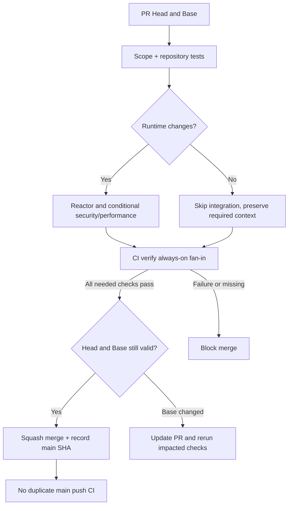

# CI 门禁分层（2026-10）

> **当前策略**：所有日常质量检查在 PR 的准确 Head 执行，squash 合并至 main 后不再自动重跑相同的 Maven、Chaos、文档和 RC/GA 构建。正式物理性能和发行授权仍是独立验收事项。

## 流程与范围

旧主 CI 的 PR 与 main push 各约 10 分钟，文档预览各约 2.5–3 分钟；大量 Registry 与 Rolling 专项也在两侧重复。这不是两份独立新证据，而是大幅增加构建队列。新分层为：

| 门禁 | 自动触发与范围 |
| --- | --- |
| `CI / scope`（快速） | 每个 PR：`check_project.py`、Git diff 文件分类、对抗性分类测试、受影响 Python 脚本语法及单测 |
| `CI / integration`（昂贵） | 仅 Java/生产模块资源/Maven 及必要运行时脚本修改，执行原 `-Pquality`、语义常量与单进程 Quickstart |
| 安全回归 | Core/Registry/Transport/Starter/Quickstart/POM 触发原 Etcd TLS/RBAC/client-cert 与 mTLS |
| V2-D.2 性能 Smoke | Benchmark、Transport、Serialization 和 JMH/Soak 脚本变化；3 秒 smoke 仅证明工具与容量上限路径，不作为正式 6×60min 实证 |
| Registry 多 JVM / Rolling / Chaos | 对应模块变更的 PR 上验证；不再因同一 PR 合并 main 重跑，后端 Chaos 不再被无关 Starter 文件或 POM 触发 |
| 文档 Mermaid/SVG | 每个 PR 保留 `Documentation Previews / render` 检查名称；无 Markdown/图像/渲染器变更时不安装 Chrome/Mermaid/中文字体 |
| Release Readiness | 只有 Maven/发行配置相关 PR 或手动执行；双版本 RC/GA 只对候选脚本/发行入口的 PR 自动运行，否则由维护者手动启动 |
| 物理机正式性能 | 只在独立已授权固定主机通过 `workflow_dispatch` 执行真实 6×3600s Full Matrix，结果依然需单独审核 |

原 CI 重复的三个独立 JVM Quickstart、Deadline 与 Manifest 回滚步骤移除，真实跨进程验证继续由 [Application Registry Independent JVM Matrix](../../.github/workflows/application-registry-e2e.yml) 在相关源码 PR 执行。保留 Core Maven、mTLS 与 Etcd 权限测试，不能以短时 benchmark 替代生产验证。

## 正确处理 Required Checks



GitHub 的工作流级路径过滤可能导致 Required Check 一直 `Pending`；Job 级条件跳过则报告成功。因此保留既有 `CI / verify` 和 `Documentation Previews / render` Check 名称，并保留每个 PR 的轻量执行。尤其 `CI / verify` 通过 `always()` 汇总 `scope` 与 `integration`：任何必须执行的 Job 失败、取消或缺失都令它失败，不会用绿色「Skipped」掩盖真实失败。

当前 GitHub 连接无法读取或更新 Branch Protection（403）。仓库管理员应核对 Require Status Checks 至少包含 `CI / verify`，并按组织策略配置其他不可跳过的安全检查。若将来开启 Merge Queue，需另行支持并校验 `merge_group`，不可直接假设 PR Check 等价于队列提交。合并前检查准确 Head SHA、Base SHA、mergeability 与必需状态；若 Base 被其他 PR 更新且改变验收输入，先更新 PR 再验证。没有更新权限时应由维护者设置，不擅自修改 Ruleset。

## 验证与手动入口

```bash
python3 scripts/check_project.py
python3 scripts/test_ci_gate_scope.py
python3 scripts/ci_gate_scope.py --changed /tmp/otryx-pr-files.txt
```

Release Readiness、OTRYX First Release Dry Run、Performance Evidence 保留独立 `workflow_dispatch`。它们的真实结果不由绿色 PR 自动推导：#146 固定硬件证据和 #147 Maven Central 权利/签名/发布授权继续按原要求执行。
