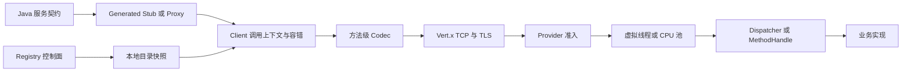

# OTRYX RPC 高质量开源项目改造实施方案

> 2026-10-15 追加说明：Issue #125 将后续使用入口统一为单一 Spring Boot Starter，并将独立 JVM 入门工程集中到 `otryx-quickstart`。本文旧阶段清单是历史合同，实际模块结构以根 `pom.xml` 和 [Quickstart](../../../otryx-quickstart/README.md) 为准。

> **For agentic workers:** 实施时遵循仓库 `AGENTS.md` 与相关工程规范，逐项记录 PR、失败机制、命令及 CI 证据。下列复选框表示计划工作，并不自动表示已通过验收。

**Goal:** 将当前 Java 21 Unary RPC 框架推进为契约明确、资源有界、故障可恢复、用户可接入、产物可验证的开源首发版本。

**Architecture:** 保留中立 Core、独立 Adapter、控制面与数据面分离以及方法级预绑定。优先补齐线程、关闭、安全、资源与契约边界，再改进使用体验，最后依据受控证据优化热路径。

**Tech Stack:** JDK 21、Spring Boot 3.5.4、Maven Reactor、Vert.x 4.5.34、Fory 1.5.0；其他依赖以实施时 POM 为准。

**Spec:** 本文第 3～5 节是设计与实施契约；执行同时遵循 [AGENTS.md](../../../AGENTS.md)、[Java 工程规范](../../engineering/java-coding-standard.md)及当前源码、测试、POM。本文为一次改造提案，不替代上述规范事实源。

**文档日期:** 2026-10-12，Asia/Shanghai。

**源码基线:** `0b4497bb09eae4bfaf5fe8bad00321dccd68ec93`，`1.0.0-SNAPSHOT`。实施前重新查询 main、工作区和相关 CI，不能据此推断后续提交状态。

**授权状态:** 用户已批准依照审查修订后的顺序执行 OTRYX RPC 工程改造，并明确保持当前版本信息不变。代码行为改变必须遵守本方案、AGENTS.md、独立 PR 与准确 Head 的 CI 验证。发行、Tag、稳定分支变更、生产与权限操作不在本授权范围内。

## 0. 执行修订：2026-10-12 设计评审结论

**版本冻结：** 所有工作包继续使用 `1.0.0-SNAPSHOT`（JDK 21、现有 Maven GAV）；本实施计划的增补不构成版本升级。未得到独立发布授权前不得创建 RC/GA Tag 或上传产物。

**执行次序：** 先完成 Issue #76 的字面量治理与严格门禁；其后 U00 → U01 → U02 → U03 → U04 → U06 → U07 → U05 → U08 → U09 → U10 → U11 → U12 → U13 → U14。U05a 的安全默认策略可以在 U06/U07 设计期间先评审，但 Fory 类型注册与身份授权落地必须使用 U06/U07 已定义的契约类型模型。所有行为变化仍分别验收。

### 0.1 审查追加的 P0 约束

1. **真实端到端背压（U03/U04）：** TLS 握手前资源、应用连接、每连接与全局半帧缓存、已准入请求、业务执行、响应编码峰值、待写响应以及 Socket 写队列分别指定资源所有者与预算。Vert.x `writeQueueFull()` 不是严格堆容量限制；超额必须快速拒绝，不能在 EventLoop 阻塞等待。
2. **关闭终态（U02）：** 区分框架已经终止与仍运行的用户业务；关闭应在共享总预算内返回，报告残留任务，不把中断信号或 Future 终止等同业务停止，也不能提前归还业务占有的 Lease。
3. **类型安全和完整契约（U06/U07/U05）：** Generated、fallback、Fingerprint、类型注册和 Fory 白名单共享相同的规范化 RPC 方法/DTO 类型语义。无效 DTO 在生成或绑定阶段失败；严禁把“框架稳定 Type ID”误认为已用于 Fory Wire 注册。网络可达场景默认必须显式选择安全模式，严格模式不静默降级。
4. **DIRECT 执行边界（U03/U12）：** 普通业务方法不得在 EventLoop 上运行不受控制的阻塞逻辑。DIRECT 若保留，只面向经审查的非阻塞内部回调；不作为用户业务方法的默认推荐路径。

### 0.2 审查追加的 P1 约束

1. **Deadline（U08）：** 选定配置与父调用剩余预算取最小值；每跳转为本地单调时钟截止时间，不宣称能在未知网络延迟下严格维持跨机器绝对时刻。元数据 Key、总长度、条目数和可信身份字段必须有边界；超时/取消/响应竞争只形成一个逻辑终态。
2. **Registry（U09）：** 区分首次未就绪、合法空快照、最近成功同步、订阅健康及 Last-Known-Good 的陈旧预算。健康 Watch 没有事件不等于目录不新鲜；超时、重试及重连任务须有界。
3. **性能（U13）：** 除 QPS/core、p99/p99.9、B/op、CPU/GC 外，记录过载拒绝、错误率、恢复时间和长期资源趋势。虚拟线程下 Fory ThreadSafe 实现及序列化器分配作为 profiling 候选；只有受控证据支持后修改热路径。
4. **仓库治理（U14）：** 主分支保护和必需检查是待维护者明确授权的建议，不能把本次工程开发授权解释成修改 GitHub 权限的授权。

**验收底线：** 保留独立 JVM 的 Consumer/Provider、TLS/mTLS、Registry 故障恢复、取消/关闭竞争与慢读负载回归。每项失败机制需可复现；不以共享 CI 冒烟数据宣称生产容量。按原方案继续使用精确 Head SHA、合并后 main CI、独立回滚和完整证据台账。

## 0.3 2026-10-15 执行快照（与原始计划分开）

本文 U00～U14 清单保留为实施契约和完整验收要求，不能把旧清单中的“待实施”解读为最新源码状态。**本节为 2026-10-15 复查快照，并非实时状态；最终已验证状态以合并到 main 的准确 SHA 和外部证据边界为准。** 复查基线：main `5b584779d58f87df7e4fb88b19672fd24bf3e653`，该 SHA 的主 CI、Java Style、Java Agent Quality、Agent Governance、文档预览均成功；GitHub 无开放 PR/Issue。

| 阶段 | 当前工程证据 | 尚不可宣称 |
|---|---|---|
| U10 | PR #114（低基数）、#115（有界异步 Observer）、#116（JFR 出口与基准）已合并；相关 Head 与 main CI 有成功记录 | 固定物理 Runner 的完整 Trace/JFR 导出开销已经定量验收 |
| U11 | PR #116 已合并；Maven Wrapper、Starter 覆盖、独立进程示例和 SPI 回归进入 CI | 所有全新 Windows/Linux 环境均已人工验证 |
| U12 | PR #117 已合并；重试/关闭预算内部职责与并发回归保持原行为；main CI 成功 | 任意用户业务任务都可被强制安全停止 |
| U13 | PR #123 已 Squash 合并为 `5b584779`，准确 Head 与 main CI 均通过；60 分钟 Soak、AB BA AB 六次一致负载、Runner/JVM/CPU 证据、完整 JMH 原始矩阵及合成恶意用例具备自动校验 | 真实固定硬件六次 >=60 分钟运行、独立数据审查及官方 QPS/Core、p99/p99.9、B/op 数值 |
| U14 | PR #118 已合并；RC1/GA 无发布 dry-run、SBOM/SHA256、OSV Scanner、发行版本 fail-closed 及文档；发布分支版本保持 `1.0.0-SNAPSHOT` | 已手动运行完整 RC/GA 构建、完成签名、Maven Namespace/商标审批或创建正式 Release |

GitHub Dependency Graph 不可用时使用 OSV Base/PR 差异检查。为遵守版本冻结和减少 CI，计划在 PR #123 关闭常规 Dependabot 版本升级入口（保留可用的安全修复 PR）；自动提出但未经批准的升级 PR 不属于本轮功能。
受控 U13 不能以共享 CI Smoke 代替；只允许输出 `REPORT_ONLY` 的描述统计，真实环境性能收益仍待单独人工审查。
**尚未执行真实发行、远程生产操作或变更仓库权限。**

## 1. Global Constraints：全局约束

- 唯一事实源顺序：当前源码、测试、POM、构建结果 > 当前依赖版本官方文档 > 仓库技术文档 > Skills > 历史对话。
- 当前尚未 GA，不承担历史未发布 Java API、SPI、Wire、Schema 或配置兼容义务；当前 Consumer/Provider 互操作、安全和资源正确性始终必须成立。
- 保留真实 Reactor；不创建空 Registry/Codec 模块，不将厂商 SDK 类型引入 Core。
- Java 4 空格、UTF-8 无 BOM、LF、120 字符、禁止通配符 import；中文契约 Javadoc、真实元数据、英文 SLF4J 参数化日志。
- 纯常量、风格、Javadoc 和行为变化分 PR；不得降低或关闭现有严格门禁。
- EventLoop 不执行阻塞 IO、同步等待、证书文件解析或任意可阻塞业务回调。
- 新资源必须定义所有者、容量、拒绝、取消、超时、关闭与释放；不得将 Future 结束等同于业务停止。
- 不承诺未经受控硬件验证的 QPS、p99、生产容量或零拷贝。
- 短生命周期 PR 只以 main 为 Base；逐一核验准确 Head SHA 和相关检查，合并后再核验 main CI。
- 稳定分支不追加提交、不强推；不执行发行、远端删除、权限修改、生产配置或数据库写入。
- 保留用户已有改动。本次工作区已有 Provider `application.yml` 改动，不属于本方案输出范围。

## 2. Review Focus：重点失败场景

| 场景 | 必须具备的行为 | 归属 |
| --- | --- | --- |
| 证书轮换时文件读取很慢、更新重叠或文件损坏 | 网络处理不等待文件 IO；仅一个准备任务在途；失败保留有效配置 | U01 |
| 业务忽略中断，关闭与超时/响应同时发生 | 框架关闭入口在预算内返回；报告残留任务；不伪装业务已停止 | U02 |
| 大量半帧、未握手连接、慢读客户端及小请求大响应 | 接入、缓冲、在途和待写资源都有上限及拒绝策略 | U03、U04 |
| 相同类名的 DTO 结构变化，或 Generated/fallback 方法集合不同 | 指纹检测结构变化；有效 RPC 方法定义一致；不静默降级契约 | U06、U07 |
| A→B→C 剩余预算不足且伴随重试、取消或上下文清理 | 下游预算不扩大；非幂等不重试；取消和资源释放分别验证 | U08 |

## 3. 当前架构与事实基线

### 3.1 模块与数据流

| 模块 | 当前职责 | 保留原则 |
| --- | --- | --- |
| `otryx-core` | API、协议、SPI、运行时、默认策略 | 生产依赖中立，不反向依赖 Adapter |
| `otryx-codegen` | 编译期 Stub / Dispatcher | 与运行时使用相同契约规则 |
| `otryx-transport/otryx-transport-vertx` | TCP、握手、连接、心跳、取消、TLS | 网络状态归 Connection Context；控制面 IO 隔离 |
| `otryx-registry` | Etcd、Nacos、Consul、Eureka；HTTP 控制面 | 声明真实能力，不在请求路径查远端 |
| `otryx-serialization/otryx-serialization-fory` | Fory Native、方法 Codec | 安全策略与 Wire 编码边界明确 |
| `otryx-proxy` | CGLIB、Byte Buddy；Core 内 JDK fallback | 保留可用 fallback，避免相同契约的不同语义 |
| `otryx-observability` | Micrometer、OpenTelemetry、JFR | 出口不泄露敏感数据，不阻断调用链 |
| `otryx-spring-boot` | 配置、注解、协调器、生命周期 | 运行时按需创建，自定义 Bean 可覆盖 |
| Examples / Benchmarks | 接入、互操作、性能工具 | 用户能复现，证据与版本绑定 |



### 3.2 已有能力与不能据此宣称的能力

| 领域 | 当前已存在源码与测试/工具 | 当前边界 |
| --- | --- | --- |
| 调用 | Unary、生成代码、代理、MethodHandle、异步 Stage | 不含 Streaming |
| 协议 | 固定 Header、握手、CANCEL、GO_AWAY、错误 Codec、健壮性测试 | Compression 仅 NONE；其他编号只是保留 |
| 发现 | Memory、Etcd、Nacos、Consul、Eureka、本地目录 | Memory 不跨进程；Consul/Eureka 采用轮询式订阅 |
| 容错 | Deadline、显式幂等重试、Retry Budget、熔断、异常端点隔离 | 幂等注解不提供业务去重或恰好一次执行 |
| 隔离 | Provider 虚拟线程、有界 CPU 池、分级准入；Client 完成执行器 | 准入字节并非完整堆内存上限 |
| 安全 | TLS/mTLS、Hostname Verification、证书重载、Fory 白名单 | 默认可信模式；完整应用授权链待设计 |
| 遥测 | Micrometer、OTel、JFR、OTel Transport E2E 测试 | 存在实现不等于全场景开销/隔离已证明 |
| 性能 | JMH、分配对比、10k logical-concurrency soak、对比 harness | 工具存在不等于受控容量证据；10k 不指 10k TCP 连接 |

### 3.3 风险与证据分级

“源码已确认”表示检查到相应调用或逻辑；“待验证风险”需要回归或故障注入证明，不应在修复前宣传为已复现漏洞。

| ID | 观察与证据 | 分类 | 改造理由 |
| --- | --- | --- | --- |
| F01 | TLS periodic callback 调用 `fileState`；`stamp` 使用 `Files.readAllBytes`，重载还同步解析证书 | 源码已确认；延迟影响未测量 | 常规 EventLoop 路径包含阻塞文件 IO |
| F02 | Server 排空后调用 `blockingExecutor.close()`；注销逐服务等待 | 源码已确认；挂起场景待复现 | Transport 排空超时不能约束整体关闭耗时 |
| F03 | 接收端维护连接集合；未见全局连接门禁；服务端请求路径未独立执行每连接 inflight 限额 | 所审阅路径的缺口 | 业务准入前也可能耗尽资源 |
| F04 | Admission 注释明确只预算已准入请求 Frame | 源码已确认 | 响应、对象图、半帧与业务对象需要各自边界 |
| F05 | Fory 构造及 Spring 属性默认 `TRUSTED_COMPATIBILITY`，网络默认 PLAINTEXT | 源码已确认；非已证实利用漏洞 | 最短接入路径需要明确安全选择 |
| F06 | Fingerprint 缺失返回 LEGACY；目录仅排除 INCOMPATIBLE；兼容函数主要比较 Fingerprint | 源码已确认 | 首发无需用缺失契约支持历史快照 |
| F07 | 参数化 Schema 不展开自定义 raw DTO 字段；enum 被视为叶子 | 源码已确认；具体编解码影响待验证 | 结构校验覆盖不完整 |
| F08 | Codegen 筛 abstract 非 static；运行时/Fingerprint 使用 `api.getMethods()` | 源码已确认；边界契约待复现 | 需要统一方法集合与继承规则 |
| F09 | `RpcTypeRegistry` 检测稳定 ID 碰撞，但未见将其注册为 Fory Wire 类型编号 | 所审阅 Codec 路径已确认 | 区分框架标识与实际编码，不夸大能力 |
| F10 | Schema DTO 测试同时改变接口名/ServiceKey；本次本地检查未成功运行 | 测试证据缺口 | 增加控制其他变量的独立测试 |
| F11 | README/需求蓝图/ROADMAP 部分历史兼容和 Adapter 描述与首发契约或当前模块不同 | 文档已确认 | 清理用户和贡献者的错误预期 |

证据入口：

- [Client](../../../otryx-core/src/main/java/com/peachsoft/otryx/core/OtryxRpcClient.java)、[Server](../../../otryx-core/src/main/java/com/peachsoft/otryx/core/OtryxRpcServer.java)、[Admission](../../../otryx-core/src/main/java/com/peachsoft/otryx/core/ProviderAdmissionController.java)。
- [Transport Client](../../../otryx-transport/otryx-transport-vertx/src/main/java/com/peachsoft/otryx/transport/vertx/VertxRpcTransportClient.java)、[Transport Server](../../../otryx-transport/otryx-transport-vertx/src/main/java/com/peachsoft/otryx/transport/vertx/VertxRpcTransportServer.java)、[TLS Support](../../../otryx-transport/otryx-transport-vertx/src/main/java/com/peachsoft/otryx/transport/vertx/VertxTlsSupport.java)。
- [Schema](../../../otryx-core/src/main/java/com/peachsoft/otryx/api/RpcSchemaFingerprint.java)、[兼容元数据](../../../otryx-core/src/main/java/com/peachsoft/otryx/api/RpcCompatibilityMetadata.java)、[Codegen](../../../otryx-codegen/src/main/java/com/peachsoft/otryx/codegen/OtryxRpcContractProcessor.java)。
- [Fory Codec](../../../otryx-serialization/otryx-serialization-fory/src/main/java/com/peachsoft/otryx/codec/fory/ForyRpcCodec.java)、[Spring 属性](../../../otryx-spring-boot/otryx-spring-boot-autoconfigure/src/main/java/com/peachsoft/otryx/spring/autoconfigure/OtryxRpcProperties.java)。

## 4. 总体实施契约

| 项 | 约定 |
| --- | --- |
| Goal | 建立可证明的线程、生命周期、资源、安全和首发契约边界，完善独立进程接入与发行准备 |
| Scope | Core、Vert.x、Fory、Codegen、Registry、Starter、Observability、Examples、Benchmarks、CI 与相关文档 |
| Non-goals | 本轮不实现 Streaming、多语言 SDK、额外 Registry、控制台；不修改品牌或 GAV；不实际发行 |
| Compatibility | 不保留仅为旧快照存在的桥接；同一候选版本内部契约必须一致；正式 GA 后另制定演进规则 |
| Constraints | 遵循第 1 节；确定性缺陷、结构拆分、默认值调整、性能改动分别审查 |
| Migration | 同步官方 Examples、Starter 配置和 Adapter；用独立 JVM 验证；协议变化使用隔离部署和明确版本 |
| Verification | 定向回归、全 Reactor quality、style、Agent/MCP；安全/协议/Registry 改动增加相应 E2E/Chaos |
| Risks | 关闭提前返回带来残留工作；预算影响吞吐；严格 Schema/白名单影响启动；API/配置变化影响示例 |
| Rollback | 每 PR 独立 revert；契约变化按完整依赖链撤回并重建两端；不得强推或移动稳定基线 |

### 4.1 目标状态与设计取舍

1. **控制面隔离：** 文件、Registry 网络 IO、动态解析在启动或有界控制面执行器；Connection 状态通过其 Context 更新。
2. **生命周期显式化：** Client/Server 都有停止接收和终止状态；关闭幂等，异常清理不短路；取消不声称可回滚业务副作用。
3. **分层预算：** 连接/握手、部分帧、请求并发/字节、响应待写、Codec 对象图分开限额。预算只描述其负责的资源，不声称控制所有用户堆对象。
4. **首发契约收敛：** 所有路径使用同一有效 RPC 方法定义；Schema 检测范围和 Codec 支持类型一致；缺失契约默认拒绝。
5. **安全显式配置：** 生产指南要求严格反序列化与 TLS/mTLS；开发允许显式可信模式。不得从缺失配置静默退回可信模式。
6. **生成优先、fallback 一致：** 保留 Generated 优先和可用 fallback；unsupported 接口在编译/绑定阶段给明确错误，不迟至首个生产请求。
7. **按需扩展：** 暂不拆出额外 API Maven 模块；先在 Core 内改善职责边界。任何模块拆分先证明独立发布或依赖收益。
8. **证据优先：** 有效测试验证失败机制；性能数据标记硬件、SHA 和测量条件；没有证据的选项保持候选状态。

### 4.2 拟定接口与参数的使用规则

下文新增类名、签名和配置键均为提案，不是现有 API。每个行为 PR 先确认最终设计，再统一实现、测试、Examples 和文档；不得把本文代码片段当成可直接使用的已发布接口。

连接、字节、关闭预算必须可配置。测试使用小容量和受控时间验证机制，不用随意的大默认值掩盖问题。生产默认值通过 U04 容量模型和 U13 测量确定；在此之前不擅自修改既有默认容量。

## 5. 阶段、依赖与交付顺序

`Uxx` 是本文工作包编号，不对应既有 PR-02～PR-07 或 GitHub PR 编号。

| 阶段 | 工作包 | 前置 | 退出标准 |
| --- | --- | --- | --- |
| A：事实与可靠性 | U00、U01、U02、U03、U04 | 当前 main 基线 | 关键失败测试成立，线程/关闭/资源预算可验证 |
| B：契约与安全 | U06、U07、U05、U08 | U05 的类型注册依赖 U06/U07；U08 依赖 U02/U06 | 类型/方法语义一致，安全策略明确，Deadline 不重新扩张 |
| C：生态与维护性 | U09、U10、U11 | A；U06/U08 支撑集成 | Adapter 恢复、遥测隔离、用户接入和构建可复现 |
| D：性能与发布准备 | U12、U13、U14 | A～C | 结构回归、受控证据或明确不宣称数值、RC 产物可验证 |

先完成 Issue #76 治理并核验主分支，然后依次实施 U00、U01、U02、U03、U04、U06、U07、U05、U08、U09、U10、U11、U12、U13、U14。U04 依赖 U03；U07 依赖 U06；U05a 可先设计，但具体类型注册/身份授权需要 U06/U07 的契约与 U03 的传输身份边界；U08 依赖 U02/U06。U12 只做结构整理，U13 必须使用受控候选 SHA 证据；各 PR 分别验收。

## 6. 工作包与可执行步骤

每个工作包独立交付 Files、接口、回归证据和 PR。以下“通过”均为预期验收结果，不是本次执行结果。

### U00：事实校准与本地验证入口

**目标/理由：** 避免旧文档驱动错误实现，建立同 SHA 的可运行基线。

**Files:** 修改 `docs/design/requirements-blueprint.md`、`ROADMAP.md`、`README.md`、`README.en-US.md`、`SECURITY.md`；基线记录放在当前 PR 描述，不覆写历史 checkpoint。

**Interfaces:** 消费当前 Reactor、SPI 和测试；产出准确的能力表、历史文档标识与待执行清单，无运行时 API 变化。

- [ ] 核对 main SHA、工作区、Reactor 和配置；保护用户改动，列出各 Adapter 实际能力。
- [ ] 清理“尚无 Consul/Eureka”、未发布版本的历史兼容义务等陈旧描述；保留历史资料并标记适用版本。
- [ ] 确认 JDK 21、Python 3、Maven、Docker/外部服务；运行第 7 节门禁，记录缺失依赖与跳过项。
- [ ] 用本次结果形成基线 PR，核验中英文 README 结构与链接；按仓库工作流提交、审查和合并。

### U01：TLS 重载与控制面隔离

**目标/理由：** 将 F01 文件 IO 移出 EventLoop，保留 TLS 更新失败时的可用配置。

**Files:** 修改 `VertxRpcTransportClient.java`、`VertxRpcTransportServer.java`、`VertxTlsSupport.java`；在同一 `com/peachsoft/otryx/transport/vertx/` 目录新增 `TlsReloadController.java`；扩展 `VertxRpcTransportTlsTest.java`、`VertxTlsSupportTest.java`，新增 `TlsReloadControllerTest.java`。

**Interfaces:** 提议包内 `TlsReloadController implements AutoCloseable`，入口 `void requestReload()`、`void close()`；材料读取由可注入包内接口提供，执行器明确所有权。已有 Transport 公共接口保持不变。

- [ ] 新增 `slowMaterialReadMustNotBlockConnectionContext`、`overlappingReloadMustUseSinglePreparation`、`invalidMaterialMustKeepLastGoodConfiguration`、`closeMustPreventPreparedConfigurationPublication`；用 latch 控制读取，断言 Context 可继续执行、在途准备数最多 1。
- [ ] 运行上述测试，记录旧路径的失败机制；不要用文件大小和 sleep 猜测阻塞。
- [ ] 用独立有界工作执行器读取/校验材料，通过 Context 应用；使用代次避免过期任务覆盖；重载只影响明确约定的连接范围。
- [ ] 验证证书原子替换、部分写入、删除、失败后恢复、TLS/mTLS 连续调用和关闭；定向测试与 quality 通过后提交 PR。

**风险/回滚：** SSL 更新完成与关闭竞争；revert U01 后不保留未被关闭的执行器。生产轮换指南要求有效材料整体准备后替换。

### U02：统一关闭预算与调用终态

**目标/理由：** 消除 F02 的无限等待，明确关闭失败和残留业务工作。

**Files:** 修改 Core `OtryxRpcClient.java`、`OtryxRpcServer.java`；修改 Spring `OtryxRpcRuntimeCoordinator.java`、`OtryxRpcServerLifecycle.java`；新增 Core `RpcShutdownOptions.java`、`RpcShutdownReport.java`；新增 `OtryxRpcShutdownTest.java`。

**Interfaces:** 提议 `RpcShutdownOptions(Duration totalTimeout)`、`CompletionStage<RpcShutdownReport> shutdown(RpcShutdownOptions options)`。报告包含是否排空、注销失败数和仍活跃的框架任务数，不包含业务输入。`close()` 使用已配置预算桥接；执行前确认线程契约。

- [ ] 新增 `shutdownMustReturnWithinBudgetForUninterruptibleWork`、`concurrentCloseMustBeIdempotent`、`closingClientMustSettlePendingCalls`、`closeFailureMustNotSkipOtherResources`。
- [ ] 测试业务忽略 interrupt，但通过测试 finally 释放 latch，避免测试进程永久挂起；总预算测试设 200 ms，断言 2 s 内返回，不把 200 ms 当生产默认值。
- [ ] 建立停止接收状态；所有注销/排空/任务等待共享单调时钟预算；先清理可清理资源，记录未停止业务，不释放仍占用的业务 Lease。
- [ ] 将延迟重试纳入 Client 自有可关闭调度器，关闭时拒绝新调用并结束已有逻辑调用；不关闭调用者拥有的资源。
- [ ] 验证响应/超时/取消/关闭竞争，Spring destroy 顺序；定向与 Reactor 检查通过后提交独立 PR。

**风险/回滚：** Java 不保证强停任意业务；文档必须说明框架关闭返回不等于用户任务停止。revert 时同步撤销新增配置和 API 调用者。

### U03：Transport 接入、连接及部分帧预算

**目标/理由：** 在进入业务准入之前限制资源占用，覆盖 F03。

**Files:** 修改 Core `RpcTransportOptions.java`、Vert.x Client/Server、`FrameAccumulator.java`、Spring Properties/AutoConfiguration；新增同包 `TransportAdmissionController.java`、`TransportAdmissionControllerTest.java`；扩展 `VertxRpcTransportTest.java`、`FrameAccumulatorTest.java`。

**Interfaces:** 提议独立 `RpcTransportAdmissionOptions`，包含 `maxConnections`、`maxHandshakes`、`maxInflightPerConnection`、`maxBufferedPartialFrameBytes` 和 `partialFrameTimeout`；由 `RpcTransportOptions.withAdmission(...)` 装配。Connection 所有者归还连接和握手 Lease，FrameAccumulator 所有者归还部分帧字节 Lease。

- [ ] 新增 `connectionLimitMustRejectAndRecover`、`handshakeLimitMustReleaseOnFailure`、`serverMustEnforceConnectionInflightLimit`、`partialFrameBudgetMustReleaseOnDisconnect`、`stalledPartialFrameMustExpire`。
- [ ] 测试用连接数 2、握手数 1、每连接在途 1；覆盖无握手连接、重复 REQUEST ID、CANCEL 和 Drain；确认旧路径失败。
- [ ] 握手/TCP 接入阶段区分限额，服务端在调用 handler 前执行每连接限额；不依赖 Core Admission 替代 Transport 门禁。
- [ ] 在追加部分帧之前预留聚合预算；完整帧交付、断连、解析失败、超时均归还；timeout 使用虚拟/可控时钟进行机制测试。
- [ ] 增加新配置启动校验、拒绝指标和容量说明；运行碎片/粘包、恶意输入和 E2E 后提交 PR。

**风险/回滚：** TCP accept 后的限制不一定覆盖 TLS 引擎握手前资源；必须单独验证底层限制并记录未覆盖范围。禁止把“已建立 socket 数”宣传为全部握手内存上限。

### U04：响应与端到端资源容量模型

**目标/理由：** 解决 F04 的预算范围缺口，并给默认容量提供依据。

**Files:** 修改 Core `ProviderAdmissionController.java`、`RpcProviderAdmissionOptions.java`、Server 和 Vert.x Server；新增 Core `ResponseByteBudget.java`、`ResponseByteBudgetTest.java`；扩展 Transport 测试；修改 `docs/reference/provider-admission.md`、`docs/reference/capacity-planning.md`。

**Interfaces:** 提议包内 `ResponseByteBudget.tryAcquire(long bytes)` 返回 Lease，写入失败、完成、取消和断连后幂等释放。明确该 Lease 覆盖框架尚持有/待写的响应；Netty 接管后的字节使用单独写队列契约。

- [ ] 新增 `slowReaderMustNotAccumulateUnboundedResponses`、`largeResponseMustBeRejectedWithoutLeaseLeak`、`disconnectDuringWriteMustReleaseResponseBudget`；响应预算测试值 4096 bytes。
- [ ] 分开统计请求 Frame、对象图、响应、Socket 队列和业务任务；不要相加不同所有权范围后声称精确堆上限。
- [ ] 对已编码响应执行限额；对编码中峰值明确约束/证据缺口。若 Fory 无可用限额编码入口，保持“编码后预算”声明并以并发、对象策略和压测控制，单独设计更强编码接口。
- [ ] 用小请求大响应、最大 Frame、多连接慢读和对象图压力建立容量矩阵；保持拒绝低基数指标。
- [ ] 输出默认值计算依据、负载假设及限制；在证据充分前不修改生产默认容量；通过定向和全量检查后提交 PR。

**风险/回滚：** 紧限额可能提高拒绝率；响应额度不能在 CPU 回调或 EventLoop 上阻塞等待。U04 revert 不得遗留半套预算和指标。

### U05：安全默认值与认证授权边界

**目标/理由：** 让默认接入不会无意使用宽松反序列化，补充应用身份边界。

**Files:** 修改 `ForyRpcCodec.java`、`ForyRpcSecurityOptions.java`、Spring Properties/AutoConfiguration、Examples 配置和 `docs/security.md`、`docs/reference/fory-security.md`；扩展 Fory/Starter/TLS 测试。

**Interfaces:** 本包拆为 U05a 默认策略、U05b 认证身份、U05c 授权三个行为 PR。提议 Core `RpcPeerIdentity`、`RpcAuthorizationContext`、`RpcAuthorizer`，后者 `CompletionStage<Boolean> authorize(RpcAuthorizationContext context)`；Transport→Core 身份传递不暴露 Vert.x 或证书 SDK 类型。

- [ ] U05a 新增 `unspecifiedSecurityPolicyMustFailWithActionableMessage`、`explicitDevelopmentPolicyMustWork`、`strictCodecMustRejectUnapprovedType`；生产示例启用 STRICT_ALLOWLIST 和 TLS/mTLS。
- [ ] Core 程序化 Codec 和 Spring 使用同一默认策略；显式可信模式仍可用于已声明的开发/可信场景，不能静默降级；同步迁移文档。
- [ ] U05b 先确定 principal 来源、证书身份映射、metadata 信任边界和是否要求外部网关；测试未认证身份、失效材料以及伪造 Metadata 不能替代连接身份。
- [ ] U05c 在反序列化业务参数之前执行授权；授权 Stage 有超时和有界并发，耗尽时拒绝；默认不信任报文中的自述身份。
- [ ] 用 `authorizationDeniedMustNotInvokeOrDecodeBusinessPayload` 验证拒绝无业务副作用；为错误状态/新 Wire 语义独立评审，完成跨 JVM TLS/mTLS E2E 后提交各 PR。

**风险/回滚：** 异步授权可能引入队列、第三方 IO和延迟；阻塞授权适配必须自带有界执行器。无证据不宣称发现 RCE；不在日志/Span 中记录 Token、完整 Metadata 或证书私钥。

### U06：统一有效 RPC 方法与 Schema

**目标/理由：** 解决 F06～F08，定义首发可支持契约。

**Files:** 修改 Core `RpcSchemaFingerprint.java`、`RpcMethodDescriptor.java`、`ServiceBinding.java`、Client、`RpcCompatibilityMetadata.java`、`ServiceDirectory.java`；修改 Codegen Processor；新增 Core `RpcContractMethods.java`、`RpcContractMethodsTest.java`；扩展 Schema/Compatibility/Generated 测试。

**Interfaces:** 提议 `RpcContractMethods.resolve(Class<?> api)` 返回确定顺序的 `List<Method>`；有效 RPC 方法限 public abstract 实例方法，排除 static、default、Object、bridge/synthetic。编译器模型遵循同样规则与独立 fixture，不在 Core 引入 javac 私有 API。

- [ ] 新增 `allInvocationPathsMustResolveSameMethods`，覆盖继承、default、static、bridge、重载和 ID 碰撞；禁止对未支持契约自动改变语义。
- [ ] 新增 `sameBinaryNameDtoFieldChangeMustChangeFingerprint`、`genericDtoFieldChangeMustChangeFingerprint`、`enumConstantsChangeMustChangeFingerprint`；用隔离 ClassLoader/独立 JVM保持名称相同，避免服务名变化使测试虚假通过。
- [ ] 递归处理自定义泛型 DTO 原始结构与类型变量绑定，包含 enum 值集合；对 wildcard、递归、继承和容器建立支持/拒绝矩阵。
- [ ] 缺失、空值、不支持协议/Schema 版本和不匹配 Fingerprint 默认排除，给出低基数诊断原因；只在真实定义变化时调整 Schema 版本。
- [ ] 同步 Provider Metadata、官方接口、生成器与 Examples；运行独立 JVM 当前版本互操作、坏 Metadata 和混合候选隔离测试后提交 PR。

**风险/回滚：** 更严格的指纹不等于字段级可演进策略；本轮先保证准确检测。若以后允许新增字段，需要 Codec 语义和兼容算法独立设计。契约 PR回滚必须同时重建 Consumer/Provider。

### U07：Fory 类型模型与 Generated/fallback 等价性

**目标/理由：** 明确 F09 的真实作用，保证生成优化不改变调用语义。

**Files:** 修改 `RpcTypeRegistry.java`、`RpcTypeIds.java`、Fory Codec、Codegen Processor；扩展 `ForyRpcCodecTest.java`、`GeneratedStubTest.java`；在 `otryx-codegen/src/test/java/com/peachsoft/otryx/codegen/` 新增 `OtryxRpcContractProcessorTest.java`。

**Interfaces:** 消费 U06 方法模型。首发保留框架 Type ID 碰撞检测与 Fory 原生编码的分离，不承诺框架 ID 已参与 Fory 编码；若决定显式 Fory 注册，另立 Wire 行为 PR，不混在本包中。

- [ ] 使用 JDK `JavaCompiler` fixtures 测试受支持接口、错误诊断、继承、重载及拒绝泛型方法/嵌套接口的当前边界；不得只做源码文本包含断言。
- [ ] Generated 与 fallback 对相同参数分别验证结果、异常、null、同步/异步返回、取消和方法级注解；Golden fixture独立保存关键协议预期。
- [ ] 对每个支持的 DTO 类型验证 bind、碰撞和安全允许规则；描述多态/Object 参数需要显式声明的类型范围。
- [ ] 同步能力文案与 SPI 示例；定向测试通过后提交 PR。

**风险/回滚：** 更换 Fory 编码注册方式会影响双方数据，不可借“内部 ID 整理”偷偷实施；应使用当前依赖 API 和独立 JVM验证。

### U08：方法配置、调用上下文与 Deadline 传播

**目标/理由：** 为不同方法提供合理预算，防止 A→B→C 每层重新获得完整超时。

**Files:** 修改 Client/Server、`RpcFrameView.java`、Spring Reference 属性处理；新增 Core API `RpcCallOptions.java`、`RpcCallContext.java`、`RpcCallScope.java`；新增 `RpcDeadlinePropagationTest.java`，扩展 Resilience/Metadata 测试。

**Interfaces:** 提议 `RpcCallOptions(Duration timeout, Map<String,String> metadata)`；`RpcCallContext.current()` 返回可空上下文，`open(RpcCallOptions options)` 返回 `RpcCallScope extends AutoCloseable`。方法默认值在绑定阶段解析，单次选项仅覆盖允许字段；上下文不持有业务对象或凭据。

- [ ] 新增 `downstreamBudgetMustNotExceedRemainingParentBudget`、`retryMustConsumeSameLogicalBudget`、`scopeMustRestorePreviousContext`、`asyncContinuationMustPropagateOnlyExplicitContext`。
- [ ] 设定优先级：单次选项 > 方法配置 > Client 默认；有效预算取所选预算与父级剩余预算最小值。跨主机只传播剩余 duration，接收端建立本地单调 deadline。
- [ ] 应用代码显式 scope；框架自己的异步边界捕获并恢复。用户任意线程池需显式包装/传递，不声称 ThreadLocal 可自动跨所有 Future。
- [ ] 测试排队、时钟偏差、元数据保留键、耗尽预算、取消、业务忽略中断；非幂等仍不重试。
- [ ] 定向及三进程链式 E2E 通过，同步 API/SPI/Starter 文档后提交 PR。

**风险/回滚：** wire epoch deadline 与 duration budget 优先级调整属于协议行为；单列协议测试。没有明确上下文时维持受配置控制的本地调用预算。

### U09：Registry 恢复、陈旧目录和控制面边界

**目标/理由：** 让注册中心故障后的可用性和恢复行为可解释。

**Files:** 修改 Core `ServiceDirectory.java`；按真实缺陷修改 Etcd/Nacos/HTTP/Consul/Eureka 实现；扩展各模块现有 Integration/Chaos/Registry 测试；修改各 `docs/reference/registry-*.md`。

**Interfaces:** 保留能力化 Registry SPI。提议 `RpcDirectoryFreshnessOptions(Duration maxStaleness)`，配置 last-known-good 最大允许陈旧时间；本地 revision 不包装成外部分布式 revision。

- [ ] 故障注入旧 revision、订阅丢失、重注册失败、lease 丢失、轮询超时与恢复；测试恢复任务不能无限累积。
- [ ] 明确初始未就绪、健康空列表与远端查询失败三个不同状态；仅有效空快照能清空目录。
- [ ] 记录本地最近成功更新时间；超过明确陈旧预算时拒绝或按已评审策略降级，并输出诊断原因。
- [ ] 验证 `ServiceKey` 与 namespace 隔离、关闭后停止订阅和定时器；真实外部服务运行与 mock 契约测试分别记录。
- [ ] 每 Adapter独立 PR；当前 Head 的定向、Integration/Chaos 和互操作通过后合并。

**风险/回滚：** 目录陈旧限制会改变故障时可用性；默认值须依据业务恢复目标评审，不能未经说明清空 last-known-good。

### U10：可观测性开销、出口安全与基数

**目标/理由：** 保持遥测不影响调用结果，并限制高基数与扩展回调影响。

**Files:** 修改 Core `RpcObserver.java`、Tracing/Metadata 接口及三个 Observability Adapter；扩展对应测试；修改 `docs/observability.md`、`docs/reference/production-observability.md`。

**Interfaces:** 保留 Core 中立事件接口；明确 Observer 为极短非阻塞回调。自定义阻塞出口通过显式有界异步 Adapter接入，队列满丢弃遥测并计数，不能回压业务调用。

- [ ] 验证异常 Observer 不改变业务结果、所有 inflight delta 平衡；新增有界出口队列满与关闭测试。
- [ ] Metrics 标签仅 service/method/status/reason 等受控集合；requestId、用户输入、动态异常 message 不作为标签。
- [ ] 审查 Trace/JFR/Logs 的实际 sink，测试秘密值不能出现在导出内容；保留安全 errorType和技术关联信息。
- [ ] 对 NOOP/Metrics/Trace/JFR 场景分别测分配与延迟；先记录数据，存在证据才改热点事件结构。
- [ ] 同步告警示例和诊断说明；定向、OTel E2E 与 quality通过后提交 PR。

### U11：Starter、Examples 与可复现构建

**目标/理由：** 降低首次运行和外部贡献门槛，准确描述默认依赖。

**Files:** 修改两个 Starter POM、AutoConfiguration/Properties/RuntimeCoordinator；扩展 AutoConfigurationTest；修改 `otryx-quickstart/README.md`、`docs/getting-started.md`、`docs/reference/starter.md`、双语 README；新增 `.mvn/wrapper/maven-wrapper.properties`、`mvnw`、`mvnw.cmd`，按选定 Wrapper 模式生成必要资源。

**Interfaces:** Lite 明确仍包含 Vert.x/Fory，并减少 Registry/Proxy附加依赖；本轮不把它改名为完全无 Adapter Starter。`@ConditionalOnMissingBean` 自定义覆盖行为须稳定。

- [ ] 增加 consumer-only、provider-only、disabled、custom Codec/Transport、配置错误和 destroy顺序的 ApplicationContext 测试。
- [ ] Wrapper 固定维护者选择且已核验的 Maven版本/分发校验值；文档明确 Python 3与外部服务，不把当前 PATH 下 JDK 8当项目运行基线。
- [ ] 提供两个独立进程最短路径；跨进程示例使用实际 Registry，不把各进程独立 Memory实例当远端发现。
- [ ] 新增真实运行的 SPI小例子，说明线程、取消、资源所有权、异常和关闭；修正文档命令与配置默认值。
- [ ] 在全新 checkout、空缓存联网环境和 Windows/Linux执行接入步骤；用户应用 classpath 不含测试依赖，示例成功/失败都输出可诊断信息。
- [ ] 同步中英文 README 的相关结构和事实，验证项目与链接检查后提交 PR。

**风险/回滚：** 更轻依赖不能破坏自动装配；Wrapper变更独立于依赖升级。新增或变更发行配置不等于授权实际发行。

### U12：运行时结构整理与工程治理收尾

**目标/理由：** 把已明确的状态机职责变得可独立审查，完成既定规范治理。

**Files:** 在 Core `core/` 包内按需提取 `ClientCall.java`、`ClientRetryController.java`、`ProviderInvocation.java`、`RpcLifecycleController.java`；修改原 Client/Server；扩展 architecture与运行时测试；治理受影响 Javadoc/日志/常量。

**Interfaces:** 先保持公共 API与行为不变；`ClientCall` 拥有一次逻辑调用的 deadline/retry/terminal，`ProviderInvocation` 拥有业务终态和 Lease，Lifecycle负责状态迁移。提取仅在减少职责耦合且可独立测试时落地。

- [ ] 固定前序行为测试作为回归，列出每个状态和资源所有者。
- [ ] 一次提取一个职责，不同时改算法、默认值或协议；保持生成和 fallback路径一致。
- [ ] 运行 ArchUnit、关闭竞争、取消、重试、准入回归；代码路径变更后重新检查性能回归风险。
- [ ] 按现有 PR-03～PR-07治理流程核实元数据来源，存量归零后才启用全量门禁；不得伪造作者/时间或忽略规则。
- [ ] 仅结构变化独立提交、审查、合并；未体现维护收益的拆分取消，不追求文件数量。

### U13：受控性能证据与有收益的优化

**目标/理由：** 证明瓶颈和优化收益，而不是根据 API形式推测性能。

**Files:** 修改受影响 `otryx-benchmarks/src/main/java/` 基准、现有 benchmark/evidence脚本和 `docs/reference/performance-evidence.md`；具体热路径文件由 profiler证据决定。

**Interfaces:** 消费已有 JMH/soak/evidence机制；每个优化独立 Base/Head SHA、相同 harness、固定环境、AB/BA和原始数据；工具输出与性能验收分别评审。

- [ ] 在固定 runner记录 JDK/JVM/CPU/内存/OS/SHA、Payload/Codec/TLS、并发、连接数和业务类型；至少 3轮受控测量。
- [ ] 输出 QPS/core、p50/p99/p99.9、B/op、CPU/GC、拒绝/超时、连接/在途及 heap趋势；不把失败请求排除后只公布成功延迟。
- [ ] 用 JFR或 allocation profiler归因 `Object[]`、Future/Pending、帧复制、Metadata、统计/准入竞争；按证据选一个候选。
- [ ] 每候选先保持正确性回归，再优化并复测；零拷贝先定义所有权，Compression先比较 CPU/带宽收益和解压预算。
- [ ] 正式 soak最低 60分钟作为本方案建议首发验收场景，测前约定错误率/拒绝和 p99目标；结果不得用来证明任意环境容量。
- [ ] 若无受控硬件，记录“无官方数值声明”，不能把 shared CI smoke晋级；有收益且无行为退化再提交优化 PR。

**风险/回滚：** 不规定脱离环境的性能提升百分比；回归阈值在测前固定且包含统计噪声。候选失败直接放弃，不调整测试使其“通过”。

### U14：开源首发与供应链准备

**目标/理由：** 让外部用户能验证依赖和发行产物，同时维护清楚的安全响应流程。

**Files:** 修改 `.github/workflows/release.yml`、`release-readiness.yml`及相关 scripts；新增 `.github/dependabot.yml`和适合当前流水线的 SBOM/依赖扫描配置；修改 `SECURITY.md`、`CONTRIBUTING.md`、`CHANGELOG.md`、发布核查与双语 README。

**Interfaces:** 提供 RC/GA明确版本校验、构建与本地产物验证；上传与发布仍为独立人工授权动作。依赖漏洞门禁按可达性、影响和例外责任人处理，不用无限期忽略。

- [ ] 专用 RC/GA流程替代历史 patch假设；验证 POM、主 JAR、sources、Javadoc、许可、SCM和签名，失败不得继续上传。
- [ ] 配置最小 workflow权限、审核固定的 Action SHA和自动更新；生成 SBOM，关联准确源码 SHA与产物校验值。
- [ ] 分别测试无凭据 dry-run与版本/产物校验失败；签名演练在维护者明确授权的环境执行，不伪称本地无凭据已验证真实签名。
- [ ] 明确安全维护范围、私密漏洞报告、响应责任人与发行说明；核实 Central Namespace和素材权利等已有外部清单。
- [ ] 完成第 8节验收登记，形成 RC候选报告；未经另行授权不创建 Tag、上传 Central或发布 GitHub Release。

## 7. 验证命令与证据记录

### 7.1 所有实现 PR 的基本门禁

以下命令要求 Python 3与 JDK 21；Windows可使用已验证的 Python 3绝对路径。`python3` 或 `mvn` 在 PATH存在不代表版本正确。Wrapper引入后再统一改用 Wrapper。

```bash
python3 scripts/check_project.py
python3 scripts/test_java_conventions.py
python3 scripts/test_java_doc_metadata.py
python3 scripts/check_java_doc_metadata.py --audit --report target/java-javadoc-metadata-audit.json
python3 scripts/test_java_magic_literals.py
python3 scripts/check_java_magic_literals.py --audit --report target/magic-literal-audit.json
python3 scripts/sync_agent_mcp.py --check
python3 scripts/test_agent_mcp.py
mvn -B -ntp -Pstyle-audit -DskipTests install
python3 scripts/summarize_checkstyle_audit.py --json target/checkstyle-audit.json --markdown target/checkstyle-audit.md --enforce-zero
mvn -B -ntp clean verify -Pquality
```

对 Java变化使用实际 Base SHA执行 `check_java_doc_metadata.py --changed --base <base-sha>`、`check_java_conventions.py --changed --base <base-sha>`、`check_java_magic_literals.py --changed --base <base-sha>`。全量元数据/魔法值 enforce遵循已批准治理阶段，不能提前声称清零。

### 7.2 定向验证

```bash
mvn -B -ntp -pl otryx-core -am test
mvn -B -ntp -pl otryx-transport/otryx-transport-vertx -am test
mvn -B -ntp -pl otryx-serialization/otryx-serialization-fory -am test
mvn -B -ntp -pl otryx-codegen,otryx-quickstart -am test
mvn -B -ntp -pl otryx-spring-boot/otryx-spring-boot-autoconfigure -am test
bash scripts/run_quickstart_process_e2e.sh
```

Registry运行对应模块的测试并配置真实外部服务；TLS/OTel相关模块加入 Reactor。独立进程脚本使用其要求的安装/打包前置，不把未构建产物缺失解释为业务失败。Windows shell不能执行 bash时使用已配置 Git Bash/WSL或记录未执行，不伪造成功。

### 7.3 每个工作包的证据模板

```text
Work package / PR:
Goal / Scope / Non-goals:
Base SHA / Head SHA / main SHA:
Affected API / Wire / config / ownership:
Before failure / regression test:
Commands / versions / external services:
Passed / failed / skipped / not executed:
CI runs for exact Head:
Post-merge main CI:
Measured performance / evidence class:
Remaining risk / next command / rollback boundary:
```

工具或网络有限重试仍失败时记录现场。任何步骤持续无进展超过 10分钟，按 AGENTS中断保护执行；不取消他人远端工作流，不以历史绿色 CI替代当前 Head。

## 8. 首发验收与发布阻塞登记

| 验收项 | 完成证据 | 当前状态 |
| --- | --- | --- |
| EventLoop无本轮已知阻塞路径 | U01回归与受影响调用链审查 | 待实施 |
| 关闭预算/残留任务可解释 | U02竞争和故障测试 | 待实施 |
| 接入、半帧、在途、响应有界 | U03/U04限额、释放及慢读测试 | 待实施 |
| 安全模式与身份边界明确 | U05白名单、TLS/mTLS、授权拒绝 E2E | 待实施 |
| 当前契约自洽 | U06/U07独立 JVM、同名 DTO、等价性测试 | 待实施 |
| Deadline不扩大 | U08三进程及竞争测试 | 待实施 |
| Registry/遥测故障可恢复 | U09/U10定向、Chaos、出口审查 | 待实施 |
| 新用户可按文档运行 | U11全新环境构建与两进程示例 | 待实施 |
| 工程门禁真实通过 | U12、同 Head及合并后 main检查 | 待实施 |
| 性能声明可复现或明确缺省 | U13原始数据/报告，或无数值声明 | 待实施 |
| 首发产物与供应链可验证 | U14 dry-run、SBOM、签名授权演练 | 待实施 |
| 外部权限和素材条件 | [发布核查](../../publication-readiness.md)逐项核验 | 以维护者新证据为准 |
| 实际发行授权 | 维护者明确授权 | 本方案不授予 |

首发验收不要求堆叠所有生态功能；不以“代码覆盖率达到某百分比”代替失败机制证明。原始验收表用于列出必须取得的证据；本轮代码交付状态见 0.3 节。没有真实固定主机性能数据、外部权限与签名授权时，不能将 OTRYX 标记为 GA Ready 或 Released。

## 9. 风险、迁移和回滚总表

| 改造 | 主要风险 | 迁移与最小回滚 |
| --- | --- | --- |
| TLS隔离 | 过期准备结果覆盖新材料、关闭竞争 | 单飞/代次；revert Controller与调用者，关闭新执行器 |
| 总关闭预算 | 用户误认为业务已停止；回调丢失 | 报告残留；统一撤回 API/配置/Starter桥接 |
| 新资源限额 | 合法负载拒绝增多、部分 Lease遗漏 | 小容量故障测试；同步撤回限额和持有者 |
| 严格白名单/身份 | 官方与用户 DTO未声明、启动失败 | 迁移指南明确白名单；不自动回退不安全模式 |
| 方法/Schema变化 | 节点被隔离、候选版本不能互通 | 两端重建与版本隔离；撤回完整依赖工作包 |
| Deadline上下文 | 异步上下文丢失/泄露、预算重复扣减 | scope finally关闭；明确捕获点；链式 E2E |
| 目录陈旧策略 | Registry故障时提前拒绝 | 显式预算与可观测状态，不混同有效空快照 |
| 结构/性能优化 | 隐藏行为改变、吞吐/尾延迟退化 | 独立 PR与同 harness对比；不达标撤回候选 |
| 发布准备 | 凭据曝光、错误版本或不可验证产物 | 无凭据 dry-run；实际上传和发行另行授权 |

## 10. 后续候选及推荐起点

Streaming、Protobuf/IDL、多语言 SDK、EndpointSlice、高级灰度/地域路由属于后续独立设计主题。需要真实使用需求与明确的流控、契约和资源设计，不在本轮作为首发门槛。

推荐从 **U00事实校准 → U01 TLS重载隔离 → U02关闭预算** 开始。这三项能迅速建立可信基线，修正已确认路径并提供可审查回归；之后推进 U03/U04资源模型，避免先做局部性能优化却扩大未受控资源占用。

时间安排以各包设计和验证结果为准，不在没有外部环境、评审和硬件信息时承诺发布日期。若分阶段缩减首发范围，需要明确更新目标和验收，不得将删除验收项当成原方案已完成。

## 11. 原始提案编写时的验证边界（历史记录，不代表后续 PR 状态）

- 本次输出文档与导航，不修改 Java、协议、配置运行行为或用户已有 Provider配置。
- 架构审阅时尝试 `python scripts/check_project.py` 未成功：PATH下 Python不可运行；`py`仅列出 Python 2.7，不满足仓库脚本要求。
- 架构审阅切换本机 JDK 21后尝试 `mvn -o -B -ntp -pl otryx-core test`，在解析 Spring Boot 3.5.4 BOM时因离线缓存缺失失败，测试未进入执行。
- 本文中的命令、测试名和验收结果是实施要求，不能视为本次已运行通过。
- 文档输出应另检查链接、编码、差异和用户改动保留情况；结果以本次交付说明为准。

## 12. 参考

- [仓库协议](../../protocol.md)、[SPI](../../spi.md)、[性能证据](../../reference/performance-evidence.md)、[发布核查](../../publication-readiness.md)。
- [JDK 21 ExecutorService.close](https://docs.oracle.com/en/java/javase/21/docs/api/java.base/java/util/concurrent/ExecutorService.html#close())：有序关闭并等待任务结束；不能用 Transport drain timeout推断整体关闭有时限。
- [gRPC Deadline指南](https://grpc.io/docs/guides/deadlines/)：参考剩余预算传播与时钟偏差处理；不是本项目已经实现此能力的证据。