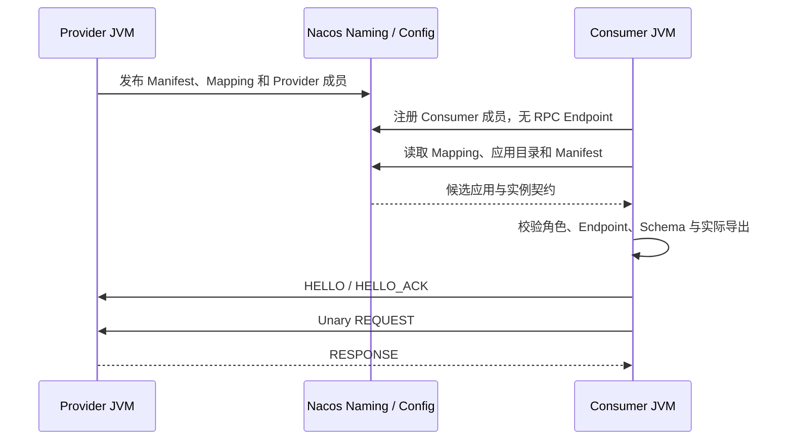

# OTRYX RPC 快速开始

> 基线：`1.0.0-SNAPSHOT` / JDK 21 / Spring Boot 3.5.4 / Wire v1。源码尚未公开发布到 Maven Central。本指南由**无需 Docker 的单 JVM Memory RPC**起步，再逐步切换为多进程服务发现。历史 Peach RPC Java API 和 OTRYX 命名空间不承诺互通。

## 1. 准备环境并克隆

必须具备 JDK 21；仓库 `mvnw` / `mvnw.cmd` 固定 Maven 3.9.11，首次安装需网络访问 Maven Central。脚本需要 Bash、Python 3、GNU `timeout`。不同学习路径使用的基础设施如下：

| 路径 | 环境与后端 |
|---|---|
| Memory | 一个 JVM，无需 Docker 或外部 Registry |
| process / chain / revision | 默认使用共享 Nacos，也可选 Etcd、Consul、Eureka；这些是显式可信开发场景 |
| mTLS 安全自动验收 | **Linux**、OpenSSL、Etcd **3.5.21** 可执行文件；脚本创建并清理自己的 loopback TLS/RBAC 实例，无需 Nacos |
| 完整聚合入口 | 同时满足默认开发场景和 mTLS 的前置条件，包括 Linux 与 `ETCD_BINARY` |

Nacos 可使用下文 Docker Compose 或自行部署的本地服务。准备 Etcd 可执行文件后，通过 `ETCD_BINARY=/absolute/path/to/etcd` 告诉安全脚本实际路径。开发脚本及 Maven 的平台条件保持各自原有约束，Linux 要求来自安全自动验收。

```bash
git clone https://github.com/Ryan-Guizhou/otryx-rpc.git
cd otryx-rpc
java -version   # 必须是 JDK 21
./mvnw --version
./mvnw -B -ntp -pl :otryx-quickstart-api,:otryx-quickstart-provider,:otryx-quickstart-consumer,:otryx-quickstart-memory -am clean package
```

Windows CMD/PowerShell 使用 `mvnw.cmd` 替代 `./mvnw`，并先把 `JAVA_HOME` 指到 JDK 21。`-pl` 必须列出四个叶子模块，不能只写聚合模块 `otryx-quickstart`；`otryx-quickstart-api` 的 `provided` 依赖会让 `-am` 一并构建 `otryx-codegen`。运行命令的工作目录始终为本仓库根目录。

### 1.1 先选择安全 Profile

Spring、Core Client/Server Builder 与 RegistryOptions 都要求显式 Profile，默认 `UNSPECIFIED` 会拒绝启动。本指南前面的 Memory/Nacos 示例已在配置中选择 `TRUSTED_DEVELOPMENT`，适用于可信隔离学习；第 5.2 节使用 `NETWORK_MTLS` 演示受保护网络路径。

网络 Profile 要求实际 mTLS、完整 `ApplicationKey` 的有限证书绑定、安全 Codec 和受保护的 Registry 来源。`server.enabled=true` 时还必须由应用声明 `RpcAuthorizer` Bean，缺少策略会在 Registry 工厂和 RPC 运行时创建前失败；纯 Consumer 显式配置 `server.enabled=false`。Core Server Builder 执行相同的缺策略拒绝。默认 Fory 使用严格 DTO allowlist，自定义 Codec 则按实际契约检查和有限解码能力校验。详细字段见 [Starter](reference/starter.md)。

## 2. 第一阶段：不启动注册中心

```bash
bash scripts/run_quickstart_memory.sh
```

或者手动启动（成功后 Ctrl+C 结束）：

```bash
java -jar otryx-quickstart/otryx-quickstart-memory/target/otryx-quickstart-memory-1.0.0-SNAPSHOT-exec.jar
```

应看到：

```text
Quickstart memory RPC succeeded: Hello, Quickstart!
```

该进程中既有 `@OtryxRpcService` Provider，也有 `@OtryxRpcReference` Consumer；RPC 会经过 Memory Registry、Fory、Vert.x loopback 和真实业务实现。**Memory Registry 不能用于两个独立 JVM 的服务发现**。这条实验只允许使用 `TRUSTED_DEVELOPMENT` 隔离开发配置。

源码：[Memory Provider](../otryx-quickstart/otryx-quickstart-memory/src/main/java/com/peachsoft/otryx/quickstart/memory/MemoryGreetingServiceImpl.java) · [Memory Consumer](../otryx-quickstart/otryx-quickstart-memory/src/main/java/com/peachsoft/otryx/quickstart/memory/MemoryGreetingRunner.java)。

## 3. 第二阶段：Nacos 下两个独立 JVM

这一阶段使用 `TRUSTED_DEVELOPMENT`。当前 Nacos Adapter 尚未完整实现 SDK 登录与数据链的独立 TLS 保护，会在创建 SDK 前拒绝 NETWORK/TLS 意图；安全自动验收采用第 5.2 节的 Etcd 路线。

启动注册中心并确认 Nacos HTTP 8848 与客户端 gRPC 9848 端口可用：

```bash
docker compose -f otryx-quickstart/docker-compose.yml up -d
```

如果上一步没有构建 Quickstart，先运行：

```bash
./mvnw -B -ntp -pl :otryx-quickstart-api,:otryx-quickstart-provider,:otryx-quickstart-consumer,:otryx-quickstart-memory -am clean package
```

**在启动任何应用之前**，为手工示例的 `public` namespace / `OTRYX_RPC` group 独占初始化 Mapping 分片：

```bash
bash scripts/bootstrap_quickstart_nacos.sh \
  otryx-quickstart/otryx-quickstart-provider/target/otryx-quickstart-provider-1.0.0-SNAPSHOT-exec.jar \
  127.0.0.1:8848 public OTRYX_RPC
```

Windows：

```powershell
.\scripts\bootstrap_quickstart_nacos.ps1 `
  otryx-quickstart\otryx-quickstart-provider\target\otryx-quickstart-provider-1.0.0-SNAPSHOT-exec.jar `
  127.0.0.1:8848 public OTRYX_RPC
```

该 scope 中不能有业务进程并发写入 Mapping。命令创建缺失分片、校验并保留已有数据；失败时先解决问题再启动应用。普通 Starter 不会自动补建；跳过此步会在 Provider 启动时得到脱敏的 `Nacos control-plane operation failed`。下面的自动验证脚本使用各自随机 group 并内置初始化，无需手工初始化共享 group。详见 [Nacos 初始化约束](reference/registry-nacos-v2.md#4-nacos-config-servicemappingmd5-casfencing分片)。

**终端 A — Provider**：

```bash
java -jar otryx-quickstart/otryx-quickstart-provider/target/otryx-quickstart-provider-1.0.0-SNAPSHOT-exec.jar
```

预期包含 `OTRYX RPC server started: bind=0.0.0.0:19090, advertised=127.0.0.1:19090`。

**终端 B — Consumer**：

```bash
java -jar otryx-quickstart/otryx-quickstart-consumer/target/otryx-quickstart-consumer-1.0.0-SNAPSHOT-exec.jar
```

预期：

```text
RPC quickstart completed successfully: Hello, OTRYX RPC!
```



`spring.application.name` 标识应用；一个进程实例共享一条成员，ServiceKey 用来选择业务契约，不作为注册实例主键。当前 Starter 使用 `registry.namespace` 构造 ApplicationKey，本示例配置为 `public`。Consumer 入册后路由仍异步刷新；目录中的 Consumer 不能进入 Provider 负载均衡池。

用于 CI 和本地自动化验证（先停止手工 JVM，保留 Nacos）：

```bash
OTRYX_RPC_E2E_RESTART_NACOS=false bash scripts/run_quickstart_process_e2e.sh
```

脚本校验真实通信、Provider 重启及 Consumer 不退出时的发现恢复，并保留初始、停止和恢复阶段的 JSON 快照。Provider 停止时 Consumer 成员仍在，已验证 Provider 列表为空；CI 环境还可以重启受控 Nacos 实例。手工读取成员、Manifest、Mapping 与 `verifiedProviders` 的命令见 [Quickstart 成员观察](../otryx-quickstart/README.md#24-观察真实成员manifest-与-mapping)。

## 4. 第三阶段：跨三个 JVM 的 Deadline

```bash
bash scripts/run_three_process_deadline_e2e.sh
```

该脚本运行 Consumer A → Relay Provider B（19091）→ Leaf Provider C（19090），验证 5 秒上游 Deadline、B 的 10 秒本地超时不能扩展上游预算、`tenant`/ `relay` 元数据随调用传递。快照须显示 A 为 Consumer-only、B 为一个 BOTH 成员、C 为 Provider。预期输出 `RPC deadline chain completed: CHAIN_OK remainingMillis=...`。

## 5. 双 revision 与独立 mTLS 安全路线

### 5.1 同一应用的真实导出变更

继续使用已构建的四模块 JAR 和本地 Nacos：

```bash
bash scripts/run_quickstart_revision_e2e.sh
```

脚本用同一 Provider JAR、同一 ApplicationName 和不变的 ServiceKey version/group，运行 `{Greeting}` 与 `{Greeting, Details}` 两个真实导出集合，验证共存、升级和回滚。Provider 全停后 Consumer 仍是成员，但不可成为路由目标。

### 5.2 受保护的 Etcd 与有限方法授权

在 Linux 上准备 OpenSSL 和 Etcd **3.5.21** 可执行文件后运行：

```bash
ETCD_BINARY=/absolute/path/to/etcd bash scripts/run_quickstart_mtls_e2e.sh
```

该脚本自行管理只监听 loopback 的 Etcd TLS/RBAC 实例。RPC 与 Registry 使用独立临时 CA；管理、Provider、Consumer、只读观察分别持有各自范围的凭据，应用不接收管理凭据。测试结束后清理受管进程、临时数据库、私钥与凭据。

Transport 把真实叶证书 DER SHA-256 绑定到完整 `ApplicationKey(namespace, applicationName)` 和有限期限，原证书与轮换证书可绑定同一 Consumer 应用。示例授权器按允许的应用、完整 Greeting ServiceKey 和 `hello` MethodId 返回有限 `RpcAuthorizationDecision`；Details 独立拒绝。许可不能超过证书、绑定、请求预算与 `server.authorization.max-grant-lifetime`。

脚本定义 E01–E15 安全场景，包括允许调用、证书轮换、应用/namespace 不匹配、未绑定或过期身份、错误 CA、过期策略、方法拒绝、缺少授权器、错误 Registry 凭据和只读观察权限。E12/E14 各含两个独立阶段。断言区分类型化认证 reason、启动失败和精确 `BAD_REQUEST` / `RPC authorization denied`；一般连接失败不能冒充预期拒绝。

每个阶段还检查真实成员和路由：初始 Provider 应保持完整，Consumer 是否存在取决于失败发生在入册之前还是之后。完整步骤、环境变量和阶段表见 [Quickstart 安全教程](../otryx-quickstart/README.md) 与 [安全指南](security.md)。这里描述的是当前工作树的验收契约，#140 的端到端结果仍在验证。

### 5.3 按顺序运行全部场景

已构建 JAR，并满足 Linux、Nacos、Etcd 3.5.21 和 OpenSSL 等条件后：

```bash
ETCD_BINARY=/absolute/path/to/etcd \
  NACOS_TEST_ENDPOINT=127.0.0.1:8848 bash scripts/run_quickstart_e2e.sh
```

入口按 Memory → 双进程 → 三进程 → revision → mTLS 执行，失败即停止。前三个默认开发进程场景各自初始化隔离 Nacos group；mTLS 使用自己的受保护 Etcd。JSON 与 `summary.log` 保存在 `target/quickstart-e2e/<scenario>.<随机后缀>/`，临时私钥和凭据不进入证据目录。脚本不替代 Maven 构建，也不启动用户提供的 Nacos。

## 6. 引入单一 Spring Boot Starter

**无需选择 Lite 或 Full**，只保留：

```xml
<dependency>
    <groupId>com.peachsoft.otryx</groupId>
    <artifactId>otryx-spring-boot-starter</artifactId>
    <version>1.0.0-SNAPSHOT</version>
</dependency>
```

默认包含 Core、Memory Registry、JDK Proxy、Fory、Vert.x 及 Spring Boot 自动配置。跨 JVM 选择 Nacos 时，业务模块**另外添加**：

```xml
<dependency>
    <groupId>com.peachsoft.otryx</groupId>
    <artifactId>otryx-registry-nacos</artifactId>
    <version>1.0.0-SNAPSHOT</version>
</dependency>
```

Nacos、Etcd、Consul/Eureka、代理与遥测 Adapter 是可选依赖，不能仅配置 `registry.type=nacos` 却不添加对应实现。当前 Snapshot 尚未发布 Central，在外部业务工程使用前先从本仓库运行 `./mvnw -B -ntp clean install -DskipTests`。

**接口与注解**直接查看 [GreetingService](../otryx-quickstart/otryx-quickstart-api/src/main/java/com/peachsoft/otryx/quickstart/api/GreetingService.java)、[Provider](../otryx-quickstart/otryx-quickstart-provider/src/main/java/com/peachsoft/otryx/quickstart/provider/GreetingServiceImpl.java) 和 [Consumer](../otryx-quickstart/otryx-quickstart-consumer/src/main/java/com/peachsoft/otryx/quickstart/consumer/GreetingRunner.java)。`@OtryxRpcContract` 编译期生成 Stub/Dispatcher，缺失时回退 JDK Proxy/MethodHandle；仅显式幂等方法允许自动重试。

## 7. 可选路线与常见失败

- **Consul/Eureka**：两个进程使用一致的显式 Profile。Eureka 还需双方设置 `registry.eureka.metadata-backend` 与 `metadata-endpoints`，并加入所选 Adapter。成员 TLS/凭据放在 `registry.security`，元数据链使用独立 `registry.metadata-security`，不能继承成员 CA 或凭据；网络 Profile 不能选择 Nacos 元数据后端。见 [后端示例](../otryx-quickstart/README.md) 和 [Starter](reference/starter.md)；
- **TLS/mTLS**：RPC 路径使用 `OTRYX_QUICKSTART_TLS_CERT`、`OTRYX_QUICKSTART_TLS_KEY`、`OTRYX_QUICKSTART_TLS_CA`；Registry CA 和凭据目录独立配置。`mtls` Profile 使用 Transport 证书绑定和 `allowed-consumer.namespace` / `allowed-consumer.application-name` / `policy-valid-until` 的有限应用策略。网络 Provider 缺少显式授权器时启动失败；
- **Observer**：Quickstart Consumer 的 `QuickstartCallObserver` 是已有可测试的 Spring 注入示例；Micrometer/OTel/JFR 按需加入；
- **`-exec.jar` 缺失**：先在仓库根目录构建，普通 JAR 不是 Spring Boot 可执行 JAR；
- **Memory 跨 JVM 无法发现**：改用共享 Registry，不要期待进程内注册表跨进程通信；
- **Nacos 连接失败**：检查 8848/9848、Registry type、namespace、Provider advertised address；
- **超时/拒绝**：先查 Provider Ready、Deadline、负载上限，再查服务目录与错误日志。

完整的路径、运行边界、可选 Profiles、期望结果、排障和安全警告见 [中文 Quickstart](../otryx-quickstart/README.md) 或 [English Quickstart](../otryx-quickstart/README.en-US.md)。

## 8. 校验与清理

```bash
python3 scripts/check_project.py
python3 scripts/test_quickstart_layout.py
./mvnw -B -ntp clean verify -Pquality
# Linux；全部 JAR 已构建、Nacos 运行中、OpenSSL 和 Etcd 3.5.21 已准备：
ETCD_BINARY=/absolute/path/to/etcd bash scripts/run_quickstart_e2e.sh
# 仅清理本教程由你启动、已不再使用的 Compose 服务：
docker compose -f otryx-quickstart/docker-compose.yml down
```

#139 的唯一应用级链路、全仓清理和相应验收已由 [PR #160](https://github.com/Ryan-Guizhou/otryx-rpc/pull/160) 合入 main `783bf8115c9523e5667023678dafe659315b2b66`，该 main 提交的门禁已核验。#140 安全加固仍在实现验证，不能沿用 #139 的通过结论。命令和预期结果不等于当前提交已经通过；新的完成结论须绑定实际日志、准确 Head 与合并后 main CI，参数和计数边界见[应用级注册验收](reference/application-registry-acceptance.md)。短时 Quickstart 不构成生产容量或正式发布证明。

继续阅读：[Starter 与配置](reference/starter.md) · [模块结构](design/project-structure.md) · [安全指南](security.md) · [运行与排障](operations.md) · [迁移](migration.md) · [FAQ](faq.md)。

