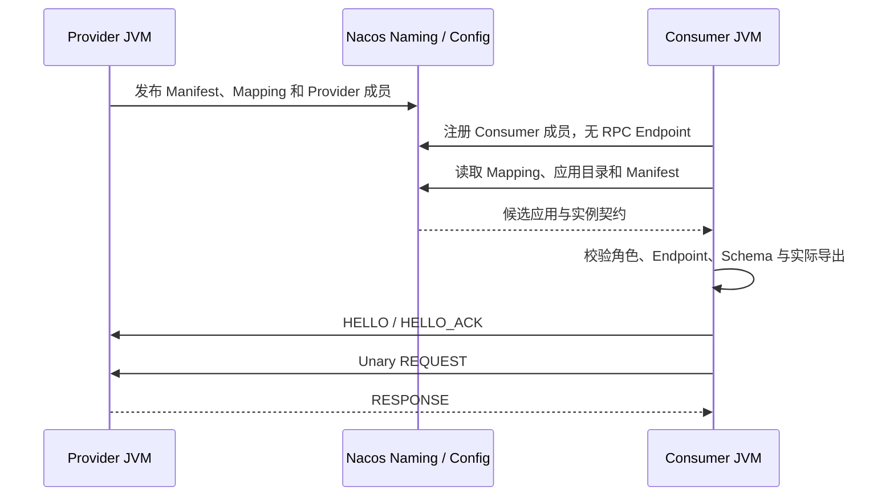

# OTRYX RPC 快速开始

> 基线：`1.0.0-SNAPSHOT` / JDK 21 / Spring Boot 3.5.4 / Wire v1。源码尚未公开发布到 Maven Central。本指南由**无需 Docker 的单 JVM Memory RPC**起步，再逐步切换为多进程服务发现。历史 Peach RPC Java API 和 OTRYX 命名空间不承诺互通。

## 1. 准备环境并克隆

必须具备 JDK 21；仓库 `mvnw` / `mvnw.cmd` 固定 Maven 3.9.11，首次安装需网络访问 Maven Central。脚本需要 Bash、Python 3、GNU `timeout`；mTLS 场景还需要 OpenSSL。跨进程实验需要共享 Nacos，可以使用下文 Docker Compose 或自行部署的本地服务；Memory 不需要 Docker。

```bash
git clone https://github.com/Ryan-Guizhou/otryx-rpc.git
cd otryx-rpc
java -version
./mvnw --version
./mvnw -B -ntp -pl otryx-quickstart -am clean package
```

Windows CMD/PowerShell 使用 `mvnw.cmd` 替代 `./mvnw`。运行命令的工作目录始终为本仓库根目录。

## 2. 第一阶段：不启动注册中心

```bash
bash scripts/run_quickstart_memory.sh
```

或者手动启动（成功后 Ctrl+C 结束）：

```bash
java -jar otryx-quickstart/otryx-quickstart-memory/target/otryx-quickstart-memory-1.0.0-SNAPSHOT-exec.jar
```

应看到：

```text
Quickstart memory RPC succeeded: Hello, Quickstart!
```

该进程中既有 `@OtryxRpcService` Provider，也有 `@OtryxRpcReference` Consumer；RPC 会经过 Memory Registry、Fory、Vert.x loopback 和真实业务实现。**Memory Registry 不能用于两个独立 JVM 的服务发现**。这条实验只允许使用 `TRUSTED_DEVELOPMENT` 隔离开发配置。

源码：[Memory Provider](../otryx-quickstart/otryx-quickstart-memory/src/main/java/com/peachsoft/otryx/quickstart/memory/MemoryGreetingServiceImpl.java) · [Memory Consumer](../otryx-quickstart/otryx-quickstart-memory/src/main/java/com/peachsoft/otryx/quickstart/memory/MemoryGreetingRunner.java)。

## 3. 第二阶段：Nacos 下两个独立 JVM

启动注册中心并确认 Nacos HTTP 8848 与客户端 gRPC 9848 端口可用：

```bash
docker compose -f otryx-quickstart/docker-compose.yml up -d
```

如果上一步没有构建 Quickstart，先运行：

```bash
./mvnw -B -ntp -pl otryx-quickstart -am clean package
```

**在启动任何应用之前**，为手工示例的 `public` namespace / `OTRYX_RPC` group 独占初始化 Mapping 分片：

```bash
bash scripts/bootstrap_quickstart_nacos.sh \
  otryx-quickstart/otryx-quickstart-provider/target/otryx-quickstart-provider-1.0.0-SNAPSHOT-exec.jar \
  127.0.0.1:8848 public OTRYX_RPC
```

该 scope 中不能有业务进程并发写入 Mapping。命令创建缺失分片、校验并保留已有数据；失败时先解决问题再启动应用。普通 Starter 不会自动补建。下面的自动验证脚本使用各自随机 group 并内置初始化，无需手工初始化共享 group。详见 [Nacos 初始化约束](reference/registry-nacos-v2.md#4-nacos-config-servicemappingmd5-casfencing分片)。

**终端 A — Provider**：

```bash
java -jar otryx-quickstart/otryx-quickstart-provider/target/otryx-quickstart-provider-1.0.0-SNAPSHOT-exec.jar
```

预期包含 `OTRYX RPC server started: bind=0.0.0.0:19090, advertised=127.0.0.1:19090`。

**终端 B — Consumer**：

```bash
java -jar otryx-quickstart/otryx-quickstart-consumer/target/otryx-quickstart-consumer-1.0.0-SNAPSHOT-exec.jar
```

预期：

```text
RPC quickstart completed successfully: Hello, OTRYX RPC!
```



`spring.application.name` 标识应用；一个进程实例共享一条成员，ServiceKey 用来选择业务契约，不作为注册实例主键。当前 Starter 使用 `registry.namespace` 构造 ApplicationKey，本示例配置为 `public`。Consumer 入册后路由仍异步刷新；目录中的 Consumer 不能进入 Provider 负载均衡池。

用于 CI 和本地自动化验证（先停止手工 JVM，保留 Nacos）：

```bash
OTRYX_RPC_E2E_RESTART_NACOS=false bash scripts/run_quickstart_process_e2e.sh
```

脚本校验真实通信、Provider 重启及 Consumer 不退出时的发现恢复，并保留初始、停止和恢复阶段的 JSON 快照。Provider 停止时 Consumer 成员仍在，已验证 Provider 列表为空；CI 环境还可以重启受控 Nacos 实例。手工读取成员、Manifest、Mapping 与 `verifiedProviders` 的命令见 [Quickstart 成员观察](../otryx-quickstart/README.md#24-观察真实成员manifest-与-mapping)。

## 4. 第三阶段：跨三个 JVM 的 Deadline

```bash
bash scripts/run_three_process_deadline_e2e.sh
```

该脚本运行 Consumer A → Relay Provider B（19091）→ Leaf Provider C（19090），验证 5 秒上游 Deadline、B 的 10 秒本地超时不能扩展上游预算、`tenant`/ `relay` 元数据随调用传递。快照须显示 A 为 Consumer-only、B 为一个 BOTH 成员、C 为 Provider。预期输出 `RPC deadline chain completed: CHAIN_OK remainingMillis=...`。

## 5. 双 revision 与 mTLS 授权

继续使用已经构建的四模块 JAR 和本地 Nacos：

```bash
bash scripts/run_quickstart_revision_e2e.sh
bash scripts/run_quickstart_mtls_e2e.sh
```

第一个场景用同一 Provider JAR、同一 ApplicationName 和不变的 ServiceKey version/group，运行 `{Greeting}` 与 `{Greeting, Details}` 两个真实导出集合，验证共存、升级和回滚；Provider 全停后 Consumer 仍是成员，但不可成为路由目标。第二个场景生成临时 PKI，验证同一 CA 下允许和未授权客户端、方法限制及恢复成功。只有精确的 `BAD_REQUEST` / `RPC authorization denied` 算授权拒绝，握手失败不算通过。

一条命令可按 Memory → 双进程 → 三进程 → revision → mTLS 顺序运行全部场景：

```bash
NACOS_TEST_ENDPOINT=127.0.0.1:8848 bash scripts/run_quickstart_e2e.sh
```

各跨进程场景先初始化独立 Nacos group，失败即停止。证据位于 `target/quickstart-e2e/<scenario>.<随机后缀>/` 的 JSON 和 `summary.log`；临时私钥不进入证据目录。脚本不会启动 Nacos 或替代 Maven 构建。每个阶段的断言和字段含义见 [Quickstart 完整教程](../otryx-quickstart/README.md)。

## 6. 引入单一 Spring Boot Starter

**无需选择 Lite 或 Full**，只保留：

```xml
<dependency>
    <groupId>com.peachsoft.otryx</groupId>
    <artifactId>otryx-spring-boot-starter</artifactId>
    <version>1.0.0-SNAPSHOT</version>
</dependency>
```

默认包含 Core、Memory Registry、JDK Proxy、Fory、Vert.x 及 Spring Boot 自动配置。跨 JVM 选择 Nacos 时，业务模块**另外添加**：

```xml
<dependency>
    <groupId>com.peachsoft.otryx</groupId>
    <artifactId>otryx-registry-nacos</artifactId>
    <version>1.0.0-SNAPSHOT</version>
</dependency>
```

Nacos、Etcd、Consul/Eureka、代理与遥测 Adapter 是可选依赖，不能仅配置 `registry.type=nacos` 却不添加对应实现。当前 Snapshot 尚未发布 Central，在外部业务工程使用前先从本仓库运行 `./mvnw -B -ntp clean install -DskipTests`。

**接口与注解**直接查看 [GreetingService](../otryx-quickstart/otryx-quickstart-api/src/main/java/com/peachsoft/otryx/quickstart/api/GreetingService.java)、[Provider](../otryx-quickstart/otryx-quickstart-provider/src/main/java/com/peachsoft/otryx/quickstart/provider/GreetingServiceImpl.java) 和 [Consumer](../otryx-quickstart/otryx-quickstart-consumer/src/main/java/com/peachsoft/otryx/quickstart/consumer/GreetingRunner.java)。`@OtryxRpcContract` 编译期生成 Stub/Dispatcher，缺失时回退 JDK Proxy/MethodHandle；仅显式幂等方法允许自动重试。

## 7. 可选路线与常见失败

- **Consul/Eureka**：两个进程使用同一 Profile。Eureka 只保存应用成员，必须在双方显式设置 `registry.eureka.metadata-backend` 和 `metadata-endpoints`，并加入所选 Etcd/Nacos/Consul Adapter。仅启动 Eureka 不足以提供 Manifest/Mapping；选 Nacos 元数据时也要先初始化该 scope，见 [后端示例](../otryx-quickstart/README.md#7-进一步验证-registryconsul--eureka)；
- **TLS/mTLS**：证书路径使用 `OTRYX_QUICKSTART_TLS_CERT`、`OTRYX_QUICKSTART_TLS_KEY`、`OTRYX_QUICKSTART_TLS_CA`。网络部署使用 `NETWORK_MTLS`、严格 Fory 白名单与业务授权；Quickstart 的 `mtls` Provider 还必须设置 `otryx.rpc.quickstart.mtls.allowed-client-sha256`，通用 Starter 未提供授权器时默认拒绝；
- **Observer**：Quickstart Consumer 的 `QuickstartCallObserver` 是已有可测试的 Spring 注入示例；Micrometer/OTel/JFR 按需加入；
- **`-exec.jar` 缺失**：先在仓库根目录构建，普通 JAR 不是 Spring Boot 可执行 JAR；
- **Memory 跨 JVM 无法发现**：改用共享 Registry，不要期待进程内注册表跨进程通信；
- **Nacos 连接失败**：检查 8848/9848、Registry type、namespace、Provider advertised address；
- **超时/拒绝**：先查 Provider Ready、Deadline、负载上限，再查服务目录与错误日志。

完整的路径、运行边界、可选 Profiles、期望结果、排障和安全警告见 [中文 Quickstart](../otryx-quickstart/README.md) 或 [English Quickstart](../otryx-quickstart/README.en-US.md)。

## 8. 校验与清理

```bash
python3 scripts/check_project.py
python3 scripts/test_quickstart_layout.py
./mvnw -B -ntp clean verify -Pquality
# 全部 JAR 已构建，Nacos 仍在运行，且已安装 OpenSSL：
bash scripts/run_quickstart_e2e.sh
# 仅清理本教程由你启动、已不再使用的 Compose 服务：
docker compose -f otryx-quickstart/docker-compose.yml down
```

命令和预期结果不等于某个提交已通过验证。#137 Starter 接入已经合并；#138 本教程的验收须检查其准确 Head 和合并后 main CI。#139 全仓旧接口级 SPI 删除尚未完成；短时 Quickstart 也不构成生产容量或正式发布证明。

继续阅读：[Starter 与配置](reference/starter.md) · [模块结构](design/project-structure.md) · [安全指南](security.md) · [运行与排障](operations.md) · [迁移](migration.md) · [FAQ](faq.md)。

