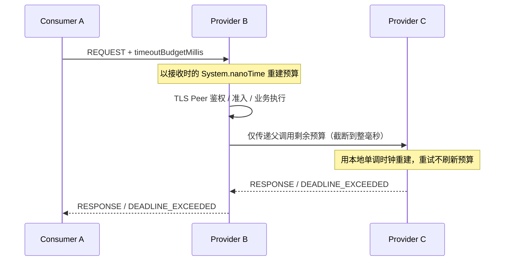

# Deadline、方法级超时与调用上下文（U08）

> 当前设计以 **JDK 21 / Wire v1 / 1.0.0-SNAPSHOT** 为准，本文描述本次 U08 开发分支的行为。合并和测试状态必须以相应 PR 的精确 Head CI 为准。

## 1. 调用预算与优先级

调用时可以通过 `RpcCallOptions` 设置覆盖超时和业务 Metadata：

```java
try (RpcCallScope ignored = RpcCallContext.open(
        new RpcCallOptions(Duration.ofMillis(700), Map.of("tenant", "alpha")))) {
    Order order = service.findById(orderId);
}
```

Consumer 的配置优先级为：**单次调用覆盖 → 方法默认值 → Consumer 全局默认值**。
如果调用已处于父级 `RpcCallContext`，最终预算不能超过 `parent.remainingNanos()`。方法默认值通过 `OtryxRpcClient.Builder.methodTimeouts(Map<String,Duration>)` 预绑定，键为 `Method.toGenericString()`：

```java
Method method = OrderService.class.getMethod("findById", Long.class);
OtryxRpcClient client = OtryxRpcClient.builder()
        // 其他必要的 discovery / transport / codec 配置省略
        .timeout(Duration.ofSeconds(3))
        .methodTimeouts(Map.of(method.toGenericString(), Duration.ofMillis(900)))
        .build();
```

Spring Properties 对应 `otryx.rpc.client.timeout` 和 `otryx.rpc.client.method-timeouts`。
后一项的 Map 键必须与运行期的 `Method.toGenericString()` **完全一致**，包含修饰符、返回类型、参数列表；建议在应用启动或配置生成环节用反射取得该键，避免手动拼写漂移。

## 2. A → B → C 链式时限



- 逻辑调用开始时计算一次 `deadlineNanos`；重试、重新选址和响应完成不得刷新它。
- Wire v1 继续携带既有 `deadlineEpochMillis` 和 `timeoutBudgetMillis`，不增加协议字段。新 Provider **优先相对预算**，避免直接比较两台机器不同的 Epoch 时钟。
- Wire 的预算精度只有毫秒，发送端向下截断；不足 1ms 时应终止调用，而非向上取整把预算扩大为 1ms。
- 网络传输仍会消耗时间；相对预算只能保证不主动“重新发满配额”，不能在未知单程网络延迟下保证全链路绝对时刻完全一致。
- 未标注 `@OtryxRpcIdempotent` 的方法不会自动重试。

## 3. Provider 阶段、取消和资源所有权

Provider 在授权前解析并验证 Metadata，并使用本地 `System.nanoTime()` 建立截止时间。授权等待、业务准入、执行队列、同步或异步业务和响应回写均共享该期限。

超时可以先完成响应 Future 为 `DEADLINE_EXCEEDED`；**Future 终态不证明业务停止**。如果业务忽略中断或外部 `CompletionStage` 仍在运行，其 Admission Lease 直到业务实际终态和响应终态**两个条件**均满足后才能归还。关闭同样遵守此规则。

## 4. ThreadLocal 生命周期

- `RpcCallContext.current()` 仅在明确的 `RpcCallScope` 内有效。
- 作用域可嵌套；在创建线程中按逆序 `close()`，保证恢复上一个值。
- 框架会在自己的 Provider 执行线程、异步结果处理和 Client 响应完成/重试线程显式 `attach`/恢复。
- **用户自定义线程池不自动继承**。必须捕获并包装：

```java
Runnable task = RpcCallContext.wrap(() -> downstreamService.call());
executor.execute(task);
```

`RpcCallContext.inbound` 只消费客户端预算和业务 Metadata，TLS Peer 身份来自经过认证的 Transport 连接，绝不能由客户端 Metadata 自称。

## 5. Metadata 安全约束

`RpcCallOptions` 对业务 Metadata 限制最多 **64 条**、总计 **8 KiB UTF-8**。键和值不得包含非法分隔符；`deadlineEpochMillis`、`timeoutBudgetMillis` 和 `rpc-peer-*`、`rpc-auth-*` 等认证保留键均不可由业务构造。Provider 无论是否启用 Trace 都会验证传入字段。

这些是应用上下文预算，不等于 Wire v1 Header 的 16-bit Metadata 长度或整个请求 Frame 的最大尺寸。

## 6. 回归与验证

```bash
mvn -B -ntp -pl otryx-core -am test
mvn -B -ntp -pl otryx-spring-boot/otryx-spring-boot-autoconfigure -am test
mvn -B -ntp clean verify -Pquality
```

重点回归：`scopeMustRestorePreviousContext`、`downstreamBudgetMustNotExceedRemainingParentBudget`、`retryMustConsumeSameLogicalBudgetAndRestoreCapturedContext`、Provider 超时但业务忽略中断、伪造 Peer Metadata 拒绝，以及 Generated/JDK fallback 路径一致。

文档与源码的行为事实需以对应测试及 PR CI 为准；**仅有测试代码不代表运行通过**。
