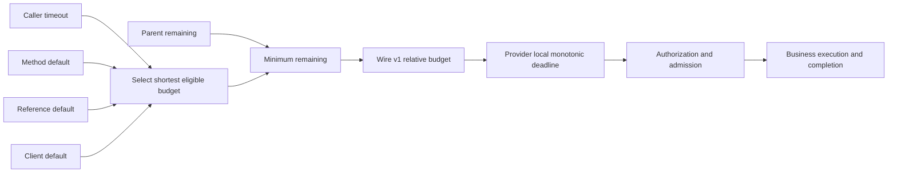

# U08 · 方法级调用预算与 Deadline 上下文传播

> 开发状态：OTRYX RPC `1.0.0-SNAPSHOT`，JDK 21，Wire v1 兼容。
> 本文说明当前 U08 实施分支的契约；合并前必须通过 PR CI、滚动兼容与 Examples。

## 1. 目标与语义

不让分布式链路 `A → B → C` 的每一跳重新获得完整超时时间。
逻辑调用的 Deadline 使用本机 **`System.nanoTime()`** 计算：
同一次调用的全部重试共享唯一截止时间，越过任何 Provider 时
都使用收到的**相对剩余预算**在本机重建 Deadline。

预算优先级：**单次调用 `RpcCallOptions` ＞ 契约方法 `@OtryxRpcTimeout` ＞
`@OtryxRpcReference.timeoutMillis` ＞ Client 默认 `otryx.rpc.client.timeout`**。
选中的预算还必须与父级 `RpcCallContext.remainingNanos()` 取最小值。
没有父级上下文时延续当前 Client 默认，不能为整个 JVM 隐式引入 ThreadLocal。



## 2. Consumer 使用方式

**方法默认：**

```java
public interface OrderQuery {
    @OtryxRpcTimeout(millis = 800)
    Order find(String orderId);
}
```

**单次预算与元数据：**

```java
try (RpcCallScope ignored = RpcCallContext.open(
        new RpcCallOptions(
                Duration.ofMillis(250),
                Map.of("x-correlation", "request-123")))) {
    Order value = orderQuery.find("order-123");
}
```

`RpcCallOptions.timeout()==null` 表示本次不指定超时；
`RpcCallOptions.metadata()` 是不可变、校验过的用户 Metadata，
不可覆盖 `deadlineEpochMillis` 或 `timeoutBudgetMillis`。
Scope 嵌套以父级剩余 Deadline 收敛，退出时按 LIFO 恢复原线程上下文。

**Spring 注解引用默认：**

```java
@OtryxRpcReference(
        version = "1.0.0", group = "default", timeoutMillis = 1200)
private OrderQuery orderQuery;
```

可调用程序化 `OtryxRpcClient.refer(api, version, group, Duration)`。
方法注解仍优先于 Reference 默认，而单次 Scope 又优先于方法注解。
以上为预算配置，权限/身份仍由独立的 mTLS + `RpcAuthorizer` 验证。

## 3. 异步任务显式传播

`RpcCallContext.current()` 在没有 Scope 的线程上返回 `null`。
框架自己的 Provider 执行器与异步结果编码路径会捕获并恢复入站快照。
但**用户提交到任意业务 Executor 的任务不会自动继承 ThreadLocal**，
可显式绑定快照：

```java
CompletableFuture<String> pending = CompletableFuture.supplyAsync(
        RpcCallContext.wrap(
                (Supplier<String>) () -> remoteService.query()));
```

`RpcCallContext.wrap(Runnable)` 和 `wrap(Supplier<T>)`
在实际工作线程内恢复捕获快照，完成后恢复之前的上下文。
不要将其用于传递明文 Token、认证凭据或密钥。

## 4. Provider 和协议行为

Wire v1 Header、请求 Codec ID 与 Payload 不变，继续使用现有 Metadata：

| 字段 | 新版作用 |
|---|---|
| `timeoutBudgetMillis` | 首选：发送端剩余 duration；接收端按本机单调钟扣减 |
| `deadlineEpochMillis` | 滚动升级兼容旧版节点；仅在缺少相对预算时按本机时钟折算 |
| 业务 Metadata | 只做上下文和 Trace/Baggage 传播，不可伪造认证身份 |

Provider 在接收到请求 Frame 后记录单调时间，随后扣减
TLS/解析以后的认证授权、Provider Admission、业务排队、调用及异步完成
所耗用的时间。授权尚未完成且预算到期时返回 `DEADLINE_EXCEEDED`；
业务排队后若预算已耗尽，也不得再解码调用。业务未响应中断时，逻辑超时
**不等同于**实际业务退出，租约仍需遵守原有双终态规则。

跨进程机器时间存在偏差时，只要双方都携带 `timeoutBudgetMillis`
就不会因为 wall-clock 差异给下游重新分配完整预算。只带 Epoch 的历史
请求无法保证不受跨节点时钟误差影响，部署时应同时保持旧协议的兼容监控。

## 5. 回归与验收

- 单次 > 方法 > Reference > Client 的有效 Deadline 选择
- 嵌套 Scope 的父级预算约束和恢复
- Retry 消耗相同逻辑调用剩余预算，非幂等不重试
- 入站 Provider 的业务线程和异步完成上下文恢复
- 只使用显式 Wrap 跨越用户线程池
- 保留 Metadata 注入拒绝、认证身份不能从用户 Metadata 取得
- Deadline 过期后不得执行未开始的业务
- 独立 JVM Consumer/Provider 与三跳示例及 CI 验收

性能注意：默认无码元数据的路径仅探测 Frame 保留键，不构建额外用户
Metadata Map；开启用户上下文才按需解析。任何新增对象分配或 p99 变化
需由受控 JMH/soak 证据验证，不得根据代码结构声称零额外开销。

[回到文档目录](../index.md) · [Wire v1 兼容](../wire-compatibility.md) ·
[安全部署](../security.md) · [Spring Starter](starter.md)
