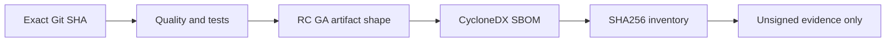

# OTRYX RPC 首发 RC/GA 验收与供应链清单

> 当前：`1.0.0-SNAPSHOT`、JDK 21、Spring Boot 3.5.4、Wire v1。本文仅描述首发候选工程准备，不是发布授权、商标审核或签名验证结果。

## 首发候选状态与边界

| 项目 | 工程证据 | 尚不能宣称 |
|---|---|---|
| U10 可观测性 | 有界 Observer、JFR 低基数出口、OpenTelemetry 回归、JMH 工具 | 已取得固定物理主机真实性能数据 |
| U11 初次接入 | Maven Wrapper、唯一 `otryx-spring-boot-starter`、Provider/Consumer 两进程与 `otryx-quickstart` 四模块实战 | 所有 Windows/Linux 首次安装环境均经人工验收 |
| U12 运行时治理 | `ClientRetryController`、`RpcShutdownBudget`、Core CI 回归 | 任意业务线程都能被安全强制停止 |
| U13 性能证据 | JMH/Matrix/10k Smoke、六轮 AB BA AB 受控证据校验、原始 JMH 可复算及负面测试；PR #123 与合并后 main CI 成功 | 真实固定 Runner 上完成六轮至少 60 分钟 Soak、工程师独立审查及生产性能指标 |
| U14 构建/供应链 | 首发 Dry-run、CycloneDX、SHA256、恶意证据校验 | 已完成签名、Tag、Central 或 Namespace 授权 |

日常 PR CI 只覆盖 `1.0.0-SNAPSHOT` 的按需质量门禁；真正 RC/GA Dry-run 需要以专用工作流两个阶段的 **原始 Actions 运行结果、产物清单、SHA256、SBOM 和 source SHA** 为准。工作流配置存在与实际执行成功是不同的验收信号；无执行证据不能宣称候选产物通过。

## RC1 / GA Dry-run 流程

完整无签名 Dry-run 现由 **OTRYX First Release Dry Run** 在相关 PR 上自动分别执行 `rc1`、`ga` 两个候选（也可通过 GitHub Actions 的 `workflow_dispatch` 手动选择一个阶段）。精确 Checkout 使用 PR Head SHA 而非自动生成的 PR Merge SHA，最终 Manifest 与来源一致；合并到 `main` 后**不会再自动重复两阶段构建**；需要对正式发行源 SHA 补充独立证据时，应由维护者通过 `workflow_dispatch` 对准确 `main` 提交手动执行 `rc1` 和 `ga` 两次。各阶段只使用临时 `-Drevision`，根 POM 及版本状态始终为 `1.0.0-SNAPSHOT`。

1. 检查精确 Git SHA、仓库、Java 21、Maven 发布元数据、恶意证据 Fixtures 与开发版状态。
2. 等待测试 Nacos，运行完整 `-Pquality,release` Reactor，不跳过核心测试及严格 Javadoc。
3. 核对所有公开模块的 Main/Sources/Javadoc JAR；`otryx-quickstart` 与 Benchmarks 不属于 Central 发布产物。
4. 用固定 CycloneDX 插件生成 Aggregate SBOM，校验项目与版本。
5. 将源码 SHA、每个构建产物 SHA256、`manifest.json`、`SHA256SUMS`、`bom.json` 关联归档为 **unsigned evidence**。

## 强制失败与责任边界

`python3 scripts/test_first_release_dry_run.py` 覆盖错误阶段/版本、缺失 Sources、错误 SBOM 版本、无效 SHA 与开发状态漂移。脚本只检验本地产物，**不能**替代 GPG 签名和 Central Portal 验证。

`dependency-review.yml` 通过 OSV Scanner 比较 Base/PR，阻断新引入的已知依赖漏洞，不要求开启 GitHub Dependency Graph；暂时无法修复时维护者必须记录可达性、影响、责任人及复核期限。Dependabot 在 GA 前暂停常规 Maven/Actions 版本升级，仅保留分组安全更新入口；新增工作流 Actions 固定完整 Commit SHA。

## 尚未关闭的外部和性能门槛

- 真实 GPG 签名及验证；Central Portal 对 `com.peachsoft.otryx` 的 Namespace Verified，发布用户有相应权限；正式坐标可从干净 Maven Repository 解析。
- OTRYX 商标风险和 Otti 吉祥物/参考图形的公开使用权。
- **V2-19 #146 强制实证门槛**：同一固定物理硬件的 AB BA AB 六个受控完整 JMH/分配/故障矩阵，每轮必须 ≥3600 秒真实 10k 逻辑并发 Soak，并附真实原生注册规模及 CPU/GC/JFR/Heap/DirectMemory/故障原始材料；缺少真实数据时继续保持 **BLOCKED，禁止官方 QPS/SLO/容量数字**。
- 维护者对 RC/GA 实际发行的明确授权。本工作流不提供 Publish 开关，不进行 Central 上传、Tag 或签名。

相关：[公开发布核查](../publication-readiness.md) · [性能证据](performance-evidence.md) · [历史发行边界](../archive/releases/release-readiness.md)。

**当前结论：已经新增可自动运行两种版本的无签名构建门禁；只有准确 PR Head 的 RC1 与 GA 两阶段实际运行成功并保存 Manifest，或维护者对正式发行源 SHA 手动运行并保留相同证据，才可认定对应版本的候选工程构建验证通过。#146 物理机性能原始证据、外部 Namespace/商标/签名和发布授权仍缺失，不等于 GA Ready 或 Published。**

## U13 性能工具新增边界

`check_u13_campaign.py` 以 AB BA AB 六个受控 Evidence Bundle 为输入，校验原始 JMH JSON 重建矩阵、源 Commit、固定 Runner 主机指纹、有效 JVM/CPU、六次 Soak 负载一致性、预先声明的策略阈值、单轮至少 3600 秒 Soak、10000 逻辑并发、实际在途阈值和 SHA256 完整性。PR #123 已合并到 `main`（`5b584779`），主分支 CI 成功。工具仍仅提供 `REPORT_ONLY`；真实运行、数据真实性与人工性能评审尚未完成，不得宣称 GA 或生产性能数值。
