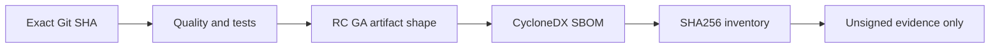

# OTRYX RPC 首发 RC/GA 验收与供应链清单

> 当前：`1.0.0-SNAPSHOT`、JDK 21、Spring Boot 3.5.4、Wire v1。本文仅描述首发候选工程准备，不是发布授权、商标审核或签名验证结果。

## 首发候选状态与边界

| 项目 | 工程证据 | 尚不能宣称 |
|---|---|---|
| U10 可观测性 | 有界 Observer、JFR 低基数出口、OpenTelemetry 回归、JMH 工具 | 已取得固定物理主机真实性能数据 |
| U11 初次接入 | Maven Wrapper、Lite Starter、两进程及 SPI 示例 | 所有 Windows/Linux 首次安装环境均经人工验收 |
| U12 运行时治理 | `ClientRetryController`、`RpcShutdownBudget`、Core CI 回归 | 任意业务线程都能被安全强制停止 |
| U13 性能证据 | JMH/Matrix/10k Smoke 和 Evidence Tooling | 三轮 AB/BA、正式 60 分钟 Soak 已完成 |
| U14 构建/供应链 | 首发 Dry-run、CycloneDX、SHA256、恶意证据校验 | 已完成签名、Tag、Central 或 Namespace 授权 |

PR/main CI 通过与手动运行完整 RC/GA Dry-run 是不同的验收信号。没有执行不得声称候选产物已验证。

## RC1 / GA Dry-run 流程

从 GitHub Actions **OTRYX First Release Dry Run** 选择 `rc1` 或 `ga`。两者只使用临时 `-Drevision`，根 POM 及版本状态始终为 `1.0.0-SNAPSHOT`。

1. 检查精确 Git SHA、仓库、Java 21、Maven 发布元数据、恶意证据 Fixtures 与开发版状态。
2. 等待测试 Nacos，运行完整 `-Pquality,release` Reactor，不跳过核心测试及严格 Javadoc。
3. 核对所有公开模块的 Main/Sources/Javadoc JAR；Examples/Benchmarks 不属于 Central 产物。
4. 用固定 CycloneDX 插件生成 Aggregate SBOM，校验项目与版本。
5. 将源码 SHA、每个构建产物 SHA256、`manifest.json`、`SHA256SUMS`、`bom.json` 关联归档为 **unsigned evidence**。

## 强制失败与责任边界

`python3 scripts/test_first_release_dry_run.py` 覆盖错误阶段/版本、缺失 Sources、错误 SBOM 版本、无效 SHA 与开发状态漂移。脚本只检验本地产物，**不能**替代 GPG 签名和 Central Portal 验证。

`dependency-review.yml` 对新增 Critical 级别依赖风险阻断；暂时无法修复时维护者必须记录可达性、影响、责任人及复核期限。Dependabot 按月分组 Maven/Actions 更新；新增工作流 Actions 固定完整 Commit SHA。

## 尚未关闭的外部和性能门槛

- 真实 GPG 签名及验证；Central Portal 对 `com.peachsoft.otryx` 的 Namespace Verified，发布用户有相应权限；正式坐标可从干净 Maven Repository 解析。
- OTRYX 商标风险和 Otti 吉祥物/参考图形的公开使用权。
- 目标硬件三轮受控性能矩阵及建议的 60 分钟 10k logical-concurrency Soak；缺少原始证据时继续保持**无官方性能数字**。
- 维护者对 RC/GA 实际发行的明确授权。本工作流不提供 Publish 开关，不进行 Central 上传、Tag 或签名。

相关：[公开发布核查](../publication-readiness.md) · [性能证据](performance-evidence.md) · [历史发行边界](../archive/releases/release-readiness.md)。

**当前结论：候选构建具有执行入口，不等于 GA Ready 或 Published。**
