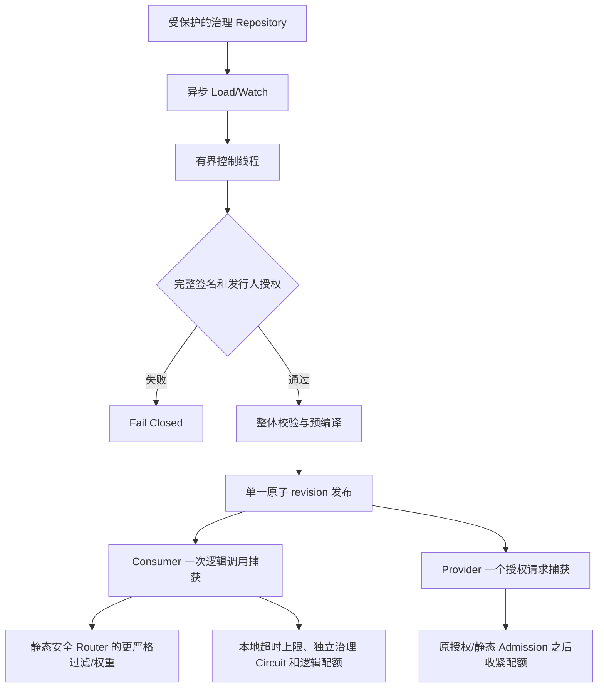

# V2-17：签名动态治理与安全回滚

> 状态：**已实现**。#144 的 [PR #165](https://github.com/Ryan-Guizhou/otryx-rpc/pull/165) 在准确 Head `a5bdc77d6c22cd24379f6ef6e80fa89bb6ba82ec` 通过全部 13 项 GitHub Actions 工作流及 17 项 Check 后 squash 合并至 `main@fd54cd3e9548cc0c5b24a954b46e62f8426c489d`；合并后 main 12/12 push 工作流已成功。本文仍严格区分治理参数与永远不能热放宽的安全硬限制。

## 1. 为什么需要单一版本治理

Application Registry 和 Mapping/Manifest 是可信 Provider 候选来源，不接受治理规则充当新应用成员注册。原静态 `RpcRouter`、`RpcCircuitBreaker` 和 Provider Admission 分别有自己的运行时资源，如果先改路由后改熔断会造成一条逻辑调用混用不同规则。



**无动态治理时**：原有 Provider/Consumer Builder、唯一 Starter、应用级注册、Wire v1 和 P2C EWMA 完全不变。开启治理必须提供受保护的 Repository + Verifier，首份完整签名到达之前拒绝调用而不开放空白策略。

## 2. API 与签发格式

- `RpcGovernanceRepository.load()` 返回 `CompletionStage<RpcGovernanceSignedUpdate>`，`watch(updates, failures)` 返回可关闭订阅。每次仅发送完整不可变快照，不支持无版本局部字段更新。
- `RpcGovernanceSnapshot(revision, services)` 的 `revision` 必须单调递增；单一 ServiceKey 使用 `RpcGovernanceServiceRule(route, applicationWeights, methods)`。路由规则复用 `RpcRouteRule` 的应用白名单、标签、zone、release、grayPercentage 等已校验字段。
- `RpcGovernanceMethodRule(maxTimeout, maxConcurrent, circuitFailures, circuitOpenDuration)` 中 `null`/0 表示该项没有治理覆盖；非零熔断阈值必须携带正数开路时长，所有规则规模受约束。
- 完整配置由 `RpcGovernanceCanonical.encode(issuer,snapshot)` 生成确定性签名负载；所有 Map/Set 固定排序，编码 schema 带版本，HMAC-SHA256 校验固定时比较。使用 `RpcHmacGovernanceVerifier` 时由业务宿主从受保护 Secret Source 传入至少 32 字节随机密钥，**不得把密钥或签名放入注册实例 Metadata**；来源 issuer 必须位于本地白名单。
- 不自动提供 Etcd/Nacos/Consul 的治理 Repository Adapter：本期以 SPI 解耦受保护传输，部署方负责后端 TLS/ACL、Watch 重连、完整快照投递以及签发端授权。缺少完整签名拒绝，不使用无认证的远端配置作为默认回退。

## 3. 数据面行为

**Consumer** 每条逻辑调用只 `capture()` 一次，得到不可变服务/方法规则和专属熔断器对象，整个 Retry 生命周期引用同一对象。既有本地 Circuit 和治理 Circuit 分开拥有 generation，两者均需放行才能发送；终态回调分别更新最初取得许可的对象，不能把旧 generation 传递给新配置。治理 Timeout 永远取静态/调用剩余时间与治理上限的更严格值。

既有 `RpcRouter` 首先限制可信目录里的 Provider 引用，治理 `RpcRouteRule` 再次过滤其结果，不能补回已被拒绝的端点；按应用分组的静态权重仅在通过过滤的应用之间分配，P2C EWMA 仍在选择的应用内部寻找实例。灰度比例是按请求抽样，不承诺会话粘性；业务 Schema/version 与实例 release 标签相互独立。

**Provider** 仍然先执行真实 Peer 身份、方法授权、Codec 和原静态 Admission，再尝试治理配额。Provider 配额按实际完成而不是 Future.cancel 的逻辑完成归还，异步 Stage 和响应双终态完成前不会释放；跨治理 revision 共用同一个服务/方法的计数器，不能因为调小 limit 就将旧业务数量归零。Consumer 侧配额限制逻辑调用数，不替代 Transport 自身 inflight 数/字节安全约束。

## 4. 安全优先级与恢复

1. 真实 TLS/身份/授权/Schema/Codec/Frame 以及静态 Admission 为不可突破的强制安全下限。
2. 一条签名治理规则只能进一步收紧/选择已验证候选；不会修改应用名称、ServiceMapping、Provider Endpoint 或本地最大资源容量。
3. 签名或发行人失败立即将受治理流量置为不可用，控制线程保留原 last-good 对象用于诊断而不继续信任。普通配置源 UNAVAILABLE 从首次故障计时，允许本地 `max-last-known-good` 期限内使用之前的签名数据，不能靠安静 Watch 重新延长失联计时。
4. 仅通过新的、经过授权签名的更高 `revision` 发布更新；回滚同样复制旧内容为**更高** revision 重新签发。相同 revision 同内容的重新验证允许恢复短暂失联状态，但旧 revision 或同版本不同内容永不覆盖当前规则。
5. 控制面固定一个线程与 64 个待处理事件队列，容量耗尽 Fail Closed；请求热路径仅使用已冻结的对象和本地容量计数，不进行 Registry IO/签名验证/配置解析。各个 Counter 的键数量有保护上限，回收直到真实租约结束。

## 5. Spring Starter、Quickstart 与运维限制

业务侧使用受保护的 Secret Provider 提供 `RpcGovernanceVerifier` Bean，另提供具备 TLS/ACL 的 `RpcGovernanceRepository` Bean。唯一 Starter 在两者同时存在时自动创建治理运行时并配接 Consumer/Provider；只出现一个时 BeanFactory 预检失败。可选配置：

```yaml
otryx:
  rpc:
    governance:
      max-last-known-good: 5m
```

不能将 HMAC Secret 或签发权限配置到明文 YAML 中，静态安全 Profile 必须在此配置之前验证。无 Bean 时无额外治理资源。可用 `RpcGovernanceRuntime.revision()` 与 `securityRejected()` 做固定维度的本地状态诊断，但不能将完整 ServiceKey、原始规则或签名密钥放入无限基数 Prometheus 标签。

**不足与独立任务**：配置后端安全部署及签发端不属于 Core SPI 自动实现；完整吞吐/内存/分配、10k 逻辑并发和固定硬件六轮 60min Soak 必须由 #146 专门提供原始 Evidence。共享 CI 只能作为 correctness。观测诊断由 #145 完善。当前未正式发布，继续保留 `1.0.0-SNAPSHOT` 和 Wire v1。

[中文 README](../../README.md) · [English README](../../README.en-US.md) · [应用级 Registry](../design/application-registry-v2.md) · [Router](routing.md) · [Interceptor](interceptors.md) · [Quickstart](../../otryx-quickstart/README.md)。
