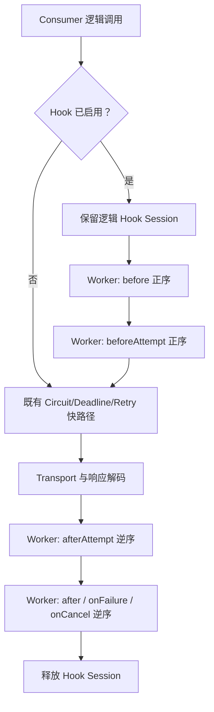
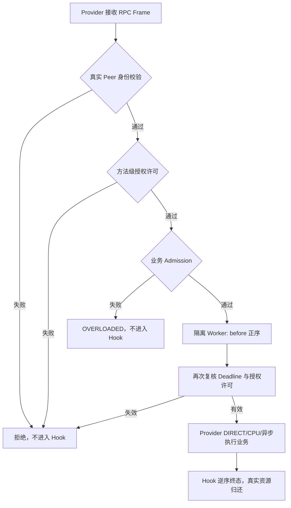

# Interceptor SPI：调用生命周期与权限边界

> 状态：V2-16（#143）候选源码契约；在相关 PR 的准确 Head 和合并后 main CI 完成前，不代表发布验收。

## 位置与默认行为

`RpcInterceptor` 适用于 OTRYX 的一条逻辑 RPC 调用，不暴露方法参数、返回值、原始认证 Header 或私钥。默认没有注册 Hook Bean 或 Builder 拦截器，**不创建 Hook Executor，也不产生每请求 Hook 事件**。只在显式启用后创建每端独立的 `RpcInterceptorRuntime`，启动阶段对集合按 `order()` 升序稳定排序。





拦截器绝不能覆盖 `RpcAuthorizer`、`RpcPeerIdentity`、安全 Profile、Schema/Manifest、Consumer 可信目录或 Wire v1 帧。Provider 的 `RpcInvocation.caller()` 来自可信 Transport 已验证的叶证书应用绑定，而不是入站 Metadata；可信开发的匿名连接为 `Optional.empty()`。Consumer 则来自实际已注册的 Application Membership。

## API 与 Starter

使用 `com.peachsoft.otryx.interceptor.RpcInterceptor` 实现 `before`、`beforeAttempt`、`afterAttempt`、`after`、`onFailure`、`onCancel`，可只覆盖所需方法：

```java
@Bean
RpcInterceptor rpcAuditInterceptor() {
    return new RpcInterceptor() {
        @Override
        public int order() {
            return 10;
        }

        @Override
        public void before(RpcInvocation invocation) {
            if (invocation.side() == RpcInvocation.Side.PROVIDER) {
                // 只检查已验证的固定身份字段，不读取 Header 中的伪造调用方身份。
                invocation.caller().ifPresent(identity -> checkAllowedCaller(identity));
            }
        }
    };
}
```

上例的 `checkAllowedCaller` 表示应用自己提供的策略函数，不是框架内置方法；真实访问控制仍必须通过 `RpcAuthorizer` 实现，不能只靠 Hook。需要补全 `@Bean`、`RpcInterceptor`、`RpcInvocation` 等相应 import。Starter 根据 Spring Bean 顺序取得列表；`order()` 决定实际调用链顺序（相同值维持注入顺序）。每一侧都运行列表，因此单侧 Hook 应通过 `invocation.side()` 区分。

```yaml
otryx:
  rpc:
    interceptor:
      workers: 4
      max-active: 512
```

此设置只在非空 Hook 列表时生效；Consumer/Provider 分别分配 Worker 与会话容量。Core Builder 可显式调用 `interceptors(List.of(hook)).interceptorExecutionLimits(4, 512)`。非法值在 Spring 配置预检或 Builder 方法中拒绝，不可动态降低权限；治理热更新由 #144 单独设计。

## 顺序、异常与 Retry

- Consumer 的 `before` 每个**已进入拦截链**的逻辑调用至多一次；`beforeAttempt` 按实际 Retry 序号分别回调。Consumer 在发送前发生目录本地重新选择仍只算原 Attempt。通常 `before` 正序，Attempt 前置正序，Attempt 完成逆序，逻辑终态逆序。
- `before` 或 `beforeAttempt` 抛异常，框架使用固定 `RpcUnavailableException` 结束 Consumer 调用、或使用固定 Provider `INTERNAL_ERROR`；原始异常文本不可传播给远端。终态 Hook 异常只按异常类型记录，不能改写已经确定的业务返回值或安全失败。
- `onCancel` 对应显式取消；Deadline 作为 `onFailure` 的 `DEADLINE_EXCEEDED`。超时/取消可能发生在 Hook 队列或执行过程中；在 Hook **真实退出**、逆序终态回调完成前，不提前释放 Session 配额。强制取消 Future 不能证明一个阻塞第三方 Hook 或底层业务已退出。
- 有界 Worker 串行执行同一个 Session 的生命周期事件，保证重试/取消/异步完成不并发重入同一会话。Consumer 原始 Deadline 从编码请求前的单调时钟起算，Hook 排队时间不能获得新的完整业务超时。
- 无法安全中断永远不返回的外部 Hook；线程采用 daemon 并由 Session 容量限流。**应用应在自己的 Hook I/O 中设置有限超时**，不允许把阻塞或长时任务放到 EventLoop。
- 这些 Hooks 只提供本地扩展上下文与生命周期观察，不允许注入 Wire 原始 Metadata 或改变认证身份；跨线程 `RpcCallContext` 在进入 Worker 时显式绑定、执行结束恢复上个线程上下文。没有将任意自定义 Trace Scope 自动升级为可信身份。
- 若独立 Hook 会话容量耗尽，新调用立即过载失败；这与 Provider 原始业务 Lease、Consumer Response Completion 容量、Transport/TLS 额度相互独立。

## 验证和剩余限制

Core 的候选回归覆盖正序/逆序、真实 Client/Provider、拒绝前无 Hook、独立 Thread、上下文不泄漏、取消后额度不提前释放和前置异常敏感内容不外泄。安全与 Quickstart 的 Maven/CI 结果必须绑定准确 PR Head 检查。

共享 CI 仅能证明正确性与基本 Smoke；Hook 开启/关闭的 `B/op`、p50/p99 延迟及 10k 并发配额必须在 #146 的固定硬件矩阵另行采集，不宣称已测得性能增益。多级授权或跨服务内部 Token 不通过拦截器模拟实现。

[中文 README](../../README.md) · [English README](../../README.en-US.md) · [SPI](../spi.md) · [Quickstart](../../otryx-quickstart/README.md)。
