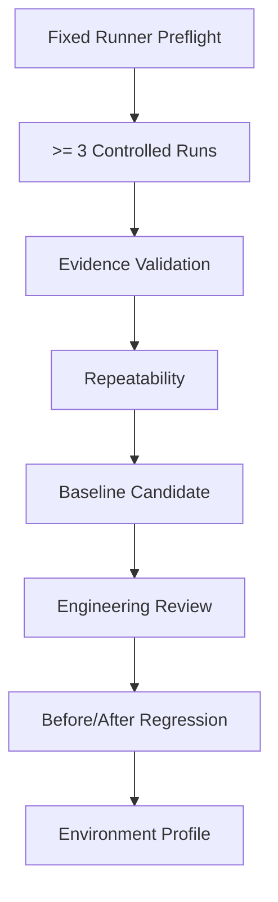
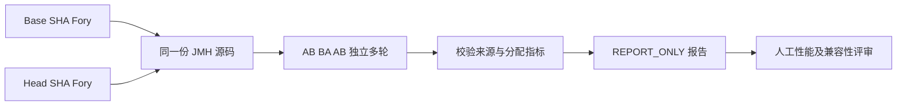

# OTRYX RPC 性能证据与容量验证

> 状态：**Tooling Current / Environment-specific Evidence Required for Numeric Claims**

## 1. 原则

OTRYX RPC 区分：

1. **性能工具是否可用**；
2. **某个固定环境的结果是否可重复**；
3. **结果是否可以晋级为容量建议或官方性能声明**。

GitHub shared runner 只用于验证工具和行为，不作为生产 SLO 来源。

## 2. 工具

仓库提供：

- JMH 参数化 Benchmark；
- payload / concurrency / connection-shard matrix；
- sample + throughput；
- `-prof gc`；
- Fory 零参数和多参数编解码分配 JMH（`scripts/run_fory_argument_allocation.sh`）；
- Provider execution/fault scenario；
- TLS/PLAINTEXT security matrix；
- Retry/Circuit/Outlier resilience matrix；
- 10k logical-concurrency Virtual Thread soak；
- Evidence validator；
- repeatability compare；
- baseline candidate；
- before/after regression closure。

## 3. Evidence 流程



## 4. 固定环境要求

至少记录：

- Commit SHA；
- JDK；
- JVM flags；
- OS/Kernel；
- CPU；
- Memory；
- Runner identity；
- physical host fingerprint；
- payload；
- concurrency；
- connection shard；
- execution/fault scenario。

不同 physical host 的结果不能自动合并为同一受控基线。

## 5. 指标

- throughput；
- p50/p99/p99.9；
- QPS/Core；
- allocation/op；
- GC；
- CPU；
- heap；
- inflight；
- connection count；
- error rate；
- overload success/error；
- failure category。

## 6. 10k Soak

10k 指 logical concurrency，不等于创建 10k TCP 连接。

正式 soak 应在目标硬件运行足够时间，至少记录：

- warmup；
- duration；
- concurrency；
- payload；
- connections；
- client timeout；
- heap/GC/CPU；
- p99/p99.9；
- error breakdown。

## 7. 性能优化门

以下候选只有 Evidence 证明收益后才进入默认路径：

- Buffer-oriented Codec；
- FrameAccumulator copy reduction（已实现的 [定向 Allocation Profiling](transport-allocation-profiling.md)，Shared Runner 的 B/op 与采样延迟仅为 Smoke）；
- Object[] elimination（当前仅零参数复用空数组；1～N 参数仍使用兼容表示）；
- Future/PendingRequest allocation reduction；
- EndpointStats/admission contention 优化；
- Compression。

## 8. GA 边界

1.0.0 可以在没有厂商级固定硬件数字的情况下发布，因为：

- 正确性、兼容性、Chaos、Release Gate 独立可验证；
- 项目不发布未经验证的官方 QPS/SLO；
- 每个使用者的 CPU、Payload、业务方法、TLS、Registry 和 JVM 都不同。

但任何官方性能比较、生产容量推荐、QPS/Core 或 p99/p99.9 数字，都必须附带本流程产生的 Evidence。

## 10. Fory 参数编解码 A/B 分配量测量

当前代码已经具有 `ForyArgumentEncodingBenchmark`，可以把**完全相同的 Benchmark 源码**复制到历史 Base worktree，再分别构建 Base 与当前 Candidate。这避免了“优化前没有相同基准代码”的比较偏差：

```bash
# 在仓库根目录，必须具备历史提交；Base 应选零参数优化前的稳定提交。
BASE_SHA="dd2bfffb7423af332d0bb071bf5e9013f49afd01"
HEAD_SHA="$(git rev-parse HEAD)"
bash scripts/run_fory_allocation_comparison.sh "$BASE_SHA" "$HEAD_SHA"
```

脚本验证两个不同的完整 Git SHA，使用同一 JDK、JVM flags、参数矩阵、`-prof gc`，以 AB/BA 顺序执行。默认每侧三轮独立样本，保留 `avgt/sample` 原始 JSON，并通过 `scripts/compare_fory_allocation.py` 检查 JDK/JMH、场景完整度、B/op、sample p99 及来源。



共享 GitHub Runner 的 PR 自动检查强制标记为 `shared-ci-smoke`，只执行一对短基准用于证明工具可运行。受控微基准需在实际固定主机上显式配置 `OTRYX_RPC_FORY_EVIDENCE_CLASS=controlled-micro`、`OTRYX_RPC_RUNNER_ID`、`OTRYX_RPC_HOST_FINGERPRINT`，至少三轮；GitHub Actions 不允许将自己声明为受控主机。**任何结果都只有 `REPORT_ONLY`，不自动给性能验收 PASS。**

报告包含相对差值与分配 CV，仍需要结合 JFR/AsyncProfiler、端到端 RPC p99/p99.9、CPU、GC 和长稳试验评估。零参数 `Object[0]` 在 JIT 优化后不一定形成实际分配；不能预设 B/op 一定下降。结果输出：`target/fory-allocation-comparison/`。

## 11. 相关文档

- [性能指南](../performance.md)
- [容量规划](capacity-planning.md)
- [生产配置](../configuration.md)
- [发布就绪](../archive/releases/release-readiness.md)


## 12. 可观测性本地基准（U10）

项目的 `ObservabilityPathBenchmark` 以相同的 `ServiceKey`、`MethodId`、成功终态比较 NOOP、Micrometer、JFR 未录制、OpenTelemetry NOOP 出口下的本地 API 路径耗时与分配：

~~~bash
./mvnw -B -ntp -pl otryx-benchmarks -am package -DskipTests
java -jar otryx-benchmarks/target/benchmarks.jar ObservabilityPathBenchmark -prof gc
~~~

该基准**不包含**网络、真实 Exporter、活动的 JFR Recording、采样处理器，也不会输出生产容量。固定环境对比需要记录 Runner/CPU/JVM/SHA/JFR 事件策略并执行至少三轮 AB/BA，再结合真实链路 p99/p99.9、heap/GC 和 10k logical-concurrency Soak 验证。目前不将缺失的受控测量宣称为验收完成。


## 13. U13 首发性能证据状态（2026-10-14）

当前已有 JMH、Allocation Profiling、Benchmark Matrix、共享 Runner 10k logical concurrency Smoke 和证据校验工具。**尚无可核验的固定物理主机、同一版本至少三轮 AB/BA 和 60 分钟正式 Soak 原始证据**，因此不宣称 U13 受控性能验收完成，也不发布官方 QPS/Core、p99/p99.9、B/op 或容量数字。

需要维护者指定真实物理主机及环境指纹、JDK/JVM 参数、负载矩阵和测前确定的验收阈值，才可运行受控实验并审批 Evidence Report。没有测量证据时不应引入猜测性的零拷贝或压缩优化；Shared Runner Smoke 仅证明工具可运行。


## 14. U13 三轮 AB/BA 固定主机证据审查

`scripts/run_v2d2_fixed_evidence.sh` 现在要求至少 **3600 秒**连续测量和 **10000 逻辑并发调用者**。`performance-evidence.yml` 的 controlled 路径要求自托管 Runner、固定主机指纹、Full Matrix、正式 Soak 和测前定义的 `soak_max_error_rate` / `soak_min_observed_inflight` / 可选 `soak_max_p99_micros`；原先受控工作流缺失的 Soak Policy Report 已被补齐。

单次运行仍不能证明低尾延迟和分配稳定性。收集两个完整 Commit 在同一硬件上的六份不可覆盖 Evidence Bundle，按 **A B B A A B** 顺序，建议把下方 JSON 存为 `target/u13-campaign.json`：

~~~json
{
  "schemaVersion": 1,
  "baselineSha": "aaaaaaaaaaaaaaaaaaaaaaaaaaaaaaaaaaaaaaaa",
  "candidateSha": "bbbbbbbbbbbbbbbbbbbbbbbbbbbbbbbbbbbbbbbb",
  "runs": [
    {"side": "baseline", "path": "u13-A1"},
    {"side": "candidate", "path": "u13-B1"},
    {"side": "candidate", "path": "u13-B2"},
    {"side": "baseline", "path": "u13-A2"},
    {"side": "baseline", "path": "u13-A3"},
    {"side": "candidate", "path": "u13-B3"}
  ]
}
~~~

这里的 SHA 仅为**格式占位符**，实际执行必须替换为两个不同的 Git 完整 SHA；六个 `path` 都相对于 Campaign JSON 所在目录。每个 Bundle 必须包含有效的 `preflight.properties`（含 JDK 主版本 21 与固定主机标识）、`environment.properties`（含带时区的 `captured_at`）、`matrix/summary.csv`、`soak.json`（含带时区的 `completedAt`）、`soak-policy/report.json`、`validation-report.json`、`decision-inputs.json` 和 `evidence-manifest.json`。校验器重新执行现有 `validate_matrix(..., "full", ...)` 完整矩阵验证，即使篡改者重新生成 Manifest 并伪造 `validation-report.json` 的 `PASS`，缺失 JMH 测试点仍必须拒绝；同时要求各轮 `environment.captured_at` 与真实 Soak `completedAt` 时间顺序严格递增、运行之间不重叠；环境 Java 版本必须解析出准确的主版本 21，不能按子串判断。

~~~bash
python3 scripts/test_u13_campaign.py
python3 scripts/check_u13_campaign.py --campaign target/u13-campaign.json --output-dir target/u13-report
~~~

校验通过仍返回 `REPORT_ONLY`（原始数据未经过独立真实性审计），输出同硬件三次 Baseline/Candidate 中位 QPS、p99 和错误率；需人工评审独立的 `gc.alloc.rate.norm`、JFR/JVM 分配剖析、CPU/GC/heap、方差/置信区间、异常拒绝和端到端 p99/p99.9，再决定是否实施特定热点改造。对每个优化候选必须额外证明 Wire、限流、取消与资源 Lease 语义无回归。

**当前工程状态：验收工具实现，真实固定 Runner 的六次长稳试验尚未执行。** 不得将测试用合成 Fixtures 或 Shared CI Smoke 表述为性能数字。
