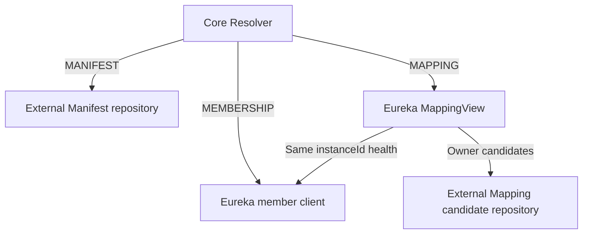

# Eureka V2 Application Membership

[中文](registry-eureka-v2.md)

> [Issue #136](https://github.com/Ryan-Guizhou/otryx-rpc/issues/136) · OTRYX RPC 1.0.0-SNAPSHOT · Current application backend. This page describes the implementation; execution evidence must identify the exact source SHA. See [acceptance boundaries](application-registry-acceptance.md).

## Members, metadata and routing

**Eureka owns application member leases.** Provider, Consumer-only and BOTH register under one native Eureka Application derived from `ApplicationKey(namespace, applicationName)`. All interfaces exported by a process share one `InstanceInfo`. A pure Consumer uses its real local IP/host and a native disabled port (`port=0`, `@enabled=false`), without an RPC endpoint.

**Etcd, Nacos or Consul owns persistent metadata.** Explicitly include one external backend exposing Manifest/Mapping repositories through `ApplicationMetadataBackend` and instance-owned candidates through `ServiceMappingCandidateSource`. The external backend does not register Eureka business members; Eureka itself provides no KV CAS.



A Mapping's ServiceKey, ApplicationKey and Owner instanceId are unverified candidates. `Eureka MappingView` requires **that same Owner instance** to be an UP Eureka Provider/BOTH with a real endpoint; an unrelated healthy Provider in the application cannot substitute for it. Core then verifies Manifest, Schema, Wire compatibility and actual service bindings. The Mapping protection descriptor retains both the external candidate source and the Eureka health source; stronger protection on one cannot hide insufficient protection on the other.

Eureka has no cross-process InstanceInfo CAS. Native IDs include a random process token to prevent two processes sharing a logical instanceId from directly overwriting each other. Duplicate logical identities in discovery fail closed; deployment still must provide unique instance IDs. The external backend supplies persistent Mapping generation CAS/fencing.

## Two independent security chains

Explicitly include `otryx-registry-eureka` and one `otryx-registry-etcd / nacos / consul` adapter. The default Starter does not include these dependencies. The old three/four-argument `RegistryOptions` constructors and `fromCsv` default to `UNSPECIFIED`; the Factory rejects startup.

For `NETWORK_MTLS`, the membership chain requires **HTTPS + explicit CA + USER_PASSWORD (HTTP Basic)**. Configure external metadata independently:

| Metadata backend | Registry protection for `NETWORK_MTLS` | Explicit development |
| --- | --- | --- |
| Etcd | HTTPS + independent CA + USER_PASSWORD | Supported |
| Consul | One HTTPS Agent + independent CA + ACL_TOKEN | Supported |
| Nacos | Unsupported; rejected before creating its SDK | `TRUSTED_DEVELOPMENT` with NONE or USER_PASSWORD |

This example uses Eureka and Consul. Both endpoints are actual deployment-supplied HTTPS URLs. `eurekaCaFile / metadataCaFile` are their respective CA-file `Path` values; `eurekaPassword / metadataAclToken` are `char[]` values from credential sources, and `eurekaUsername` is the username. `RpcSecurityProfile` belongs to `com.peachsoft.otryx.api`, `RpcObserver` to `com.peachsoft.otryx.observability`, and the security DTOs to `com.peachsoft.otryx.registry`.

```java
RegistrySecurityOptions memberSecurity = new RegistrySecurityOptions(
    Optional.of(new RegistryTlsOptions(eurekaCaFile, Optional.empty())),
    RegistryCredentials.userPassword(eurekaUsername, eurekaPassword));

RegistrySecurityOptions metadataSecurity = new RegistrySecurityOptions(
    Optional.of(new RegistryTlsOptions(metadataCaFile, Optional.empty())),
    RegistryCredentials.aclToken(metadataAclToken));

RegistryOptions options = new RegistryOptions(
    List.of(eurekaHttpsEndpoint),
    "production",
    Map.of(
        "eurekaMetadataBackend", "consul",
        "eurekaMetadataEndpoints", consulHttpsEndpoint,
        "eurekaLeaseSeconds", "30",
        "eurekaHeartbeatSeconds", "10",
        "eurekaPollIntervalMillis", "1000"),
    RpcObserver.noop(),
    RpcSecurityProfile.NETWORK_MTLS,
    memberSecurity,
    Optional.of(metadataSecurity));

EurekaApplicationRegistry registry = (EurekaApplicationRegistry)
    ExtensionLoader.getLoader(ApplicationRegistryFactory.class)
        .getExtension("eureka").create(options);
ApplicationManifestRepository manifests = registry.manifestRepository();
ServiceMappingRepository mappings = registry.serviceMappingRepository();
```

`security` protects only the Eureka membership chain; `metadataSecurity` protects only the external metadata chain. The latter inherits the same profile and logical namespace, **never the member CA, client key or password**. If omitted, it has no materials and cannot satisfy NETWORK requirements. For Etcd metadata, use `RegistryCredentials.userPassword(...)` for the second credential.

Each TLS chain verifies the server hostname and CA; HTTP redirects are disabled. Its own `RegistryTlsOptions.clientIdentity` may add a client certificate/key, but the current factories do not accept standalone `CLIENT_CERTIFICATE` instead of the required password or ACL token. DTOs defensively copy secret arrays and redact `toString()`; protection descriptors are created after actual client installation. Registry configuration does not replace RPC transport mTLS, method authorization or other Core security gates. See [security boundaries](../security.md).

For an explicitly isolated plaintext development fixture:

```java
RegistryOptions development = RegistryOptions.trustedDevelopment(
    List.of("http://127.0.0.1:8761/eureka"),
    "development",
    Map.of(
        "eurekaMetadataBackend", "consul",
        "eurekaMetadataEndpoints", "http://127.0.0.1:8500"));
```

This helper supplies no security materials. Development credentials require the seven-argument constructor, explicit `TRUSTED_DEVELOPMENT` and the two typed security configurations. Historical Map keys such as `eurekaUsername / eurekaPassword` and `eurekaMetadata.consulToken` are rejected and cannot bypass the typed boundary.

## Allowed nonsecurity options

| `providerOptions` | Default / requirement |
| --- | --- |
| `eurekaMetadataBackend` | Required: `etcd / nacos / consul` |
| `eurekaMetadataEndpoints` | Required: external backend endpoint CSV |
| `eurekaMemberHost` | Detect a real local address by default; wildcard addresses are rejected |
| `eurekaLeaseSeconds` | Default 30; 9–3600 seconds |
| `eurekaHeartbeatSeconds` | Default 10; at least 1 second and below lease |
| `eurekaPollIntervalMillis` | Default 1000; 200–60000 milliseconds |
| `eurekaRequestTimeoutMillis` | Default 3000; 100–60000 milliseconds |

`eurekaMetadata.*` forwards **only the selected backend's allowlist**, not arbitrary properties:

| Backend | Allowed complete keys |
| --- | --- |
| Etcd | `eurekaMetadata.leaseTtlSeconds` |
| Nacos | `eurekaMetadata.nacosGroup`, `eurekaMetadata.nacosCluster`, `eurekaMetadata.nacosMemberHost` |
| Consul | `eurekaMetadata.consulTtlSeconds`, `eurekaMetadata.consulHeartbeatSeconds`, `eurekaMetadata.consulPollIntervalMillis`, `eurekaMetadata.consulRequestTimeoutMillis`, `eurekaMetadata.consulEnterpriseNamespace` |

The logical namespace is shared; there is no fallback to a second namespace. Eureka and metadata permissions must each follow their actual paths. Service Metadata role/token fields are not authentication or authorization. See [Consul paths](registry-consul-v2.en-US.md) and [Etcd paths](registry-etcd.md).

## Resources, failures and freshness

The member limit is 256, subscriptions 128, control workers 2–4 and queue 256. Raw Eureka HTTP responses are capped at 4 MiB, with at most 64 HTTP requests in flight. The total HTTP budget includes connection, body and JSON parsing. Error statuses and chunked responses share the byte cap; strict UTF-8, JSON depth/scalar limits and duplicate-field checks precede metadata use. These network operations do not run on RPC EventLoops.

Genuine DOWN or unroutable members may be filtered by health, but malformed or foreign V2 declarations must cause a security rejection. TLS, authentication, authorization, reference, integrity and response-limit failures expose stable `RegistrySecurityException.reason()` values without raw causes or response bodies; they cannot publish healthy empty directories. Core security epochs immediately invalidate old snapshots, including another route that has not refreshed. Ordinary network failures retain bounded LKG semantics.

A 404 lease renewal triggers re-registration. Unregister deletes only this process's native ID. External `lookupCandidateOwners` results must never go directly to a load balancer. Ordinary Etcd/Consul `lookup` still checks its own Member Leases; only composed candidate reads bypass another Registry's leases before Eureka checks actual membership health. Persistent generation tombstones and Manifest revisions are retained for rollout, rollback and fencing; no automatic GC is provided.

`directory-max-staleness` bounds LKG use only after an explicit synchronization failure. Parsed and validated HTTP 200 responses, and HTTP 404 responses handled as an empty application, count as successful synchronization. Such success does not signal that the server cache has incorporated the latest member changes. Core cannot infer cache lag from it; the budget is not a maximum age for server cache contents. See [directory freshness](registry-freshness.md).

## Real-service verification and fixture limits

The [Eureka workflow](../../.github/workflows/eureka-v2.yml) `real-eureka` job runs JDK 21, an isolated Spring Boot 3.5.4 / Spring Cloud 2025.0.0 Eureka Server and real Consul KV. Cases include all three roles, the native disabled Consumer port, metadata CAS, instance conflicts, lost leases and a real Eureka JVM restart. This plaintext fixture verifies registration/recovery contracts; it is not evidence that both TLS/credential chains have passed real deployment validation.

The server lives under `.github/test-fixtures/eureka-server`, outside the RPC Reactor, and adds no second production Starter. Shared contracts use 30 real Java interfaces and ten independent Registry client objects in one test JVM. Separate business-JVM process/chain/revision scenarios run in the [application-registry-e2e workflow](../../.github/workflows/application-registry-e2e.yml). Native membership `0→10→0`, SPI entries, subscription creation, snapshot/health notifications and convergence times are measured separately, not as total HTTP, renewal or Watch traffic. Check actual execution and conditional skips against the exact SHA, job/step and original reports.

The isolated fixture sets `eureka.server.use-read-only-response-cache=false`, disabling only the read-only layer. The read-write cache retains its own invalidation and expiration behavior. `eureka.server.response-cache-auto-expiration-in-seconds=1` sets write-based expiration to one second; subsequent queries reload expired entries. `eureka.server.response-cache-update-interval-ms` is not the read-write cache expiration time.

These settings define isolated CI convergence conditions. They are not a production adapter fix and do not guarantee convergence within 25 seconds under production Eureka defaults. See the [engineering checkpoint](../engineering/agent-governance-checkpoint.md) and [acceptance boundaries](application-registry-acceptance.md) for actual configuration, execution evidence and gates.

Implementation references: [Factory](../../otryx-registry/otryx-registry-eureka/src/main/java/com/peachsoft/otryx/registry/eureka/EurekaApplicationRegistryFactory.java), [composed Registry](../../otryx-registry/otryx-registry-eureka/src/main/java/com/peachsoft/otryx/registry/eureka/EurekaApplicationRegistry.java), [RegistryOptions](../../otryx-core/src/main/java/com/peachsoft/otryx/registry/RegistryOptions.java), [HTTP boundary](../../otryx-registry/otryx-registry-http/src/main/java/com/peachsoft/otryx/registry/http/HttpRegistryClient.java), [Resolver](../../otryx-core/src/main/java/com/peachsoft/otryx/registry/ApplicationServiceResolver.java).
