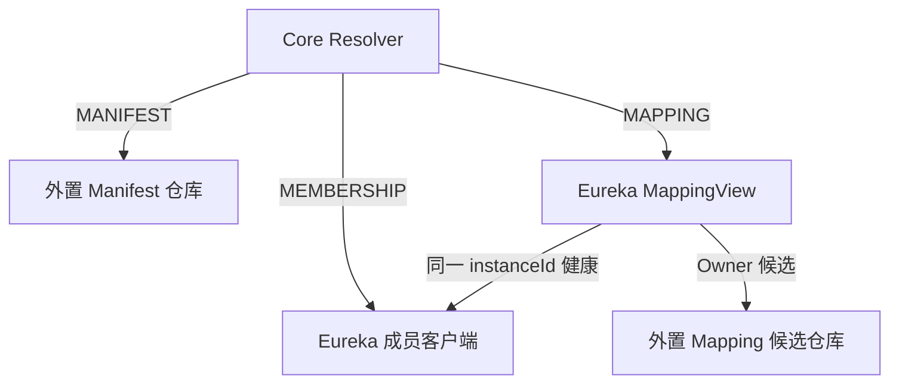

# Eureka V2 应用级注册

[English](registry-eureka-v2.en-US.md)

> [Issue #136](https://github.com/Ryan-Guizhou/otryx-rpc/issues/136) · OTRYX RPC 1.0.0-SNAPSHOT · 当前应用级后端。本文描述当前实现；执行证据须绑定准确源码 SHA，见[验收边界](application-registry-acceptance.md)。

## 一、成员、元数据与路由

**Eureka 管理应用成员租约**。Provider、Consumer-only、BOTH 按 `ApplicationKey(namespace, applicationName)` 的确定性散列注册到一个原生 Eureka Application。同一进程所有接口共享一个 `InstanceInfo`。纯 Consumer 使用真实本机 IP/Host、原生 `port=0` 且 `@enabled=false`，不发布 RPC Endpoint。

**Etcd、Nacos 或 Consul 管理持久元数据**。必须显式引入一个外置后端，通过 `ApplicationMetadataBackend` 取得 Manifest/Mapping 仓库，并通过 `ServiceMappingCandidateSource` 读取按实例拥有的候选。外置后端不注册 Eureka 业务成员；Eureka 本身不提供 KV CAS。



Mapping 返回的 ServiceKey、ApplicationKey 和 Owner instanceId 是未验证候选。`Eureka MappingView` 要求**同一 Owner 实例**是 Eureka UP、Provider/BOTH 且有真实端点；不能以同应用另一个健康 Provider 替代。Core 继续核对 Manifest、Schema、Wire 与实际服务绑定。Mapping 的保护描述同时保留外置候选来源和 Eureka 成员健康来源，任一来源保护不足都不能被另一个来源覆盖。

Eureka 没有跨进程 InstanceInfo CAS。Native ID 包含进程随机 token，避免同逻辑 instanceId 的两个进程直接覆盖；发现重复逻辑身份时失败关闭，部署仍须保证实例 ID 唯一。持久 Mapping generation 的 CAS/fencing 由外置后端承担。

## 二、两条独立安全链

显式引入 `otryx-registry-eureka`，并引入一个 `otryx-registry-etcd / nacos / consul` 适配器。默认 Starter 不包含这些依赖。旧三参/四参 `RegistryOptions` 及 `fromCsv` 默认 `UNSPECIFIED`，Factory 拒绝启动。

`NETWORK_MTLS` 的成员链要求 **HTTPS + 显式 CA + USER_PASSWORD（HTTP Basic）**。外置元数据独立配置，当前支持边界为：

| Metadata Backend | `NETWORK_MTLS` 的 Registry 保护 | 显式开发场景 |
| --- | --- | --- |
| Etcd | HTTPS + 独立 CA + USER_PASSWORD | 支持 |
| Consul | 单个 HTTPS Agent + 独立 CA + ACL_TOKEN | 支持 |
| Nacos | 不支持，在创建 Nacos SDK 前拒绝 | `TRUSTED_DEVELOPMENT`，NONE 或 USER_PASSWORD |

以下示例使用 Eureka + Consul。两个 endpoint 均为部署提供的实际 HTTPS URL；`eurekaCaFile / metadataCaFile` 是各自 CA 的 `Path`，`eurekaPassword / metadataAclToken` 是凭据来源提供的 `char[]`，`eurekaUsername` 为用户名。`RpcSecurityProfile` 位于 `com.peachsoft.otryx.api`，`RpcObserver` 位于 `com.peachsoft.otryx.observability`，安全 DTO 位于 `com.peachsoft.otryx.registry`。

```java
RegistrySecurityOptions memberSecurity = new RegistrySecurityOptions(
    Optional.of(new RegistryTlsOptions(eurekaCaFile, Optional.empty())),
    RegistryCredentials.userPassword(eurekaUsername, eurekaPassword));

RegistrySecurityOptions metadataSecurity = new RegistrySecurityOptions(
    Optional.of(new RegistryTlsOptions(metadataCaFile, Optional.empty())),
    RegistryCredentials.aclToken(metadataAclToken));

RegistryOptions options = new RegistryOptions(
    List.of(eurekaHttpsEndpoint),
    "production",
    Map.of(
        "eurekaMetadataBackend", "consul",
        "eurekaMetadataEndpoints", consulHttpsEndpoint,
        "eurekaLeaseSeconds", "30",
        "eurekaHeartbeatSeconds", "10",
        "eurekaPollIntervalMillis", "1000"),
    RpcObserver.noop(),
    RpcSecurityProfile.NETWORK_MTLS,
    memberSecurity,
    Optional.of(metadataSecurity));

EurekaApplicationRegistry registry = (EurekaApplicationRegistry)
    ExtensionLoader.getLoader(ApplicationRegistryFactory.class)
        .getExtension("eureka").create(options);
ApplicationManifestRepository manifests = registry.manifestRepository();
ServiceMappingRepository mappings = registry.serviceMappingRepository();
```

`security` 只保护 Eureka 成员链，`metadataSecurity` 只保护外置元数据链。后者继承同一 profile 和逻辑 namespace，**不继承成员 CA、客户端密钥或密码**；省略后为无材料配置，不能满足 NETWORK 要求。Etcd 元数据应将第二份凭据改为 `RegistryCredentials.userPassword(...)`。

每条 TLS 链都校验服务端主机名及 CA，HTTP 不跟随重定向。可通过各自 `RegistryTlsOptions.clientIdentity` 添加客户端证书/私钥，但当前 Factory 不接受以单独 `CLIENT_CERTIFICATE` 取代必需的密码或 ACL Token。DTO 对秘密数组做防御复制并隐藏 `toString()`；实际客户端安装后才生成保护描述。Registry 配置不能代替 RPC 传输 mTLS、方法授权和其他 Core 安全门禁，见[安全边界](../security.md)。

明确隔离的明文开发夹具可用：

```java
RegistryOptions development = RegistryOptions.trustedDevelopment(
    List.of("http://127.0.0.1:8761/eureka"),
    "development",
    Map.of(
        "eurekaMetadataBackend", "consul",
        "eurekaMetadataEndpoints", "http://127.0.0.1:8500"));
```

该 helper 不提供安全材料。开发环境需要凭据时使用七参构造、显式 `TRUSTED_DEVELOPMENT` 与两份 typed 安全配置。历史 `eurekaUsername / eurekaPassword`、`eurekaMetadata.consulToken` 等 Map 凭据键均被拒绝，不能作为旁路。

## 三、允许的非安全选项

| `providerOptions` | 默认/要求 |
| --- | --- |
| `eurekaMetadataBackend` | 必填：`etcd / nacos / consul` |
| `eurekaMetadataEndpoints` | 必填：外置后端 endpoint CSV |
| `eurekaMemberHost` | 默认探测真实本机地址；不能为通配地址 |
| `eurekaLeaseSeconds` | 默认 30，范围 9–3600 秒 |
| `eurekaHeartbeatSeconds` | 默认 10，至少 1 秒且小于 lease |
| `eurekaPollIntervalMillis` | 默认 1000，范围 200–60000 毫秒 |
| `eurekaRequestTimeoutMillis` | 默认 3000，范围 100–60000 毫秒 |

`eurekaMetadata.*` **只转发所选后端的以下白名单**，不是任意属性透传：

| 后端 | 允许的完整键 |
| --- | --- |
| Etcd | `eurekaMetadata.leaseTtlSeconds` |
| Nacos | `eurekaMetadata.nacosGroup`、`eurekaMetadata.nacosCluster`、`eurekaMetadata.nacosMemberHost` |
| Consul | `eurekaMetadata.consulTtlSeconds`、`eurekaMetadata.consulHeartbeatSeconds`、`eurekaMetadata.consulPollIntervalMillis`、`eurekaMetadata.consulRequestTimeoutMillis`、`eurekaMetadata.consulEnterpriseNamespace` |

逻辑 namespace 必须一致；不会偷偷回退到第二个 namespace。Eureka 与元数据后端需要各自实际路径的权限；Service Metadata 中的 role/token 不构成认证授权。Consul KV 路径见 [Consul 参考](registry-consul-v2.md)，Etcd 路径见 [Etcd 参考](registry-etcd.md)。

## 四、资源、失败与新鲜度

成员最多 256、订阅最多 128，控制线程 2–4、队列 256；Eureka 原始 HTTP 响应最多 4 MiB，HTTP 在途请求最多 64。HTTP 总预算包含连接、响应体和 JSON 解析，错误状态与 chunked 响应同样受字节限制；严格 UTF-8、JSON 深度/标量限制和重复字段检查先于元数据使用。RPC EventLoop 不执行这些网络调用。

合法 DOWN 或不可路由成员可以健康过滤，但损坏或异源 V2 声明必须安全拒绝。TLS、认证、授权、错误引用、完整性或响应超限返回稳定 `RegistrySecurityException.reason()`，不泄露原始 cause 或响应正文，不能发布健康空目录。Core 的安全 epoch 使旧快照立即失效，包括另一条尚未刷新路由；普通网络故障仍受有界 LKG 规则约束。

lease 续期收到 404 时重新注册；注销只删除本进程原生 ID。外置 `lookupCandidateOwners` 严禁直接送入负载均衡器；Etcd/Consul 普通 `lookup` 仍检查自身 Member Lease，只有组合候选读取跳过另一个注册中心的 Lease，再由 Eureka 核对实际成员健康。持久 generation 墓碑和 Manifest 不自动 GC，保留滚动、回滚及 fencing 语义。

`directory-max-staleness` 只限制明确同步失败后的 LKG 使用时间。解析校验通过的 HTTP 200、以及按空应用处理的 HTTP 404，均算成功同步。服务端缓存尚未反映成员变化时，这类成功响应不会自动变成失败；Core 无法据此识别缓存滞后，预算也不是服务端缓存内容的年龄上限。详见[目录新鲜度](registry-freshness.md)。

## 五、真实服务验证与夹具边界

[Eureka workflow](../../.github/workflows/eureka-v2.yml) 的 `real-eureka` job 使用 JDK 21、Spring Boot 3.5.4 / Spring Cloud 2025.0.0 的独立真实 Eureka Server 与真实 Consul KV。场景包含三种角色、Consumer 原生禁用端口、元数据 CAS、多实例冲突、lease 丢失以及真实 Eureka JVM 重启。该明文夹具验证注册与恢复合同，不能充当两条 TLS/凭据链已经通过真实部署验证的证据。

服务器位于 `.github/test-fixtures/eureka-server`，不属于 RPC Reactor，也不会引入第二个生产 Starter。共享合同使用 30 个真实 Java 接口 × 10 个独立 Registry client 对象，位于一个测试 JVM；业务 JVM process/chain/revision 另由 [application-registry-e2e workflow](../../.github/workflows/application-registry-e2e.yml) 执行。原生成员 `0→10→0`、SPI 入口、订阅创建、快照/健康通知和收敛时间分别计量，不等于全部 HTTP、续租或 Watch 流量。实际执行与条件跳过须按准确 SHA、job/step 和原始测试报告核对。

隔离夹具设置 `eureka.server.use-read-only-response-cache=false`，只停用只读层；读写缓存仍使用自己的失效与过期机制。`eureka.server.response-cache-auto-expiration-in-seconds=1` 将读写缓存写入后过期设为一秒，由后续查询重新加载。`eureka.server.response-cache-update-interval-ms` 不是读写缓存过期时间。

这些参数只界定隔离 CI 收敛条件，不构成生产 Adapter 修复，也不保证生产 Eureka 默认配置在 25 秒内收敛。实际配置、执行记录与门槛见[工程断点](../engineering/agent-governance-checkpoint.md)及[验收边界](application-registry-acceptance.md)。

实现依据：[Factory](../../otryx-registry/otryx-registry-eureka/src/main/java/com/peachsoft/otryx/registry/eureka/EurekaApplicationRegistryFactory.java)、[组合 Registry](../../otryx-registry/otryx-registry-eureka/src/main/java/com/peachsoft/otryx/registry/eureka/EurekaApplicationRegistry.java)、[RegistryOptions](../../otryx-core/src/main/java/com/peachsoft/otryx/registry/RegistryOptions.java)、[HTTP 边界](../../otryx-registry/otryx-registry-http/src/main/java/com/peachsoft/otryx/registry/http/HttpRegistryClient.java)、[Resolver](../../otryx-core/src/main/java/com/peachsoft/otryx/registry/ApplicationServiceResolver.java)。
