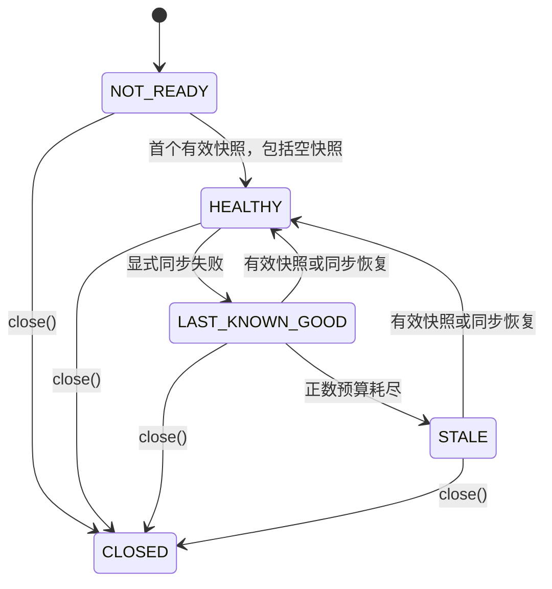

# Registry 健康状态、Last-Known-Good 与故障恢复（U09）

## 使用和边界

Consumer 的请求热路径只读取本地服务目录，不执行远端 Registry IO。默认保留最近已知有效快照
（Last-Known-Good，LKG），避免短暂控制面失联直接清空可路由实例。显式正数预算可禁止无限期使用过期节点：

```yaml
otryx:
  rpc:
    client:
      directory-max-staleness: 10s
```

`directory-max-staleness` 默认 `0s`（不限制）。只有 Adapter 明确报告
`RegistryListener.onSynchronizationFailed(error)`，Core 才启动本地单调计时。
安静且无变更的健康 Watch 不能被判为失联；成功的远端校对即使内容未变，也可报告
`onSynchronizationSucceeded()`。程序化入口：
`OtryxRpcClient.builder().directoryFreshnessOptions(
new RpcDirectoryFreshnessOptions(Duration.ofSeconds(10)))`。

## 状态机



状态在读取时判断，`STALE` 不依赖额外的超时线程。默认 0s 永远不因陈旧预算进入 `STALE`。

| 状态 | 原因 | 路由 |
| --- | --- | --- |
| `NOT_READY` | 尚未获得首个有效快照 | 不路由；同步失败不能伪造空快照 |
| `HEALTHY` | 快照可用且同步健康 | 正常路由；真实健康空列表代表没有节点 |
| `LAST_KNOWN_GOOD` | 后续同步失败且未超出启用的窗口 | 保留最近的有效节点 |
| `STALE` | 显式失败且启用的窗口耗尽 | 拒绝向旧节点发送请求 |
| `CLOSED` | 订阅关闭 | 不路由、丢弃迟到更新 |

Etcd Revision 来自服务端，Nacos、Consul、Eureka 的 Revision 仅在适配器进程内递增，
不得当作跨机全局时钟；乱序快照不会覆盖新快照。ServiceKey / Namespace 均独立隔离。

## 适配器故障恢复

| 适配器 | 当前实现 | 限制 |
| --- | --- | --- |
| Etcd（U09-B） | Range/Watch 失败和成功通知、Compaction 重建、代次隔离、单飞刷新与 Lease 恢复 | 真实远端 Revision |
| Nacos（U09-C） | 订阅失败后低频重试、NamingEvent 合并、查询失败保持 LKG、静默成功恢复 | Ephemeral Provider 主要依赖 Nacos SDK 恢复 |
| Consul/Eureka（U09-D） | 有界线程/队列、单飞轮询、同步失败/恢复通知、指数退避 | 无原生 Watch 和跨机 Revision |

首次发现失联保持 `NOT_READY`，不会把失败解释为健康空目录。SDK 自行续约成功不等于 RPC 数据面
零停顿；默认无限 LKG 也可能路由到已退役节点，需要联合配置 Timeout、熔断与业务级故障恢复策略。

## 诊断契约

Consumer `OtryxRpcClient.attempt()` 无可选节点时生成 `RpcUnavailableException`，
通过 `RpcObserver.onClientAttemptCompleted()` 暴露 `RpcStatus.UNAVAILABLE` 和异常。
以下文案可用于开发排错，不是稳定 Machine-Readable Code：

- `Registry directory has no initial snapshot for ...`：初始未就绪
- `Registry directory freshness budget exceeded for ...`：LKG 超出预算
- `Registry directory has been closed for ...`：目录关闭
- `No available instance for ...`：健康目录中没有可选实例

当前**没有**单独的 Directory Status 指标。不要把动态异常、Metadata、用户输入或具体 Endpoint
当作指标标签；后续如需分类指标应先定义低基数枚举。

## 真实独立 JVM 复现

在**隔离测试环境**启动 Nacos 3.2.4（Docker）、使用 JDK 21 和 Maven，在仓库根目录执行：

```bash
mvn -B -ntp clean verify -Pquality
mvn -B -ntp -pl otryx-quickstart -am clean package
OTRYX_RPC_E2E_RESTART_NACOS=true OTRYX_RPC_E2E_MAX_STALENESS=3s \
  bash scripts/run_quickstart_process_e2e.sh
```

E2E 保持两个独立 Java 进程中的长生命周期 Consumer/Provider，包含 Provider 重启、
Nacos 容器重启、对仍运行 Provider 注册的全新 Consumer 探测，以及 Provider
19090→19091 端口迁移后旧 Consumer 的恢复。脚本成功等待有限；失败时打印受控进程日志。
它**不能**证明每次故障都进入 `STALE`：短暂失联可能快于同步失败检测周期。
`ServiceDirectoryTest` / `OtryxRpcClientResilienceTest` 的确定性时间与故障注入
才验证拒绝和恢复；`EtcdRegistryIntegrationTest` 验证 Lease/Compaction，
`NacosRegistrySubscriptionHealthTest` 与 `HttpRegistryTest` 验证明确健康通知。
真实 Consul/Eureka Server 故障转移和集群条件属于额外外部验收，不以 Mock 声称已验证。

该任务保持 JDK 21、`1.0.0-SNAPSHOT`、Wire v1 不变，不实际发布。
