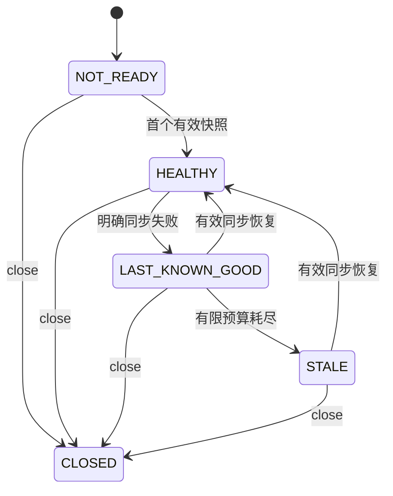

# 应用目录新鲜度与故障恢复

## 1. 使用和边界

Consumer 请求热路径只读取本地已验证服务目录，不访问远端 Registry。应用控制面完成 ServiceMapping、应用成员、实例 Manifest 和业务契约校验后发布候选；同步失败时仅在有限预算内使用最近已知有效快照（Last-Known-Good，LKG）。

```yaml
otryx:
  rpc:
    client:
      directory-max-staleness: 10s
```

Core 与 Starter 的默认预算均为 `30s`，配置必须严格为正且可表示为有限计时预算。`0s`、负值和无法表示的超大时长直接失败，不能变成永久保留过期节点。程序化入口为 `OtryxRpcClient.builder().directoryFreshnessOptions(new RpcDirectoryFreshnessOptions(Duration.ofSeconds(10)))`；Resolver 的 `maxStale` 也必须有限且为正。

`ApplicationRegistryListener` 区分快照更新、同步成功与同步失败。安静且内容未变的健康 Watch 不代表断网；一次明确成功的校对可恢复健康，但单独健康通知不能将非空成员目录清空。首次读取失败不能伪造健康空快照。

## 2. 本地目录状态

以下状态用于解释路由行为，不是额外的公共 Java enum 或配置选项。



状态由本地单调时钟和当前应用控制面结果决定，不能通过墙上时钟回拨延长预算。健康空目录表示当前无可用 Provider；纯 Consumer 成员可以继续存在。

一次成功刷新会产生新的已验证候选，即使公开内容相同，旧候选的凭据也会退役。若 Resolver 已提交新的健康候选，而本地目录的成功发布回调仍在排队，已经初始化的目录可在一次本地读取中补齐新候选的端点投影。投影来自该新候选本身，并重新校验其来源、路由和安全代次；旧 Selection 继续失效，Provider 被移除后的合法空快照也会生效。

这次补投影只读取内存，最多进行一次 CAS，不触发远端查询或等待。原目录的成功同步时间、故障状态和 LKG 起点全部保留；真正的成功发布回调执行后才更新同步状态。本地重复读取不能延长 LKG 截止点，Resolver 的 LKG 候选也不会通过补投影变成新的成功同步。初次未就绪、到期、关闭和安全拒绝仍按各自边界处理。

| 状态 | 路由行为 |
| --- | --- |
| NOT_READY | 不路由，等待首个完整成功的发现结果 |
| HEALTHY | 只路由通过成员、Manifest 和业务契约校验的 Provider/BOTH |
| LAST_KNOWN_GOOD | 在剩余陈旧预算内保留最近有效候选 |
| STALE | 拒绝使用预算已耗尽的候选 |
| CLOSED | 不路由，丢弃迟到更新和回调 |

Etcd Revision 来自服务端；Nacos、Consul、Eureka 的目录 Revision 是 Adapter 进程内的顺序，不是跨主机全局时钟。应用、Namespace、业务 ServiceKey 和 Mapping Owner 的隔离共同限制候选范围。

## 3. 后端恢复

| 后端 | 当前应用级机制 | 外部验收 |
| --- | --- | --- |
| Etcd | Range/Watch、Compaction 重建、租约恢复和代次隔离 | 三节点 leader transfer、成员 Lease 丢失、恢复 |
| Nacos | Naming 事件与定期健康校对、失败重订阅、SDK 临时成员恢复 | pause/unpause、服务端重启、Provider 端点变化 |
| Consul | Agent TTL + Session Claim、有界轮询、失败/恢复通知 | Agent pause/recovery、ACL 拒绝、TTL/Session 丢失 |
| Eureka | Lease 续约、404 重注册、健康轮询，独立 Consul Metadata | 真实 Eureka JVM 重启、恢复与 Owner 健康交叉校验 |

短时 RPC 恢复不证明每次故障都经过 STALE：断网可能短于失败检测周期。状态、陈旧截止点和关闭后迟到事件由确定性 Core 测试验证；SDK 自行续约成功也不等于 RPC 零停顿。

## 4. 诊断与实测

无可用候选时 Client 通过 `RpcUnavailableException`、`RpcStatus.UNAVAILABLE` 和 `RpcObserver` 报告失败。动态异常、Metadata、应用输入和具体 Endpoint 不能作为高基数 Metrics 标签。具体异常文案用于开发排错，不是稳定机器协议。

已有 Nacos 重启场景仍使用原命令，保持同一个长生命周期 Consumer JVM：

```bash
OTRYX_RPC_E2E_RESTART_NACOS=true OTRYX_RPC_E2E_MAX_STALENESS=3s \
  bash scripts/run_quickstart_process_e2e.sh
```

该命令要求唯一受控本地 Nacos 3.2.4 Docker 容器；它依次验证 Provider 停止/恢复、Nacos 重启、全新 Consumer 探测和 Provider `19090→19091` 端点迁移。受控测试脚本不会用观察读取失败冒充空目录。

Etcd、Consul、Eureka 独立进程运行与 Chaos 门禁见 [应用级注册验收](application-registry-acceptance.md)。观察脚本记录的 `convergenceSeconds` 包含进程启动、读取与重试开销，是该阶段外部观察的耗时；共享契约测试中的收敛计时具有不同起点。二者不能替换成全部后端流量、生产延迟分布或正式容量结论。
