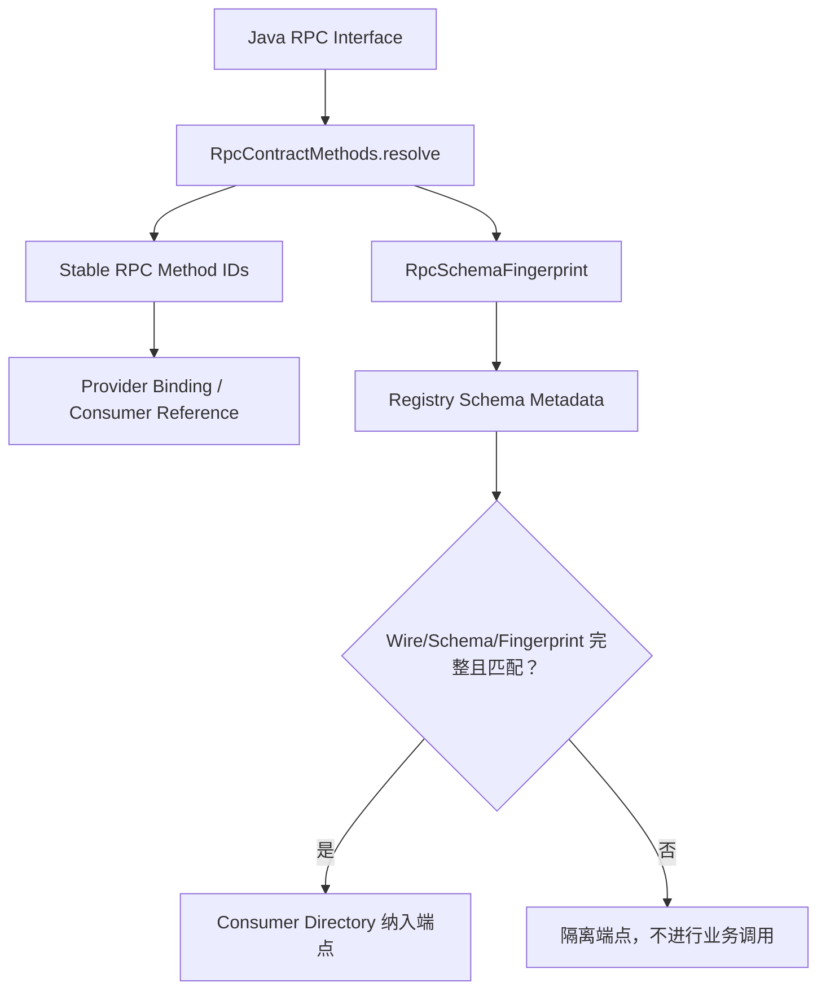

# RPC 有效方法与 Schema 结构指纹

状态：**U06 契约治理候选，适用于 1.0.0-SNAPSHOT**。本文只描述本轮已经实现或作为下一阶段明确标注的功能。

## 有效方法集合

`RpcContractMethods.resolve(api)` 是反射 Consumer、Provider 与 Schema 的共同事实来源。有效远程方法限 Java Interface 上的 public abstract 实例方法；排除 Object、default、static、bridge、synthetic。接口级嵌套泛型的完整类型重绑定仍需与 Codegen 共同验证，泛型方法声明会在绑定时明确报错。

编译期 `OtryxRpcContractProcessor` 同样过滤非抽象方法和 Object 方法，且拒绝泛型方法声明。JDK Proxy fallback 的 default 方法应在代理进程本地执行，不应产生 Transport 请求；Generated Stub 自然继承接口 default 实现。

## DTO 结构规则

相同 ServiceKey 的哈希输入包含排序后的有效 RPC 方法、完整参数/返回泛型、用户 DTO 的 Record Components 与非 static/non transient 字段。自定义参数化 DTO 还需要展开原始类型的字段与实际类型变量，父类继承字段参与计算，枚举常量集合参与计算。递归 DTO 会以稳定标记截断，避免无限递归；反射 Field 顺序不会影响结果。

回归测试使用 `JavaCompiler` 与隔离 `URLClassLoader` 构造**同一个全限定名**的不同二进制类，确认 DTO 字段增删、参数化 DTO 本身的字段变化及 Enum 新增常量都会改变 Fingerprint。仅对照两个不同类名并不足以证明结构检测。

## Registry 兼容策略

Provider 发布 `peach.rpc.protocol.version`、`peach.rpc.schema.version` 和 `peach.rpc.schema.fingerprint`。Consumer 对元数据缺失、版本不一致、指纹不匹配全部判为 `INCOMPATIBLE`，从本地目录过滤，不允许回退到未声明兼容性的旧快照。这个严格策略只适用于尚未发布的 `1.0.0-SNAPSHOT` 演进；已发布版本的滚动策略应另行设计。

## 尚不等同的事项

- `RpcTypeIds` / Fingerprint 是稳定身份和结构比对，不代表 Fory Native Payload 已使用相同数字 Type ID。
- 对象结构哈希不自动建立 Fory STRICT_ALLOWLIST，U07/U05 才负责序列化 Type Model、安全绑定与显式启动策略。
- 此契约仍需经过 Generated 与 fallback 混合 JVM 回归、独立 ClassLoader DTO 变更测试、同代 Rolling Compatibility 和完整 Maven 门禁，不可仅凭理论判断发布兼容。
- 未经确认不会修改 Maven GAV、`1.0.0-SNAPSHOT`、已有 Wire v1 固定头或发布 Tag。
