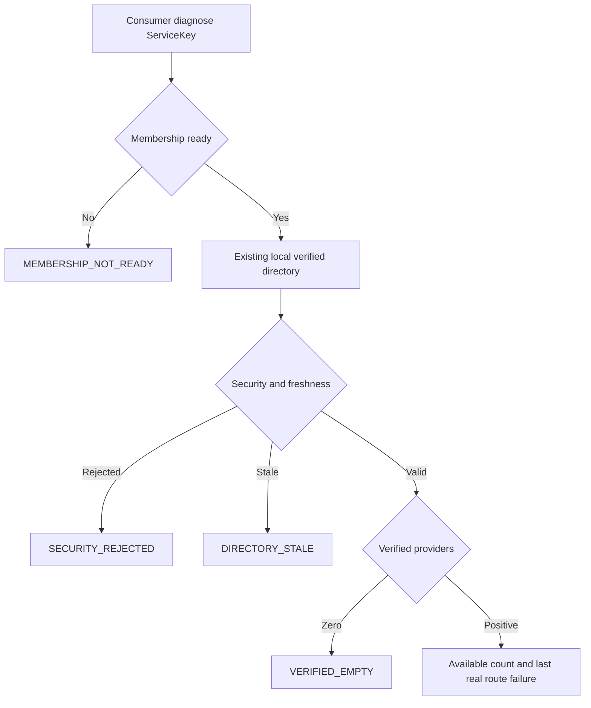

# OTRYX RPC 本地运行时诊断（V2-18）

> Current: Consumer 显式只读查询、固定原因指标/JFR 和 Provider 编码预算水位。不是远程 Registry 查询，也不声称测量 JVM 总内存。

## 使用方法

```java
ServiceKey key = new ServiceKey("com.example.GreetingService", "1.0.0", "default");
RpcServiceDiagnosticSnapshot result = client.diagnose(key);
System.out.println(result.directoryState() + " " + result.reason());
RpcResponseBufferDiagnosticSnapshot buffer = server.responseEncodingDiagnostics();
```

诊断只读取已通过 `refer()` 创建的本地 `ServiceDirectory` / 已验证的 `ApplicationServiceResolver`。未创建订阅返回 `NOT_REFERENCED`，不会隐式订阅或执行 Registry/Metadata IO、用户 Router、配置回滚、业务 Codec 或网络访问。

## 状态与原因

- `MEMBERSHIP_NOT_READY`：Consumer 应用未完成成员登记；Consumer 不得伪造 Provider RPC Endpoint。
- `NOT_READY`：尚无有效初始 Manifest/Mapping/成员/Schema 验证快照。
- `HEALTHY`：本地最近有效快照；如果已验证 Provider 为零，则原因 `VERIFIED_EMPTY`。此计数不能仅凭本地视图精确区分 Mapping Miss 与合法空目录。
- `LAST_KNOWN_GOOD`：显式同步故障后仍在正数有限缓存期内，不代表新的健康刷新。
- `STALE`：超过 LKG 期限，候选强制不路由。
- `SECURITY_REJECTED`：校验失败时固定枚举 Fail Closed，不输出凭证或私密异常。
- `CLOSED`：已经关闭的 Client 或目录不继续提供路由。
- `ROUTER_FILTERED_ALL` / `GOVERNANCE_FILTERED_ALL`：**同一可信快照上最近一次实际 RPC 调用**的筛选结果，诊断绝不重新执行自定义 Router。后续真正选中可信端点时清除历史标记。
- `NO_HEALTHY_ENDPOINT`：存在可信 Provider，但本地负载均衡不能选中可用候选，不代表 Registry 安全性已改变。

## 只读数据流



## Observability

`RpcObserver.onClientDirectoryFailure(RpcDirectoryFailureReason)` 仅对真实 RPC 失败分支调用一次首次逻辑尝试事件；`RpcObserver.noop()` 不构造动态事件对象，Composite 隔离导出器失败。Micrometer `otryx.rpc.client.directory.failures` 标签只有有限枚举 `reason`，不含 ServiceKey、InstanceId、Endpoint 或自定义字符串。JFR 重用固定字段 Recovery Event（`domain=directory`，`action=reason`）。现有 Registry、TLS、重试与 Admission 事件继续独立工作。

Provider 的 `responseEncodingDiagnostics()` 读取编码临时输出数组、扩容复制和最终 Frame 分配的预算、历史水位；**不代表** Codec 对象图、全进程 Heap、DirectMemory、内核 Socket Buffer 或 SSL 堆外对象。与 [性能证据](performance-evidence.md) 的资源采样应分别解读。

## 排障原则

先核对 Consumer 本地成员 readiness；再检查目录 state、verifiedProviders、usableProviders 与 mappingRevision；最后核对是否有最近实际的 Router/Governance 空集失败。诊断查询不能代替真实后端 Chaos、合法身份审计或固定物理机容量实验。
