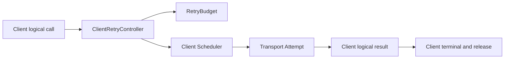
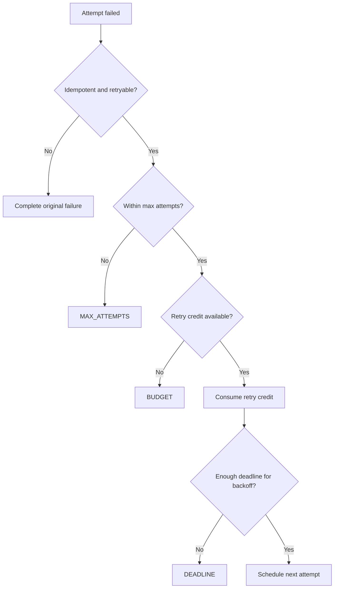

# OTRYX RPC 运行时资源所有权与内部策略（U12）

> 当前源码：1.0.0-SNAPSHOT / JDK 21 / Wire v1。本文描述已抽取的内部职责，不是新的公共 Java API。

## 单次逻辑调用的归属

| 对象 | 拥有的状态或动作 | 负责释放 / 取消的主体 |
|---|---|---|
| `OtryxRpcClient` | Pending Future、终态、Trace、传输请求、Completion Executor | Client 的 complete / cancel / shutdown |
| `ClientRetryController` | 可重试性、MaxAttempts、Backoff、RetryBudget 准入的决策 | 不直接持有网络资源，不触发终态 |
| `RetryBudget` | Consumer 共享重试额度 | Consumer 生命周期 |
| `ServiceDirectory` | 本地 Registry Snapshot 和 Subscription | Client shutdown |
| `OtryxRpcServer` | Provider Admission Permit、Invocation/Response、请求 Deadline | 服务响应终态或关闭控制 |
| `RpcShutdownBudget` | 单次关闭的单调时钟截止点 | 无活动资源，随关闭流程对象回收 |

## Retry 决策原顺序

1. 未显式声明幂等、或失败不可重试：立即以原错误终结，不上报 retry-exhausted。
2. Attempt 达到 MaxAttempts：上报 `MAX_ATTEMPTS`，不消耗额度。
3. RetryBudget 没有额度：上报 `BUDGET`。
4. **先扣额度再检查**剩余 Deadline/Backoff；预算不足：上报 `DEADLINE`，维持原实现的额度消耗顺序。
5. 仅允许决策由 Client 调度定时 Retry，沿用同一逻辑 Deadline；结果/取消竞争仍由 Client 一次性结算。

## 共享 Shutdown Deadline

Client 与 Provider 分别在 shutdown 入口生成一个 `RpcShutdownBudget`，并向下传递同一实例。`remainingNanos()` 不返回负数；**没有任何阶段可重置预算**。

Client：停止新请求 → Completion/Deadline Executor 停止 → Pending Calls、Directory、Transport 独立清理 → 在预算内等待 → 生成残留报告。

Provider：转为 DRAINING → Registry Unregister → GO_AWAY/Drain → Pending Responses 取消 → Transport/Authorization/Executor 关闭 → 在预算内生成残留报告。

关闭 Stage 到期代表调用方等待结束，不能因此断言虚拟线程/不合作的第三方代码已物理停止。Admission Lease 和业务终态仍按已有语义释放。

## 结构取舍与验收

本次不提取 `ClientCall` / `ProviderInvocation`：现有 Pending Future 与 Admission Lease 的实际所有权仍在 Client/Server；分离它们必须证明可以安全处理超时、取消、响应和关闭竞争，否则会增加耦合。

回归门禁：

- `ClientRetryControllerTest`：非幂等、预算耗尽、MaxAttempts、Deadline/额度顺序与失败分类。
- `RpcShutdownBudgetTest`：共享预算衰减和配置非法值。
- `OtryxRpcClientResilienceTest`：真实 Client Retry、Deadline 与 Metadata 传播。
- `OtryxRpcServerAsyncExecutionTest` 以及关闭/取消测试：异步 Provider Admission、资源终态和关闭竞争。
- CI / Java Style Audit / Java Agent Quality / Docs 必须在当前精确 Head SHA 成功；如无法获取受控环境性能证据，不做改进宣称。

本次不修改 `1.0.0-SNAPSHOT`、Wire v1、公共 Builder API、配置默认值与注册中心协议。
