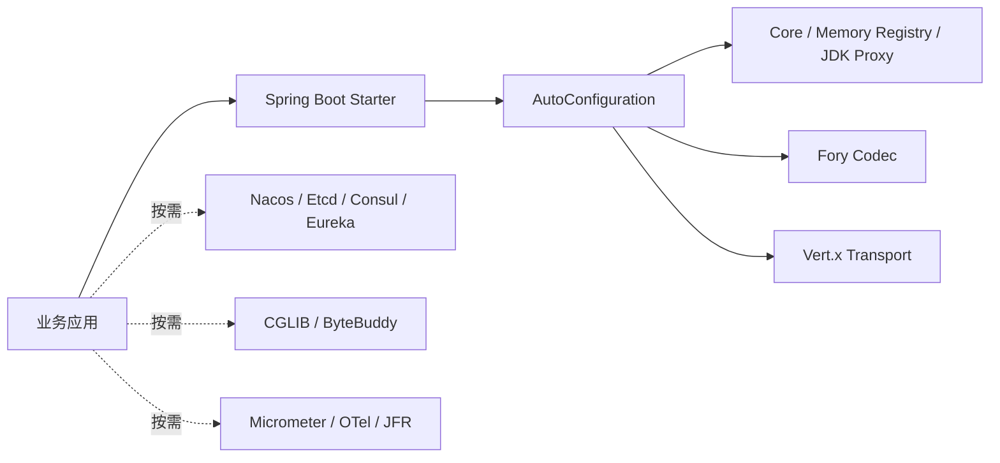

# Spring Boot Starter 与配置

> 当前 Maven 坐标：`com.peachsoft.otryx:otryx-* : 1.0.0-SNAPSHOT`（源码开发版，须本地 install，尚未从 Maven Central 发布）。历史 Peach RPC 1.0.x Java API 不与 OTRYX 1.0 自动兼容。参见[迁移指南](../migration.md)。
>
> 本文描述已合并 #137 的应用级 Starter 行为。#138 在同一 Starter 上补齐 Quickstart 成员诊断、真实导出 revision 与 mTLS 授权教程；每次修改的验收仍以准确 PR Head 及合并后 main CI 为准。#139 的全仓旧接口级 SPI 删除尚未完成。

## 1. 引入

### 1.1 唯一的 Spring Boot Starter

目前只保留 **`otryx-spring-boot-starter`**，不区分 Lite/Full。Starter 本身不再传递 Etcd、Nacos 或 CGLIB SDK，默认依赖 Spring Boot AutoConfiguration、Core、Memory Registry、JDK Proxy、Fory、Vert.x，完整 RPC 能力与 Wire v1 不变。

```xml
<dependency>
    <groupId>com.peachsoft.otryx</groupId>
    <artifactId>otryx-spring-boot-starter</artifactId>
    <version>1.0.0-SNAPSHOT</version>
</dependency>
```

只有跨进程使用 Nacos 时，再在**具体业务项目**加入：

```xml
<dependency>
    <groupId>com.peachsoft.otryx</groupId>
    <artifactId>otryx-registry-nacos</artifactId>
    <version>1.0.0-SNAPSHOT</version>
</dependency>
```

Etcd、Consul/Eureka、CGLIB、ByteBuddy 或遥测模块也按照需求独立引入：`otryx-registry-etcd`、`otryx-registry-consul`、`otryx-registry-eureka`、`otryx-proxy-cglib`、`otryx-proxy-bytebuddy`。Consul/Eureka 已有应用级 V2 Adapter；`otryx-registry-http` 是由 Adapter 引入的共享 HTTP 基础设施，Eureka V2 仍使用其中的 `HttpRegistryClient`，它本身不是可选择的 Registry SPI。#139 清理的是旧接口级注册路径，不能将整个 HTTP 工具模块误称为废弃实现。SPI 自动发现实际安装的 Adapter；`registry.type=nacos` 却没有 `otryx-registry-nacos` 将在启动时明确失败。

单一 Starter 只是依赖汇总，不复制运行时实现；Bean 自动装配与注解生命周期始终由 `otryx-spring-boot-autoconfigure` 提供。下图表示**默认依赖与显式可选依赖的边界**：



**迁移说明**：本次调整发生于尚未正式发布的 `1.0.0-SNAPSHOT` 源码，若你的本地开发项目此前依赖旧 Lite 坐标，应改为上面的唯一 Starter，并按需显式加入原来由单一 Starter 传递的注册中心、代理 SDK。不创建别名或空壳兼容模块。

### 1.2 零外部依赖的真实 RPC 冒烟

仓库包含 `OtryxRpcAutoConfigurationTest.memoryRegistryShouldCompleteRealRpcWithoutExternalInfrastructure`，在一个 Spring 测试上下文内启动真实 Vert.x Provider/Consumer，使用内存 Registry、回环地址、随机端口完成 `DemoService.call()`。不依赖 Nacos、Etcd、Docker 或外部数据库。

从仓库根目录执行：

```bash
./mvnw -B -ntp -pl otryx-spring-boot/otryx-spring-boot-autoconfigure -am \
  -Dtest=OtryxRpcAutoConfigurationTest \
  -Dsurefire.failIfNoSpecifiedTests=false test
```

这是源码测试命令。若业务项目单独引用单一 Starter，需先引入双方共享的 RPC 接口定义，然后分别声明 `@OtryxRpcService` 和 `@OtryxRpcReference`，单 JVM 内存模式适合本地冒烟，跨进程生产环境必须换用 Etcd、Nacos、Consul、Eureka 或等价的共享注册中心。

### 1.3 V2 应用级身份、生命周期与路由

`spring.application.name` 是默认 ApplicationName。也可以用 `otryx.rpc.registry.application-name` 显式覆盖；两者均未配置时直接拒绝启动，不会猜测历史 ServiceKey 或使用默认接口名。Namespace 默认为 `default`，可显式覆盖；`instance-id` 默认启动时生成一次 UUID，部署可设置稳定且全局唯一的实例 ID。

当前 Starter 以 `otryx.rpc.registry.namespace` 同时配置后端与 `ApplicationKey.namespace`，未提供或为空时应用 namespace 才回退 `default`。Quickstart Nacos 配置显式使用 `public`，因此其成员 ApplicationKey 也是 `public`；观察 CLI 的 Nacos namespace 与 application namespace 应同时传 `public`。Nacos group 和 ServiceKey group 是独立维度，不用它们代替 ApplicationName。

```yaml
spring:
  application:
    name: order-service
otryx:
  rpc:
    security-profile: TRUSTED_DEVELOPMENT # 仅本地隔离
    registry:
      type: memory
      namespace: demo
      instance-id: local-order-node-1
      control-plane-timeout: 3s
```

- **Consumer-only**：仅在实例化含 `@OtryxRpcReference` 的 Bean 或程序化获取 Client 时注册真实 `ApplicationRole.CONSUMER` 成员；无监听端口、不产生虚构的 RPC Endpoint。没有实际引用、或引用所属的 lazy Bean 尚未实例化时，不提前创建 Client 或成员。首次创建在 Spring 初始化或业务控制线程等待 Registry 确认入册；拒绝、异常或超时导致创建失败，并触发已分配 Client/Transport 的有界回收，不得从 EventLoop 调用该创建入口。
- **Provider-only**：业务接口先完成绑定，发布不可变 Manifest 和该实例唯一的 CAS Mapping Owner，监听真正 Ready 后注册 `PROVIDER` 成员。服务数量只增加 Manifest 导出记录，不增加成员数。
- **BOTH**：同一个 Spring 进程只创建一个 `ApplicationMembershipCoordinator` 和固定 `ApplicationKey+instanceId`，在 Consumer/Provider 两角色就绪后升级为一个 `BOTH` 成员；停止 Provider 时保持真实 Consumer 成员、撤销 Provider Owner。
- **Discovery**：`ServiceMappingCache` → `ApplicationDirectory` → `ManifestSnapshotCache` → Schema/Wire → 已验证 Provider 列表；RPC 调用数据面只能使用本地已验证路由，Registry/KV 请求全部经限额控制面执行。Consumer 入册确认只证明自身成员已注册，目标 Provider 的目录刷新仍异步进行，不能把入册成功等同于首个 RPC 已可路由。
- **Lifecycle**：`SmartLifecycle` 协调已启动 Provider 的排空；运行时销毁先封闭 Client/Server 懒创建入口，发起两端关闭，再在同一总预算内等待 Client 关闭、Provider 排空，最后关闭共享 Membership。慢 Consumer Transport 不会阻止 Provider 开始排空。已创建 Provider 时采用 `server.shutdown-timeout`，否则采用 Core 默认的 35 秒预算。超时或失败会记录不完整清理并继续触发剩余清理，不能保证网络中断时立即完成远端注销；租约后端仍需依靠各自租约收敛。关闭后再次获取尚未使用的 Client/Server 也会失败。

`otryx.rpc.registry.control-plane-timeout` 为共享应用成员的单次控制面操作和 Consumer 入册等待设置预算，默认 `3s`，必须大于零且不超过 `30s`。它独立于 Provider 的 `otryx.rpc.server.control-plane-timeout`，关闭 Provider 能力不会取消这个校验。启动失败后的资源回收另有受限等待，因此该值不表示整个 Spring Context 启动的总时限。

并发或重复 `close()` 共享第一次关闭尝试的完成信号与原始截止时间，不重新增加等待预算；发起线程的同步重入由最外层调用负责清理和通知。等待到期或中断会报告不完整清理，中断标记保留；截止时间约束等待，不保证所有外部资源在该时刻均已释放。

**后端装配**：默认 `registry.type=consul` 必须使用一个本地 Consul Agent；旧 `otryx.rpc.registry.consul.datacenter` 非空会被拒绝，应移除该键并用 `otryx.rpc.registry.endpoints` 选择本地 Agent。默认 `registry.type=eureka` 必须显式声明 `otryx.rpc.registry.eureka.metadata-backend`（`etcd`、`nacos` 或 `consul`）与 `otryx.rpc.registry.eureka.metadata-endpoints`，并加入所选元数据 Adapter。Eureka 只管理应用成员，外置后端提供 Manifest/Mapping，不会额外注册同一业务实例；纯 Consumer 的 Eureka Port 保持 disabled。

`metadata-options` 使用后端原始选项名称；例如向 Consul 传递 ACL Token 时用 YAML Map 键 `"[consulToken]": "${CONSUL_TOKEN}"` 保留大小写，从环境或受控配置源注入真实值。不要在代码、文档或日志中写入凭据。完整后端约束见 [Consul V2](registry-consul-v2.md) 与 [Eureka V2](registry-eureka-v2.md)。

实现入口：[自动装配与配置校验](../../otryx-spring-boot/otryx-spring-boot-autoconfigure/src/main/java/com/peachsoft/otryx/spring/autoconfigure/OtryxRpcAutoConfiguration.java)、[配置模型](../../otryx-spring-boot/otryx-spring-boot-autoconfigure/src/main/java/com/peachsoft/otryx/spring/autoconfigure/OtryxRpcProperties.java)、[运行时生命周期](../../otryx-spring-boot/otryx-spring-boot-autoconfigure/src/main/java/com/peachsoft/otryx/spring/runtime/OtryxRpcRuntimeCoordinator.java)。跨注册代际的成对迁移与回滚见[迁移指南](../migration.md)；Starter 不提供旧路径 fallback 或双读双写模式。

## 2. Provider

```java
@OtryxRpcService(interfaceClass = OrderService.class, version = "1.0.0")
public class OrderServiceImpl implements OrderService {
}
```

以下为 Nacos 与 Provider 地址配置片段；还须按第 6 节和安全 Profile 要求配置网络安全参数。

Nacos V2（包括 Eureka 选用 Nacos 元数据后端）要求部署流程在所有应用启动前，独占初始化同一 namespace/group 的 Mapping 分片。使用现有 `NacosV2MetadataBootstrap.initialize(RegistryOptions)`，或按 [Quickstart 独立初始化命令](../../otryx-quickstart/README.md#2-第二条调用nacos-双独立-jvm) 执行。Starter 使用已初始化的控制面；缺失分片时拒绝发布，不能由每个应用启动时并发补建。详见 [Nacos CAS 与初始化约束](registry-nacos-v2.md#4-nacos-config-servicemappingmd5-casfencing分片)。

```yaml
spring:
  application:
    name: order-service
otryx:
  rpc:
    registry:
      type: nacos
      endpoints: 127.0.0.1:8848
      namespace: public
      nacos:
        group: OTRYX_RPC
        cluster: DEFAULT
    server:
      host: 0.0.0.0
      port: 19090
      advertised-host: 10.0.0.15
```

存在 `@OtryxRpcService` 时才会创建 Provider 运行时，并在 `SmartLifecycle` 阶段统一启动。当前 Registry 必须通过 V2 `ApplicationRegistry.registrar()` 暴露 `ApplicationRegistrar`，且关联 `ApplicationMetadataBackend` Manifest/Mapping；任一依赖缺失即 fail-fast。`@OtryxRpcService` 不允许使用 lazy 或非 singleton Bean，以保证全部服务在 Server 启动前完成绑定。

Provider 方法默认执行在虚拟线程。CPU 密集方法可以显式声明：

```java
@OtryxRpcExecution(RpcExecutionMode.CPU)
Report buildReport();
```

极短且确定不阻塞的纯内存方法才可以使用 DIRECT：

```java
@OtryxRpcExecution(RpcExecutionMode.DIRECT)
int healthScore();
```

DIRECT 默认禁止。只有配置 `otryx.rpc.server.execution.allow-direct=true` 后才能注册包含 DIRECT 方法的服务，避免业务代码意外阻塞 Vert.x Event Loop。

## 3. Consumer

```java
@OtryxRpcReference(version = "1.0.0")
private OrderService orderService;
```

默认调用超时为 3 秒，可通过 `otryx.rpc.client.timeout` 修改。本轮增加 `otryx.rpc.client.method-timeouts` 方法级映射（键为 `Method.toGenericString()`，值为 `Duration`），以及 `RpcCallContext.open(RpcCallOptions)` 单次作用域；优先级：单次 > 方法 > Consumer 默认，始终受父调用剩余时限约束。使用自定义线程池时需要 `RpcCallContext.wrap(task)`，详见 [Deadline 与调用上下文](deadline-context.md)。调用的逻辑 Deadline 从参数编码**开始前**计算，覆盖编码耗时、连接建立、HELLO/ACK 握手、排队、重试和响应完成；超过 Deadline 的逻辑调用由独立调度器终止并尽可能取消下游请求。同步参数编码属于用户调用线程运行的代码，框架无法安全地强行中断任意阻塞的编码器；编码返回后会检查剩余预算。请求同时携带旧 `deadlineEpochMillis` 与新 `timeoutBudgetMillis`，新 Provider 优先使用相对预算语义避免跨节点 wall-clock 偏差，旧 Provider 仍可使用绝对 Deadline，支持滚动升级。

Consumer 在请求编码之前预留有界响应完成容量，容量不足时**不执行参数序列化**，直接返回 `RpcOverloadedException`；同步编码失败则立即归还预留容量。

Vert.x Transport 每隔 1 分钟尝试清退连续空闲至少 5 分钟的 Endpoint 连接池，仅清退无活跃请求的分组，重访时重新连接；这是当前源码内部的固定策略，尚无对应 Spring 配置项。Consumer 的负载统计也会周期性清退注册目录中已消失、且无在途请求的 Endpoint，避免频繁上下线导致的长期堆积。

自动重试默认最多 2 次 attempt，但**只有显式标注 `@OtryxRpcIdempotent` 的服务方法才允许重试**。未标注方法无论 Retry Budget 是否有余额都不会由框架自动重试：

```java
@OtryxRpcIdempotent
Order findById(Long id);
```

该注解表示业务方确认“相同参数重复执行不会产生不可接受的重复副作用”。创建订单、扣款、转账等接口不应仅为了获得重试而添加该注解，除非业务本身已有可靠幂等键/幂等语义。

Consumer 响应解码、同步 Future continuation 被调度到独立的有界 completion executor。程序化 Builder 可调整 `responseCompletionThreads(int)` 和 `responseCompletionQueueCapacity(int)`，饱和时快速拒绝而非阻塞 EventLoop。

## 4. 可选：编译期 Consumer Stub

普通 Starter 不要求代码生成，因此现有业务可继续使用 JDK Proxy fallback。

需要高性能调用路径时，服务接口标注：

```java
@OtryxRpcContract
public interface OrderService {
    Order findById(Long id);
}
```

并在业务模块 Maven Compiler 中配置：

```xml
<plugin>
    <groupId>org.apache.maven.plugins</groupId>
    <artifactId>maven-compiler-plugin</artifactId>
    <configuration>
        <annotationProcessorPaths>
            <path>
                <groupId>com.peachsoft.otryx</groupId>
                <artifactId>otryx-codegen</artifactId>
                <version>${otryx.version}</version>
            </path>
        </annotationProcessorPaths>
    </configuration>
</plugin>
```

编译器同时生成 `<Service>OtryxRpcClientFactory` 与 `<Service>OtryxRpcServerFactory`。Consumer `refer()` 优先使用 Generated Stub；Provider 注册服务时优先使用 Generated Dispatcher。缺失生成代码时分别回退到配置的 `ProxyFactory` 与 MethodHandle。

生成与反射 fallback 的有效 RPC 方法解析、DTO 结构指纹及 Registry 严格兼容规则，参见 [RPC 契约与 Schema](rpc-contract-schema.md)。

## 5. 主要配置

- `otryx.rpc.enabled`：总开关。
- `otryx.rpc.registry.type`：`memory`、`etcd`、`nacos`、`consul` 或 `eureka`，也可以是自定义 SPI 名称。
- `otryx.rpc.registry.endpoints`：默认空，由 Adapter 决定；Etcd 默认 `http://127.0.0.1:2379`，Nacos 默认 `127.0.0.1:8848`。
- `otryx.rpc.registry.namespace`：Spring Starter 默认 `default`；不同 Provider/Consumer 必须一致。独立手动创建的 Adapter 可能有专用 Namespace 默认值，两者不可混为一谈。
- `otryx.rpc.registry.application-name`：覆盖 `spring.application.name`；若两者均空则 fail-fast。`otryx.rpc.registry.instance-id`：显式固定当前进程实例 ID，未配置时启动生成一次随机 UUID。
- `otryx.rpc.registry.control-plane-timeout`：共享成员单次控制面操作和 Consumer 入册等待预算，默认 `3s`，允许范围为大于零且不超过 `30s`；与 `server.enabled`、`server.control-plane-timeout` 独立。
- `otryx.rpc.registry.nacos.member-host`：纯 Consumer 在 Nacos 中使用的真实主机 IP，不是可调用 RPC Endpoint。
- `otryx.rpc.registry.nacos.group` / `cluster`：Nacos 管理分组与集群，默认 `OTRYX_RPC` / `DEFAULT`；RPC 接口自身的 group 仍属于 `ServiceKey`，两者不是同一概念。
- `otryx.rpc.registry.nacos.username` / `password`：Nacos 用户名密码；日志和异常不得输出密码。
- `otryx.rpc.registry.consul.*`：ACL Token、TTL、心跳、轮询、请求超时与可选 Enterprise namespace，详见 [Consul V2](registry-consul-v2.md)。默认 Consul 工厂拒绝非空 `datacenter`；使用 `registry.endpoints` 指定单个本地 Agent。
- `otryx.rpc.registry.eureka.*`：Basic Auth、Lease、心跳、轮询、请求超时、真实 `member-host`、强制 `metadata-backend` 和 `metadata-endpoints`。外置 Metadata 选项用 `metadata-options` 传递；详见 [Eureka V2](registry-eureka-v2.md)。
- `otryx.rpc.transport.type`：默认 `vertx`。
- `otryx.rpc.transport.handshake-timeout`：协议握手超时，默认 3 秒。
- `otryx.rpc.transport.connections-per-endpoint`：每个服务端点连接分片数，默认 1。
- `otryx.rpc.transport.heartbeat-interval`：空闲连接发送 PING 前的间隔，默认 30 秒。
- `otryx.rpc.transport.heartbeat-timeout`：PING 后等待任意有效入站流量/PONG 的最大时间，默认 10 秒。
- `otryx.rpc.transport.reconnect-base-backoff`：异常连接下一次 request-driven 重连的基础 full-jitter 窗口，默认 50ms。
- `otryx.rpc.transport.reconnect-max-backoff`：重连 full-jitter 最大窗口，默认 3 秒。
- `otryx.rpc.transport.security.mode`：`PLAINTEXT` / `TLS` / `MTLS`，默认 `PLAINTEXT`。
- `otryx.rpc.transport.security.certificate-path`：本端 PEM 证书路径；Provider TLS/MTLS 与 Consumer MTLS 需要。
- `otryx.rpc.transport.security.private-key-path`：本端 PEM 私钥路径。
- `otryx.rpc.transport.security.trust-certificate-path`：信任 CA PEM 路径；Consumer TLS/MTLS 与 Provider MTLS 需要。
- `otryx.rpc.transport.security.hostname-verification`：Consumer Hostname Verification，默认 true。
- `otryx.rpc.transport.security.handshake-timeout`：TLS handshake timeout，默认 3 秒。
- `otryx.rpc.transport.security.reload-interval`：证书文件变化检查周期，默认 30 秒。
- `otryx.rpc.transport.security.expiry-warning-threshold`：证书过期前告警窗口，默认 7 天。
- `otryx.rpc.client.enabled`：默认 true，表示允许 Consumer；引用所属 Bean 实例化或程序化获取 Client 时按需创建运行时。
- `otryx.rpc.client.directory-max-staleness`：应用级 V2 的 LKG 同步故障允许陈旧期限，Spring 默认 **30 秒**。只要 `client.enabled=true`，显式设为 `0s`（无限 LKG）即 fail-fast，即使尚无实际引用；不得以历史旧默认推断 V2 安全边界。
- `otryx.rpc.server.enabled`：默认 true，表示允许 Provider；没有 `@OtryxRpcService` 时不会自动监听端口，程序化 Server 由调用方启动。
- `otryx.rpc.client.proxy`：Generated Stub 缺失时的 fallback，默认 `jdk`；可显式选择 `cglib` 或可选 Byte Buddy 模块提供的 `bytebuddy`。
- `otryx.rpc.client.load-balancer`：默认 `p2c-ewma`。
- `otryx.rpc.server.host` / `port`：Provider 监听地址与端口；port=0 可用于动态端口测试。
- `otryx.rpc.server.advertised-host` / `advertised-port`：写入 Registry 的对外地址。绑定 `0.0.0.0`/`::` 时必须显式提供 advertised-host；advertised-port=0 使用实际监听端口。
- `otryx.rpc.server.max-concurrent`：Provider 最大并发业务执行数。
- `otryx.rpc.server.drain-timeout`：Provider 关闭时等待 inflight 排空的最大时间，默认 30 秒。
- `otryx.rpc.server.control-plane-timeout`：Provider 自身控制面等待预算，默认 3 秒；不再用作共享 Membership 或 Consumer 入册预算，后两者使用 `registry.control-plane-timeout`。
- `otryx.rpc.server.shutdown-timeout`：Provider **整体**关闭预算，Spring 默认 25 秒，约束所有注销/排空/清理阶段且不按服务数累加。Spring SmartLifecycle 使用异步停止回调，业务线程可能超过该预算仍在运行。
- `otryx.rpc.server.execution.allow-direct`：是否允许 DIRECT 方法运行在 Transport Event Loop，默认 false。
- `otryx.rpc.server.execution.cpu-parallelism`：CPU 执行池线程数，默认当前 JVM 可用处理器数。
- `otryx.rpc.server.execution.cpu-queue-capacity`：CPU 执行池有界队列容量，默认 1024。
- `otryx.rpc.transport.max-inflight-per-connection`：Provider 每连接真正强制执行的未完成 REQUEST 容量，默认 1024；超过后返回 `OVERLOADED`，不进入 Handler。CANCEL 的旧完成回调不能误删复用同 Request ID 的新请求。
- `otryx.rpc.transport.admission.max-connections`：Transport Server 在 NetSocket 回调后已接入连接限额，默认 4096；TLS 预握手不在此统计范围内。
- `otryx.rpc.transport.admission.max-handshakes`：同时进行 OTRYX HELLO 握手的已接入连接限额，默认 1024。
- `otryx.rpc.transport.admission.max-buffered-partial-frame-bytes`：Transport 实例级全局残帧逻辑字节额度，默认 67108864；FrameAccumulator 追加前预留、消费或关闭后归还。
- `otryx.rpc.transport.admission.partial-frame-timeout`：残帧最大驻留时间，默认 10 秒；长时间没有完整帧完成时断连并归还预算。
- `otryx.rpc.transport.admission.max-buffered-response-bytes`：每个 Transport Server 的已编码 RESPONSE 待写字节额度，默认 67108864；在写前获取，在写 Future 终态/断连后归还，不覆盖 Codec 编码峰值或 Socket/Netty Direct Memory。
- [Transport 准入限制与资源所有权](transport-admission.md) 说明已实现的连接/握手限制及 TLS 安全边界。
- `otryx.rpc.client.resilience.max-attempts`：单次逻辑调用最大尝试次数，默认 2，包含首次调用。
- `otryx.rpc.client.resilience.retry-budget-ratio`：每个原始请求补充的全局重试额度比例，默认 0.10。
- `otryx.rpc.client.resilience.retry-budget-min-retries` / `retry-budget-max-retries`：重试预算突发下限/上限，默认 10/100。
- `otryx.rpc.client.resilience.retry-base-backoff` / `retry-max-backoff`：随机退避窗口，默认 10ms/100ms。
- `otryx.rpc.client.resilience.outlier-consecutive-failure-threshold`：Endpoint 连续基础设施失败剔除阈值，默认 5。
- `otryx.rpc.client.resilience.outlier-ejection-duration`：Endpoint 临时剔除时间，默认 30 秒。
- `otryx.rpc.client.resilience.circuit-consecutive-failure-threshold`：方法级熔断连续失败阈值，默认 20。
- `otryx.rpc.client.resilience.circuit-open-duration`：Circuit OPEN 时间，默认 10 秒。

## 6. TLS / mTLS

TLS/mTLS 配置属于 Transport，不修改 OTRYX RPC v1 Header。启用后顺序为：

~~~text
TCP connect
 -> TLS/mTLS handshake
 -> certificate verification
 -> HELLO / HELLO_ACK
 -> ACTIVE
~~~

完整证书校验、在线 Reload、迁移与测试说明见 [TLS / mTLS 安全指南](../security.md)。

可运行的 [Quickstart mTLS 教程](../../otryx-quickstart/README.md#5-mtls已认证证书仍须通过方法授权) 使用现有 Provider/Consumer 的 `mtls` Profile：临时 CA 下的两个客户端都可通过证书信任检查，但仅显式授权的叶子证书指纹可调用指定 Greeting 方法。证书路径变量为 `OTRYX_QUICKSTART_TLS_CERT`、`OTRYX_QUICKSTART_TLS_KEY`、`OTRYX_QUICKSTART_TLS_CA`；旧 `OTRYX_RPC_TLS_*` 环境变量应移除，避免被 Starter 严格配置校验识别为未知键。

## 7. 可观测性

Core 的 `RpcObserver`、`RpcTracingBridge`、`RpcMetadataPropagator` 不依赖具体观测框架。业务可按需添加 Adapter：

~~~xml
<dependency>
    <groupId>com.peachsoft.otryx</groupId>
    <artifactId>otryx-observability-micrometer</artifactId>
    <version>1.0.0-SNAPSHOT</version>
</dependency>
~~~

~~~xml
<dependency>
    <groupId>com.peachsoft.otryx</groupId>
    <artifactId>otryx-observability-opentelemetry</artifactId>
    <version>1.0.0-SNAPSHOT</version>
</dependency>
~~~

~~~xml
<dependency>
    <groupId>com.peachsoft.otryx</groupId>
    <artifactId>otryx-observability-jfr</artifactId>
    <version>1.0.0-SNAPSHOT</version>
</dependency>
~~~

三个 Adapter 都不是 Starter 强制依赖。Micrometer/OpenTelemetry 在对应 Bean 存在时自动装配；JFR 通过 `otryx.rpc.observability.jfr.enabled=true` 启用。

完整指标、Trace 和 JFR 说明见 [可观测性指南](../observability.md)。

## 8. 注解驱动运行时

含 `@OtryxRpcReference` 的 Bean 首次实例化时按需创建 Consumer，并等待自身应用成员入册确认；lazy Bean 尚未实例化时不会提前产生 Consumer 成员。`@OtryxRpcService` 首次出现时创建 Provider，但 Server 只在所有服务 Bean 完成注册后启动。同一应用同时包含两类注解是合法的上下游组合服务，两种角色共享同一个成员实例。

程序化注入 `OtryxRpcClient` 会按需创建 Consumer。程序化注入 `OtryxRpcServer` 只创建运行时，不由注解生命周期自动启动；调用方应显式完成服务注册和 `start()`。

## 9. Bean 覆盖

自动配置对 ApplicationRegistry、MembershipCoordinator、Resolver、Codec Registry、TransportFactory、LoadBalancer、ProxyFactory、Client、Server 均使用 `@ConditionalOnMissingBean`，业务项目可以通过声明同类型 Bean 覆盖默认装配。

自定义 `ApplicationRegistry` 必须提供真实 `ApplicationRegistrar`，并实现 `ApplicationMetadataBackend`、返回非空 Manifest/Mapping Repository，供默认 Coordinator 和 Resolver 使用。覆盖 Registry Bean 后不再加载默认类型对应的工厂，未使用的 Consul/Eureka 专属后端配置不会阻止该覆盖；通用配置与有效安全 Profile 校验仍然执行。

旧 `Registry`、`ServiceRegistrar` 或 `ServiceDiscovery` Bean 定义在创建 RPC 资源之前即被拒绝，包括尚未实例化的 lazy Bean。自定义扩展必须提供应用级 SPI，不能依靠旧 Bean 获得隐式 fallback。

## 10. 启动 Fail-fast 与脱敏诊断

启用 Starter 时，BeanFactory 阶段先严格检查 Starter 所拥有的 `otryx.rpc.*` 配置键；未知键、拼写错误或旧接口级配置不会被静默忽略，错误会列出配置键并给出应用级迁移提示。`otryx.rpc.observability.*` 和 `otryx.rpc.quickstart.*` 由各自模块拥有，不纳入本次 Starter 严格试绑定。`otryx.rpc.enabled=false` 会跳过该自动装配及其前置校验。

参数绑定后立即校验 Registry、Transport、Fory、Consumer 与 Provider 的已启用选项，出现零超时、负数限额、非法端口、退避范围错误或无效的 Fory 严格白名单会终止启动。错误直接指出具体配置键，如 `Invalid otryx.rpc.client.timeout: must be positive`。未启用的 Consumer/Provider 的专属配置不参与对应校验；共享 `registry.control-plane-timeout` 始终独立校验。

默认 Eureka 工厂缺少元数据后端或地址时，错误明确指向 `otryx.rpc.registry.eureka.metadata-backend` 或 `otryx.rpc.registry.eureka.metadata-endpoints`；默认 Consul 工厂遇到旧 `otryx.rpc.registry.consul.datacenter` 时要求删除该配置并选择单个本地 Agent。这些检查在加载相应后端 SDK 前执行。

无法找到已配置的 SPI 时（例如在 单一 Starter 上选择 `otryx.rpc.registry.type=nacos`，却未加入 `otryx-registry-nacos` 依赖），启动异常会指出配置键，并建议加入对应 Adapter。可用扩展列表来自实际 Classpath，不硬编码在诊断器中。

启动时输出 Registry、Transport、Proxy、Fory 安全模式、TLS 模式、启用角色与限额摘要，**不记录注册中心 username/password、密钥、证书或其文件内容**。默认的 `PLAINTEXT` 与 `TRUSTED_COMPATIBILITY` 会发出安全提醒；提醒不阻止本地开发，但面向不可信网络应开启 TLS/mTLS 与严格 Fory allowlist。

当未引入任一业务注解且未程序化获取运行时时，配置校验不会提前创建 RPC Client Transport 或监听 RPC 端口；注册中心 SDK 的控制面连接行为由对应 Adapter 决定。

## U05 安全意图与认证授权

Spring Boot 默认要求明确指定 `otryx.rpc.security-profile`。
可信隔离开发可选 `TRUSTED_DEVELOPMENT`（不得开放至不可信网络）；
网络部署选 `NETWORK_MTLS`，同时设置
`otryx.rpc.transport.security.mode=MTLS`、
`otryx.rpc.codec.fory.mode=STRICT_ALLOWLIST` 与实际 DTO allowlist。
缺失任何必需项在配置绑定阶段失败。

Provider 在实际解码 RPC DTO 之前从已验证 TLS Peer 与预绑定
ServiceKey/MethodId 生成 `RpcAuthorizationContext`；若容器中声明
`RpcAuthorizer` Bean 则运行自定义服务/方法权限，网络 Profile 始终
先要求证书已验证。业务授权 Stage 必须非阻塞。

`otryx.rpc.server.authorization.max-pending` 默认 1024，
`otryx.rpc.server.authorization.timeout` 默认 3s；
已逻辑超时但尚未真实退出的授权仍占据容量，不可认为业务已停止。

`otryx.rpc.server.authorization.max-buffered-request-bytes` 默认
67108864，限制异步安全策略等待期间持有的原始请求 Frame 总字节数；
与 `max-pending` 一起组成授权阶段双维度容量限制，超额立即拒绝。


安全 Profile 对自定义 `RpcCodecRegistry` 与 `RpcTransportOptions` Bean 进行运行时
验证：`NETWORK_MTLS` 的最终 Codec 必须是严格白名单 Fory，最终 Transport
必须启用 mTLS。授权失败使用已有 `BAD_REQUEST`，不应重试；
授权等待截止时间为客户端剩余预算与服务端策略超时的较短者。

`NETWORK_MTLS` Provider 未声明 `RpcAuthorizer` Bean 时默认拒绝所有方法，
业务须声明按证书身份和 ServiceKey/MethodId 验证的授权 Bean。

Quickstart Provider 在 `mtls` Profile 下提供一个独立示例授权器；它不属于通用 Starter 的默认授权策略。必须设置 `otryx.rpc.quickstart.mtls.allowed-client-sha256` 为允许客户端叶子证书 DER 的 SHA-256（64 个小写十六进制字符、无冒号或首尾空白）。它同时限定 `GreetingService` / `1.0.0` / `default` 与 `hello` MethodId，Details 方法不在授权范围；CN/SAN 和注册中心 attributes 不能代替已验证证书身份。

Consumer 的示例拒绝模式只把精确的 `RpcRemoteException`、`BAD_REQUEST` 和 `RPC authorization denied` 视为预期结果，不能把连接中断、CA/Hostname 校验或 TLS 握手失败算成授权验收成功。自动脚本还验证切回允许客户端后的真实调用成功，见 [Quickstart](../../otryx-quickstart/README.md)。


## 可运行的自定义 Observer 接入示例（U11）

Consumer 示例中的 [QuickstartCallObserver](../../otryx-quickstart/otryx-quickstart-consumer/src/main/java/com/peachsoft/otryx/quickstart/consumer/QuickstartCallObserver.java) 直接实现 Core `RpcObserver` 并注册为 Spring `@Component`，按逻辑请求终态以 `LongAdder` 统计成功/失败次数。
它不读取请求 Payload、不记录异常内容，也不在 RPC 线程执行 I/O。

- Spring 可通过已注册的自定义 `RpcObserver` Bean 汇入 Coordinator 的复合 Observer；业务无需修改协议或 Core。
- 自定义 `RpcTransportFactory` Bean 可覆盖 SPI 名称选择；已有 Bean 时 `@ConditionalOnMissingBean` 不再创建默认工厂。
- 对可能阻塞的第三方遥测出口，使用 `new BoundedAsyncRpcObserver(delegate, queueCapacity)` 并明确关闭所有权；队列溢出丢弃遥测，不反向压制 RPC 业务。
- [QuickstartCallObserverTest](../../otryx-quickstart/otryx-quickstart-consumer/src/test/java/com/peachsoft/otryx/quickstart/consumer/QuickstartCallObserverTest.java) 与 `OtryxRpcAutoConfigurationTest` 校验计数和覆盖行为。

本示例不包含持久化、Exactly-once 审计或网络外部 Exporter；直接在隔离开发环境运行上述双 JVM 示例即可触发回调。

应用注册状态另由 Quickstart 的只读 `QuickstartRegistrySnapshot` CLI 观察，输出指定应用的成员与 Manifest，并查询三个固定 Quickstart 契约的 ServiceMapping 候选与已验证 Provider；服务视图可能包含同 scope 中其他导出相同契约的应用。它不枚举整个注册中心、不创建观察者成员、不导出任意 attributes，也不替代调用遥测或事务快照。命令要求新输出文件，详见 [成员诊断](../../otryx-quickstart/README.md#24-观察真实成员manifest-与-mapping)。
