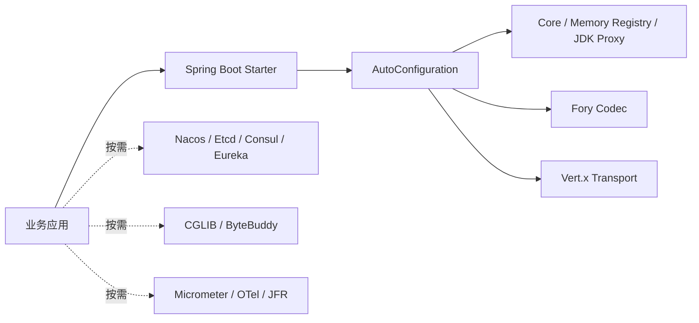

# Spring Boot Starter 与配置

> 当前 Maven 坐标：`com.peachsoft.otryx:otryx-* : 1.0.0-SNAPSHOT`（源码开发版，须本地 install，尚未从 Maven Central 发布）。历史 Peach RPC 1.0.x Java API 不与 OTRYX 1.0 自动兼容。参见[迁移指南](../migration.md)。
>
> 本文以当前分支的配置模型、实际 SPI 与应用级运行时为准。安全配置和代码示例不代表某次端到端验收已经通过；验证记录须对应准确提交，见[工程断点](../engineering/agent-governance-checkpoint.md)。

## 1. 引入

### 1.1 唯一的 Spring Boot Starter

目前只保留 **`otryx-spring-boot-starter`**，不区分 Lite/Full。Starter 本身不再传递 Etcd、Nacos 或 CGLIB SDK，默认依赖 Spring Boot AutoConfiguration、Core、Memory Registry、JDK Proxy、Fory、Vert.x，完整 RPC 能力与 Wire v1 不变。

```xml
<dependency>
    <groupId>com.peachsoft.otryx</groupId>
    <artifactId>otryx-spring-boot-starter</artifactId>
    <version>1.0.0-SNAPSHOT</version>
</dependency>
```

只有跨进程使用 Nacos 时，再在**具体业务项目**加入：

```xml
<dependency>
    <groupId>com.peachsoft.otryx</groupId>
    <artifactId>otryx-registry-nacos</artifactId>
    <version>1.0.0-SNAPSHOT</version>
</dependency>
```

Etcd、Consul/Eureka、CGLIB、ByteBuddy 或遥测模块也按照需求独立引入：`otryx-registry-etcd`、`otryx-registry-consul`、`otryx-registry-eureka`、`otryx-proxy-cglib`、`otryx-proxy-bytebuddy`。Consul/Eureka 已有应用级 V2 Adapter；`otryx-registry-http` 是由 Adapter 引入的共享 HTTP 基础设施，Eureka V2 仍使用其中的 `HttpRegistryClient`，它本身不是可选择的 Registry SPI。#139 清理的是旧接口级注册路径，不能将整个 HTTP 工具模块误称为废弃实现。SPI 自动发现实际安装的 Adapter；`registry.type=nacos` 却没有 `otryx-registry-nacos` 将在启动时明确失败。

单一 Starter 只是依赖汇总，不复制运行时实现；Bean 自动装配与注解生命周期始终由 `otryx-spring-boot-autoconfigure` 提供。下图表示**默认依赖与显式可选依赖的边界**：



**迁移说明**：本次调整发生于尚未正式发布的 `1.0.0-SNAPSHOT` 源码，若你的本地开发项目此前依赖旧 Lite 坐标，应改为上面的唯一 Starter，并按需显式加入原来由单一 Starter 传递的注册中心、代理 SDK。不创建别名或空壳兼容模块。

### 1.2 零外部依赖的真实 RPC 冒烟

仓库包含 `OtryxRpcAutoConfigurationTest.memoryRegistryShouldCompleteRealRpcWithoutExternalInfrastructure`，在一个 Spring 测试上下文内启动真实 Vert.x Provider/Consumer，使用内存 Registry、回环地址、随机端口完成 `DemoService.call()`。不依赖 Nacos、Etcd、Docker 或外部数据库。

从仓库根目录执行：

```bash
./mvnw -B -ntp -pl otryx-spring-boot/otryx-spring-boot-autoconfigure -am \
  -Dtest=OtryxRpcAutoConfigurationTest \
  -Dsurefire.failIfNoSpecifiedTests=false test
```

这是源码测试命令。若业务项目单独引用单一 Starter，需先引入双方共享的 RPC 接口定义，然后分别声明 `@OtryxRpcService` 和 `@OtryxRpcReference`，单 JVM 内存模式适合显式可信开发；跨进程网络部署须选择能满足全部安全通道要求的共享注册中心，当前支持范围见第 6.2 节。

### 1.3 V2 应用级身份、生命周期与路由

`spring.application.name` 是默认 ApplicationName。也可以用 `otryx.rpc.registry.application-name` 显式覆盖；两者均未配置时直接拒绝启动，不会猜测历史 ServiceKey 或使用默认接口名。Namespace 默认为 `default`，可显式覆盖；`instance-id` 默认启动时生成一次 UUID，部署可设置稳定且全局唯一的实例 ID。

当前 Starter 以 `otryx.rpc.registry.namespace` 同时配置后端与 `ApplicationKey.namespace`，未提供或为空时应用 namespace 才回退 `default`。Quickstart Nacos 配置显式使用 `public`，因此其成员 ApplicationKey 也是 `public`；观察 CLI 的 Nacos namespace 与 application namespace 应同时传 `public`。Nacos group 和 ServiceKey group 是独立维度，不用它们代替 ApplicationName。

```yaml
spring:
  application:
    name: order-service
otryx:
  rpc:
    security-profile: TRUSTED_DEVELOPMENT # 仅本地隔离
    registry:
      type: memory
      namespace: demo
      instance-id: local-order-node-1
      control-plane-timeout: 3s
```

- **Consumer-only**：仅在实例化含 `@OtryxRpcReference` 的 Bean 或程序化获取 Client 时注册真实 `ApplicationRole.CONSUMER` 成员；无监听端口、不产生虚构的 RPC Endpoint。没有实际引用、或引用所属的 lazy Bean 尚未实例化时，不提前创建 Client 或成员。首次创建在 Spring 初始化或业务控制线程等待 Registry 确认入册；拒绝、异常或超时导致创建失败，并触发已分配 Client/Transport 的有界回收，不得从 EventLoop 调用该创建入口。
- **Provider-only**：业务接口先完成绑定，发布不可变 Manifest 和该实例唯一的 CAS Mapping Owner，监听真正 Ready 后注册 `PROVIDER` 成员。服务数量只增加 Manifest 导出记录，不增加成员数。
- **BOTH**：同一个 Spring 进程只创建一个 `ApplicationMembershipCoordinator` 和固定 `ApplicationKey+instanceId`，在 Consumer/Provider 两角色就绪后升级为一个 `BOTH` 成员；停止 Provider 时保持真实 Consumer 成员、撤销 Provider Owner。
- **Discovery**：`ServiceMappingCache` → `ApplicationDirectory` → `ManifestSnapshotCache` → Schema/Wire → 已验证 Provider 列表；RPC 调用数据面只能使用本地已验证路由，Registry/KV 请求全部经限额控制面执行。Consumer 入册确认只证明自身成员已注册，目标 Provider 的目录刷新仍异步进行，不能把入册成功等同于首个 RPC 已可路由。
- **Lifecycle**：`SmartLifecycle` 协调已启动 Provider 的排空；运行时销毁先封闭 Client/Server 懒创建入口，发起两端关闭，再在同一总预算内等待 Client 关闭、Provider 排空，最后关闭共享 Membership。慢 Consumer Transport 不会阻止 Provider 开始排空。已创建 Provider 时采用 `server.shutdown-timeout`，否则采用 Core 默认的 35 秒预算。超时或失败会记录不完整清理并继续触发剩余清理，不能保证网络中断时立即完成远端注销；租约后端仍需依靠各自租约收敛。关闭后再次获取尚未使用的 Client/Server 也会失败。

`otryx.rpc.registry.control-plane-timeout` 为共享应用成员的单次控制面操作和 Consumer 入册等待设置预算，默认 `3s`，必须大于零且不超过 `30s`。它独立于 Provider 的 `otryx.rpc.server.control-plane-timeout`，关闭 Provider 能力不会取消这个校验。启动失败后的资源回收另有受限等待，因此该值不表示整个 Spring Context 启动的总时限。

并发或重复 `close()` 共享第一次关闭尝试的完成信号与原始截止时间，不重新增加等待预算；发起线程的同步重入由最外层调用负责清理和通知。等待到期或中断会报告不完整清理，中断标记保留；截止时间约束等待，不保证所有外部资源在该时刻均已释放。

**后端装配**：默认 `registry.type=consul` 必须使用一个本地 Consul Agent；旧 `otryx.rpc.registry.consul.datacenter` 非空会被拒绝，应移除该键并用 `otryx.rpc.registry.endpoints` 选择本地 Agent。默认 `registry.type=eureka` 必须显式声明 `otryx.rpc.registry.eureka.metadata-backend`（`etcd`、`nacos` 或 `consul`）与 `otryx.rpc.registry.eureka.metadata-endpoints`，并加入所选元数据 Adapter。Eureka 只管理应用成员，外置后端提供 Manifest/Mapping，不会额外注册同一业务实例；纯 Consumer 的 Eureka Port 保持 disabled。

`metadata-options` 只接受所选后端实现的非敏感选项，例如 TTL、轮询周期和后端组。成员链的 TLS/凭据放在 `otryx.rpc.registry.security`，Eureka 外置元数据链使用独立的 `otryx.rpc.registry.metadata-security`；后者缺失时不会继承前者的 CA 或凭据。完整后端约束见 [Consul V2](registry-consul-v2.md) 与 [Eureka V2](registry-eureka-v2.md)，字段说明见第 6.2 节。

实现入口：[自动装配与配置校验](../../otryx-spring-boot/otryx-spring-boot-autoconfigure/src/main/java/com/peachsoft/otryx/spring/autoconfigure/OtryxRpcAutoConfiguration.java)、[配置模型](../../otryx-spring-boot/otryx-spring-boot-autoconfigure/src/main/java/com/peachsoft/otryx/spring/autoconfigure/OtryxRpcProperties.java)、[运行时生命周期](../../otryx-spring-boot/otryx-spring-boot-autoconfigure/src/main/java/com/peachsoft/otryx/spring/runtime/OtryxRpcRuntimeCoordinator.java)。跨注册代际的成对迁移与回滚见[迁移指南](../migration.md)；Starter 不提供旧路径 fallback 或双读双写模式。

### 1.4 每个入口都要选择安全 Profile

`RpcSecurityProfile` 表示部署意图，默认值 `UNSPECIFIED` 不能用于启动。这个要求同时适用于 Spring 配置、程序化 `OtryxRpcClient.Builder.securityProfile(...)` / `OtryxRpcServer.Builder.securityProfile(...)` 和创建 Registry 的 `RegistryOptions`。开发工具可显式使用 `RegistryOptions.trustedDevelopment(...)`；仅调用旧形状的便捷构造或 `fromCsv(...)` 不会自动获得开发许可。

| Profile | 使用条件 | 必需行为 |
|---|---|---|
| `TRUSTED_DEVELOPMENT` | 可信隔离的开发或测试 | 明确承担明文、匿名 Peer 或兼容 Codec 的边界；仍保持容量、截止时间与应用级注册约束 |
| `NETWORK_MTLS` | 需要保护网络身份与控制面的部署 | RPC 双向 TLS、有限证书绑定、实际安全 Codec、全部 Registry 来源保护，以及显式 Provider 授权策略 |
| `UNSPECIFIED` | 配置缺省值 | 在资源创建或启动前拒绝，不降级为开发模式 |

`NETWORK_MTLS` 且 `server.enabled=true` 时，Spring 必须在创建 Registry 工厂和 RPC 运行时前找到 `RpcAuthorizer` Bean；纯 Consumer 应明确设置 `server.enabled=false`。自定义授权器由应用声明，通用 Starter 不注入放行策略。Core Server Builder 同样拒绝缺失的网络授权器。

安全配置试绑定之后，还会核对最终实际对象。Starter 为已启用的 Client/Server 准备 Builder，在两端都通过 `validate()` 后才启动任一角色；因此 BOTH 不会先注册一个角色，再发现另一个角色保护不足。Provider 在 `start()` 时还会复核本地证书绑定和实际能力，覆盖创建与启动之间的失效窗口。

实现入口：[Core 安全预检](../../otryx-core/src/main/java/com/peachsoft/otryx/core/RpcSecurityChecks.java)、[RegistryOptions](../../otryx-core/src/main/java/com/peachsoft/otryx/registry/RegistryOptions.java)、[Starter 运行时协调](../../otryx-spring-boot/otryx-spring-boot-autoconfigure/src/main/java/com/peachsoft/otryx/spring/runtime/OtryxRpcRuntimeCoordinator.java)。

## 2. Provider

```java
@OtryxRpcService(interfaceClass = OrderService.class, version = "1.0.0")
public class OrderServiceImpl implements OrderService {
}
```

以下是可信隔离环境中的 Nacos 与 Provider 地址片段。当前 Nacos Adapter 拒绝 `NETWORK_MTLS` 和 TLS 配置，因为其 SDK 登录链与数据链尚未具备完整的隔离保护实现；网络安全示例使用 [Quickstart](../../otryx-quickstart/README.md) 中的受保护 Etcd 控制面。

Nacos V2（包括 Eureka 选用 Nacos 元数据后端）要求部署流程在所有应用启动前，独占初始化同一 namespace/group 的 Mapping 分片。使用现有 `NacosV2MetadataBootstrap.initialize(RegistryOptions)`，或按 [Quickstart 独立初始化命令](../../otryx-quickstart/README.md#2-第二条调用nacos-双独立-jvm) 执行。Starter 使用已初始化的控制面；缺失分片时拒绝发布，不能由每个应用启动时并发补建。详见 [Nacos CAS 与初始化约束](registry-nacos-v2.md#4-nacos-config-servicemappingmd5-casfencing分片)。

```yaml
spring:
  application:
    name: order-service
otryx:
  rpc:
    security-profile: TRUSTED_DEVELOPMENT
    registry:
      type: nacos
      endpoints: 127.0.0.1:8848
      namespace: public
      nacos:
        group: OTRYX_RPC
        cluster: DEFAULT
    server:
      host: 0.0.0.0
      port: 19090
      advertised-host: 10.0.0.15
```

存在 `@OtryxRpcService` 时才会创建 Provider 运行时，并在 `SmartLifecycle` 阶段统一启动。当前 Registry 必须通过 V2 `ApplicationRegistry.registrar()` 暴露 `ApplicationRegistrar`，且关联 `ApplicationMetadataBackend` Manifest/Mapping；任一依赖缺失即 fail-fast。`@OtryxRpcService` 不允许使用 lazy 或非 singleton Bean，以保证全部服务在 Server 启动前完成绑定。

Provider 方法默认执行在虚拟线程。CPU 密集方法可以显式声明：

```java
@OtryxRpcExecution(RpcExecutionMode.CPU)
Report buildReport();
```

极短且确定不阻塞的纯内存方法才可以使用 DIRECT：

```java
@OtryxRpcExecution(RpcExecutionMode.DIRECT)
int healthScore();
```

DIRECT 默认禁止。只有配置 `otryx.rpc.server.execution.allow-direct=true` 后才能注册包含 DIRECT 方法的服务，避免业务代码意外阻塞 Vert.x Event Loop。

## 3. Consumer

```java
@OtryxRpcReference(version = "1.0.0")
private OrderService orderService;
```

默认调用超时为 3 秒，可通过 `otryx.rpc.client.timeout` 修改。本轮增加 `otryx.rpc.client.method-timeouts` 方法级映射（键为 `Method.toGenericString()`，值为 `Duration`），以及 `RpcCallContext.open(RpcCallOptions)` 单次作用域；优先级：单次 > 方法 > Consumer 默认，始终受父调用剩余时限约束。使用自定义线程池时需要 `RpcCallContext.wrap(task)`，详见 [Deadline 与调用上下文](deadline-context.md)。调用的逻辑 Deadline 从参数编码**开始前**计算，覆盖编码耗时、连接建立、HELLO/ACK 握手、排队、重试和响应完成；超过 Deadline 的逻辑调用由独立调度器终止并尽可能取消下游请求。同步参数编码属于用户调用线程运行的代码，框架无法安全地强行中断任意阻塞的编码器；编码返回后会检查剩余预算。请求同时携带旧 `deadlineEpochMillis` 与新 `timeoutBudgetMillis`，新 Provider 优先使用相对预算语义避免跨节点 wall-clock 偏差，旧 Provider 仍可使用绝对 Deadline，支持滚动升级。

Consumer 在请求编码之前预留有界响应完成容量，容量不足时**不执行参数序列化**，直接返回 `RpcOverloadedException`；同步编码失败则立即归还预留容量。

连接池和负载统计以 `RpcTarget(ApplicationKey, RpcEndpoint)` 区分目标；相同地址上的不同应用不能共享一个目标身份。Vert.x Transport 每隔 1 分钟尝试清退连续空闲至少 5 分钟且无活跃请求的连接分组，重访时重新连接；这是当前源码内部固定策略，尚无对应 Spring 配置项。Consumer 的负载统计也会周期性清退目录中已消失、且无在途请求的目标。

自动重试默认最多 2 次 attempt，但**只有显式标注 `@OtryxRpcIdempotent` 的服务方法才允许重试**。未标注方法无论 Retry Budget 是否有余额都不会由框架自动重试：

```java
@OtryxRpcIdempotent
Order findById(Long id);
```

该注解表示业务方确认“相同参数重复执行不会产生不可接受的重复副作用”。创建订单、扣款、转账等接口不应仅为了获得重试而添加该注解，除非业务本身已有可靠幂等键/幂等语义。

Consumer 响应解码、同步 Future continuation 被调度到独立的有界 completion executor。程序化 Builder 可调整 `responseCompletionThreads(int)` 和 `responseCompletionQueueCapacity(int)`，饱和时快速拒绝而非阻塞 EventLoop。

## 4. 可选：编译期 Consumer Stub

普通 Starter 不要求代码生成，因此现有业务可继续使用 JDK Proxy fallback。

需要高性能调用路径时，服务接口标注：

```java
@OtryxRpcContract
public interface OrderService {
    Order findById(Long id);
}
```

并在业务模块 Maven Compiler 中配置：

```xml
<plugin>
    <groupId>org.apache.maven.plugins</groupId>
    <artifactId>maven-compiler-plugin</artifactId>
    <configuration>
        <annotationProcessorPaths>
            <path>
                <groupId>com.peachsoft.otryx</groupId>
                <artifactId>otryx-codegen</artifactId>
                <version>${otryx.version}</version>
            </path>
        </annotationProcessorPaths>
    </configuration>
</plugin>
```

编译器同时生成 `<Service>OtryxRpcClientFactory` 与 `<Service>OtryxRpcServerFactory`。Consumer `refer()` 优先使用 Generated Stub；Provider 注册服务时优先使用 Generated Dispatcher。缺失生成代码时分别回退到配置的 `ProxyFactory` 与 MethodHandle。

生成与反射 fallback 的有效 RPC 方法解析、DTO 结构指纹及 Registry 严格兼容规则，参见 [RPC 契约与 Schema](rpc-contract-schema.md)。

## 5. 主要配置

- `otryx.rpc.enabled`：总开关。
- `otryx.rpc.security-profile`：必须显式选择 `TRUSTED_DEVELOPMENT` 或 `NETWORK_MTLS`；默认 `UNSPECIFIED` 拒绝启动。
- `otryx.rpc.registry.type`：`memory`、`etcd`、`nacos`、`consul` 或 `eureka`，也可以是自定义 SPI 名称。
- `otryx.rpc.registry.endpoints`：默认空，由 Adapter 决定；Etcd 默认 `http://127.0.0.1:2379`，Nacos 默认 `127.0.0.1:8848`。
- `otryx.rpc.registry.namespace`：Spring Starter 默认 `default`；不同 Provider/Consumer 必须一致。独立手动创建的 Adapter 可能有专用 Namespace 默认值，两者不可混为一谈。
- `otryx.rpc.registry.application-name`：覆盖 `spring.application.name`；若两者均空则 fail-fast。`otryx.rpc.registry.instance-id`：显式固定当前进程实例 ID，未配置时启动生成一次随机 UUID。
- `otryx.rpc.registry.control-plane-timeout`：共享成员单次控制面操作和 Consumer 入册等待预算，默认 `3s`，允许范围为大于零且不超过 `30s`；与 `server.enabled`、`server.control-plane-timeout` 独立。
- `otryx.rpc.registry.nacos.member-host`：纯 Consumer 在 Nacos 中使用的真实主机 IP，不是可调用 RPC Endpoint。
- `otryx.rpc.registry.nacos.group` / `cluster`：Nacos 管理分组与集群，默认 `OTRYX_RPC` / `DEFAULT`；RPC 接口自身的 group 仍属于 `ServiceKey`，两者不是同一概念。
- `otryx.rpc.registry.security`：实际成员访问链的有类型 TLS/凭据；`registry.metadata-security` 专供 Eureka 独立外置元数据链，详见第 6.2 节。
- `otryx.rpc.registry.consul.*`：TTL、心跳、轮询、请求超时与可选 Enterprise namespace，详见 [Consul V2](registry-consul-v2.md)。ACL Token 使用 `registry.security.credentials`。默认 Consul 工厂拒绝非空 `datacenter`；使用 `registry.endpoints` 指定单个本地 Agent。
- `otryx.rpc.registry.eureka.*`：Lease、心跳、轮询、请求超时、真实 `member-host`、强制 `metadata-backend` 和 `metadata-endpoints`。Basic Auth 使用 `registry.security.credentials`；外置 Metadata 的非敏感选项用 `metadata-options` 传递，其 TLS/凭据使用独立的 `registry.metadata-security`。详见 [Eureka V2](registry-eureka-v2.md)。
- `otryx.rpc.transport.type`：默认 `vertx`。
- `otryx.rpc.transport.handshake-timeout`：协议握手超时，默认 3 秒。
- `otryx.rpc.transport.connections-per-endpoint`：每个实际 `RpcTarget` 的连接分片数，默认 1；配置键名称保持不变。
- `otryx.rpc.transport.heartbeat-interval`：空闲连接发送 PING 前的间隔，默认 30 秒。
- `otryx.rpc.transport.heartbeat-timeout`：PING 后等待任意有效入站流量/PONG 的最大时间，默认 10 秒。
- `otryx.rpc.transport.reconnect-base-backoff`：异常连接下一次 request-driven 重连的基础 full-jitter 窗口，默认 50ms。
- `otryx.rpc.transport.reconnect-max-backoff`：重连 full-jitter 最大窗口，默认 3 秒。
- `otryx.rpc.transport.security.mode`：`PLAINTEXT` / `TLS` / `MTLS`，默认 `PLAINTEXT`。
- `otryx.rpc.transport.security.certificate-path`：本端 PEM 证书路径；Provider TLS/MTLS 与 Consumer MTLS 需要。
- `otryx.rpc.transport.security.private-key-path`：本端 PEM 私钥路径。
- `otryx.rpc.transport.security.trust-certificate-path`：信任 CA PEM 路径；Consumer TLS/MTLS 与 Provider MTLS 需要。
- `otryx.rpc.transport.security.hostname-verification`：Consumer Hostname Verification，默认 true。
- `otryx.rpc.transport.security.handshake-timeout`：TLS handshake timeout，默认 3 秒。
- `otryx.rpc.transport.security.reload-interval`：证书文件变化检查周期，默认 30 秒。
- `otryx.rpc.transport.security.expiry-warning-threshold`：证书过期前告警窗口，默认 7 天。
- `otryx.rpc.transport.security.identity.certificate-bindings`：部署方维护的叶证书与完整 `ApplicationKey` 绑定列表，最多 1024 条；每条包含 `certificate-sha256`、`application.namespace`、`application.application-name` 与有限的 `valid-until`。同指纹的矛盾应用或期限被拒绝。
- `otryx.rpc.client.enabled`：默认 true，表示允许 Consumer；引用所属 Bean 实例化或程序化获取 Client 时按需创建运行时。
- `otryx.rpc.client.directory-max-staleness`：普通同步故障下，最近一次有效目录的最大陈旧期限，Core 与 Spring 默认均为 **30 秒**。只要 `client.enabled=true`，显式设为 `0s` 即 fail-fast，即使尚无实际引用；Core 预算同样必须为正且可转换为有限纳秒。安全拒绝立即使旧验证代次失效，不享受这段陈旧宽限。
- `otryx.rpc.server.enabled`：默认 true，表示允许 Provider；没有 `@OtryxRpcService` 时不会自动监听端口，程序化 Server 由调用方启动。
- `otryx.rpc.client.proxy`：Generated Stub 缺失时的 fallback，默认 `jdk`；可显式选择 `cglib` 或可选 Byte Buddy 模块提供的 `bytebuddy`。
- `otryx.rpc.client.load-balancer`：默认 `p2c-ewma`。
- `otryx.rpc.server.host` / `port`：Provider 监听地址与端口；port=0 可用于动态端口测试。
- `otryx.rpc.server.advertised-host` / `advertised-port`：写入 Registry 的对外地址。绑定 `0.0.0.0`/`::` 时必须显式提供 advertised-host；advertised-port=0 使用实际监听端口。
- `otryx.rpc.server.max-concurrent`：Provider 最大并发业务执行数。
- `otryx.rpc.server.drain-timeout`：Provider 关闭时等待 inflight 排空的最大时间，默认 30 秒。
- `otryx.rpc.server.control-plane-timeout`：Provider 自身控制面等待预算，默认 3 秒；不再用作共享 Membership 或 Consumer 入册预算，后两者使用 `registry.control-plane-timeout`。
- `otryx.rpc.server.shutdown-timeout`：Provider **整体**关闭预算，Spring 默认 25 秒，约束所有注销/排空/清理阶段且不按服务数累加。Spring SmartLifecycle 使用异步停止回调，业务线程可能超过该预算仍在运行。
- `otryx.rpc.server.authorization.max-pending`：真实授权工作槽位上限，默认 1024；策略体和原始 Stage 都结束后才归还。
- `otryx.rpc.server.authorization.max-buffered-request-bytes`：逻辑授权等待保留的请求 Frame 字节上限，默认 67108864。
- `otryx.rpc.server.authorization.timeout`：授权等待上限，默认 3 秒，仍受原请求剩余预算约束。
- `otryx.rpc.server.authorization.max-grant-lifetime`：单次许可最大有效期，默认 30 秒，必须大于零且不超过 1 天；策略返回更长期限也不能突破此上限。
- `otryx.rpc.server.execution.allow-direct`：是否允许 DIRECT 方法运行在 Transport Event Loop，默认 false。
- `otryx.rpc.server.execution.cpu-parallelism`：CPU 执行池线程数，默认当前 JVM 可用处理器数。
- `otryx.rpc.server.execution.cpu-queue-capacity`：CPU 执行池有界队列容量，默认 1024。
- `otryx.rpc.transport.max-inflight-per-connection`：Provider 每连接真正强制执行的未完成 REQUEST 容量，默认 1024；超过后返回 `OVERLOADED`，不进入 Handler。CANCEL 的旧完成回调不能误删复用同 Request ID 的新请求。
- `otryx.rpc.transport.admission.max-connections`：Transport Server 在 NetSocket 回调后已接入连接限额，默认 4096；TLS 预握手不在此统计范围内。
- `otryx.rpc.transport.admission.max-handshakes`：同时进行 OTRYX HELLO 握手的已接入连接限额，默认 1024。
- `otryx.rpc.transport.admission.max-buffered-partial-frame-bytes`：Transport 实例级全局残帧逻辑字节额度，默认 67108864；FrameAccumulator 追加前预留、消费或关闭后归还。
- `otryx.rpc.transport.admission.partial-frame-timeout`：残帧最大驻留时间，默认 10 秒；长时间没有完整帧完成时断连并归还预算。
- `otryx.rpc.transport.admission.max-buffered-response-bytes`：每个 Transport Server 的已编码 RESPONSE 待写字节额度，默认 67108864；在写前获取，在写 Future 终态/断连后归还，不覆盖 Codec 编码峰值或 Socket/Netty Direct Memory。
- [Transport 准入限制与资源所有权](transport-admission.md) 说明已实现的连接/握手限制及 TLS 安全边界。
- `otryx.rpc.client.resilience.max-attempts`：单次逻辑调用最大尝试次数，默认 2，包含首次调用。
- `otryx.rpc.client.resilience.retry-budget-ratio`：每个原始请求补充的全局重试额度比例，默认 0.10。
- `otryx.rpc.client.resilience.retry-budget-min-retries` / `retry-budget-max-retries`：重试预算突发下限/上限，默认 10/100。
- `otryx.rpc.client.resilience.retry-base-backoff` / `retry-max-backoff`：随机退避窗口，默认 10ms/100ms。
- `otryx.rpc.client.resilience.outlier-consecutive-failure-threshold`：Endpoint 连续基础设施失败剔除阈值，默认 5。
- `otryx.rpc.client.resilience.outlier-ejection-duration`：Endpoint 临时剔除时间，默认 30 秒。
- `otryx.rpc.client.resilience.circuit-consecutive-failure-threshold`：方法级熔断连续失败阈值，默认 20。
- `otryx.rpc.client.resilience.circuit-open-duration`：Circuit OPEN 时间，默认 10 秒。

## 6. RPC 身份与独立 Registry 保护

### 6.1 双向 TLS 和有限应用绑定

TLS/mTLS 属于 Transport，不改变 OTRYX Wire v1 Header。连接先完成 TLS 证书链校验，再完成 OTRYX HELLO/ACK；网络 Profile 还要求从真实 TLS 会话的叶证书解析可信应用绑定。CN、SAN、请求 Metadata、Registry attributes 和远端自报 ApplicationName 都不能替代这一绑定。Hostname Verification 继续验证网络目标，应用绑定另行验证完整 `ApplicationKey(namespace, applicationName)`。

`certificate-bindings` 中每条叶证书 SHA-256 必须对应一个应用和有限的 `valid-until`，列表同时覆盖本端证书与允许建立 RPC 连接的对端证书。一个应用可以绑定多张轮换证书；同一指纹不能对应矛盾应用或期限。本端应用身份取自实际 Membership Coordinator，不再单独配置第二份本端应用名。

有效期取证书期限与部署绑定期限的交集。框架同时检查壁钟和从验证时刻开始的单调时间预算，壁钟回退不能延长已有身份；单调时钟倒退也会失效。真实 TLS 材料代次改变时，旧会话不能冒充新代次身份，调用会得到固定的 `SECURITY_CONTEXT_CHANGED` 认证失败。Consumer 使用同一连接的 `RpcTransportResponse(frame, peer)`，在响应解码前以及解码后交付结果前再次检查 Peer 的有效期、目标应用和 namespace。

完整材料校验与 Reload 边界见 [安全指南](../security.md)。可直接对照 [Provider mTLS 配置](../../otryx-quickstart/otryx-quickstart-provider/src/main/resources/application-mtls.yml) 与 [Consumer mTLS 配置](../../otryx-quickstart/otryx-quickstart-consumer/src/main/resources/application-mtls.yml)：RPC 证书路径使用 `OTRYX_QUICKSTART_TLS_CERT`、`OTRYX_QUICKSTART_TLS_KEY`、`OTRYX_QUICKSTART_TLS_CA`，Registry 另用自己的 CA 和凭据目录。实际运行步骤与阶段断言见 [Quickstart](../../otryx-quickstart/README.md)。

### 6.2 有类型的 Registry TLS 与凭据

`otryx.rpc.registry.security` 描述成员访问链。Eureka 还需要结构相同、彼此独立的 `otryx.rpc.registry.metadata-security`，供外置 Manifest/Mapping 后端使用。RPC CA、Eureka 成员 CA、元数据 CA 与各自凭据均按实际访问链配置。

以下字段均相对于 `registry.security`；Eureka 元数据链把前缀替换为 `registry.metadata-security`：

| 字段 | 含义与约束 |
|---|---|
| `tls.trust-certificate-collection` | 明确的 PEM CA 集合路径；不隐式采用系统默认信任库 |
| `tls.client-identity.certificate-chain` / `private-key` | 可选的完整客户端证书链与 PKCS#8 私钥，必须成对提供 |
| `tls.client-identity.private-key-password` | 加密私钥密码；通过受控配置源注入 |
| `credentials.kind` | `NONE`、`USER_PASSWORD`、`ACL_TOKEN` 或 `CLIENT_CERTIFICATE`；还须被具体工厂支持 |
| `credentials.username` / `password` | 仅用于 `USER_PASSWORD` |
| `credentials.token` | 仅用于 `ACL_TOKEN` |

凭据种类与字段不一致会被拒绝，不能同时混入另一种凭据。敏感值使用 Spring `configtree:` 或受控秘密配置源；Quickstart 以私有文件注入完整的属性名，例如 `otryx.rpc.registry.security.credentials.username` 与 `otryx.rpc.registry.security.credentials.password`。TLS/凭据不再混入普通 `providerOptions` 或 Eureka `metadata-options` Map。配置对象和安全异常使用脱敏描述，日志不能回显原始密码、Token、材料内容或绑定错误值。

| 当前 Factory | `NETWORK_MTLS` 下的 Registry 访问链 | 实现边界 |
|---|---|---|
| Etcd | HTTPS/gRPC TLS、明确 CA、`USER_PASSWORD` | 三个通道共享实际安装保护的客户端；可另装客户端证书材料 |
| Consul | 单个本地 Agent 的 HTTPS、明确 CA、`ACL_TOKEN` | 成员、Manifest 和 Mapping 均经实际受保护 HTTP 客户端 |
| Eureka | 成员 HTTPS 与 `USER_PASSWORD`；元数据链单独配置受支持后端 | Mapping 同时依赖元数据和 Eureka 健康状态，两条来源都必须通过检查 |
| Nacos | 当前拒绝 | SDK 登录 HTTP 与数据 gRPC 的隔离保护尚未完整实现；仅支持显式可信开发 |
| Memory | 真实进程内实现 | 只承认框架的实际 Memory 来源；自定义 SPI 自报 `LOCAL_PROCESS` 不会取得同等许可 |

`CLIENT_CERTIFICATE` 是有类型凭据模型的一部分，当前 Etcd/Consul/Eureka 工厂并未接受它作为单独的 `credentials.kind`；可选客户端证书不替代这些工厂要求的用户名密码或 ACL Token。所有网络 Endpoint 必须与明确的 TLS 模式一致，URL 中的 user-info、query、fragment 和隐式 HTTPS 信任均被拒绝。

Factory 在验证并安装实际 TLS/凭据后才报告 `RegistrySecurityDescriptor`。Core 对 `MEMBERSHIP`、`MANIFEST`、`MAPPING` 中的每个实际来源逐项检查；一个已保护的来源不能覆盖同通道中的未知或明文来源。详见 [Registry 安全配置模型](../../otryx-core/src/main/java/com/peachsoft/otryx/registry/RegistrySecurityOptions.java)、[实际来源描述](../../otryx-core/src/main/java/com/peachsoft/otryx/registry/RegistrySecurityDescriptor.java) 与 [Spring 绑定模型](../../otryx-spring-boot/otryx-spring-boot-autoconfigure/src/main/java/com/peachsoft/otryx/spring/autoconfigure/OtryxRpcRegistrySecurityProperties.java)。

## 7. 可观测性

Core 的 `RpcObserver`、`RpcTracingBridge`、`RpcMetadataPropagator` 不依赖具体观测框架。业务可按需添加 Adapter：

~~~xml
<dependency>
    <groupId>com.peachsoft.otryx</groupId>
    <artifactId>otryx-observability-micrometer</artifactId>
    <version>1.0.0-SNAPSHOT</version>
</dependency>
~~~

~~~xml
<dependency>
    <groupId>com.peachsoft.otryx</groupId>
    <artifactId>otryx-observability-opentelemetry</artifactId>
    <version>1.0.0-SNAPSHOT</version>
</dependency>
~~~

~~~xml
<dependency>
    <groupId>com.peachsoft.otryx</groupId>
    <artifactId>otryx-observability-jfr</artifactId>
    <version>1.0.0-SNAPSHOT</version>
</dependency>
~~~

三个 Adapter 都不是 Starter 强制依赖。Micrometer/OpenTelemetry 在对应 Bean 存在时自动装配；JFR 通过 `otryx.rpc.observability.jfr.enabled=true` 启用。

完整指标、Trace 和 JFR 说明见 [可观测性指南](../observability.md)。

## 8. 注解驱动运行时

含 `@OtryxRpcReference` 的 Bean 首次实例化时按需创建 Consumer，并等待自身应用成员入册确认；lazy Bean 尚未实例化时不会提前产生 Consumer 成员。`@OtryxRpcService` 首次出现时创建 Provider，但 Server 只在所有服务 Bean 完成注册后启动。同一应用同时包含两类注解是合法的上下游组合服务，两种角色共享同一个成员实例。

程序化注入 `OtryxRpcClient` 会按需创建 Consumer。程序化注入 `OtryxRpcServer` 只创建运行时，不由注解生命周期自动启动；调用方应显式完成服务注册和 `start()`。

## 9. Bean 覆盖

自动配置对 ApplicationRegistry、MembershipCoordinator、Resolver、Codec Registry、TransportFactory、LoadBalancer、ProxyFactory、Client、Server 均使用 `@ConditionalOnMissingBean`，业务项目可以通过声明同类型 Bean 覆盖默认装配。

自定义 `ApplicationRegistry` 必须提供真实 `ApplicationRegistrar`，并实现 `ApplicationMetadataBackend`、返回非空 Manifest/Mapping Repository，供默认 Coordinator 和 Resolver 使用。覆盖 Registry Bean 后不再加载默认类型对应的工厂，未使用的 Consul/Eureka 专属后端配置不会阻止该覆盖；通用配置与有效安全 Profile 校验仍然执行。

自定义 Transport Client 使用 `request(RpcTarget, byte[], Duration)`，返回 `CompletionStage<RpcTransportResponse>`，响应必须携带同一连接验证得到的 Peer；没有只接收 Endpoint 的兼容入口。Core 的目标应用校验依赖这份实际证明，不能由注册中心 Metadata 合成。

自定义扩展必须实现当前应用级成员与元数据 SPI，并由实际对象提供安全能力描述。`NETWORK_MTLS` 会核验最终 Codec、绑定后的方法 Codec、Transport Client/Server、Coordinator 与 Resolver 的实际来源；缺省 `UNKNOWN` 声明不满足要求。默认 Fory 的严格模式配置只约束自动配置实际创建的 Fory；替换成其他 Codec 后，仍须通过相同的有限类型/载荷能力检查。Core 和 Starter 均要求真实 Consumer 入册及 Provider membership，不能依赖 discovery-only Bean、静态候选或隐式 fallback 建立运行时。

## 10. 启动 Fail-fast 与脱敏诊断

启用 Starter 时，BeanFactory 阶段先严格检查 Starter 所拥有的 `otryx.rpc.*` 配置键；未知键、拼写错误或旧接口级配置不会被静默忽略，错误会列出配置键并给出应用级迁移提示。`otryx.rpc.observability.*` 和 `otryx.rpc.quickstart.*` 由各自模块拥有，不纳入本次 Starter 严格试绑定。`otryx.rpc.enabled=false` 会跳过该自动装配及其前置校验。

参数绑定后立即校验 Registry、Transport、Fory、Consumer 与 Provider 的已启用选项，出现零超时、负数限额、非法端口、退避范围错误或无效的 Fory 严格白名单会终止启动。错误直接指出具体配置键，如 `Invalid otryx.rpc.client.timeout: must be positive`。未启用的 Consumer/Provider 的专属配置不参与对应校验；共享 `registry.control-plane-timeout` 始终独立校验。

默认 Eureka 工厂缺少元数据后端或地址时，错误明确指向 `otryx.rpc.registry.eureka.metadata-backend` 或 `otryx.rpc.registry.eureka.metadata-endpoints`；默认 Consul 工厂遇到旧 `otryx.rpc.registry.consul.datacenter` 时要求删除该配置并选择单个本地 Agent。这些检查在加载相应后端 SDK 前执行。

无法找到已配置的 SPI 时（例如在 单一 Starter 上选择 `otryx.rpc.registry.type=nacos`，却未加入 `otryx-registry-nacos` 依赖），启动异常会指出配置键，并建议加入对应 Adapter。可用扩展列表来自实际 Classpath，不硬编码在诊断器中。

启动时输出 Registry、Transport、Proxy、安全模式、启用角色与限额摘要；凭据值、证书内容、私钥和原始敏感绑定异常不进入诊断。`TRUSTED_DEVELOPMENT` 可采用明文和兼容 Codec；`NETWORK_MTLS` 要求双向 TLS、完整身份绑定、受保护的 Registry 通道以及有限的契约类型校验，缺少必需能力会直接拒绝启动。

当未引入任一业务注解且未程序化获取运行时时，配置校验不会提前创建 RPC Client Transport 或监听 RPC 端口；注册中心 SDK 的控制面连接行为由对应 Adapter 决定。

## 11. 实际能力预检与有限方法授权

### 11.1 自定义组件也要通过最终能力检查

`NETWORK_MTLS` 检查实际对象提供的 descriptor，而不是 Bean 名称、Codec ID 或配置开关。对应接口的缺省 `UNKNOWN` 声明不能用于网络运行时。

| 实际对象 | Core 必须确认的能力 |
|---|---|
| Transport Client/Server | 有效 mTLS、真实证书链校验、应用绑定、Peer 交付与身份期限；Client 还要求目标应用校验、目标绑定连接池和 Hostname Verification |
| Codec Registry 与每个绑定后的 Method Codec | `EXPLICIT_ALLOWLIST` 或 `REGISTERED_CONTRACT_TYPES`、声明契约类型检查、DTO 实例化前载荷检查、正数的载荷/深度/估算图内存上限 |
| Coordinator 与 Resolver | 三个 Registry 通道的完整实际来源列表；网络来源须认证 TLS、非空有效凭据与正确 namespace |

Transport 的启用 Codec ID 集合必须等于实际 Codec Registry，绑定后的 Method Codec ID 也必须匹配。默认 Fory 在网络 Profile 下使用 `STRICT_ALLOWLIST` 和实际 DTO allowlist；替换 Codec 后按上述能力契约校验，不以某个实现类名作为信任依据。Codec 的估算内存限制不能解释为 JVM、Direct Memory 或编码过程的硬内存租约。

### 11.2 策略结果与执行期限

应用实现 `RpcAuthorizer.authorize(RpcAuthorizationContext)`，返回 `CompletionStage<RpcAuthorizationDecision>`。允许结果必须通过 `RpcAuthorizationDecision.allowUntil(Instant)` 指定有限到期时刻；拒绝使用 `deny()`。策略不返回布尔值或无限期许可，`allowed()` 也只表示声明允许，执行前仍须检查期限。

Context 来自真实 Peer、实际本端 `ApplicationKey` 和预绑定 `ServiceKey`/`methodId`，不包含业务 Payload。应用据此检查完整来源应用及方法权限。`maximumValidUntil` 已取原请求剩余预算、`max-grant-lifetime` 和 Peer 身份剩余期限中的最早边界；策略许可只能进一步收紧，不能延长这段预算。

授权策略体被调度到独立的有界工作池，超时任务先于策略调用建立。即使策略在返回 Stage 之前阻塞，也不会阻塞接收请求的 EventLoop；等待期限为原请求剩余预算与 `server.authorization.timeout` 的较短者。容量耗尽立即拒绝，不在 EventLoop 等待空位。

| 资源或阶段 | 释放或复核规则 |
|---|---|
| `max-pending` 授权槽位 | 正在运行的策略体退出且原始 Stage 实际结束后才归还；超时、取消或中断本身不能证明工作结束 |
| 尚未运行的 owned 授权任务 | 超时、取消或关闭后明确从队列放弃，不得稍后再调用策略 |
| 授权等待中的 Frame 字节预算 | 逻辑授权终态清理后才对外发布结果；这不代表后续业务的内存已释放 |
| 队列与解码边界 | 在策略调用前、恢复原请求执行器时、进入业务执行前、解码前及解码后调用业务前复核许可与 Peer |
| 已经开始的业务 | 许可到期不伪装为安全强停；正常响应交付仍受请求与 Peer 有效性约束 |

异步授权完成后，DIRECT 方法通过 Transport 提供的原请求执行器恢复，CPU/虚拟线程方法继续使用各自执行模型。身份与许可采用壁钟加单调时间的双重判断；RPC Deadline 保持真实调用时钟，不因许可续期重置。

策略拒绝、空结果、异常和过期许可使用现有 `BAD_REQUEST` 授权拒绝结果，Wire 没有新增鉴权消息格式。纯可信开发未提供策略时使用受同样期限限制的开发许可；网络 Provider 缺策略则在启动前失败。

实现入口：[RpcAuthorizer](../../otryx-core/src/main/java/com/peachsoft/otryx/core/RpcAuthorizer.java)、[Context](../../otryx-core/src/main/java/com/peachsoft/otryx/api/RpcAuthorizationContext.java)、[有限 Decision](../../otryx-core/src/main/java/com/peachsoft/otryx/api/RpcAuthorizationDecision.java)、[隔离授权工作](../../otryx-core/src/main/java/com/peachsoft/otryx/core/RpcAuthorizationGate.java)。

### 11.3 目录安全代次与不重试边界

普通控制面暂时不可用可在 `directory-max-staleness` 内继续使用最后一次验证成功的目录。TLS、认证、授权或元数据完整性拒绝则产生类型化 `RegistrySecurityException`，推进 Resolver 的安全代次；其他路由仍缓存的旧验证结果也立即失去使用资格，不能因某个路由后来恢复而重新生效。

Directory 原子保存同一次候选快照与其端点投影，发布、状态读取、快照读取和每次 attempt 发送前都执行本地安全复核。发送前核对的是选中端点所属的原始候选，不能拿另一份更新的候选为旧端点背书。该检查不访问 Registry 网络。

`RpcAuthenticationException` 与 `RegistrySecurityException` 在 attempt 内立即终结逻辑调用，包括异步响应和重试调度进入的 attempt。它们不会重试，也不累计 Endpoint 或熔断失败，也不更新目标延迟 EWMA；已持有的 inflight/探测额度正常归还，已有健康历史不会被重置。`SECURITY_CONTEXT_CHANGED` 遵循同一规则。远端方法授权拒绝保持已有 `BAD_REQUEST` 的非重试行为。

Quickstart 的 `mtls` 示例策略按完整允许 Consumer `ApplicationKey`、指定 `GreetingService` 与 `hello` 方法发放有限许可；轮换证书可以绑定同一应用，Details 仍独立拒绝。Consumer 分别核对精确的远端授权拒绝和类型化认证 reason，不能把一般断连算作相同结果。场景和真实验收记录见 [Quickstart](../../otryx-quickstart/README.md) 与 [安全指南](../security.md)。

## 可运行的自定义 Observer 接入示例（U11）

Consumer 示例中的 [QuickstartCallObserver](../../otryx-quickstart/otryx-quickstart-consumer/src/main/java/com/peachsoft/otryx/quickstart/consumer/QuickstartCallObserver.java) 直接实现 Core `RpcObserver` 并注册为 Spring `@Component`，按逻辑请求终态以 `LongAdder` 统计成功/失败次数。
它不读取请求 Payload、不记录异常内容，也不在 RPC 线程执行 I/O。

- Spring 可通过已注册的自定义 `RpcObserver` Bean 汇入 Coordinator 的复合 Observer；业务无需修改协议或 Core。
- 自定义 `RpcTransportFactory` Bean 可覆盖 SPI 名称选择；已有 Bean 时 `@ConditionalOnMissingBean` 不再创建默认工厂。
- 对可能阻塞的第三方遥测出口，使用 `new BoundedAsyncRpcObserver(delegate, queueCapacity)` 并明确关闭所有权；队列溢出丢弃遥测，不反向压制 RPC 业务。
- [QuickstartCallObserverTest](../../otryx-quickstart/otryx-quickstart-consumer/src/test/java/com/peachsoft/otryx/quickstart/consumer/QuickstartCallObserverTest.java) 与 `OtryxRpcAutoConfigurationTest` 校验计数和覆盖行为。

本示例不包含持久化、Exactly-once 审计或网络外部 Exporter；直接在隔离开发环境运行上述双 JVM 示例即可触发回调。

应用注册状态另由 Quickstart 的只读 `QuickstartRegistrySnapshot` CLI 观察。它输出指定应用的成员与 Manifest，并查询三个固定 Quickstart 契约的 ServiceMapping 候选与已验证 Provider；服务视图可能包含同 scope 中其他导出相同契约的应用。观察过程只执行读取，不创建观察者成员、不发布 Manifest/Mapping、不导出任意 attributes，也不替代调用遥测或事务快照。

CLI 通过 `QUICKSTART_REGISTRY_SECURITY_FILE` 读取独立安全文件：配置与凭据引用文件须为私有 `0600` 普通文件，严格限制大小和 JSON 结构，拒绝符号链接、未知字段和矛盾凭据。文件存在时按 `NETWORK_MTLS` 检查实际 Resolver 的全部来源；未提供文件的公开开发调用显式使用 `TRUSTED_DEVELOPMENT`。配置只存秘密文件引用，Eureka 的元数据链仍单独声明。命令要求新输出文件，保留 15 秒默认读取预算、30 秒上限和固定输出限额，详见 [Quickstart 成员诊断](../../otryx-quickstart/README.md)。


### Provider 流式编码输出容量

唯一 Starter 允许 `otryx.rpc.server.encoding.max-buffered-bytes`（默认 67108864）与 `max-response-bytes`（默认 16777216）。Core Builder 对应 `responseEncodingLimits(totalBytes, singleBytes)`。限额在实际输出缓冲扩容前获取，关闭或异常幂等释放；实际 Codec 报告的 `maxPayloadBytes` 若更小则优先。Fory 覆盖 `RpcMethodCodec.encodeResultTo` 直接流式写入，可信开发中未覆盖的第三方 Codec 默认先编码为完整数组；NETWORK_MTLS Provider 的方法绑定则要求 RpcBoundedResultMethodCodec。两项数值均必须为正，单响应上限不能超过全局缓冲额度。完整生命周期和保留风险见 [Transport 接入容量](transport-admission.md)。


### Interceptor SPI 注入与容量

同一 Starter 在运行时创建之前读取 `ObjectProvider<RpcInterceptor>.orderedStream()`，Provider/Consumer 使用这份启动时冻结的扩展列表分别建立有界执行器。配置 `otryx.rpc.interceptor.workers`（默认 4）及 `otryx.rpc.interceptor.max-active`（默认 512）；空列表不创建额外线程或每次请求对象。自定义 Hook 的权限边界、顺序、取消和过载见 [Interceptor 参考](interceptors.md)。


### 有签名动态治理

唯一 Starter 在出现 `RpcGovernanceRepository` + `RpcGovernanceVerifier` 配套 Bean 时创建 `RpcGovernanceRuntime`，异步拉取完整快照并在受限控制线程验证 HMAC 与单调 revision。配置 `otryx.rpc.governance.max-last-known-good: 5m`（严格正且最多 `30m`）。与原 Registry/Manifest/认证的安全边界分离，缺少任一 Bean 启动预检拒绝；未配置两个 Bean 时不产生治理控制线程或每次调用快照对象。Provider 和 Consumer 一起复用已验证的版本发布，但并发 quota 按侧隔离。[完整治理安全与回滚说明](governance.md)。
