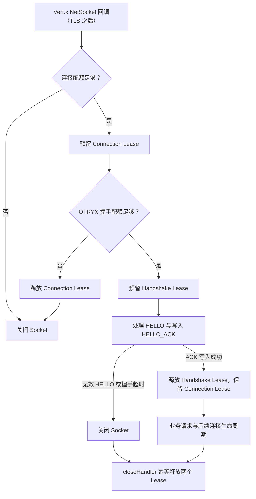
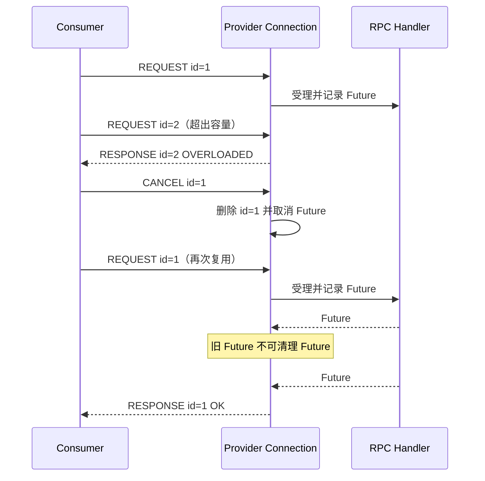

# Transport 接入容量与生命周期

状态：**U03-A 连接/HELLO 限额、U03-B 全局残帧预算与超时、U03-C Provider 单连接 Inflight 限额均已实现**；TLS 握手前资源治理不在这些限额覆盖范围内。

## 目的与边界

Provider 在进入 RPC Core Admission 前需要抵御大量连接与停留在握手阶段的连接。Vert.x 的 `TransportAdmissionController` 以每个 Transport Server 实例为范围，使用原子计数与幂等 Lease；拒绝只关闭 Socket，不等待或阻塞 EventLoop。

| 预算 | 默认值 | 实施状态及实际含义 |
|---|---:|---|
| `maxConnections` | 4096 | 已启用：Vert.x `NetSocket` 连接回调已接入且未关闭的连接数 |
| `maxHandshakes` | 1024 | 已启用：在 `NetSocket` 回调后开始，直至 HELLO_ACK 成功写出或连接关闭 |
| `maxBufferedPartialFrameBytes` | 67108864 | 已启用：每个 Transport Server 实例的残帧保留字节额度（追加前预留、消费后释放） |
| `partialFrameTimeout` | 10s | 已启用：残帧首次驻留到期关闭连接；追加小碎片不重置时限 |
| `maxInflightPerConnection` | 1024 | 已启用：每条 Provider NetSocket 独立跟踪未结束的 REQUEST 数；容量耗尽返回 OVERLOADED，不运行 Handler |
| `maxBufferedResponseBytes` | 67108864 | U04-B：每 Transport Server 已编码 RESPONSE 待写额度；写 Future 终态和 Socket 关闭后归还 Lease |

这些默认值是配置基线，**不是**经生产负载矩阵证明的最佳容量。请结合目标环境的连接数、容器内存、TLS 模式和业务并发重新验证。

## 握手与 Lease 所有权



成功 HELLO 时只归还握手额度，连接仍占用额度直至真实连接关闭。握手失败、Socket 异常、握手超时、Drain、主动关闭最终都通过同一个幂等所有权释放点收尾。应用层早期关闭不会把 Transport 资源视作已经释放。

**安全限制：** 当开启 TLS/mTLS 时，TLS 引擎可能在 Vert.x `NetSocket` 回调前分配资源。这两项配额不能限制 TCP backlog、内核 socket、TLS 预握手内存，也不等于整个 JVM 的硬内存上限；不要将 `maxConnections` 宣称为 TLS 握手攻击的完整防护策略。

## Spring Boot 配置

```yaml
otryx:
  rpc:
    transport:
      admission:
        max-connections: 4096
        max-handshakes: 1024
        max-buffered-partial-frame-bytes: 67108864
        partial-frame-timeout: 10s
        max-buffered-response-bytes: 67108864
```

程序化构建时可使用 `RpcTransportOptions.DEFAULT.withAdmission(new RpcTransportAdmissionOptions(...))`。所有额度必须为正值，部分帧超时还要求不超过一天；Spring 在绑定阶段拒绝非法配置。

## 回归与待完善项

- `TransportAdmissionControllerTest`：跨线程 CAS 限额、拒绝后的恢复和两次释放不产生负计数；
- `VertxRpcTransportAdmissionTest`：真实 TCP 连接限额、HELLO 配额失败与关闭后的恢复；
- `OtryxRpcAutoConfigurationTest`：Spring 配置绑定与非法数值拒绝。

U03-B 已在 `FrameAccumulator` 追加不完整数据前预留全局字节预算，在完整帧消费、错误、超时和关闭时立即归还。正常完整帧继续走无全局计数与中间累积复制的快速路径。残帧超时从开始保留的时间起算；如果交付了一帧而仍有下一帧残留，重启对应的新驻留时钟，小碎片追加不会无限续期。

全局残帧预算覆盖的是 **FrameAccumulator 逻辑保留的字节**，不是 TLS 引擎内存、Socket 接收缓冲、Netty Direct Buffer 容量或整个 JVM Heap 的硬上限。已有残帧时，会为新的 TCP chunk 在追加前保守地预留全部字节（即便其中可能包含随后立即交付的完整帧），避免瞬时无额度拷贝。

### Provider 每连接 Inflight（U03-C）

服务端 `VertxRpcTransportServer.ServerConnection` 在 EventLoop 内使用连接所有的 Inflight Map。优先检查 Request ID 非零、重复 ID 和协商 Codec，再检查 `inflight.size() >= maxInflightPerConnection`；超限用相同 Request ID 返回 `RpcStatus.OVERLOADED`，**不调用 Handler**，也不分配新的协议 Inflight 槽位。若写队列已满或拒绝帧超过协商的最大长度，改用 GO_AWAY 关闭连接，而不是无限堆积拒绝响应。

完成、CANCEL、关闭与 Drain 共同管理 Map 生命周期。特别注意 CANCEL 已删除旧 ID 后，新请求可能立即复用它：完成回调必须使用 **Request ID + 原 Future 实例** 双重匹配，绝不能让旧回调错误地移除新请求。重复正在执行的 ID 仍按协议错误拒绝。



**容量模型限制：** 此限额指连接层仍跟踪的请求数。CANCEL 能使连接协议槽位释放，但无法证明远端实际业务已退出；仍在运行的业务由 Core Provider Admission Lease 独立约束。多连接各自拥有独立预算，并非全局 Provider 并发限制。TLS 预握手、FrameAccumulator、写队列和业务资源必须分别建模，不能用这一个值宣传全链路硬容量约束。

验证测试：`serverMustEnforceConnectionInflightLimitAndRecover`、`cancelAndReusedRequestIdMustNotLoseNewInflightSlot`、`oneBusyConnectionMustNotExhaustAnotherConnectionsQuota`。现有重复 ID、CANCEL、Drain 与 TLS 回归继续作为硬门禁。


## U04-B：已编码响应的有界保留

Server 在 Handler 完成、检查协商的单帧长度和 Socket 当前写队列之后，为完整编码的 RESPONSE 获取共享 `ResponseByteBudget` 的 Lease。额度不足时立即 OVERLOADED/GO_AWAY；写 Future 终态或 Socket closeHandler 归还（由 Lease 保证重复释放安全）。Drain 必须等 Map 中的请求和本连接的 pending-response Lease 都清空。

这个预算跟踪的是框架响应写入的生命周期，不覆盖 Codec 编码期间峰值、OS/TLS/Netty 缓冲以及对端真正消费速度；成功的 write Future 不能被描述为远端已经接收。
