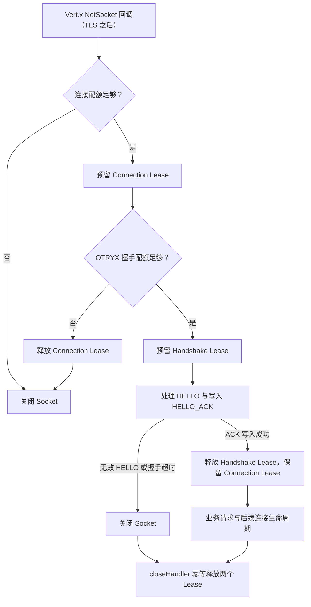

# Transport 接入容量与生命周期

状态：**U03-A 已实现的连接/HELLO 限额**；**U03-B 部分帧全局预算、U03-C Provider 单连接 Inflight 约束尚待实现**。

## 目的与边界

Provider 在进入 RPC Core Admission 前需要抵御大量连接与停留在握手阶段的连接。Vert.x 的 `TransportAdmissionController` 以每个 Transport Server 实例为范围，使用原子计数与幂等 Lease；拒绝只关闭 Socket，不等待或阻塞 EventLoop。

| 预算 | 默认值 | 实施状态及实际含义 |
|---|---:|---|
| `maxConnections` | 4096 | 已启用：Vert.x `NetSocket` 连接回调已接入且未关闭的连接数 |
| `maxHandshakes` | 1024 | 已启用：在 `NetSocket` 回调后开始，直至 HELLO_ACK 成功写出或连接关闭 |
| `maxBufferedPartialFrameBytes` | 67108864 | U03-B 预留配置；此时 **尚未**形成跨连接全局字节硬限制 |
| `partialFrameTimeout` | 10s | U03-B 预留配置；此时 **尚未**为每个不完整帧设置超时 |
| `maxInflightPerConnection` | 1024 | 独立的 `RpcTransportOptions` 字段；U03-C 将实现 Provider 入站限额 |

这些默认值是配置基线，**不是**经生产负载矩阵证明的最佳容量。请结合目标环境的连接数、容器内存、TLS 模式和业务并发重新验证。

## 握手与 Lease 所有权



成功 HELLO 时只归还握手额度，连接仍占用额度直至真实连接关闭。握手失败、Socket 异常、握手超时、Drain、主动关闭最终都通过同一个幂等所有权释放点收尾。应用层早期关闭不会把 Transport 资源视作已经释放。

**安全限制：** 当开启 TLS/mTLS 时，TLS 引擎可能在 Vert.x `NetSocket` 回调前分配资源。这两项配额不能限制 TCP backlog、内核 socket、TLS 预握手内存，也不等于整个 JVM 的硬内存上限；不要将 `maxConnections` 宣称为 TLS 握手攻击的完整防护策略。

## Spring Boot 配置

```yaml
otryx:
  rpc:
    transport:
      admission:
        max-connections: 4096
        max-handshakes: 1024
        max-buffered-partial-frame-bytes: 67108864
        partial-frame-timeout: 10s
```

程序化构建时可使用 `RpcTransportOptions.DEFAULT.withAdmission(new RpcTransportAdmissionOptions(...))`。所有额度必须为正值，部分帧超时还要求不超过一天；Spring 在绑定阶段拒绝非法配置。

## 回归与待完善项

- `TransportAdmissionControllerTest`：跨线程 CAS 限额、拒绝后的恢复和两次释放不产生负计数；
- `VertxRpcTransportAdmissionTest`：真实 TCP 连接限额、HELLO 配额失败与关闭后的恢复；
- `OtryxRpcAutoConfigurationTest`：Spring 配置绑定与非法数值拒绝。

U03-B 将在 `FrameAccumulator` 追加数据前预留全局部分帧预算，并在消费/断连/超时中归还；U03-C 将为每个服务端连接独立限制未完成 REQUEST，同时覆盖 CANCEL、重复 ID 与 Drain。上述能力未交付前仍不能宣传“全链路 Transport 容量已收敛”。
