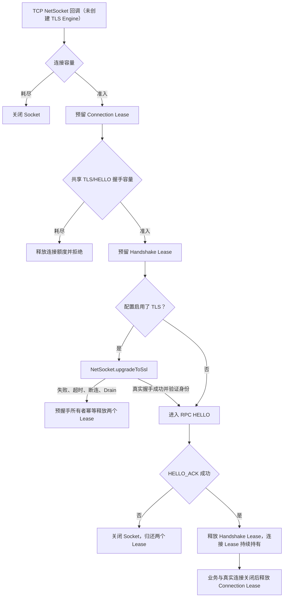
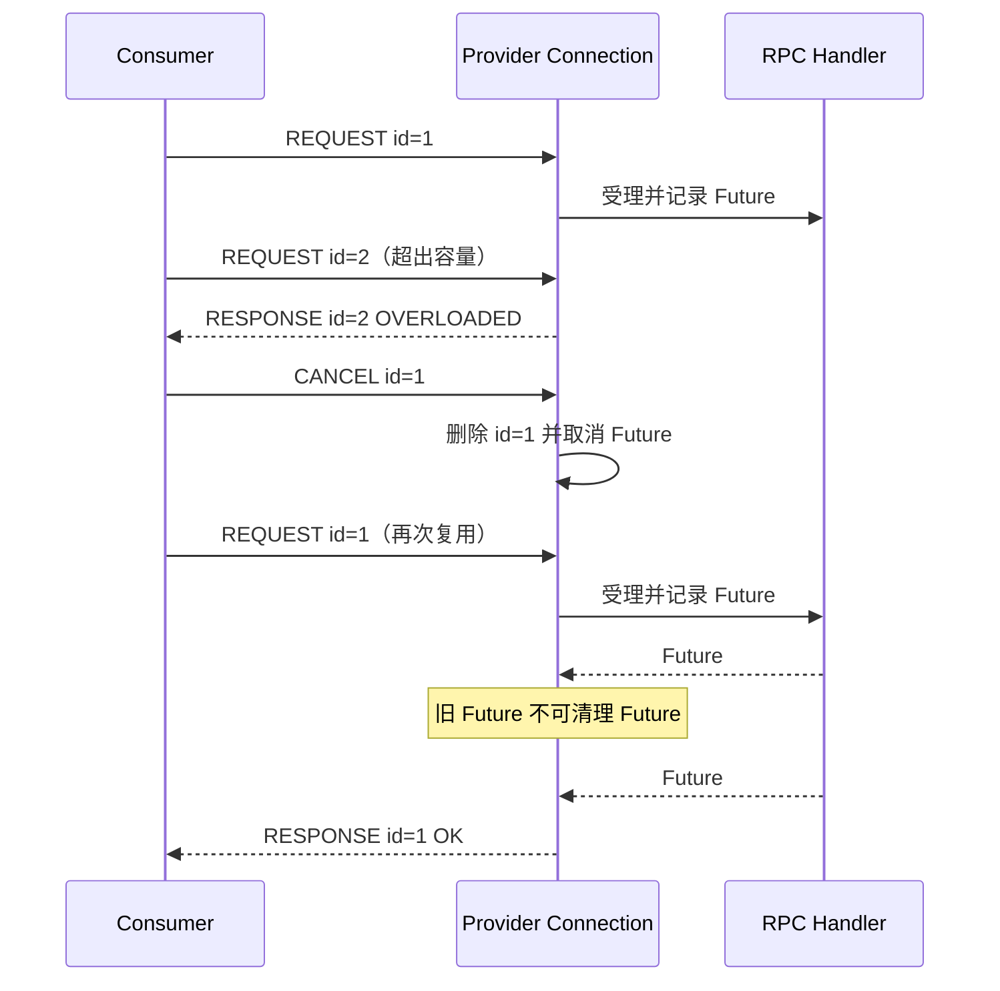

# Transport 接入容量与生命周期

状态：**U03-A 连接/HELLO 限额、U03-B 残帧预算、U03-C 单连接 Inflight 已实现**。V2-14 候选实现将 TLS Engine 创建前的 Socket/握手计数纳入同一预算；生效与否以 #141 PR 的真实 TLS/mTLS CI 验收为准。

## 目的与边界

Provider 在进入 RPC Core Admission 前需要抵御大量连接与停留在握手阶段的连接。Vert.x 的 `TransportAdmissionController` 以每个 Transport Server 实例为范围，使用原子计数与幂等 Lease；拒绝只关闭 Socket，不等待或阻塞 EventLoop。

| 预算 | 默认值 | 实施状态及实际含义 |
|---|---:|---|
| `maxConnections` | 4096 | TLS 启用时在原始 TCP `NetSocket` 接入、`upgradeToSsl()` 前预留连接；其他模式在普通 TCP 接入时预留 |
| `maxHandshakes` | 1024 | TLS 启用时覆盖 TLS 预握手及后续 HELLO，只有 HELLO_ACK 成功才释放；TLS 失败/超时或 Socket 关闭均释放 |
| `maxBufferedPartialFrameBytes` | 67108864 | 已启用：每个 Transport Server 实例的残帧保留字节额度（追加前预留、消费后释放） |
| `partialFrameTimeout` | 10s | 已启用：残帧首次驻留到期关闭连接；追加小碎片不重置时限 |
| `maxInflightPerConnection` | 1024 | 已启用：每条 Provider NetSocket 独立跟踪未结束的 REQUEST 数；容量耗尽返回 OVERLOADED，不运行 Handler |
| `maxBufferedResponseBytes` | 67108864 | U04-B：每 Transport Server 已编码 RESPONSE 待写额度；写 Future 终态和 Socket 关闭后归还 Lease |

这些默认值是配置基线，**不是**经生产负载矩阵证明的最佳容量。请结合目标环境的连接数、容器内存、TLS 模式和业务并发重新验证。

## 握手与 Lease 所有权


成功 HELLO 时只归还握手额度，连接仍占用额度直至真实连接关闭。握手失败、Socket 异常、握手超时、Drain、主动关闭最终都通过同一个幂等所有权释放点收尾。应用层早期关闭不会把 Transport 资源视作已经释放。

**边界：** TLS 启用时监听器先以 `ssl=false` 接收 TCP，EventLoop 在本地取得连接与共享握手配额之后立即 `upgradeToSsl()`。未经 TLS 的明文 RPC 请求不会交付给 Handler。TLS 失败、超时、断连或 Drain 由预握手对象一次性释放额度。手动握手仍依赖 Vert.x/JSSE 的超时和内核安全设置：计数不限制 TCP backlog、内核 Socket 缓冲、每个 TLS Engine 的峰值或整个 JVM Heap/DirectMemory，不能称为全 JVM 硬内存界。安全 Profile、身份/证书绑定、热更新仍需真实 mTLS E2E 验证。

## Spring Boot 配置

```yaml
otryx:
  rpc:
    transport:
      admission:
        max-connections: 4096
        max-handshakes: 1024
        max-buffered-partial-frame-bytes: 67108864
        partial-frame-timeout: 10s
        max-buffered-response-bytes: 67108864
```

程序化构建时可使用 `RpcTransportOptions.DEFAULT.withAdmission(new RpcTransportAdmissionOptions(...))`。所有额度必须为正值，部分帧超时还要求不超过一天；Spring 在绑定阶段拒绝非法配置。

## 回归与待完善项

- `TransportAdmissionControllerTest`：跨线程 CAS 限额、拒绝后的恢复和两次释放不产生负计数；
- `VertxRpcTransportAdmissionTest`：真实 TCP 连接限额、HELLO 配额失败与关闭后的恢复；
- `VertxTlsPreHandshakeAdmissionTest`：真实 mTLS 监听端的无 ClientHello 洪峰、越限立即拒绝、关闭/Drain 归还，以及恢复后合法 TLS RPC；
- `OtryxRpcAutoConfigurationTest`：Spring 配置绑定与非法数值拒绝。

U03-B 已在 `FrameAccumulator` 追加不完整数据前预留全局字节预算，在完整帧消费、错误、超时和关闭时立即归还。正常完整帧继续走无全局计数与中间累积复制的快速路径。残帧超时从开始保留的时间起算；如果交付了一帧而仍有下一帧残留，重启对应的新驻留时钟，小碎片追加不会无限续期。

全局残帧预算覆盖的是 **FrameAccumulator 逻辑保留的字节**，不是 TLS 引擎内存、Socket 接收缓冲、Netty Direct Buffer 容量或整个 JVM Heap 的硬上限。已有残帧时，会为新的 TCP chunk 在追加前保守地预留全部字节（即便其中可能包含随后立即交付的完整帧），避免瞬时无额度拷贝。

### Provider 每连接 Inflight（U03-C）

服务端 `VertxRpcTransportServer.ServerConnection` 在 EventLoop 内使用连接所有的 Inflight Map。优先检查 Request ID 非零、重复 ID 和协商 Codec，再检查 `inflight.size() >= maxInflightPerConnection`；超限用相同 Request ID 返回 `RpcStatus.OVERLOADED`，**不调用 Handler**，也不分配新的协议 Inflight 槽位。若写队列已满或拒绝帧超过协商的最大长度，改用 GO_AWAY 关闭连接，而不是无限堆积拒绝响应。

完成、CANCEL、关闭与 Drain 共同管理 Map 生命周期。特别注意 CANCEL 已删除旧 ID 后，新请求可能立即复用它：完成回调必须使用 **Request ID + 原 Future 实例** 双重匹配，绝不能让旧回调错误地移除新请求。重复正在执行的 ID 仍按协议错误拒绝。



**容量模型限制：** 此限额指连接层仍跟踪的请求数。CANCEL 能使连接协议槽位释放，但无法证明远端实际业务已退出；仍在运行的业务由 Core Provider Admission Lease 独立约束。多连接各自拥有独立预算，并非全局 Provider 并发限制。TLS 预握手、FrameAccumulator、写队列和业务资源必须分别建模，不能用这一个值宣传全链路硬容量约束。

验证测试：`serverMustEnforceConnectionInflightLimitAndRecover`、`cancelAndReusedRequestIdMustNotLoseNewInflightSlot`、`oneBusyConnectionMustNotExhaustAnotherConnectionsQuota`。现有重复 ID、CANCEL、Drain 与 TLS 回归继续作为硬门禁。


## U04-B：已编码响应的有界保留

Server 在 Handler 完成、检查协商的单帧长度和 Socket 当前写队列之后，为完整编码的 RESPONSE 获取共享 `ResponseByteBudget` 的 Lease。额度不足时立即 OVERLOADED/GO_AWAY；写 Future 终态或 Socket closeHandler 归还（由 Lease 保证重复释放安全）。Drain 必须等 Map 中的请求和本连接的 pending-response Lease 都清空。

这个预算跟踪的是框架响应写入的生命周期，不覆盖 Codec 编码期间峰值、OS/TLS/Netty 缓冲以及对端真正消费速度；成功的 write Future 不能被描述为远端已经接收。

## V2-14：TLS 预握手与输出编码高水位

TLS/mTLS 连接经过 `TCP accept → Connection/Handshake Lease → upgradeToSsl() → 真实 TLS Peer 证明 → RPC HELLO`。用于发起 TLS 的 Lease 覆盖尚未发送 ClientHello 的 Socket，不必先创建 SSL Engine。关闭、失败、TLS 超时与 Drain 使用幂等释放。握手前计数并不限制内核 accept backlog 或单个 JSSE Engine 的真实 Heap/DirectMemory 使用，相关配置仍需要操作系统与运行时防护。

Provider 输出编码使用 `server.encoding`，默认单 Transport 对应 Provider 运行时：

| 配置键 | 默认值 | 含义 |
|---|---:|---|
| `server.encoding.max-buffered-bytes` | 67108864 | 当前 Provider 全部并发编码流保留的可增长缓冲容量总额，扩容前 CAS 预留 |
| `server.encoding.max-response-bytes` | 16777216 | 单次响应 Payload 的上限；还受实际 Codec 已声明的 maxPayloadBytes 限制 |

Fory 在编码结果时直接写入受限 OutputStream，单次结果过大或全局容量耗尽会返回 `OVERLOADED`，不会携带业务对象信息。为保障 Wire v1 兼容，需要比较原 `encodeResult(value)` 与新的流式输出字节是否完全相同。未覆盖 `encodeResultTo` 的第三方 Codec 仍由兼容默认方法先分配完整字节数组，**不能据此声称其编码前内存有硬上界**；上线前应提供真实流式覆盖和专用压力试验。

`RpcResponseEncodingBudget` 的 `reservedBytes/highWaterBytes` 只计量当前 Java 输出缓冲的**有效保留容量**，不计算并行数组扩容复制、Fory 对象图、最终 Wire 帧复制、Netty Write Buffer、SSL 内存或内核 Socket。该计量应与 Heap peak、DirectMemory、实际序列化时长和全链路 Lease/FD 采集一起验收，不能把输出缓冲额度改写为整进程的绝对峰值证明。#146 的正式容量矩阵仍独立执行。
