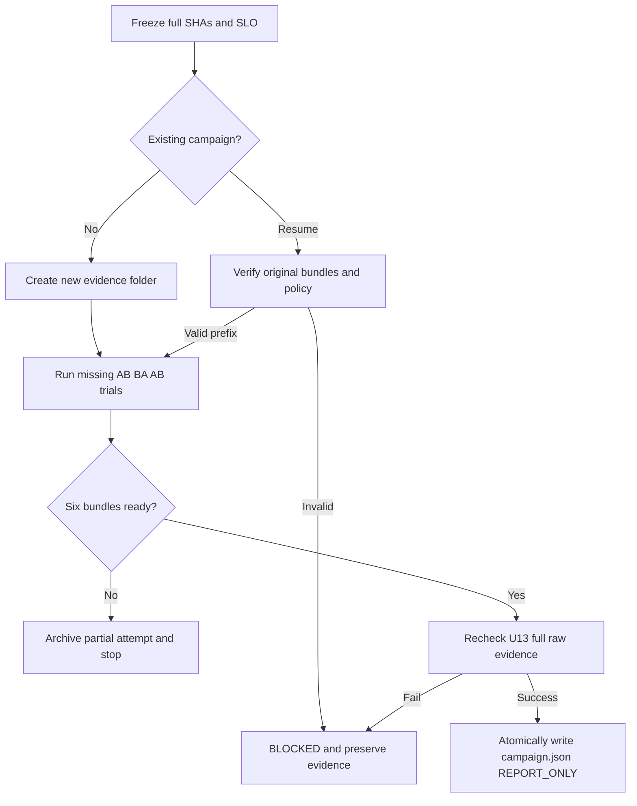

# V2-19 性能矩阵与应用级注册规模对照

> 工具完成不代表性能实验完成：截至本文编写时尚无可验证的固定物理机六轮 60 分钟原始结果，因此 **BLOCKED（正式证据）**，不可宣称 P0 性能验收或生产 QPS/SLO。

## 已有的受控实验基础

仓库原有 `scripts/run_v2d2_benchmark_matrix.sh` 覆盖 Payload、连接分片、线程、TLS、错误注入、不同执行模式，并使用 JMH `-prof gc` 记录分配。实际逻辑并发 `PerformanceSoakRunner` 与 `scripts/check_soak_quality.py` 不把配置的 `concurrency=10000` 当作实际 inflight。固化的 `check_u13_campaign.py` 要求 **AB BA AB 六次完整固定主机运行**、每次至少 3600s、真实原始 Full Matrix/JMH 与 SHA256、固定 JDK21/CPU/JVM/内存/主机指纹、事先定义错误率及并发阈值；共享 Runner 只能 Smoke，永不充当官方容量结论。

## 本期补充：控制面服务注册缩减的真实量测

应用级注册的理论 Registry Member 数不会随接口数成倍扩张，但理论值**不是实测**。需分别在真正旧接口级版本和现行应用级版本，以同一后端和固定物理机，给同一 30 接口×10 实例工作负载采集至少三轮原生后台计数，记录：

- `nativeMembers`：实际后端原生成员条目数，而不是 Java Client 对象数；
- `activeSubscriptions` / `watchEvents`：控制面订阅数、固定观察窗口发生的原生 Watch 事件；
- `consumerRssBytes`：进程真实 RSS，而不是 JVM 配额或者虚构估算；
- `recoveryMillis`：实际故障恢复耗时，必须固定注入时点及观察窗口；
- 源代码完整 SHA、固定 Host fingerprint、JDK21、JVM flags、后端、接口/实例数、负载标识和唯一 runId。

**注意：** 历史接口级源码必须在隔离 worktree 和测试 Registry 中真实运行；不能将旧 ServiceKey 注册 SPI 重新带回主线。后端 `origin` 必须是 `backend-native`，任意 `formula-estimate` 等推算数据将被拒绝。为避免泄漏，不记录真实 InstanceId 或业务参数。

原始两侧 JSON：

```json
{
  "registryModel": "application",
  "commit": "<40-hex-sha>",
  "hostFingerprintSha256": "<64-hex-host-hash>",
  "backend": "etcd",
  "jdkMajor": 21,
  "jvmFlags": "-Xms256m -Xmx256m",
  "interfaces": 30,
  "instances": 10,
  "workloadId": "<fixed-experiment-id>",
  "runs": [
    {
      "runId": "<unique-run-id>",
      "capturedAt": "<ISO-8601-with-zone>",
      "sampleSeconds": 60,
      "origin": "backend-native",
      "nativeMembers": 0,
      "activeSubscriptions": 0,
      "watchEvents": 0,
      "consumerRssBytes": 0,
      "recoveryMillis": 0
    }
  ]
}
```

此 JSON 只说明**字段结构**，不是可运行或可验收的样例：零成员/RSS 会被拒绝，runs 不足三条会被拒绝。指标必须来自真实测量并保留底层原始监测记录。

```bash
python3 scripts/test_v2_19_registration_scale.py
python3 scripts/check_v2_19_registration_scale.py \
  --legacy <measured-legacy.json> \
  --application <measured-application.json> \
  --output target/v2-19/registry-scale-report.json
```

若文件缺失、主机不一致、Commit 相同、缺少真实原生计数或重复 runId，命令退出状态 2 且不生成虚假证据。通过也只输出 `REPORT_ONLY`，从不自行宣布性能达标；需结合 [U13 性能证据总控](performance-evidence.md) 和 [Soak 正式门禁](soak-acceptance.md) 人工签署 SLO 与严重退化阈值。

## 不能关闭 #146 的外部前置条件

1. 确定真实固定物理机、独立目标应用和后端，锁定两版完整 Git SHA 和不可变 JVM/CPU 参数。
2. **测试前**声明错误率、p99/p99.9、吞吐、Allocation、恢复/抖动的门限与严重退化阈值。
3. 六次 AB BA AB Full Matrix + 每次至少一小时 soak，保留原始性能数据、JFR/GC/JMH、CPU/DirectMemory/Heap/FD、各类失败及限流指标。
4. 完成注册规模实测、真实 TLS/mTLS 和故障场景，并经人工核对原始来源及回归结论。

缺少这些真实结果时保持 `BLOCKED`，不得以 CI Smoke 或模拟输出关闭 Issue #146。

## 六轮受控 Campaign 一次性执行入口

当前补充 `scripts/run_v2_19_controlled_campaign.py`，只在真实固定 Linux 物理机、JDK 21、可用 Maven Wrapper、完整历史两版本 SHA 和测前冻结阈值齐全后启动。自动建立两个本地 detached worktree，**串行**运行 Baseline → Candidate → Candidate → Baseline → Baseline → Candidate。每轮复用原有 `run_v2d2_fixed_evidence.sh` 严格执行完整 JMH Matrix、10000 逻辑并发、至少 3600 秒 Soak，检查 Runner 基线与原始 SHA256；六轮全部成功后再调用 `check_u13_campaign.py` 重新复算。所有报告保持 REPORT_ONLY。

在仓库根目录运行（占位值必须替换为真实机器/审批结果）：

```bash
export OTRYX_RPC_RUNNER_ID="<actual-physical-runner-id>"
export OTRYX_RPC_EXPECT_HOST_FINGERPRINT_SHA256="<64-hex-preflight-host-hash>"
export OTRYX_RPC_JVM_FLAGS="-Xms2g -Xmx2g"
export OTRYX_RPC_SOAK_MAX_ERROR_RATE="<predeclared-maximum-error-ratio>"
export OTRYX_RPC_SOAK_MAX_P99_MICROS="<predeclared-positive-p99-budget>"
export OTRYX_RPC_SOAK_MIN_OBSERVED_INFLIGHT="<predeclared-observed-floor>"
export OTRYX_RPC_SOAK_CONCURRENCY="10000"
export OTRYX_RPC_SOAK_DURATION_SECONDS="3600"
python3 scripts/run_v2_19_controlled_campaign.py \
  --baseline-sha "<40-hex-baseline-commit>" \
  --candidate-sha "<40-hex-candidate-commit>" \
  --output-dir "/data/otryx-v2-19-evidence/campaign-01"
```

如果第 N 轮失败，需在**同一固定物理机**按完全相同的 SHA、环境和测前阈值重用上面的命令，仅额外添加 `--resume`；无需重新运行已经校验的前 N−1 轮。恢复操作先比对 `predeclared-policy.json` 的两侧源码 SHA、Runner 身份、JVM 参数、错误率/inflight/p99 预算；对已经完成的连续前缀逐轮校验来源身份、宿主指纹和原始文件 SHA256，拒绝乱序、重复或被篡改的证据。上轮失败的非完整目录会被**移动保留**至 `failed-attempts/<run-id>/attempt-NNN/` 后重新执行，不会直接删除原始现场。

```bash
# 复用与初次命令完全相同的 export 和两个 SHA / 证据目录
python3 scripts/run_v2_19_controlled_campaign.py \
  --baseline-sha "<same-baseline-commit>" \
  --candidate-sha "<same-candidate-commit>" \
  --output-dir "/data/otryx-v2-19-evidence/campaign-01" \
  --resume
```

提交前会运行完整 `check_u13_campaign.py` 校验；`campaign.json` **仅在六轮通过复算后原子生成**，此前只允许存在隐藏的 `.campaign-validation-pending.json`。即使全部六轮执行结束，如果完整证据检查失败，也只有 `campaign-failure.json`，不可误认为正式通过。



该命令**拒绝覆盖已有目录**、两个相同 SHA、错误或空的宿主身份、GitHub shared-runner、降低为 Smoke 的测试配置、未填写 p99 正数预算、错误率上限为 100% 或不满足的阈值；并将 `OTRYX_RPC_REQUIRE_BARE_METAL=true` 传递给原有物理主机预检。无环境、脚本出错或任一轮不足时返回非零，保留已完成的原始包及 `campaign-failure.json`，不生成完整的 `campaign.json` 或伪成功结论。测试中的 Git worktree/manifest Fixture 仅验证脚本调度，不是性能证据，命令 `python3 scripts/test_v2_19_controlled_campaign.py`。

**正式阻塞尚未解除：** 尚未取得授权的物理主机及测前 SLO、两个版本中适用且可比较的真实基准工作负载、至少六个不可篡改的实际证据包和独立性能复核。不得用共享 CI、模拟数据或单机局部 smoke 关闭 #146，也不自动发布 1.0.0。
