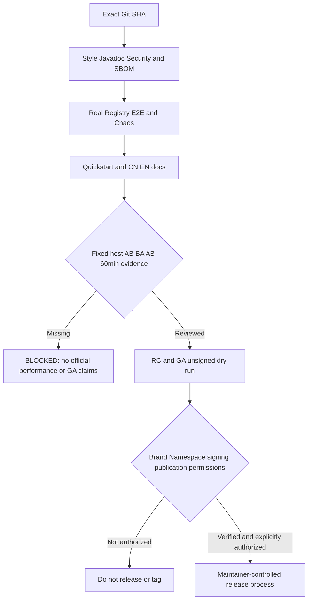

# V2-20 首发前规范、文档和工程验收清单

> **当前状态：工程收口推进中；不等于首发 GA 已准备完成或已发布。**
> 本页面只陈述已在准确 Git Head 上有可回溯 CI/源码证据的能力。
> 严格依赖 #146 在真实固定物理机完成的 60 分钟六轮正式性能实证，
> 因此不得在缺少真实原始数据的情况下关闭 [#147](https://github.com/Ryan-Guizhou/otryx-rpc/issues/147)。

## 1. 当前版本不可违背的架构契约

- JDK 21 / Spring Boot 3.5.4 / `1.0.0-SNAPSHOT` / Wire v1；禁止未经授权发行或创建 Tag。
- Provider、Consumer-only、BOTH 都必须有真实应用级 Member；Consumer-only 不具有路由 RPC Endpoint。
- `ServiceKey` 仅用作调用业务接口契约，不能作为 Registry 服务实例主键。
- 仅一个 `otryx-spring-boot-starter`，新用户从 `otryx-quickstart` 起步；已删除 Lite Starter 和旧 Examples。
- 显式安全 Profile，mTLS/受保护注册来源/调用授权、响应编码预算、取消/超时/背压必须 Fail Closed；禁止修复 CI 时弱化权限或容量限额。

## 2. 质量来源与明确的有限结论

| 验收项 | 已有入口 | 验收边界 |
|---|---|---|
| Maven Reactor + 单元/集成测试 | `./mvnw -B -ntp clean verify -Pquality`、CI 与 Release Readiness | 每次只认准确 Head 对应的全部必需检查，无测试运行就不能判定通过 |
| 代码风格/Javadoc/中文 API 注释、英文 SLF4J 日志 | `-Pstyle-audit`、`scripts/check_java_magic_literals.py`、`scripts/check_project.py` | 静态零报告不证明所有并发/资源行为正确；架构禁止 Core 逆向依赖外部 Adapter |
| Registry/部署兼容 | 四后端独立 JVM Matrix、Nacos/Etcd/Consul/Eureka E2E 与 Chaos、Rolling Compatibility | 同 JVM 10 Client 不等于十个业务进程，Shared CI 不是生产稳定性 |
| 业务安全与资源 | Security Profile、mTLS、授权前解码阻断、容量、Deadline、Governance 原子快照 | 不得因旧 Snapshot/安全 epoch 失效恢复旧连接或先解码未经授权业务参数 |
| 首发文档 | 中英文 README 标记一致、Markdown 链接、Mermaid/SVG 预览及 Quickstart 使用路径 | `docs/reference/governance.md`、首发验收当前状态不得残留 Lite Starter、Examples 等退役入口 |
| 供应链 | CycloneDX SBOM、Sources/Javadoc、依赖审计、SHA256 和 RC/GA dry-run 脚本 | 工具可运行不等于手动 rc1/ga 完整 Dry Run 已执行；不含签名、Central 上传或授权证明 |
| 性能正式量化 | `docs/reference/performance-evidence.md`、`scripts/check_u13_campaign.py`、真实固定机采样要求 | 尚未取得独立物理机六轮每轮至少 3600 秒 soak 和原始分配/故障/注册规模证据，**BLOCKED** |

## 3. 发布安全门

**不存在自动「GA Ready」判定**：各 CI 工作流可验证当前提交质量，但正式性能实验、品牌/Namespace 权利、真实发行授权是额外门槛。未经授权不得签名、发布、创建 Tag 或变更仓库权限。

## 4. 工程补漏检查

当前工程门禁 `scripts/check_project.py` 会显式阻断在当前首发参考文档中重新写入 `Lite Starter`、`Examples/Benchmarks` 及已完成 Issue #144 的旧「开发候选」状态；不改历史 archive 文档。这属于**回归防护**，不是补充生产遥测、强行关闭性能问题或降低质量规则。

完整发布前材料：[首发 RC/GA 验收](first-release-acceptance.md) · [应用注册验收](application-registry-acceptance.md) · [正式性能证据](performance-evidence.md) · [性能长稳门槛](soak-acceptance.md) · [动态治理](governance.md)。
