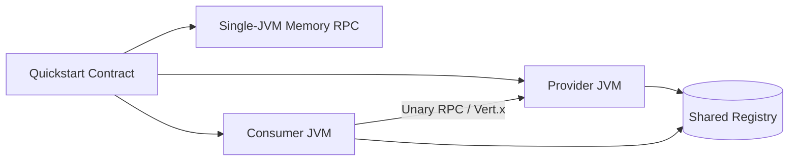
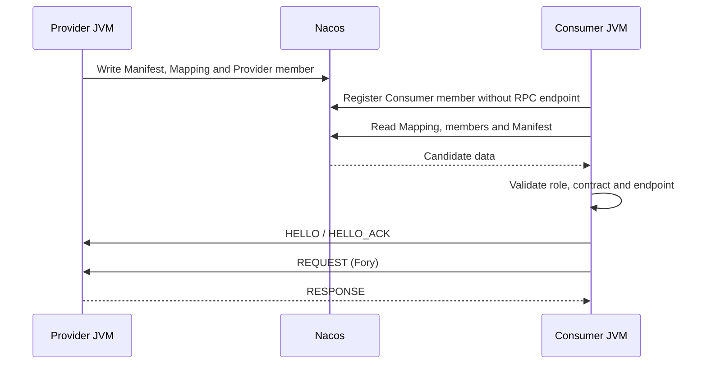

# OTRYX RPC Quickstart

> **Source baseline**: 1.0.0-SNAPSHOT, JDK 21, Spring Boot 3.5.4, Wire v1. This build is not yet on Maven Central. `TRUSTED_DEVELOPMENT` is **only for isolated local environments**.

This is a **runnable learning project**, not a set of disconnected snippets. Start with a real single-JVM RPC round trip, then move to two independent processes, A → B → C deadlines, pluggable registries and transport security. Use one `otryx-spring-boot-starter`; Nacos and other adapters are explicit dependencies.

## Module map and learning paths

| Step | Module(s) | Process model | Infrastructure | Goal |
|---|---|---|---|---|
| 1 | `otryx-quickstart-memory` | Provider + Consumer in **one JVM** | None | Real RPC over loopback |
| 2 | `otryx-quickstart-api` | Shared contract / DTO module | None | Interface, generated stub |
| 3 | `otryx-quickstart-provider` + `otryx-quickstart-consumer` | Two JVMs | Nacos | Registry, discovery, RPC |
| 4 | Consumer + Relay + Leaf | Three JVMs | Nacos | Deadline and metadata propagation |
| 5 | Optional profiles | Separate JVMs | Consul/Eureka/PKI | Registry alternatives and TLS/mTLS |



**Memory Registry is strictly in-process.** Use Nacos, Consul, Eureka or another shared registry for independent JVMs.

## Prerequisites and build

From the **repository root**: JDK 21, Maven Wrapper (Maven 3.9.11), access to Maven Central for the first dependency download. Docker is required only for the Nacos walkthrough, not for the Memory Quickstart.

The Bash initialization and independent-process verification scripts require GNU coreutils `timeout` on `PATH`. It is not included in a default macOS installation; install and configure it before using those scripts.

```bash
git clone https://github.com/Ryan-Guizhou/otryx-rpc.git
cd otryx-rpc
java -version
./mvnw --version
./mvnw -B -ntp -pl otryx-quickstart -am clean package
```

On Windows use `mvnw.cmd` instead of `./mvnw`. The shell snippets below target Linux/macOS; Windows can run the exact `-exec.jar` artifact paths from two terminals.

## 1. Zero-infrastructure Memory Quickstart

```bash
bash scripts/run_quickstart_memory.sh
# Or launch and stop it manually with Ctrl+C:
java -jar otryx-quickstart/otryx-quickstart-memory/target/otryx-quickstart-memory-1.0.0-SNAPSHOT-exec.jar
```

Expected log marker:

```text
Quickstart memory RPC succeeded: Hello, Quickstart!
```

`MemoryGreetingRunner` invokes `@OtryxRpcReference`, the Consumer encodes with Fory, Vert.x sends over loopback to `MemoryGreetingServiceImpl`, and the response is decoded. This tests a **real** RPC round trip. It does not make the development security profile suitable for an untrusted network.

Provider routes refresh asynchronously after application membership is acknowledged. The Memory demo retries explicit unavailable results only for the declared idempotent `hello`, within a discovery budget of at most 10 seconds. An existing parent deadline shortens that budget, and each RPC uses the remaining time. Business, protocol and response-validation failures stop immediately; interruption preserves the interrupt flag and ends the wait.

Source: [Provider](otryx-quickstart-memory/src/main/java/com/peachsoft/otryx/quickstart/memory/MemoryGreetingServiceImpl.java) · [Consumer](otryx-quickstart-memory/src/main/java/com/peachsoft/otryx/quickstart/memory/MemoryGreetingRunner.java) · [Configuration](otryx-quickstart-memory/src/main/resources/application.yml).

## 2. Nacos: two independent JVMs

Start Nacos:

```bash
docker compose -f otryx-quickstart/docker-compose.yml up -d
```

Both applications explicitly depend on `otryx-registry-nacos` and configure `registry.type=nacos` in their respective `application.yml`. The single Starter deliberately does **not** transitively pull Nacos.

**Initialize Nacos V2 Mapping shards before starting any Provider or Consumer.** Wait for Nacos HTTP port `8848` and client gRPC port `9848`, then run this command in an exclusive maintenance window with no application writing to the same namespace/group:

```bash
bash scripts/bootstrap_quickstart_nacos.sh \
  otryx-quickstart/otryx-quickstart-provider/target/otryx-quickstart-provider-1.0.0-SNAPSHOT-exec.jar \
  127.0.0.1:8848 public OTRYX_RPC
```

The standalone JVM invokes the existing `NacosV2MetadataBootstrap` with the same endpoint, namespace and Nacos group used below. It creates missing shards and validates and preserves existing contents. Resolve initialization failures before starting applications. Normal Starter startup does not replace this maintenance step, which must never run concurrently with application Mapping writes. See the [Nacos V2 contract](../docs/reference/registry-nacos-v2.md#4-nacos-config-servicemappingmd5-casfencing分片).

Provider terminal:

```bash
java -jar otryx-quickstart/otryx-quickstart-provider/target/otryx-quickstart-provider-1.0.0-SNAPSHOT-exec.jar
```

Expected: `OTRYX RPC server started: bind=0.0.0.0:19090, advertised=127.0.0.1:19090`.

Consumer terminal:

```bash
java -jar otryx-quickstart/otryx-quickstart-consumer/target/otryx-quickstart-consumer-1.0.0-SNAPSHOT-exec.jar
```

Expected: `RPC quickstart completed successfully: Hello, OTRYX RPC!`.



Verify real Nacos/Provider recovery with the same Consumer process:

```bash
OTRYX_RPC_E2E_RESTART_NACOS=false bash scripts/run_quickstart_process_e2e.sh
```

The CI version can additionally restart the test Nacos container and verify subscription recovery and endpoint changes.

The two-process, three-process and rolling verification scripts each use a separate Nacos group per run. They initialize shards before the first application starts and pass the same scope to every application start, restart and fresh Consumer probe.

## 3. Three independent JVMs: A → B → C

With Nacos running:

```bash
bash scripts/run_three_process_deadline_e2e.sh
```

The script launches Consumer A, Relay Provider B (19091), and Leaf Provider C (19090). A sets a 5-second per-call deadline and metadata; B's local 10-second client timeout must not extend A's remaining budget; C validates the remaining deadline and propagated metadata.

Expected:

```text
RPC deadline chain completed: CHAIN_OK remainingMillis=...
```

The script validates real RPC and cleans up the child processes.

## 4. Use the single Starter in your application

The API module compiles a shared `@OtryxRpcContract` with an annotation processor. Generated Stub/Dispatcher is preferred; a JDK Proxy / MethodHandle fallback exists when generated code is absent:

```java
@OtryxRpcContract
public interface GreetingService {
    @OtryxRpcIdempotent
    GreetingReply hello(GreetingRequest request);
}
```

Provider: `@OtryxRpcService(interfaceClass = GreetingService.class, version = "1.0.0")`.

Consumer: `@OtryxRpcReference(version = "1.0.0")`.

Only declare `@OtryxRpcIdempotent` for truly idempotent operations, not blindly for payments or order creation.

```xml
<dependency>
    <groupId>com.peachsoft.otryx</groupId>
    <artifactId>otryx-spring-boot-starter</artifactId>
    <version>1.0.0-SNAPSHOT</version>
</dependency>
<!-- Only when you need Nacos: -->
<dependency>
    <groupId>com.peachsoft.otryx</groupId>
    <artifactId>otryx-registry-nacos</artifactId>
    <version>1.0.0-SNAPSHOT</version>
</dependency>
```

Other opt-in adapters include Etcd, Consul, Eureka, CGLIB, ByteBuddy, Micrometer, OpenTelemetry and JFR. The Starter entrypoint does not change. See the [Starter reference](../docs/reference/starter.md).

## 5. Consul / Eureka profiles

The Provider and Consumer build files include the optional Consul/Eureka adapters required by these demonstrations. Start your own Consul agent or Eureka server, then apply the **same** Spring profile to both JVMs:

```bash
# Provider terminal:
java -jar otryx-quickstart/otryx-quickstart-provider/target/otryx-quickstart-provider-1.0.0-SNAPSHOT-exec.jar --spring.profiles.active=consul
# Consumer terminal:
java -jar otryx-quickstart/otryx-quickstart-consumer/target/otryx-quickstart-consumer-1.0.0-SNAPSHOT-exec.jar --spring.profiles.active=consul
```

Eureka stores application membership and requires a separate Manifest/Mapping backend. The following example requires both Eureka and Consul; both adapters are already explicit Quickstart dependencies. Configure the same Consul KV backend in both JVMs:

```bash
# Provider terminal:
java -jar otryx-quickstart/otryx-quickstart-provider/target/otryx-quickstart-provider-1.0.0-SNAPSHOT-exec.jar \
  --spring.profiles.active=eureka \
  --otryx.rpc.registry.eureka.metadata-backend=consul \
  --otryx.rpc.registry.eureka.metadata-endpoints=http://127.0.0.1:8500
# Consumer terminal:
java -jar otryx-quickstart/otryx-quickstart-consumer/target/otryx-quickstart-consumer-1.0.0-SNAPSHOT-exec.jar \
  --spring.profiles.active=eureka \
  --otryx.rpc.registry.eureka.metadata-backend=consul \
  --otryx.rpc.registry.eureka.metadata-endpoints=http://127.0.0.1:8500
```

The Consul profile reads `CONSUL_HTTP_TOKEN`; Eureka membership reads `EUREKA_USERNAME`/`EUREKA_PASSWORD`. Credentials for Eureka's external metadata backend must be supplied separately through `metadata-options`, as described in the [Starter backend configuration](../docs/reference/starter.md). Never commit real credentials. See [Consul V2](../docs/reference/registry-consul-v2.md) and [Eureka V2](../docs/reference/registry-eureka-v2.md) for backend contracts.

## 6. TLS / mTLS safety boundaries

The optional `application-tls.yml` and `application-mtls.yml` profiles use `OTRYX_QUICKSTART_TLS_CERT`, `OTRYX_QUICKSTART_TLS_KEY`, and `OTRYX_QUICKSTART_TLS_CA` for PEM credentials. Enable with `--spring.profiles.active=tls` or `mtls` and provision matching CA/hostname identities.

Update older launch scripts that use `OTRYX_RPC_TLS_CERT`, `OTRYX_RPC_TLS_KEY` or `OTRYX_RPC_TLS_CA` to the names above and remove the old environment variables, which strict configuration validation rejects. The underlying `otryx.rpc.transport.security.*` certificate properties and security requirements are unchanged.

The mTLS profile selects `NETWORK_MTLS` with a strict Fory DTO allowlist. **This is not sufficient for an authorized business RPC call**: Provider must also expose an `RpcAuthorizer` validating authenticated client identity, ServiceKey and MethodId. Without it, network-profile calls are rejected by default. Read the [security guide](../docs/security.md) before network exposure.

## 7. Observability, capacity and lifecycle

`QuickstartCallObserver` is a Spring `RpcObserver` that counts success/failure outcomes without reading sensitive payloads. Add Micrometer, OpenTelemetry or JFR adapters only when needed. Calls can be rejected under admission/backpressure; retries are limited to explicitly idempotent methods. Provider drain and Consumer closure are managed by the runtime. See [Operations](../docs/operations.md) and [Deadlines](../docs/reference/deadline-context.md).

## 8. Troubleshooting

| Symptom | Checks |
|---|---|
| `-exec.jar` not found | Run `./mvnw -B -ntp -pl otryx-quickstart -am clean package` from repo root |
| Maven cannot resolve `1.0.0-SNAPSHOT` | Not published: run `./mvnw -B -ntp clean install -DskipTests` first |
| Nacos endpoint unavailable | Compose service, 8848/9848, matching namespace/configuration |
| Memory mode cannot discover remote JVM | Memory Registry is not shared across processes |
| `NETWORK_MTLS` rejects requests | CA/keys/hostname, Fory allowlist and `RpcAuthorizer` |
| Calls timeout | Provider readiness, discovery, deadline, overload and client timeout |
| Port collision | Provider normally uses 19090; the relay scenario uses 19090/19091 |

## 9. Validation and cleanup

```bash
python3 scripts/test_quickstart_layout.py
./mvnw -B -ntp clean verify -Pquality
bash scripts/run_quickstart_memory.sh
# These require a running local Nacos:
OTRYX_RPC_E2E_RESTART_NACOS=false bash scripts/run_quickstart_process_e2e.sh
bash scripts/run_three_process_deadline_e2e.sh
docker compose -f otryx-quickstart/docker-compose.yml down
```

Read next: [User guide](../docs/user-guide.md) · [Starter reference](../docs/reference/starter.md) · [Architecture](../docs/architecture.md) · [Protocol compatibility](../docs/wire-compatibility.md). A short Quickstart run is **not** a production performance SLO or GA certification.

## V2 application registry migration status (development branch)

Core provides `ApplicationMembershipCoordinator`, `ApplicationServiceResolver`,
`OtryxRpcClient.applicationControlPlane(...)` and `OtryxRpcServer.applicationMembership(...)`.
`ApplicationRuntimeEndToEndTest` exercises real Wire v1 RPC with three contracts,
an independent Consumer and a same-process BOTH role.

The #137 branch connects the single Spring Starter to the same application control plane.
The Spring Quickstarts register Provider, Consumer or BOTH members through that Starter;
a consumer-only member has no RPC endpoint. The Nacos process scripts initialize an isolated
scope before starting applications. Acceptance of #137 depends on the exact PR head and
post-merge main CI.

The complete membership diagnostics, two-real-revision rolling example and mTLS authorization
walkthrough remain #138. Full removal of the legacy interface-level SPI remains #139.
A successful existing Quickstart does not establish project-wide V2 migration or production
readiness. See [V2 design and status](../docs/design/application-registry-v2.md) for stage boundaries.
