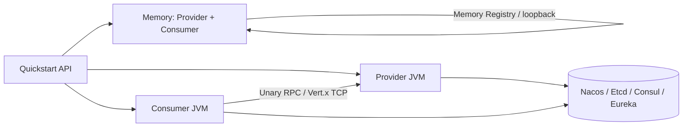
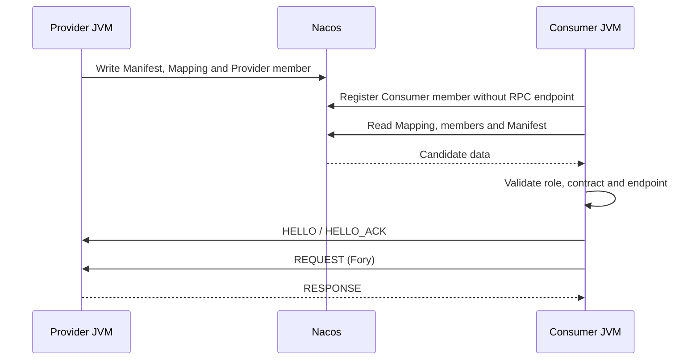
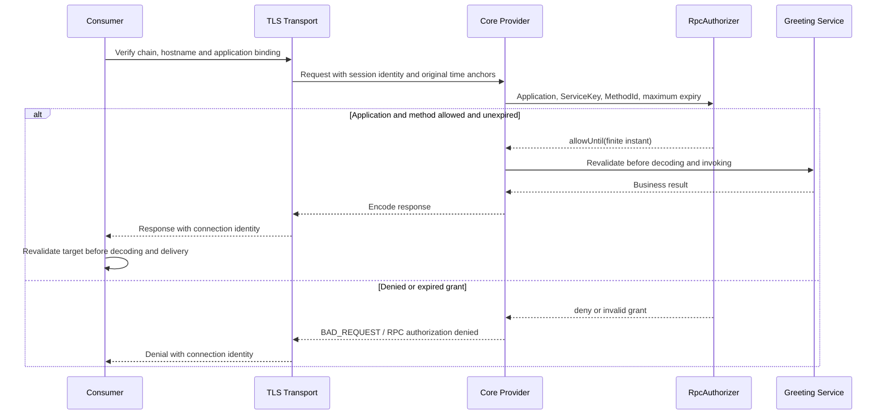

# OTRYX RPC Quickstart

[简体中文](README.md) | [English](README.en-US.md)

> **Source baseline**: 1.0.0-SNAPSHOT, JDK 21, Spring Boot 3.5.4, Wire v1. This build is not yet on Maven Central. `TRUSTED_DEVELOPMENT` is **only for isolated local environments**.

This is a **runnable learning project**, not a set of disconnected snippets. Start with a real single-JVM RPC round trip, then move to two independent processes, A → B → C deadlines, pluggable registries and transport security. Use one `otryx-spring-boot-starter`; Nacos and other adapters are explicit dependencies.

<!-- doc-section:learning-path -->
## Module map and learning paths

| Step | Module(s) | Process model | Infrastructure | Goal |
|---|---|---|---|---|
| 1 | `otryx-quickstart-memory` | Provider + Consumer in **one JVM** | None | Real RPC over loopback |
| 2 | `otryx-quickstart-api` | Shared contract / DTO module | None | Interface, generated stub |
| 3 | `otryx-quickstart-provider` + `otryx-quickstart-consumer` | Two JVMs | Nacos | Application members, Manifest, Mapping and verified routes |
| 4 | Consumer + Relay + Leaf | Three JVMs | Nacos | Consumer / BOTH / Provider and A → B → C deadlines |
| 5 | Two export sets from the same Provider JAR | Separate JVMs | Nacos | Two real Manifest revisions, promotion and rollback |
| 6 | Existing Provider / Consumer with the `mtls` profile | Separate JVMs | Etcd 3.5.21 executable, OpenSSL | Application identity bindings, finite method grants and Registry permissions |



**Memory Registry is strictly in-process.** Use Nacos, Etcd, Consul, Eureka or another shared registry for independent JVMs.

<!-- doc-section:prerequisites -->
## 0. Prerequisites and build

Run all commands from the **repository root**. You need JDK 21, the Maven Wrapper (Maven 3.9.11), and access to Maven Central for the first dependency download.

Scripts require Bash, Python 3 and GNU coreutils `timeout`. Automated mTLS acceptance additionally requires Linux, OpenSSL and an Etcd 3.5.21 executable to manage isolated process groups and its temporary TLS/RBAC backend. Development scenarios also run on macOS with GNU `timeout` on `PATH`. Two-process recovery, the deadline chain and revision scenarios use a running shared Nacos by default, either the Docker Compose service below or your own local deployment. The mTLS script starts its own temporary Etcd. Memory needs no Docker.

```bash
git clone https://github.com/Ryan-Guizhou/otryx-rpc.git
cd otryx-rpc
java -version
./mvnw --version
./mvnw -B -ntp -pl otryx-quickstart -am clean package
```

On Windows use `mvnw.cmd` instead of `./mvnw`. The shell snippets below target Linux/macOS; Windows can run the exact `-exec.jar` artifact paths from two terminals.

### Run every scenario with one command after building the JARs

Prepare Nacos as described in section 2.1 and a local Etcd 3.5.21 executable, then run:

```bash
NACOS_TEST_ENDPOINT=127.0.0.1:8848 ETCD_BINARY=/absolute/path/to/etcd \
  bash scripts/run_quickstart_e2e.sh
```

The entrypoint runs Memory, two-process recovery, the three-process deadline chain, two revisions and mTLS authorization in order, stopping at the first failure. It uses the existing four modules' built JARs; it does not build them or start Nacos. The three development scenarios each create a separate Nacos group, bootstrap the shards, and pass the same scope to every participating JVM. The mTLS scenario uses its own managed Etcd TLS/RBAC instance.

Evidence for the three development scenarios and mTLS is saved under `target/quickstart-e2e/<scenario>.<random-suffix>/`, with allowlisted JSON snapshots and `summary.log`; the Memory success marker remains in console output. Set `OTRYX_QUICKSTART_EVIDENCE_DIR` to choose another evidence root. Intermediate JSON attempts may not have converged: use the file identified by `Registry snapshot verified` in `summary.log` as the accepted evidence for that stage. Temporary mTLS PKI, backend data and credentials are created and cleaned outside the evidence directory; private keys are not evidence artifacts. The expected behavior of each stage is described below. A documented command is not a claim that the current working tree has passed that execution.

<!-- doc-section:memory -->
## 1. Zero-infrastructure Memory Quickstart

```bash
bash scripts/run_quickstart_memory.sh
```

Or launch the JAR manually and stop it with Ctrl+C:

```bash
java -jar otryx-quickstart/otryx-quickstart-memory/target/otryx-quickstart-memory-1.0.0-SNAPSHOT-exec.jar
```

On success the script prints `Memory Quickstart: PASS (real RPC, no external registry)` to stdout. A manually launched JAR displays the following application log marker; the script checks that same marker in its temporary application log:

```text
Quickstart memory RPC succeeded: Hello, Quickstart!
```

`MemoryGreetingRunner` invokes `@OtryxRpcReference`, the Consumer encodes with Fory, Vert.x sends over loopback to `MemoryGreetingServiceImpl`, and the response is decoded. This tests a **real** RPC round trip. It does not make the development security profile suitable for an untrusted network.

Provider routes refresh asynchronously after application membership is acknowledged. The Memory demo retries explicit unavailable results only for the declared idempotent `hello`, within a discovery budget of at most 10 seconds. An existing parent deadline shortens that budget, and each RPC uses the remaining time. Business, protocol and response-validation failures stop immediately; interruption preserves the interrupt flag and ends the wait.

Source: [Provider](otryx-quickstart-memory/src/main/java/com/peachsoft/otryx/quickstart/memory/MemoryGreetingServiceImpl.java) · [Consumer](otryx-quickstart-memory/src/main/java/com/peachsoft/otryx/quickstart/memory/MemoryGreetingRunner.java) · [Configuration](otryx-quickstart-memory/src/main/resources/application.yml) · [Shared GreetingService](otryx-quickstart-api/src/main/java/com/peachsoft/otryx/quickstart/api/GreetingService.java).

<!-- doc-section:nacos -->
## 2. Nacos: two independent JVMs

### 2.1 Start the registry

```bash
docker compose -f otryx-quickstart/docker-compose.yml up -d
```

Both applications explicitly depend on `otryx-registry-nacos` and configure `registry.type=nacos` in their respective `application.yml`. The single Starter deliberately does **not** transitively pull Nacos.

**Initialize Nacos V2 Mapping shards before starting any Provider or Consumer.** Wait for Nacos HTTP port `8848` and client gRPC port `9848`, then run this command in an exclusive maintenance window with no application writing to the same namespace/group:

```bash
bash scripts/bootstrap_quickstart_nacos.sh \
  otryx-quickstart/otryx-quickstart-provider/target/otryx-quickstart-provider-1.0.0-SNAPSHOT-exec.jar \
  127.0.0.1:8848 public OTRYX_RPC
```

The standalone JVM invokes the existing `NacosV2MetadataBootstrap` with the same endpoint, namespace and Nacos group used below. It creates missing shards and validates and preserves existing contents. Resolve initialization failures before starting applications. Normal Starter startup does not replace this maintenance step, which must never run concurrently with application Mapping writes. See the [Nacos V2 contract](../docs/reference/registry-nacos-v2.md#4-nacos-config-servicemappingmd5-casfencing分片).

The manual bootstrap command has a 120-second execution budget and a 5-second forced-exit grace period. Automated scenarios already perform this step in their own random groups; do not bootstrap an active shared group to prepare an automated run.

### 2.2 Start the Provider in terminal A

```bash
java -jar otryx-quickstart/otryx-quickstart-provider/target/otryx-quickstart-provider-1.0.0-SNAPSHOT-exec.jar
```

Expected log:

```text
OTRYX RPC server started: bind=0.0.0.0:19090, advertised=127.0.0.1:19090
```

### 2.3 Start the Consumer in terminal B

```bash
java -jar otryx-quickstart/otryx-quickstart-consumer/target/otryx-quickstart-consumer-1.0.0-SNAPSHOT-exec.jar
```

Expected:

```text
RPC quickstart completed successfully: Hello, OTRYX RPC!
```

The Consumer briefly retries routes that have not yet reached its local directory, without hiding business or protocol failures. These are independent JVMs sharing only interfaces, DTOs and contract metadata from `otryx-quickstart-api`.



### 2.4 Observe real membership, Manifests and Mapping

Keep both JVMs running. In a third terminal, create a new output path:

```bash
mkdir -p target/quickstart-e2e
snapshot_dir=$(mktemp -d target/quickstart-e2e/manual.XXXXXXXX)
bash scripts/observe_quickstart_nacos.sh \
  otryx-quickstart/otryx-quickstart-provider/target/otryx-quickstart-provider-1.0.0-SNAPSHOT-exec.jar \
  127.0.0.1:8848 public OTRYX_RPC public "$snapshot_dir/members.json" \
  otryx-quickstart-provider otryx-quickstart-consumer
```

Arguments are **Provider executable JAR, endpoint, Nacos namespace, Nacos group, application namespace, new JSON file, and 1–16 application names**. The current Starter uses `otryx.rpc.registry.namespace` for both backend configuration and `ApplicationKey.namespace`. This tutorial explicitly configures `public`, so both namespace arguments are `public`; there is no separate Spring application namespace property.

Keep these identities distinct:

| Dimension | Manual example | Purpose |
|---|---|---|
| `ApplicationKey` | `public` + `otryx-quickstart-provider` or `otryx-quickstart-consumer` | Application membership identity |
| Nacos group | `OTRYX_RPC` | Isolates this run's Naming / Config control-plane data |
| `ServiceKey` | Fully qualified interface + `1.0.0` + `default` | Business contract and routing target, not the registry instance key |
| `instanceId` | Instance ID generated at startup | Distinguishes processes within one application |
| Manifest revision | Derived from actual exported contract content | Identifies an immutable export set, not a manually assigned release version |

Inspect these JSON fields:

| Field | Expected meaning |
|---|---|
| `applications[].members` | A real `PROVIDER` member and a real `CONSUMER` member in their respective applications |
| Consumer `rpcEndpoint` / `manifestRevision` / `weight` | `null` / `null` / `0`; no invented listening port |
| `applications[].manifests[].services` | Exported ServiceKey, serviceId, methodIds and schemaFingerprint |
| `services[].mappedApplications` | Candidate applications returned by ServiceMapping |
| `services[].verifiedProviders` | Providers validated against role, endpoint, Manifest and contract; a consumer-only member never appears here |

The member and Manifest views read the explicitly named applications. Service views query the real Mapping/Resolver for three fixed contracts—Greeting, RelayGreeting and GreetingDetails—and may include other applications exporting those contracts in the same scope. The observer does not enumerate the entire registry, register itself or export arbitrary instance attributes. It writes a new file only after all reads succeed and refuses to overwrite an existing file. Use a new filename for every observation. Naming and Config reads are **not a cross-store transaction**: allow time for convergence after changes, and do not interpret a failed read as an empty directory. See [QuickstartRegistrySnapshot](otryx-quickstart-provider/src/main/java/com/peachsoft/otryx/quickstart/provider/QuickstartRegistrySnapshot.java).

### 2.5 Verify stop and recovery automatically

First stop the manually launched JVMs to release their ports, then run:

```bash
OTRYX_RPC_E2E_RESTART_NACOS=false bash scripts/run_quickstart_process_e2e.sh
```

The script uses `otryx-quickstart-process-provider` and `otryx-quickstart-process-consumer` in a scope separate from the manual example. It observes `initial`, `provider-stopped` and `provider-restarted` while one Consumer JVM stays alive. With the Provider stopped, the Consumer member remains but Greeting has no verified provider; after restoration the same Consumer must complete RPC again.

Explicit repeat mode additionally tolerates a local `RpcTimeoutException` only for ordinary `GreetingService.hello`, which has no side effects and is marked idempotent, while preserving the default `3s` deadline for each RPC. The new timeout handling does not apply to one-shot, Relay, Details or expected-denial modes. Other failures keep the existing classification: explicit `UNAVAILABLE` may be retried, while remote deadline and other business, protocol and authorization errors propagate. The script's finite stage waits and TERM/KILL cleanup bound the recovery scenario.

For a local test container you own and can restart, set `OTRYX_RPC_E2E_RESTART_NACOS=true` to also check `registry-recovered`, discovery by a fresh Consumer, and `endpoint-changed` (19090 → 19091). This extension requires exactly one `nacos/nacos-server:v3.2.4` container and endpoint `127.0.0.1:8848`. The switch defaults to `CI`; explicitly set it to `false` for shared or non-container Nacos. The aggregate entrypoint inherits this choice.

The two-process, three-process and rolling verification scripts each use a separate Nacos group per run. They initialize shards before the first application starts and pass the same scope to every application start, restart and fresh Consumer probe.

<!-- doc-section:chain -->
## 3. Three independent JVMs: A → B → C

With Nacos running:

```bash
bash scripts/run_three_process_deadline_e2e.sh
```

The script launches Consumer A, Relay Provider B (19091), and Leaf Provider C (19090). A sets a 5-second per-call deadline and metadata; B's local 10-second client timeout must not extend A's remaining budget; C validates the remaining deadline and propagated metadata.

The member snapshot must show A as `CONSUMER` without an endpoint, B as one `BOTH` member with a real endpoint, and C as `PROVIDER`. B does not create two members because it consumes and exports services. Metadata such as `tenant` and `relay` follows the A → B → C call.

Expected:

```text
RPC deadline chain completed: CHAIN_OK remainingMillis=...
```

The script validates real RPC and cleans up its child processes, printing their diagnostic logs on failure.

The application names are `otryx-quickstart-chain-consumer`, `otryx-quickstart-chain-relay` and `otryx-quickstart-chain-leaf`; the snapshot stage is `complete`.

<!-- doc-section:revisions -->
## 4. Two real Manifest revisions of one application

```bash
bash scripts/run_quickstart_revision_e2e.sh
```

The script reuses **the same newly built Provider JAR, ApplicationName, and ServiceKey version/group** while changing the actual exported services. The baseline exports `GreetingService`; `otryx.rpc.quickstart.details-enabled=true` additionally loads [GreetingDetailsServiceImpl](otryx-quickstart-provider/src/main/java/com/peachsoft/otryx/quickstart/provider/GreetingDetailsServiceImpl.java) and exports `GreetingDetailsService`. Its idempotent `details(GreetingRequest)` method returns `GreetingReply("DETAILS_OK")`.

The Provider application is `otryx-quickstart-revision-provider`, with instances `baseline` / `extended` on 19090 / 19091. The long-lived Consumer is `otryx-quickstart-revision-consumer` / `consumer-main`. Different export content produces different Manifest revisions without inventing a revision or changing the interface version. During coexistence the assertions also compare Greeting's complete contract entry in both Manifests: ServiceKey, serviceId, schemaFingerprint and the MethodId set must remain identical. The additional Details export causes this example's revision change. Observations and assertions follow this sequence:

| Stage | Members and exports of the same Provider application | Required behavior |
|---|---|---|
| `baseline` | One instance exporting `{Greeting}` | Greeting RPC succeeds |
| `coexist` | Two instances exporting `{Greeting}` and `{Greeting, Details}` | Two real revisions coexist; Details routes only to the instance that exports it |
| `details-probed` | Both Providers coexist with an additional Details Consumer probe | The probe receives `DETAILS_OK` over real RPC and is observed as a Consumer without an endpoint |
| `promoted` | Only the `{Greeting, Details}` instance | The same long-lived Consumer completes Greeting RPC; Details routes to that instance |
| `rollback-coexist` | The baseline instance rejoins; both revisions coexist | Greeting remains routable during rollback |
| `rolled-back` | Only the `{Greeting}` instance | Greeting succeeds; Details has no verified provider |
| `providers-stopped` | All Providers stop while the Consumer JVM remains alive | The Consumer member remains; neither Greeting nor Details has a verified provider |

The actual Details RPC success marker is:

```text
RPC details quickstart completed successfully: DETAILS_OK
```

The Details probe application is `otryx-quickstart-revision-details-probe`; it exits after the call and observation. After all stages pass, the script prints `Two actual application Manifest revisions and rollback: PASS`. See the [revision script](../scripts/run_quickstart_revision_e2e.sh) and [snapshot assertions](../scripts/assert_quickstart_snapshot.py).

This scenario checks changing exports, membership coexistence and convergence within the current application control plane. It does not establish interoperability between historical interface-level and application-level registries. Cross-generation rules remain in the [migration guide](../docs/migration.md).

<!-- doc-section:security -->
## 5. mTLS: application identity, finite authorization and a protected registry

Prepare an Etcd **3.5.21** executable, then run the existing Provider and Consumer JARs:

```bash
ETCD_BINARY=/absolute/path/to/etcd bash scripts/run_quickstart_mtls_e2e.sh
```

The script owns an Etcd TLS/RBAC instance listening on loopback; this scenario does not need Nacos. RPC and Registry use separate temporary CAs. Four backend identities serve fixture administration, Provider, Consumer and read-only observation. Administrative credentials are used only for test setup and permission changes. Applications and the observer receive only their own scoped credential files. The temporary database, certificates, keys and credentials are removed after all owned processes stop.

RPC applications are `otryx-quickstart-mtls-provider` (`127.0.0.1:19143`) and `otryx-quickstart-mtls-consumer`, in namespace `otryx-quickstart-security`. Transport binds the full DER SHA-256 of each trusted leaf certificate to an explicit `ApplicationKey(namespace, applicationName)` and finite expiry. The Consumer's original and rotated certificates bind to the same application. The sample authorizer permits that application to call `hello` on `GreetingService / 1.0.0 / default` and returns a finite `validUntil`. CN/SAN participate in certificate and hostname validation; application binding and method authorization are separate checks.

### Fifteen scenario categories and precise outcomes

E12 and E14 each have two branches, producing **17 named stage snapshots**. An independent observer reads the real backend at every stage. The Provider must retain its actual Greeting and Details exports. A pure Consumer cannot have an RPC endpoint or enter the Provider pool.

| Stage | Action | Required outcome | Consumer member |
|---|---|---|---|
| `E01-allowed-initial` | Original certificate calls Greeting | Real RPC succeeds | Present |
| `E02-rotated-consumer` | Rotated certificate for the same application calls Greeting | Real RPC succeeds | Present |
| `E03-unbound-provider` | Consumer does not bind the actual Provider certificate | `IDENTITY_UNBOUND` | Present |
| `E04-local-application-mismatch` | Local certificate binds another application | `APPLICATION_MISMATCH` before startup | Absent |
| `E05-remote-application-mismatch` | Remote certificate binds another application | `APPLICATION_MISMATCH` | Present |
| `E06-remote-namespace-mismatch` | Remote certificate binds another namespace | `NAMESPACE_MISMATCH` | Present |
| `E07-wrong-rpc-ca` | Wrong RPC trust CA | `CERTIFICATE_REJECTED` | Present |
| `E08-expired-local-binding` | Local application binding expired | `IDENTITY_EXPIRED` before startup | Absent |
| `E09-expired-certificate` | Local leaf certificate expired | TLS material rejected before startup | Absent |
| `E10-expired-policy` | Provider's finite policy expired | Exact remote method authorization denial | Present |
| `E11-details-denied` | Valid application calls unauthorized Details | Exact remote method authorization denial | Present |
| `E12-missing-authorizer-provider` / `E12-missing-authorizer-both` | New Provider / BOTH lacks an authorizer | Rejected before startup; no extra member or listener | Absent |
| `E13-allowed-repeat` | Normal call after negative cases | Real RPC succeeds again | Present |
| `E14-wrong-registry-ca` / `E14-wrong-registry-credentials` | Wrong Registry CA or password | Exact `TLS_REJECTED` / `AUTHENTICATION_REJECTED` | Absent |
| `E15-observer-read-only` | Observer attempts to overwrite Provider membership | Permission denied; original membership and routes remain intact | Absent |

Each Consumer stage owns a separate process. The Provider restarts before E10 to load an expired policy and before E11 to restore a valid policy. Other negative cases must preserve the healthy running Provider. Only complete success prints:

```text
Quickstart NETWORK_MTLS security scenarios: PASS
```

Authentication cases require the exact local `RpcAuthenticationException.Reason` and print `RPC authentication failure verified: reason=<REASON>`. Method authorization cases accept only `RpcRemoteException` with `BAD_REQUEST` and fixed message `RPC authorization denied`, printing `RPC authorization denial verified.`. Connection failures, generic TLS errors, wrong reasons and unexpected successes fail the scenario.



### Configure the existing profiles manually

The `tls` profile demonstrates server TLS under explicit `TRUSTED_DEVELOPMENT`. Provider uses `OTRYX_QUICKSTART_TLS_CERT` / `OTRYX_QUICKSTART_TLS_KEY`; Consumer uses `OTRYX_QUICKSTART_TLS_CA`. The `mtls` profile requires a protected Etcd and these settings:

| Setting | Meaning |
|---|---|
| `OTRYX_QUICKSTART_TLS_CERT`, `OTRYX_QUICKSTART_TLS_KEY`, `OTRYX_QUICKSTART_TLS_CA` | This process's RPC certificate, key and trust CA |
| `OTRYX_QUICKSTART_REGISTRY_ENDPOINT`, `OTRYX_QUICKSTART_REGISTRY_CA` | Etcd HTTPS endpoint and independent Registry trust CA; endpoint must match certificate SAN |
| `OTRYX_QUICKSTART_REGISTRY_CREDENTIALS_DIR` | This role's Spring configtree directory containing its username and password files |
| `OTRYX_QUICKSTART_NAMESPACE` | Shared namespace for actual membership and certificate bindings |
| `OTRYX_QUICKSTART_PROVIDER_BINDING_NAMESPACE` | Defaults to that namespace; allows a negative scenario to change only the Provider certificate binding namespace |
| `OTRYX_QUICKSTART_PROVIDER_APPLICATION`, `OTRYX_QUICKSTART_CONSUMER_APPLICATION` | Default to the two names above; must match actual process membership |
| `OTRYX_QUICKSTART_PROVIDER_SHA256`, `OTRYX_QUICKSTART_CONSUMER_SHA256` | SHA-256 of each application's complete leaf certificate DER |
| `OTRYX_QUICKSTART_CONSUMER_ROTATED_SHA256` | Rotated certificate fingerprint for the same Consumer; defaults to its current fingerprint |
| `OTRYX_QUICKSTART_BINDING_VALID_UNTIL` | Finite ISO-8601 expiry for the example certificate bindings |
| `OTRYX_QUICKSTART_POLICY_VALID_UNTIL` | Finite expiry of the Provider's sample business policy |

The configtree filenames are `otryx.rpc.registry.security.credentials.username` and `otryx.rpc.registry.security.credentials.password`. Populate private files from your credential-management channel; keep secrets out of command arguments, source, public logs and evidence. The profile explicitly selects `USER_PASSWORD`; generic `providerOptions` do not supply credentials.

Calculate a certificate fingerprint with:

```bash
openssl x509 -in consumer.crt -outform DER | openssl dgst -sha256
```

The sample authorizer reads `otryx.rpc.quickstart.mtls.allowed-consumer.namespace`, `allowed-consumer.application-name` and `policy-valid-until`, bound by the profile from the environment above. Certificate rotation does not change the policy's application name. A grant is additionally bounded by the certificate, binding, request budget and `server.authorization.max-grant-lifetime` (`30s` in this profile). A `NETWORK_MTLS` Provider / BOTH without an explicit `RpcAuthorizer` fails before Registry or Transport activation.

`otryx.rpc.quickstart.use-details=true` and `use-relay=true` are mutually exclusive. `expect-authentication-failure=<REASON>` cannot be combined with `expect-authorization-denied=true`, and neither negative mode supports repeat calls. The old `allowed-client-sha256` business setting was removed; fingerprints now belong to Transport application bindings. Remove old `OTRYX_RPC_TLS_*` variables and use the Quickstart path variables listed above.

### Independent read-only security observer

Prefix the existing `observe_quickstart_registry.sh` invocation with `QUICKSTART_REGISTRY_SECURITY_FILE=/absolute/path/observer.json`. Configuration and credential files must be regular files with mode `0600`. JSON accepts only known fields and is limited to 64 KiB and eight levels; secrets are single-line UTF-8 limited to 4096 bytes. Relative references resolve against the JSON directory. An Etcd observer configuration is:

```json
{
  "security": {
    "trustCertificateCollection": "registry-ca.crt",
    "credentialKind": "USER_PASSWORD",
    "usernameFile": "observer.username",
    "passwordFile": "observer.password"
  }
}
```

Eureka requires an independent `metadataSecurity` object; other backends reject that extra object. Before reading, the observer validates TLS, credentials and namespace for every actual Membership, Manifest and Mapping source. Without a security file it explicitly selects development mode; an invalid supplied file never falls back. Observation creates no member, Manifest or Mapping Owner.

See the [security guide](../docs/security.md), [runner](../scripts/run_quickstart_mtls_e2e.py) and [observer security configuration](otryx-quickstart-provider/src/main/java/com/peachsoft/otryx/quickstart/provider/QuickstartRegistrySecurity.java) for implementation boundaries.

<!-- doc-section:integration -->
## 6. Use the single Starter in your application

The API module compiles a shared `@OtryxRpcContract` with an annotation processor. Generated Stub/Dispatcher is preferred; a JDK Proxy / MethodHandle fallback exists when generated code is absent:

```java
@OtryxRpcContract
public interface GreetingService {
    @OtryxRpcIdempotent
    GreetingReply hello(GreetingRequest request);
}
```

Provider: `@OtryxRpcService(interfaceClass = GreetingService.class, version = "1.0.0")`.

Consumer: `@OtryxRpcReference(version = "1.0.0")`.

Only declare `@OtryxRpcIdempotent` for truly idempotent operations, not blindly for payments or order creation.

```xml
<dependency>
    <groupId>com.peachsoft.otryx</groupId>
    <artifactId>otryx-spring-boot-starter</artifactId>
    <version>1.0.0-SNAPSHOT</version>
</dependency>
<dependency>
    <groupId>com.peachsoft.otryx</groupId>
    <artifactId>otryx-registry-nacos</artifactId>
    <version>1.0.0-SNAPSHOT</version>
</dependency>
```

Other opt-in adapters include Etcd, Consul, Eureka, CGLIB, ByteBuddy, Micrometer, OpenTelemetry and JFR. The Starter entrypoint does not change. See the [Starter reference](../docs/reference/starter.md).

<!-- doc-section:other-registries -->
## 7. Etcd / Consul / Eureka

Both executable JARs explicitly include Nacos, Etcd, Consul and Eureka; the Memory module still has no network Registry dependency. These three scenarios reuse the same Starter and read-only observer and apply identical real membership, routing and RPC assertions across all four backends:

```bash
# Real Etcd is already running; each scenario creates an isolated namespace.
export QUICKSTART_REGISTRY=etcd
export QUICKSTART_REGISTRY_ENDPOINT=http://127.0.0.1:2379
bash scripts/run_quickstart_process_e2e.sh
bash scripts/run_three_process_deadline_e2e.sh
bash scripts/run_quickstart_revision_e2e.sh
```

For Consul choose `QUICKSTART_REGISTRY=consul` and `http://127.0.0.1:8500`. For Eureka choose `QUICKSTART_REGISTRY=eureka` and `http://127.0.0.1:8761/eureka`, and explicitly set `QUICKSTART_EUREKA_METADATA_ENDPOINT=http://127.0.0.1:8500`. Metadata comes from real Consul; omission fails before any application starts. Nacos retains its public namespace, isolated group and bootstrap-before-start sequence. Other backends do not restart servers by default; their fault gates run separately.

The shared observation entrypoint is `scripts/observe_quickstart_registry.sh`. Arguments are Provider JAR, backend, endpoint, namespace, Nacos group or `-`, Eureka's Consul metadata endpoint or `-`, new JSON file, and application names. The existing Nacos-specific wrapper remains available and requires matching namespace arguments. See [application acceptance](../docs/reference/application-registry-acceptance.md) for the four-backend CI matrix, pinned server versions, full arguments and evidence boundaries.

Observer `convergenceSeconds` includes observer JVM startup, reads and retries. Shared contract tests separately report member counts, SPI method-entry calls, subscription creation calls and snapshot/health notifications. These are not total backend HTTP, keepalive or server Watch traffic, and ten SDK client objects do not mean ten business JVMs.

### Manual Consul / Eureka profiles

The Provider and Consumer build files include the optional Consul/Eureka adapters required by these demonstrations. Start your own Consul agent or Eureka server, then apply the **same** Spring profile to both JVMs:

```bash
# Provider terminal:
java -jar otryx-quickstart/otryx-quickstart-provider/target/otryx-quickstart-provider-1.0.0-SNAPSHOT-exec.jar --spring.profiles.active=consul
# Consumer terminal:
java -jar otryx-quickstart/otryx-quickstart-consumer/target/otryx-quickstart-consumer-1.0.0-SNAPSHOT-exec.jar --spring.profiles.active=consul
```

Eureka stores application membership and requires a separate Manifest/Mapping backend. The following example requires both Eureka and Consul; both adapters are already explicit Quickstart dependencies. Configure the same Consul KV backend in both JVMs:

```bash
# Provider terminal:
java -jar otryx-quickstart/otryx-quickstart-provider/target/otryx-quickstart-provider-1.0.0-SNAPSHOT-exec.jar \
  --spring.profiles.active=eureka \
  --otryx.rpc.registry.eureka.metadata-backend=consul \
  --otryx.rpc.registry.eureka.metadata-endpoints=http://127.0.0.1:8500
# Consumer terminal:
java -jar otryx-quickstart/otryx-quickstart-consumer/target/otryx-quickstart-consumer-1.0.0-SNAPSHOT-exec.jar \
  --spring.profiles.active=eureka \
  --otryx.rpc.registry.eureka.metadata-backend=consul \
  --otryx.rpc.registry.eureka.metadata-endpoints=http://127.0.0.1:8500
```

These manual profiles explicitly use `TRUSTED_DEVELOPMENT` and configure no backend credentials by default. Protected backends require typed TLS and credential settings under `otryx.rpc.registry.security`. Eureka's external metadata chain uses its own `otryx.rpc.registry.metadata-security`; generic `metadata-options` must not contain credentials. Supply security material through restricted configuration files or your credential management channel. See the [Starter backend configuration](../docs/reference/starter.md), [Consul V2](../docs/reference/registry-consul-v2.md) and [Eureka V2](../docs/reference/registry-eureka-v2.md).

<!-- doc-section:operations -->
## 8. Observability, capacity and lifecycle

`QuickstartCallObserver` is a Spring `RpcObserver` that counts success/failure outcomes without reading sensitive payloads. Add Micrometer, OpenTelemetry or JFR adapters only when needed. Calls can be rejected under admission/backpressure; retries are limited to explicitly idempotent methods. Provider drain and Consumer closure are managed by the runtime. See [Operations](../docs/operations.md) and [Deadlines](../docs/reference/deadline-context.md).

### Troubleshooting

| Symptom | Checks |
|---|---|
| `-exec.jar` not found | Run `./mvnw -B -ntp -pl otryx-quickstart -am clean package` from repo root |
| Maven cannot resolve `1.0.0-SNAPSHOT` | Not published: run `./mvnw -B -ntp clean install -DskipTests` first |
| Nacos endpoint unavailable | Compose service, 8848/9848, matching namespace/configuration |
| Missing Mapping shards | Stop all writers in that scope, then bootstrap exclusively; automated scenarios already bootstrap before startup |
| Memory mode cannot discover remote JVM | Memory Registry is not shared across processes |
| Consumer member exists but calls fail | Membership is not Provider readiness; inspect Mapping, that instance's Manifest, role and `verifiedProviders` |
| Observer refuses the output file | Use a new filename each time; verify namespace/group/applicationName |
| `NETWORK_MTLS` rejects startup or calls | Use the exact reason to distinguish configuration, Registry, certificate and method authorization failures. Check the actual ApplicationKey/namespace, chain and hostname, binding/policy expiry, ServiceKey/MethodId and actual Codec capabilities. A missing authorizer rejects Provider/BOTH before startup |
| Calls timeout | Provider readiness, discovery, deadline, overload and client timeout |
| Port collision | Provider normally uses 19090; chain and revision use 19090/19091, mTLS uses 19143; stop manual processes and run scripts sequentially |

<!-- doc-section:validation -->
## 9. Validation and cleanup

```bash
python3 scripts/test_quickstart_layout.py
./mvnw -B -ntp clean verify -Pquality
# All JARs are built, local Nacos is running, and Etcd 3.5.21 is available:
ETCD_BINARY=/absolute/path/to/etcd bash scripts/run_quickstart_e2e.sh
# Only if you started this Compose service and no longer need it:
docker compose -f otryx-quickstart/docker-compose.yml down
```

Read next: [User guide](../docs/user-guide.md) · [Starter reference](../docs/reference/starter.md) · [Architecture](../docs/architecture.md) · [Protocol compatibility](../docs/wire-compatibility.md). A short Quickstart run is **not** a production performance SLO or GA certification.

The aggregate entrypoint prints `Complete application-level Quickstart suite: PASS` only after all five scripts succeed. Development scenarios print temporary JVM log tails on failure. The security scenario exposes fixed outcomes; its `--diagnostics` option can retain failure logs in a separate restricted local directory. Raw logs are not public acceptance attachments. Scripts manage their own application and observer processes; mTLS also closes the Etcd it started. User-provided Nacos remains running.

<!-- doc-section:migration-status -->
## V2 application registry migration status

Core `ApplicationMembershipCoordinator`, `ApplicationServiceResolver`, Client `applicationControlPlane(...)` and Server `applicationMembership(...)` form the only application control plane. Provider, Consumer and BOTH register real members; consumer-only has no RPC endpoint. ServiceInstance remains only a local load-balancing DTO.

#139 was merged through [PR #160](https://github.com/Ryan-Guizhou/otryx-rpc/pull/160) at `main@783bf8115c9523e5667023678dafe659315b2b66`, with independently verified source/configuration cleanup, shared contracts, the four-real-backend independent-JVM matrix and all five rolling pairs. Retired registry modes cannot be rolling baselines. #140 security changes require their own exact-head execution and post-merge verification; #139 results do not establish this security acceptance. See the [checkpoint](../docs/engineering/agent-governance-checkpoint.md) for evidence and [V2 design](../docs/design/application-registry-v2.md) for the contract. Tutorials, static scans and shell fixtures do not substitute for real execution or establish production capacity or a release.

## Optional: labels, zones and canary routing

Spring Boot applications can declare public labels on **actual application members** in `application.yml`. The Consumer default router SPI is `rules`. Provider/Consumer/BOTH identity, Manifest validation and authorization do not change:

```yaml
otryx:
  rpc:
    registry:
      member-attributes:
        zone: cn-shanghai
        release: v2
        track: stable
    client:
      router: rules
```

The default empty ruleset does not filter Providers. To use deployment labels, zones, canary routing or explicit application selection, provide a `RuleBasedRpcRouter` Bean and atomically publish a `RpcRoutingSnapshot`. See the [routing guide and security boundaries](../docs/reference/routing.md). This is not a new executable E2E scenario; Core Router tests cover canary distribution and snapshot changes.

## Optional Provider response encoding limits

The following settings bound **streaming output buffer capacity**, separate from the transport's queued response budget. They do not bound Fory's internal object graph, temporary frame copies, TLS or Netty direct memory:

```yaml
otryx:
  rpc:
    server:
      encoding:
        max-buffered-bytes: 67108864
        max-response-bytes: 16777216
```

Oversized payloads and exhausted output reservations are rejected as `OVERLOADED`. This does not prove that arbitrary user work stopped when a request was cancelled. See [Transport admission and limitations](../docs/reference/transport-admission.md).


## Optional business Interceptor SPI (Wire v1 unchanged)

Spring Boot can declare multiple `RpcInterceptor` beans (for example, using `@Order(10)`). The Starter compiles a single ordered bean list with `ObjectProvider.orderedStream()` at startup. Consumer and Provider use the same configured list but independent bounded workers. Do not trust a caller identity asserted in Wire Metadata; `RpcInvocation.caller()` contains the actual application member or authenticated TLS peer, and is empty for anonymous trusted-development connections.

```yaml
otryx:
  rpc:
    interceptor:
      workers: 4
      max-active: 512
```

Without interceptor beans, no worker threads or per-call hook events are created. Programmatic Client/Server builders can use `interceptors(List.of(...)).interceptorExecutionLimits(4, 512)`. Hooks cannot replace transport identity, ServiceKey, Payload or authorization. See [Interceptor reference](../docs/reference/interceptors.md).


## Optional signed dynamic governance (V2-17)

The single Spring Starter creates and closes `RpcGovernanceRuntime` only when both `RpcGovernanceRepository` (asynchronous full-snapshot Load/Watch) and `RpcGovernanceVerifier` (preferably `RpcHmacGovernanceVerifier`) beans are available. Configuring just one fails during BeanFactory preflight. **No remote governance rules are implicitly read from untrusted Nacos/Etcd/Eureka metadata and HMAC secrets are not read from YAML**; applications must provide protected repository adapters and secret sources. Without these beans, existing Quickstart behavior is unchanged.

```yaml
otryx:
  rpc:
    governance:
      max-last-known-good: 5m
```

A transient control-plane outage permits a bounded last-known-good window; signature/authorization failure fails closed immediately. Updates and rollbacks require a higher monotonic revision and an authenticated full snapshot. Application-level Registry keys and Wire v1 remain unchanged. See [governance reference](../docs/reference/governance.md).
