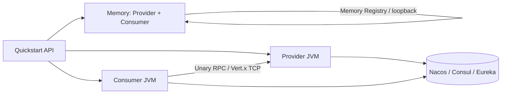
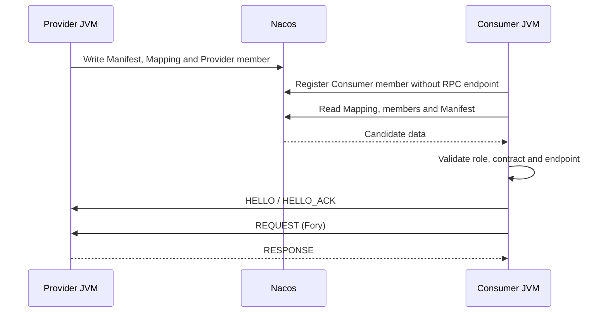
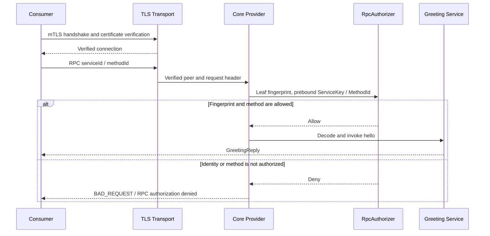

# OTRYX RPC Quickstart

[简体中文](README.md) | [English](README.en-US.md)

> **Source baseline**: 1.0.0-SNAPSHOT, JDK 21, Spring Boot 3.5.4, Wire v1. This build is not yet on Maven Central. `TRUSTED_DEVELOPMENT` is **only for isolated local environments**.

This is a **runnable learning project**, not a set of disconnected snippets. Start with a real single-JVM RPC round trip, then move to two independent processes, A → B → C deadlines, pluggable registries and transport security. Use one `otryx-spring-boot-starter`; Nacos and other adapters are explicit dependencies.

<!-- doc-section:learning-path -->
## Module map and learning paths

| Step | Module(s) | Process model | Infrastructure | Goal |
|---|---|---|---|---|
| 1 | `otryx-quickstart-memory` | Provider + Consumer in **one JVM** | None | Real RPC over loopback |
| 2 | `otryx-quickstart-api` | Shared contract / DTO module | None | Interface, generated stub |
| 3 | `otryx-quickstart-provider` + `otryx-quickstart-consumer` | Two JVMs | Nacos | Application members, Manifest, Mapping and verified routes |
| 4 | Consumer + Relay + Leaf | Three JVMs | Nacos | Consumer / BOTH / Provider and A → B → C deadlines |
| 5 | Two export sets from the same Provider JAR | Separate JVMs | Nacos | Two real Manifest revisions, promotion and rollback |
| 6 | Existing Provider / Consumer with the `mtls` profile | Separate JVMs | Nacos, OpenSSL | Certificate authentication, client fingerprints and method authorization |



**Memory Registry is strictly in-process.** Use Nacos, Consul, Eureka or another shared registry for independent JVMs.

<!-- doc-section:prerequisites -->
## 0. Prerequisites and build

Run all commands from the **repository root**. You need JDK 21, the Maven Wrapper (Maven 3.9.11), and access to Maven Central for the first dependency download.

Scripts require Bash, Python 3 and GNU coreutils `timeout`; mTLS also requires OpenSSL. Configure GNU `timeout` on `PATH` on macOS. Independent JVMs need a running shared Nacos, either the Docker Compose service below or your own local deployment. Memory needs no Docker.

```bash
git clone https://github.com/Ryan-Guizhou/otryx-rpc.git
cd otryx-rpc
java -version
./mvnw --version
./mvnw -B -ntp -pl otryx-quickstart -am clean package
```

On Windows use `mvnw.cmd` instead of `./mvnw`. The shell snippets below target Linux/macOS; Windows can run the exact `-exec.jar` artifact paths from two terminals.

### Run every scenario with one command after building the JARs

Prepare Nacos as described in section 2.1, then run:

```bash
NACOS_TEST_ENDPOINT=127.0.0.1:8848 bash scripts/run_quickstart_e2e.sh
```

The entrypoint runs Memory, two-process recovery, the three-process deadline chain, two revisions and mTLS authorization in order, stopping at the first failure. It uses the existing four modules' built JARs; it does not build them or start Nacos. Each independent-process scenario creates its own Nacos group, bootstraps the shards, and passes the same scope to every participating JVM.

Evidence for the four Nacos scenarios is saved under `target/quickstart-e2e/<scenario>.<random-suffix>/`, with allowlisted JSON snapshots and `summary.log`; the Memory success marker remains in console output. Set `OTRYX_QUICKSTART_EVIDENCE_DIR` to choose another evidence root. Intermediate JSON attempts may not have converged: use the file identified by `Registry snapshot verified` in `summary.log` as the accepted evidence for that stage. Temporary mTLS PKI is created and cleaned outside the evidence directory; private keys are not evidence artifacts. The expected behavior of each stage is described below. A documented command is not a claim that the current working tree has passed that execution.

<!-- doc-section:memory -->
## 1. Zero-infrastructure Memory Quickstart

```bash
bash scripts/run_quickstart_memory.sh
```

Or launch the JAR manually and stop it with Ctrl+C:

```bash
java -jar otryx-quickstart/otryx-quickstart-memory/target/otryx-quickstart-memory-1.0.0-SNAPSHOT-exec.jar
```

On success the script prints `Memory Quickstart: PASS (real RPC, no external registry)` to stdout. A manually launched JAR displays the following application log marker; the script checks that same marker in its temporary application log:

```text
Quickstart memory RPC succeeded: Hello, Quickstart!
```

`MemoryGreetingRunner` invokes `@OtryxRpcReference`, the Consumer encodes with Fory, Vert.x sends over loopback to `MemoryGreetingServiceImpl`, and the response is decoded. This tests a **real** RPC round trip. It does not make the development security profile suitable for an untrusted network.

Provider routes refresh asynchronously after application membership is acknowledged. The Memory demo retries explicit unavailable results only for the declared idempotent `hello`, within a discovery budget of at most 10 seconds. An existing parent deadline shortens that budget, and each RPC uses the remaining time. Business, protocol and response-validation failures stop immediately; interruption preserves the interrupt flag and ends the wait.

Source: [Provider](otryx-quickstart-memory/src/main/java/com/peachsoft/otryx/quickstart/memory/MemoryGreetingServiceImpl.java) · [Consumer](otryx-quickstart-memory/src/main/java/com/peachsoft/otryx/quickstart/memory/MemoryGreetingRunner.java) · [Configuration](otryx-quickstart-memory/src/main/resources/application.yml) · [Shared GreetingService](otryx-quickstart-api/src/main/java/com/peachsoft/otryx/quickstart/api/GreetingService.java).

<!-- doc-section:nacos -->
## 2. Nacos: two independent JVMs

### 2.1 Start the registry

```bash
docker compose -f otryx-quickstart/docker-compose.yml up -d
```

Both applications explicitly depend on `otryx-registry-nacos` and configure `registry.type=nacos` in their respective `application.yml`. The single Starter deliberately does **not** transitively pull Nacos.

**Initialize Nacos V2 Mapping shards before starting any Provider or Consumer.** Wait for Nacos HTTP port `8848` and client gRPC port `9848`, then run this command in an exclusive maintenance window with no application writing to the same namespace/group:

```bash
bash scripts/bootstrap_quickstart_nacos.sh \
  otryx-quickstart/otryx-quickstart-provider/target/otryx-quickstart-provider-1.0.0-SNAPSHOT-exec.jar \
  127.0.0.1:8848 public OTRYX_RPC
```

The standalone JVM invokes the existing `NacosV2MetadataBootstrap` with the same endpoint, namespace and Nacos group used below. It creates missing shards and validates and preserves existing contents. Resolve initialization failures before starting applications. Normal Starter startup does not replace this maintenance step, which must never run concurrently with application Mapping writes. See the [Nacos V2 contract](../docs/reference/registry-nacos-v2.md#4-nacos-config-servicemappingmd5-casfencing分片).

The manual bootstrap command has a 120-second execution budget and a 5-second forced-exit grace period. Automated scenarios already perform this step in their own random groups; do not bootstrap an active shared group to prepare an automated run.

### 2.2 Start the Provider in terminal A

```bash
java -jar otryx-quickstart/otryx-quickstart-provider/target/otryx-quickstart-provider-1.0.0-SNAPSHOT-exec.jar
```

Expected log:

```text
OTRYX RPC server started: bind=0.0.0.0:19090, advertised=127.0.0.1:19090
```

### 2.3 Start the Consumer in terminal B

```bash
java -jar otryx-quickstart/otryx-quickstart-consumer/target/otryx-quickstart-consumer-1.0.0-SNAPSHOT-exec.jar
```

Expected:

```text
RPC quickstart completed successfully: Hello, OTRYX RPC!
```

The Consumer briefly retries routes that have not yet reached its local directory, without hiding business or protocol failures. These are independent JVMs sharing only interfaces, DTOs and contract metadata from `otryx-quickstart-api`.



### 2.4 Observe real membership, Manifests and Mapping

Keep both JVMs running. In a third terminal, create a new output path:

```bash
mkdir -p target/quickstart-e2e
snapshot_dir=$(mktemp -d target/quickstart-e2e/manual.XXXXXXXX)
bash scripts/observe_quickstart_nacos.sh \
  otryx-quickstart/otryx-quickstart-provider/target/otryx-quickstart-provider-1.0.0-SNAPSHOT-exec.jar \
  127.0.0.1:8848 public OTRYX_RPC public "$snapshot_dir/members.json" \
  otryx-quickstart-provider otryx-quickstart-consumer
```

Arguments are **Provider executable JAR, endpoint, Nacos namespace, Nacos group, application namespace, new JSON file, and 1–16 application names**. The current Starter uses `otryx.rpc.registry.namespace` for both backend configuration and `ApplicationKey.namespace`. This tutorial explicitly configures `public`, so both namespace arguments are `public`; there is no separate Spring application namespace property.

Keep these identities distinct:

| Dimension | Manual example | Purpose |
|---|---|---|
| `ApplicationKey` | `public` + `otryx-quickstart-provider` or `otryx-quickstart-consumer` | Application membership identity |
| Nacos group | `OTRYX_RPC` | Isolates this run's Naming / Config control-plane data |
| `ServiceKey` | Fully qualified interface + `1.0.0` + `default` | Business contract and routing target, not the registry instance key |
| `instanceId` | Instance ID generated at startup | Distinguishes processes within one application |
| Manifest revision | Derived from actual exported contract content | Identifies an immutable export set, not a manually assigned release version |

Inspect these JSON fields:

| Field | Expected meaning |
|---|---|
| `applications[].members` | A real `PROVIDER` member and a real `CONSUMER` member in their respective applications |
| Consumer `rpcEndpoint` / `manifestRevision` / `weight` | `null` / `null` / `0`; no invented listening port |
| `applications[].manifests[].services` | Exported ServiceKey, serviceId, methodIds and schemaFingerprint |
| `services[].mappedApplications` | Candidate applications returned by ServiceMapping |
| `services[].verifiedProviders` | Providers validated against role, endpoint, Manifest and contract; a consumer-only member never appears here |

The member and Manifest views read the explicitly named applications. Service views query the real Mapping/Resolver for three fixed contracts—Greeting, RelayGreeting and GreetingDetails—and may include other applications exporting those contracts in the same scope. The observer does not enumerate the entire registry, register itself or export arbitrary instance attributes. It writes a new file only after all reads succeed and refuses to overwrite an existing file. Use a new filename for every observation. Naming and Config reads are **not a cross-store transaction**: allow time for convergence after changes, and do not interpret a failed read as an empty directory. See [QuickstartRegistrySnapshot](otryx-quickstart-provider/src/main/java/com/peachsoft/otryx/quickstart/provider/QuickstartRegistrySnapshot.java).

### 2.5 Verify stop and recovery automatically

First stop the manually launched JVMs to release their ports, then run:

```bash
OTRYX_RPC_E2E_RESTART_NACOS=false bash scripts/run_quickstart_process_e2e.sh
```

The script uses `otryx-quickstart-process-provider` and `otryx-quickstart-process-consumer` in a scope separate from the manual example. It observes `initial`, `provider-stopped` and `provider-restarted` while one Consumer JVM stays alive. With the Provider stopped, the Consumer member remains but Greeting has no verified provider; after restoration the same Consumer must complete RPC again.

For a local test container you own and can restart, set `OTRYX_RPC_E2E_RESTART_NACOS=true` to also check `registry-recovered`, discovery by a fresh Consumer, and `endpoint-changed` (19090 → 19091). This extension requires exactly one `nacos/nacos-server:v3.2.4` container and endpoint `127.0.0.1:8848`. The switch defaults to `CI`; explicitly set it to `false` for shared or non-container Nacos. The aggregate entrypoint inherits this choice.

The two-process, three-process and rolling verification scripts each use a separate Nacos group per run. They initialize shards before the first application starts and pass the same scope to every application start, restart and fresh Consumer probe.

<!-- doc-section:chain -->
## 3. Three independent JVMs: A → B → C

With Nacos running:

```bash
bash scripts/run_three_process_deadline_e2e.sh
```

The script launches Consumer A, Relay Provider B (19091), and Leaf Provider C (19090). A sets a 5-second per-call deadline and metadata; B's local 10-second client timeout must not extend A's remaining budget; C validates the remaining deadline and propagated metadata.

The member snapshot must show A as `CONSUMER` without an endpoint, B as one `BOTH` member with a real endpoint, and C as `PROVIDER`. B does not create two members because it consumes and exports services. Metadata such as `tenant` and `relay` follows the A → B → C call.

Expected:

```text
RPC deadline chain completed: CHAIN_OK remainingMillis=...
```

The script validates real RPC and cleans up its child processes, printing their diagnostic logs on failure.

The application names are `otryx-quickstart-chain-consumer`, `otryx-quickstart-chain-relay` and `otryx-quickstart-chain-leaf`; the snapshot stage is `complete`.

<!-- doc-section:revisions -->
## 4. Two real Manifest revisions of one application

```bash
bash scripts/run_quickstart_revision_e2e.sh
```

The script reuses **the same newly built Provider JAR, ApplicationName, and ServiceKey version/group** while changing the actual exported services. The baseline exports `GreetingService`; `otryx.rpc.quickstart.details-enabled=true` additionally loads [GreetingDetailsServiceImpl](otryx-quickstart-provider/src/main/java/com/peachsoft/otryx/quickstart/provider/GreetingDetailsServiceImpl.java) and exports `GreetingDetailsService`. Its idempotent `details(GreetingRequest)` method returns `GreetingReply("DETAILS_OK")`.

The Provider application is `otryx-quickstart-revision-provider`, with instances `baseline` / `extended` on 19090 / 19091. The long-lived Consumer is `otryx-quickstart-revision-consumer` / `consumer-main`. Different export content produces different Manifest revisions without inventing a revision or changing the interface version. During coexistence the assertions also compare Greeting's complete contract entry in both Manifests: ServiceKey, serviceId, schemaFingerprint and the MethodId set must remain identical. The additional Details export causes this example's revision change. Observations and assertions follow this sequence:

| Stage | Members and exports of the same Provider application | Required behavior |
|---|---|---|
| `baseline` | One instance exporting `{Greeting}` | Greeting RPC succeeds |
| `coexist` | Two instances exporting `{Greeting}` and `{Greeting, Details}` | Two real revisions coexist; Details routes only to the instance that exports it |
| `details-probed` | Both Providers coexist with an additional Details Consumer probe | The probe receives `DETAILS_OK` over real RPC and is observed as a Consumer without an endpoint |
| `promoted` | Only the `{Greeting, Details}` instance | The same long-lived Consumer completes Greeting RPC; Details routes to that instance |
| `rollback-coexist` | The baseline instance rejoins; both revisions coexist | Greeting remains routable during rollback |
| `rolled-back` | Only the `{Greeting}` instance | Greeting succeeds; Details has no verified provider |
| `providers-stopped` | All Providers stop while the Consumer JVM remains alive | The Consumer member remains; neither Greeting nor Details has a verified provider |

The actual Details RPC success marker is:

```text
RPC details quickstart completed successfully: DETAILS_OK
```

The Details probe application is `otryx-quickstart-revision-details-probe`; it exits after the call and observation. After all stages pass, the script prints `Two actual application Manifest revisions and rollback: PASS`. See the [revision script](../scripts/run_quickstart_revision_e2e.sh) and [snapshot assertions](../scripts/assert_quickstart_snapshot.py).

This scenario checks changing exports, membership coexistence and convergence within the current application control plane. It does not establish interoperability between historical interface-level and application-level registries. Cross-generation rules remain in the [migration guide](../docs/migration.md).

<!-- doc-section:security -->
## 5. mTLS: authenticated certificates still need method authorization

```bash
bash scripts/run_quickstart_mtls_e2e.sh
```

The script generates a temporary CA, a server certificate with the correct identity, and **two different client certificates signed by the same CA**. Applications are `otryx-quickstart-mtls-provider` (19143) and `otryx-quickstart-mtls-consumer`. The Provider authorizes only one client's leaf-certificate SHA-256 fingerprint to call Greeting's `hello`, with these stages in order:

| Stage | Client and target | Expected outcome |
|---|---|---|
| `allowed-initial` | Allowed certificate calls Greeting hello | Real RPC succeeds |
| `identity-denied` | Another certificate from the same CA calls Greeting hello | Exact remote authorization denial |
| `allowed-repeat` | Return to the allowed certificate and call Greeting hello | Success again; Provider remains the same JVM |
| `service-denied` | Allowed certificate calls the exported Details service | Exact remote authorization denial: trust does not grant every method |

Each stage starts and stops its own Consumer while the Provider remains running. After all stages pass, the script prints `mTLS verified identity and service authorization: PASS`.



Denial must be exactly `BAD_REQUEST` / `RPC authorization denied`. CA, hostname or handshake errors are **authentication failures** and cannot pass this authorization-denial scenario. Consumer property `otryx.rpc.quickstart.expect-authorization-denied=true` accepts only that exact outcome and prints:

```text
RPC authorization denial verified.
```

### Use the TLS / mTLS profiles manually

Each profile reads the certificate variables required by its role. All paths point to local PEM files:

| Profile / process | Required environment variables | Purpose |
|---|---|---|
| `tls` / Provider | `OTRYX_QUICKSTART_TLS_CERT`, `OTRYX_QUICKSTART_TLS_KEY` | Server certificate and private key |
| `tls` / Consumer | `OTRYX_QUICKSTART_TLS_CA` | Trusted CA for server verification |
| `mtls` / Provider and Consumer | `OTRYX_QUICKSTART_TLS_CERT`, `OTRYX_QUICKSTART_TLS_KEY`, `OTRYX_QUICKSTART_TLS_CA` | Each process's own certificate and private key, plus the CA used to verify its peer |

Rename and remove old `OTRYX_RPC_TLS_CERT`, `OTRYX_RPC_TLS_KEY` and `OTRYX_RPC_TLS_CA` variables; otherwise Starter strict validation rejects the unknown properties. Enable with `--spring.profiles.active=tls` or `--spring.profiles.active=mtls`. The Consumer verifies the target hostname by default.

The `mtls` profile enables `NETWORK_MTLS`, a strict Fory DTO allowlist and the Quickstart-specific `RpcAuthorizer`. **Provider must explicitly configure** `otryx.rpc.quickstart.mtls.allowed-client-sha256` as exactly 64 lowercase hexadecimal characters, without colons or surrounding whitespace. Compute it from the allowed client's leaf certificate DER:

```bash
openssl x509 -in client.crt -outform DER | openssl dgst -sha256
```

Pass the final 64-character digest as Provider argument `--otryx.rpc.quickstart.mtls.allowed-client-sha256=<digest>`. Consumer does not need this property. Missing or malformed values fail Provider startup. Authorization uses the Transport-verified leaf-certificate DER SHA-256, **not CN/SAN text**. The target must also match `GreetingService` / `1.0.0` / `default` and the `hello` MethodId. Details remains unauthorized even for a trusted certificate with an allowed fingerprint.

`otryx.rpc.quickstart.use-details=true` selects Details and is mutually exclusive with `use-relay=true`. Expected-denial mode cannot run with repeat mode. The [sample authorizer](otryx-quickstart-provider/src/main/java/com/peachsoft/otryx/quickstart/provider/QuickstartMtlsAuthorizationConfiguration.java) belongs to the Quickstart Provider; the general Starter does not generate business authorization policies. A `NETWORK_MTLS` Provider without an authorizer still denies calls by default. See [Security and authorization](../docs/security.md) for certificate deployment, reload and authorization boundaries.

<!-- doc-section:integration -->
## 6. Use the single Starter in your application

The API module compiles a shared `@OtryxRpcContract` with an annotation processor. Generated Stub/Dispatcher is preferred; a JDK Proxy / MethodHandle fallback exists when generated code is absent:

```java
@OtryxRpcContract
public interface GreetingService {
    @OtryxRpcIdempotent
    GreetingReply hello(GreetingRequest request);
}
```

Provider: `@OtryxRpcService(interfaceClass = GreetingService.class, version = "1.0.0")`.

Consumer: `@OtryxRpcReference(version = "1.0.0")`.

Only declare `@OtryxRpcIdempotent` for truly idempotent operations, not blindly for payments or order creation.

```xml
<dependency>
    <groupId>com.peachsoft.otryx</groupId>
    <artifactId>otryx-spring-boot-starter</artifactId>
    <version>1.0.0-SNAPSHOT</version>
</dependency>
<dependency>
    <groupId>com.peachsoft.otryx</groupId>
    <artifactId>otryx-registry-nacos</artifactId>
    <version>1.0.0-SNAPSHOT</version>
</dependency>
```

Other opt-in adapters include Etcd, Consul, Eureka, CGLIB, ByteBuddy, Micrometer, OpenTelemetry and JFR. The Starter entrypoint does not change. See the [Starter reference](../docs/reference/starter.md).

<!-- doc-section:other-registries -->
## 7. Consul / Eureka profiles

The Provider and Consumer build files include the optional Consul/Eureka adapters required by these demonstrations. Start your own Consul agent or Eureka server, then apply the **same** Spring profile to both JVMs:

```bash
# Provider terminal:
java -jar otryx-quickstart/otryx-quickstart-provider/target/otryx-quickstart-provider-1.0.0-SNAPSHOT-exec.jar --spring.profiles.active=consul
# Consumer terminal:
java -jar otryx-quickstart/otryx-quickstart-consumer/target/otryx-quickstart-consumer-1.0.0-SNAPSHOT-exec.jar --spring.profiles.active=consul
```

Eureka stores application membership and requires a separate Manifest/Mapping backend. The following example requires both Eureka and Consul; both adapters are already explicit Quickstart dependencies. Configure the same Consul KV backend in both JVMs:

```bash
# Provider terminal:
java -jar otryx-quickstart/otryx-quickstart-provider/target/otryx-quickstart-provider-1.0.0-SNAPSHOT-exec.jar \
  --spring.profiles.active=eureka \
  --otryx.rpc.registry.eureka.metadata-backend=consul \
  --otryx.rpc.registry.eureka.metadata-endpoints=http://127.0.0.1:8500
# Consumer terminal:
java -jar otryx-quickstart/otryx-quickstart-consumer/target/otryx-quickstart-consumer-1.0.0-SNAPSHOT-exec.jar \
  --spring.profiles.active=eureka \
  --otryx.rpc.registry.eureka.metadata-backend=consul \
  --otryx.rpc.registry.eureka.metadata-endpoints=http://127.0.0.1:8500
```

The Consul profile reads `CONSUL_HTTP_TOKEN`; Eureka membership reads `EUREKA_USERNAME`/`EUREKA_PASSWORD`. Credentials for Eureka's external metadata backend must be supplied separately through `metadata-options`, as described in the [Starter backend configuration](../docs/reference/starter.md). Never commit real credentials. See [Consul V2](../docs/reference/registry-consul-v2.md) and [Eureka V2](../docs/reference/registry-eureka-v2.md) for backend contracts.

<!-- doc-section:operations -->
## 8. Observability, capacity and lifecycle

`QuickstartCallObserver` is a Spring `RpcObserver` that counts success/failure outcomes without reading sensitive payloads. Add Micrometer, OpenTelemetry or JFR adapters only when needed. Calls can be rejected under admission/backpressure; retries are limited to explicitly idempotent methods. Provider drain and Consumer closure are managed by the runtime. See [Operations](../docs/operations.md) and [Deadlines](../docs/reference/deadline-context.md).

### Troubleshooting

| Symptom | Checks |
|---|---|
| `-exec.jar` not found | Run `./mvnw -B -ntp -pl otryx-quickstart -am clean package` from repo root |
| Maven cannot resolve `1.0.0-SNAPSHOT` | Not published: run `./mvnw -B -ntp clean install -DskipTests` first |
| Nacos endpoint unavailable | Compose service, 8848/9848, matching namespace/configuration |
| Missing Mapping shards | Stop all writers in that scope, then bootstrap exclusively; automated scenarios already bootstrap before startup |
| Memory mode cannot discover remote JVM | Memory Registry is not shared across processes |
| Consumer member exists but calls fail | Membership is not Provider readiness; inspect Mapping, that instance's Manifest, role and `verifiedProviders` |
| Observer refuses the output file | Use a new filename each time; verify namespace/group/applicationName |
| `NETWORK_MTLS` rejects requests | Distinguish handshake failure from `RPC authorization denied`; then check fingerprint, ServiceKey, MethodId and the Fory allowlist |
| Calls timeout | Provider readiness, discovery, deadline, overload and client timeout |
| Port collision | Provider normally uses 19090; chain and revision use 19090/19091, mTLS uses 19143; stop manual processes and run scripts sequentially |

<!-- doc-section:validation -->
## 9. Validation and cleanup

```bash
python3 scripts/test_quickstart_layout.py
./mvnw -B -ntp clean verify -Pquality
# All JARs are built and local Nacos is running:
bash scripts/run_quickstart_e2e.sh
# Only if you started this Compose service and no longer need it:
docker compose -f otryx-quickstart/docker-compose.yml down
```

Read next: [User guide](../docs/user-guide.md) · [Starter reference](../docs/reference/starter.md) · [Architecture](../docs/architecture.md) · [Protocol compatibility](../docs/wire-compatibility.md). A short Quickstart run is **not** a production performance SLO or GA certification.

The aggregate entrypoint prints `Complete application-level Quickstart suite: PASS` only after all five scripts succeed. Raw JVM logs are temporary; their diagnostic tails are printed on failure and are not persistent evidence after cleanup. Scripts manage the application processes they start and leave the user-provided Nacos running.

<!-- doc-section:migration-status -->
## V2 application registry migration status

Core provides `ApplicationMembershipCoordinator`, `ApplicationServiceResolver`,
`OtryxRpcClient.applicationControlPlane(...)` and `OtryxRpcServer.applicationMembership(...)`.
`ApplicationRuntimeEndToEndTest` exercises real Wire v1 RPC with three contracts,
an independent Consumer and a same-process BOTH role.

#137 connected the single Spring Starter to the same application control plane and has merged.
The Spring Quickstarts register Provider, Consumer or BOTH members through that Starter;
a consumer-only member has no RPC endpoint. The Nacos process scripts initialize an isolated
scope before starting applications. #138 covers this tutorial's membership diagnostics,
two-real-revision rolling example and mTLS authorization, reusing the four existing modules
and the single Starter. Acceptance requires actual results for its exact PR head and post-merge main CI.
Full removal of the legacy interface-level SPI remains #139 and is not complete.
A successful Quickstart does not establish project-wide V2 migration or production
readiness. See [V2 design and status](../docs/design/application-registry-v2.md) for stage boundaries.
