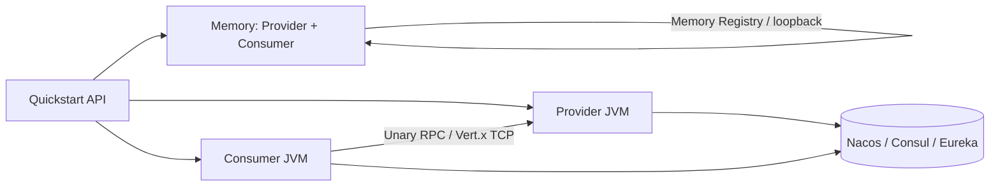
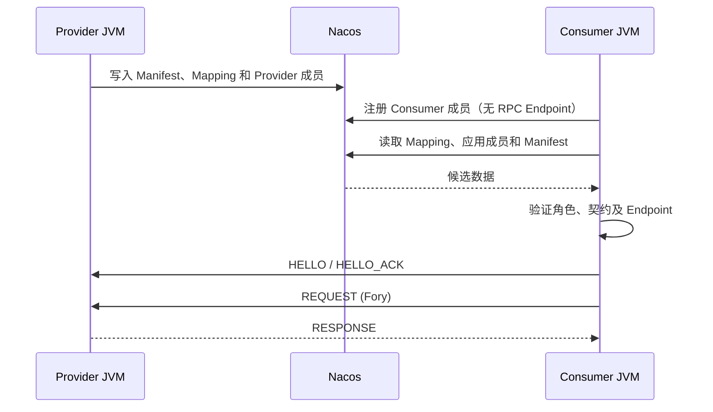

# OTRYX RPC Quickstart

> **当前源码**：1.0.0-SNAPSHOT、JDK 21、Spring Boot 3.5.4、Wire v1。尚未发布到 Maven Central，使用前先从本仓库编译。以下安全配置中的 TRUSTED_DEVELOPMENT **仅限本地或隔离环境**。

本目录是 OTRYX RPC 的**可运行入门工程**：不只展示代码片段，而是以真实的接口、Provider、Consumer、序列化与 Vert.x TCP 调用帮助你完成从首次运行到跨服务通信的学习。**只需依赖一个 `otryx-spring-boot-starter`**；Nacos/Consul/Eureka 等 Adapter 由具体应用显式选用。

## 学习路径与模块

| 顺序 | 模块 | 运行方式 | 必备基础设施 | 学习目标 |
|---|---|---|---|---|
| 1 | `otryx-quickstart-memory` | **一个 JVM** 内运行 Provider 和 Consumer | 无 | 最快跑通完整 RPC 调用 |
| 2 | `otryx-quickstart-api` | 共享 Contract / DTO 编译模块 | 无 | 接口契约、Generated Stub |
| 3 | `otryx-quickstart-provider` + `otryx-quickstart-consumer` | 两个 JVM | Nacos | 服务注册、发现、代理调用 |
| 4 | 同上 + Relay Provider | **三个 JVM** | Nacos | A → B → C Deadline 和 Metadata |
| 5 | 可选 Profiles | 多 JVM | Consul/Eureka、真实 CA | 替换 Registry、TLS/mTLS 安全边界 |



**注意**：Memory Registry 仅在单个 JVM 内共享，不提供跨进程发现。两个独立 JVM 的学习路径必须先运行 Nacos 或其他共享注册中心。

## 0. 准备工作

在仓库根目录运行所有命令：

- JDK **21**，确认 `java -version`；
- 仓库自带 Maven Wrapper（固定 Maven 3.9.11），Linux/macOS 使用 `./mvnw`，Windows 使用 `mvnw.cmd`；
- 首次下载 Maven/依赖需要 Maven Central 网络访问；
- Bash 初始化与跨进程验证脚本需要 GNU coreutils 的 `timeout` 命令在 `PATH` 中可用；macOS 默认不带该命令，需先安装并配置；
- 仅进行 Nacos、Consul 或 Eureka 双进程路径时才需要对应外部服务；Memory 路径不需要 Docker。

```bash
git clone https://github.com/Ryan-Guizhou/otryx-rpc.git
cd otryx-rpc
java -version
./mvnw --version
./mvnw -B -ntp -pl otryx-quickstart -am clean package
```

**Windows**：将上述 `./mvnw` 改为 `mvnw.cmd`；下面以 Linux/macOS bash 命令为主，Windows 可用两个 CMD/PowerShell 终端启动对应确切 JAR 文件名。

## 1. 第一条调用：无 Nacos 的 Memory Quickstart

```bash
# 可直接使用验证脚本（负责启动、校验返回值、关闭子进程）
bash scripts/run_quickstart_memory.sh
```

或自行启动 JAR（从仓库根目录运行；之后 Ctrl+C 退出）：

```bash
java -jar otryx-quickstart/otryx-quickstart-memory/target/otryx-quickstart-memory-1.0.0-SNAPSHOT-exec.jar
```

输出中应出现：

```text
Quickstart memory RPC succeeded: Hello, Quickstart!
```

该应用的完整调用路径是：`MemoryGreetingRunner` 中的 `@OtryxRpcReference` → Consumer（JDK Proxy，优先 Generated Stub）→ Fory 编码 → Vert.x loopback → `MemoryGreetingServiceImpl` → Response。只运行在单进程、回环地址、动态端口，**不代表网络环境安全配置已经完成**。

应用成员入册后，Provider 路由仍需异步刷新。Memory 演示对已声明幂等的 `hello` 在最多 10 秒的发现预算内重试明确的不可用结果；已有父调用 Deadline 时使用更短预算，每次 RPC 也受剩余时间约束。业务、协议和响应校验失败会立即终止，线程中断会保留中断标记并退出等待。

主要源码：

- [Memory Provider](otryx-quickstart-memory/src/main/java/com/peachsoft/otryx/quickstart/memory/MemoryGreetingServiceImpl.java)
- [Memory Consumer](otryx-quickstart-memory/src/main/java/com/peachsoft/otryx/quickstart/memory/MemoryGreetingRunner.java)
- [Memory 配置](otryx-quickstart-memory/src/main/resources/application.yml)
- [公共 GreetingService](otryx-quickstart-api/src/main/java/com/peachsoft/otryx/quickstart/api/GreetingService.java)

## 2. 第二条调用：Nacos 双独立 JVM

### 2.1 启动注册中心

```bash
docker compose -f otryx-quickstart/docker-compose.yml up -d
```

确认 Nacos 本地 TCP `127.0.0.1:8848` 可达。Quickstart Provider 和 Consumer 的 `application.yml` 均配置了 `registry.type=nacos`，并在各自 Maven POM 中**显式引入** `otryx-registry-nacos`。单一 Starter 不会偷偷引入未使用的注册中心。

**在启动任何 Provider/Consumer 前初始化 Nacos V2 Mapping 分片。** 等待 Nacos 的 HTTP `8848` 和客户端 gRPC `9848` 端口就绪，然后在该 namespace/group 没有业务进程写入的独占维护窗口执行：

```bash
bash scripts/bootstrap_quickstart_nacos.sh \
  otryx-quickstart/otryx-quickstart-provider/target/otryx-quickstart-provider-1.0.0-SNAPSHOT-exec.jar \
  127.0.0.1:8848 public OTRYX_RPC
```

该命令通过独立 JVM 调用已有 `NacosV2MetadataBootstrap`，与后续示例使用相同的 endpoint、namespace 和 Nacos group。它只创建缺失分片并校验、保留已有内容；初始化失败时先解决错误，再启动应用。普通 Starter 启动不会代替这一步，也不能与业务 Mapping 写入并发执行。参数和 CAS 约束见 [Nacos V2 文档](../docs/reference/registry-nacos-v2.md#4-nacos-config-servicemappingmd5-casfencing分片)。

### 2.2 启动 Provider（终端 A）

```bash
java -jar otryx-quickstart/otryx-quickstart-provider/target/otryx-quickstart-provider-1.0.0-SNAPSHOT-exec.jar
```

预期日志包含类似：

```text
OTRYX RPC server started: bind=0.0.0.0:19090, advertised=127.0.0.1:19090
```

### 2.3 启动 Consumer（终端 B）

```bash
java -jar otryx-quickstart/otryx-quickstart-consumer/target/otryx-quickstart-consumer-1.0.0-SNAPSHOT-exec.jar
```

预期：

```text
RPC quickstart completed successfully: Hello, OTRYX RPC!
```

Consumer 首次启动时会短暂重试尚未传播到本地目录的注册记录，但不会无条件吞掉业务或协议错误。Provider/Consumer 是**两个独立 JVM**；共享的只是 `otryx-quickstart-api` 里的接口、DTO 和 Contract 元数据。



**自动化复验**（先保证 Nacos 启动）：

```bash
OTRYX_RPC_E2E_RESTART_NACOS=false bash scripts/run_quickstart_process_e2e.sh
```

这还会在单个 Consumer JVM 存活期间验证 Provider 停止与恢复。CI 在具备可重启的测试 Nacos 容器时可额外验证 Nacos 控制面恢复、注册恢复与端点更换。

双进程、三进程和滚动验证脚本分别使用本轮独立 Nacos group，在首个应用启动前完成分片初始化，并把同一 scope 传给所有启动、重启和新 Consumer 探测进程。

## 3. 第三条调用：三个 JVM 的 Deadline 和 Metadata

继续保持 Nacos 运行，并从仓库根目录执行：

```bash
bash scripts/run_three_process_deadline_e2e.sh
```

脚本分别启动 Consumer A、Relay Provider B（19091）、Leaf Provider C（19090），并断言：

- Consumer 显式设置 5 秒本次调用 Deadline；
- Relay Provider 的本地 Client 默认 10 秒，但**不能覆盖**上游更短的剩余预算；
- `tenant` 和 `relay` 等 Metadata 随 A → B → C 调用透传；
- Leaf 校验剩余预算与来源 Metadata，Consumer 应输出以下 marker：

```text
RPC deadline chain completed: CHAIN_OK remainingMillis=...
```

失败时脚本会输出三个进程日志并清理子进程。这是真实通信验收，不是仅打印一段伪日志。

## 4. 理解需要复制到自己项目里的最小代码

共享 Contract 接口使用 `@OtryxRpcContract`，可通过 Maven Annotation Processor 生成 Stub/Dispatcher（当前 API 模块已经配置处理器）。没有生成代码时，会回退至 JDK Proxy / MethodHandle，不影响接口协议：

```java
@OtryxRpcContract
public interface GreetingService {
    @OtryxRpcIdempotent
    GreetingReply hello(GreetingRequest request);
}
```

Provider 声明 `@OtryxRpcService(interfaceClass = GreetingService.class, version = "1.0.0")`；Consumer 注入 `@OtryxRpcReference(version = "1.0.0")`。只有业务真正具备幂等语义时才应添加 `@OtryxRpcIdempotent`，尤其不要仅为了重试而将扣款、下单标记为幂等。

你的应用应只引入单一 Starter；需要 Nacos 再明确添加 Adapter：

```xml
<dependency>
    <groupId>com.peachsoft.otryx</groupId>
    <artifactId>otryx-spring-boot-starter</artifactId>
    <version>1.0.0-SNAPSHOT</version>
</dependency>
<dependency>
    <groupId>com.peachsoft.otryx</groupId>
    <artifactId>otryx-registry-nacos</artifactId>
    <version>1.0.0-SNAPSHOT</version>
</dependency>
```

其他可按需选择 `otryx-registry-etcd`、`otryx-registry-consul`、`otryx-registry-eureka`、`otryx-proxy-cglib`、`otryx-proxy-bytebuddy` 或 Observability Adapter；无需重新换 Starter。完整属性与 SPI 覆盖见 [Starter 参考](../docs/reference/starter.md)。

## 5. 进一步验证 Registry：Consul / Eureka

Provider、Consumer 当前的 POM 已声明可选演示所需的 Consul/Eureka Adapter。先自己部署对应服务后，**两个进程使用同一 Profile**，不要尝试与 Memory Registry 跨 JVM 连接：

```bash
# Provider 终端
java -jar otryx-quickstart/otryx-quickstart-provider/target/otryx-quickstart-provider-1.0.0-SNAPSHOT-exec.jar --spring.profiles.active=consul
# Consumer 终端
java -jar otryx-quickstart/otryx-quickstart-consumer/target/otryx-quickstart-consumer-1.0.0-SNAPSHOT-exec.jar --spring.profiles.active=consul
```

Eureka 只保存应用成员，必须另外配置提供 Manifest/Mapping 的元数据后端。下面示例要求同时运行 Eureka 和 Consul；Quickstart 已显式引入这两个 Adapter，两个进程均指定同一个 Consul KV 后端：

```bash
# Provider 终端
java -jar otryx-quickstart/otryx-quickstart-provider/target/otryx-quickstart-provider-1.0.0-SNAPSHOT-exec.jar \
  --spring.profiles.active=eureka \
  --otryx.rpc.registry.eureka.metadata-backend=consul \
  --otryx.rpc.registry.eureka.metadata-endpoints=http://127.0.0.1:8500
# Consumer 终端
java -jar otryx-quickstart/otryx-quickstart-consumer/target/otryx-quickstart-consumer-1.0.0-SNAPSHOT-exec.jar \
  --spring.profiles.active=eureka \
  --otryx.rpc.registry.eureka.metadata-backend=consul \
  --otryx.rpc.registry.eureka.metadata-endpoints=http://127.0.0.1:8500
```

Consul Profile 的认证通过 `CONSUL_HTTP_TOKEN` 传递，Eureka 成员面的认证通过 `EUREKA_USERNAME`/`EUREKA_PASSWORD` 传递。Eureka 的外置元数据凭据须另外通过 `metadata-options` 配置，见 [Starter 后端装配](../docs/reference/starter.md)。不要提交真实密钥。后端约束见 [Consul V2](../docs/reference/registry-consul-v2.md) 和 [Eureka V2](../docs/reference/registry-eureka-v2.md)。

## 6. 安全运行：TLS / mTLS

Provider、Consumer 的 `application-tls.yml`、`application-mtls.yml` 都读取环境变量：

| 环境变量 | 用途 |
|---|---|
| `OTRYX_QUICKSTART_TLS_CERT` | 当前进程的 PEM 证书 |
| `OTRYX_QUICKSTART_TLS_KEY` | 对应私钥 |
| `OTRYX_QUICKSTART_TLS_CA` | 信任 CA 证书 |

旧启动脚本中的 `OTRYX_RPC_TLS_CERT`、`OTRYX_RPC_TLS_KEY`、`OTRYX_RPC_TLS_CA` 应改用上述新名，并移除旧环境变量；旧名会被严格配置校验拒绝。证书路径对应的 `otryx.rpc.transport.security.*` 属性与安全要求保持不变。

使用 `--spring.profiles.active=tls` 或 `--spring.profiles.active=mtls` 启动。Consumer 默认执行 Hostname Verification，证书身份必须与目标地址匹配。mTLS Profile 会启用 `NETWORK_MTLS`、严格 Fory DTO allowlist；**还必须提供基于验证过的客户端身份、ServiceKey、MethodId 的 `RpcAuthorizer` Bean**，否则网络 Profile 下 Provider 会默认拒绝业务调用。这里的 TLS/mTLS 文件是安全配置起点，不应在未配置真实证书与授权时误认为端到端生产接入已完成。

另见 [安全与授权](../docs/security.md)。

## 7. 观测、背压和生命周期

- `QuickstartCallObserver` 演示自定义 `RpcObserver` 的 Spring Bean 接入，按终态累计成功/失败次数，不读取 Payload；
- Micrometer、OpenTelemetry、JFR 是**按需添加**的 Adapter，不会作为 Starter 的强制依赖；
- 重试仅适用于幂等方法；达到容量上限时会快速拒绝而非阻塞 EventLoop；
- Provider/Consumer 的关闭、Drain、Deadline 均由真实运行时负责，见 [运行与排障](../docs/operations.md)、[Deadline](../docs/reference/deadline-context.md)。

## 8. 常见问题和排查顺序

| 现象 | 检查项 |
|---|---|
| `exec.jar` 找不到 | 先在**仓库根目录**运行 `./mvnw -B -ntp -pl otryx-quickstart -am clean package`；区分普通 JAR 与 `-exec.jar` |
| Maven 解析不了 OTRYX `1.0.0-SNAPSHOT` | 尚未发布 Central；先本地运行 `./mvnw -B -ntp clean install -DskipTests` |
| 无法连接 Nacos | 检查 `docker compose ... up -d`、8848/9848、Registry type、namespace 与 Provider/Consumer 配置是否一致 |
| Memory 模式双进程互相看不到 | Memory Registry **不跨 JVM**；使用 Nacos / Consul / Eureka 等共享注册中心 |
| `NETWORK_MTLS` 拒绝调用 | 检查 CA/证书/私钥、Hostname、严格 Fory 白名单和 `RpcAuthorizer` |
| RPC 偶发超时 | 检查 Provider 是否启动、服务目录是否完成同步、请求 Deadline、连接与背压指标 |
| 端口被占用 | Provider 默认 19090；多跳场景脚本使用 19090/19091；先停止先前的 Provider 进程 |

## 9. 完整验收与清理

```bash
python3 scripts/test_quickstart_layout.py
./mvnw -B -ntp clean verify -Pquality
bash scripts/run_quickstart_memory.sh
# 下面两条命令需要本地 Nacos
OTRYX_RPC_E2E_RESTART_NACOS=false bash scripts/run_quickstart_process_e2e.sh
bash scripts/run_three_process_deadline_e2e.sh
docker compose -f otryx-quickstart/docker-compose.yml down
```

初次验收完成后可阅读：[用户指南](../docs/user-guide.md) · [Starter 参考](../docs/reference/starter.md) · [架构设计](../docs/architecture.md) · [协议兼容](../docs/wire-compatibility.md)。固定硬件性能结论仍需要受控证据，短时 Quickstart 成功**不是**正式生产性能或 GA 发布认证。

## V2 应用级注册迁移说明（开发分支）

Core 编程式 `ApplicationMembershipCoordinator`、`ApplicationServiceResolver` 与
`OtryxRpcClient.applicationControlPlane(...)` / `OtryxRpcServer.applicationMembership(...)`
已经建立独立的应用级 RPC 路径。可运行的 **Core 单 JVM Wire v1 E2E**
在 `ApplicationRuntimeEndToEndTest` 中验证三接口、独立 Consumer 与同进程 BOTH。
当前 #137 分支已将唯一 Spring Starter 接入同一套应用级控制面，
本目录的 Spring Quickstart 通过该 Starter 注册 Provider、Consumer 或 BOTH 成员；
纯 Consumer 不注册 RPC Endpoint。Nacos 独立进程脚本在启动应用前初始化本轮独立 scope。
#137 的验收以准确 PR Head 和合并后 main CI 为准。

完整的成员诊断、两个真实 Manifest revision 滚动和 mTLS 授权教程仍归 #138；
旧接口级 SPI 的全量删除仍归 #139。现有 Quickstart 成功不能作为全仓 V2 迁移完成或
生产就绪的证明。各阶段范围与剩余工作见 [V2 设计与状态](../docs/design/application-registry-v2.md)。
