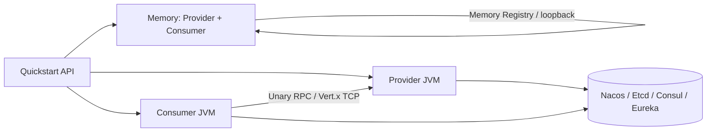
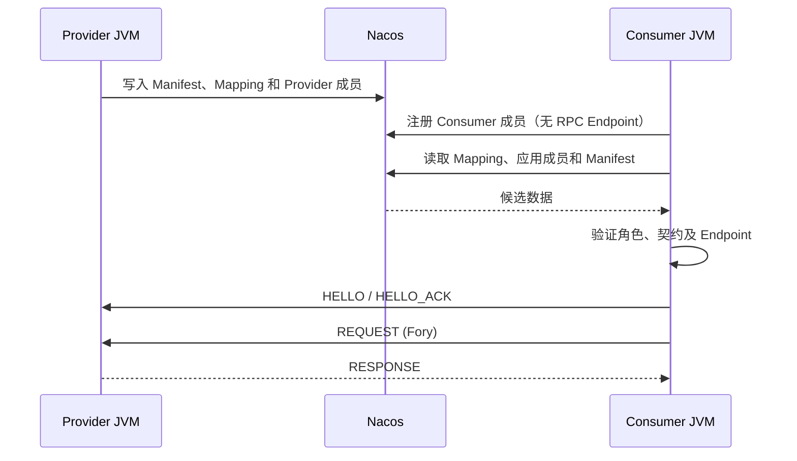
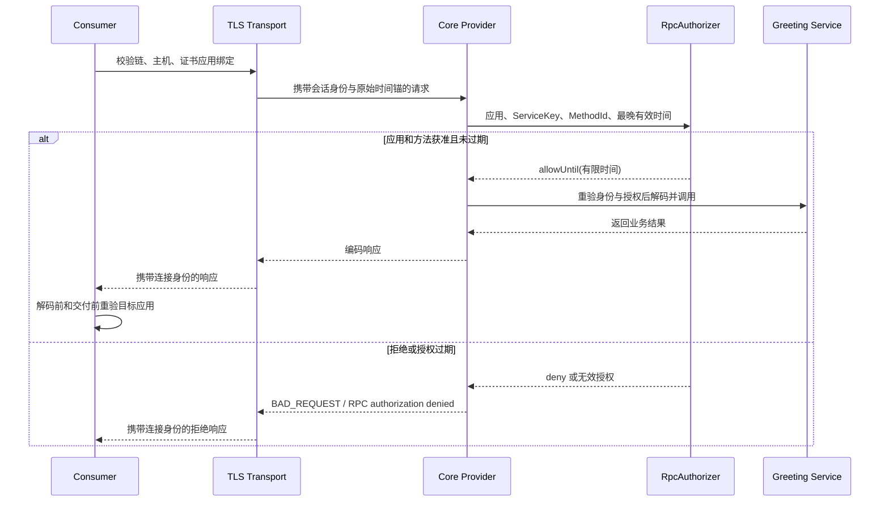

# OTRYX RPC Quickstart

[简体中文](README.md) | [English](README.en-US.md)

> **当前源码**：1.0.0-SNAPSHOT、JDK 21、Spring Boot 3.5.4、Wire v1。尚未发布到 Maven Central，使用前先从本仓库编译。以下安全配置中的 TRUSTED_DEVELOPMENT **仅限本地或隔离环境**。

本目录是 OTRYX RPC 的**可运行入门工程**：不只展示代码片段，而是以真实的接口、Provider、Consumer、序列化与 Vert.x TCP 调用帮助你完成从首次运行到跨服务通信的学习。**只需依赖一个 `otryx-spring-boot-starter`**；Nacos/Consul/Eureka 等 Adapter 由具体应用显式选用。

<!-- doc-section:learning-path -->
## 学习路径与模块

| 顺序 | 模块 | 运行方式 | 必备基础设施 | 学习目标 |
|---|---|---|---|---|
| 1 | `otryx-quickstart-memory` | **一个 JVM** 内运行 Provider 和 Consumer | 无 | 最快跑通完整 RPC 调用 |
| 2 | `otryx-quickstart-api` | 共享 Contract / DTO 编译模块 | 无 | 接口契约、Generated Stub |
| 3 | `otryx-quickstart-provider` + `otryx-quickstart-consumer` | 两个 JVM | Nacos | 应用成员、Manifest、Mapping 与已验证路由 |
| 4 | 同上 + Relay Provider | **三个 JVM** | Nacos | Consumer / BOTH / Provider，A → B → C Deadline |
| 5 | 同一 Provider JAR 的两个导出集合 | 多 JVM | Nacos | 两个真实 Manifest revision 共存、升级、回滚 |
| 6 | 现有 Provider / Consumer 的 `mtls` Profile | 多 JVM | Etcd 3.5.21 可执行文件、OpenSSL | 应用身份绑定、有限方法授权与注册中心权限 |



**注意**：Memory Registry 仅在单个 JVM 内共享，不提供跨进程发现。两个独立 JVM 的学习路径必须先运行 Nacos 或其他共享注册中心。

<!-- doc-section:prerequisites -->
## 0. 准备工作

在仓库根目录运行所有命令：

- JDK **21**，确认 `java -version`；
- 仓库自带 Maven Wrapper（固定 Maven 3.9.11），Linux/macOS 使用 `./mvnw`，Windows 使用 `mvnw.cmd`；
- 首次下载 Maven/依赖需要 Maven Central 网络访问；
- 脚本需要 Bash、Python 3 和 GNU coreutils 的 `timeout`；mTLS 自动验收还需要 Linux、OpenSSL 和 Etcd 3.5.21 可执行文件，以管理独立进程组与临时 TLS/RBAC 后端。macOS 可运行开发场景，需把 GNU `timeout` 配置到 `PATH`；
- 双进程恢复、三进程 Deadline 和双 revision 开发路径默认使用已运行的共享 Nacos；可使用下文 Docker Compose，也可使用自行部署的本地 Nacos。mTLS 脚本自行启动临时 Etcd；Memory 路径不需要 Docker。

```bash
git clone https://github.com/Ryan-Guizhou/otryx-rpc.git
cd otryx-rpc
java -version
./mvnw --version
./mvnw -B -ntp -pl otryx-quickstart -am clean package
```

**Windows**：将上述 `./mvnw` 改为 `mvnw.cmd`；下面以 Linux/macOS bash 命令为主，Windows 可用两个 CMD/PowerShell 终端启动对应确切 JAR 文件名。

### 已构建 JAR 后，一条命令运行全部场景

先按第 2.1 节准备 Nacos，并提供本机 Etcd 3.5.21 可执行文件，再执行：

```bash
NACOS_TEST_ENDPOINT=127.0.0.1:8848 ETCD_BINARY=/absolute/path/to/etcd \
  bash scripts/run_quickstart_e2e.sh
```

入口依次运行 Memory、双进程恢复、三进程 Deadline、双 revision、mTLS 授权，任一阶段失败即停止。它使用现有四个模块的已构建 JAR，不代替 Maven 构建或启动 Nacos。前三个跨进程开发场景分别创建独立 Nacos group，先初始化分片，再把同一 scope 传给所有参与 JVM；mTLS 场景则使用自身管理的 Etcd TLS/RBAC 实例。

三个开发场景与 mTLS 场景的证据保存在 `target/quickstart-e2e/<scenario>.<随机后缀>/`，包含受限字段的 JSON 快照和 `summary.log`；Memory 成功标记保留在控制台输出。可用 `OTRYX_QUICKSTART_EVIDENCE_DIR` 改变证据根目录。JSON 的中间尝试可能尚未收敛，以 `summary.log` 中 `Registry snapshot verified` 指向的文件作为该阶段断言通过的证据。mTLS 临时 PKI、后端数据库与凭据在证据目录之外生成并清理，私钥不进入证据。详细步骤和每个阶段应满足的行为见下文；列出命令不表示当前工作树已经通过该次执行。

<!-- doc-section:memory -->
## 1. 第一条调用：无 Nacos 的 Memory Quickstart

```bash
# 可直接使用验证脚本（负责启动、校验返回值、关闭子进程）
bash scripts/run_quickstart_memory.sh
```

或自行启动 JAR（从仓库根目录运行；之后 Ctrl+C 退出）：

```bash
java -jar otryx-quickstart/otryx-quickstart-memory/target/otryx-quickstart-memory-1.0.0-SNAPSHOT-exec.jar
```

脚本成功时向标准输出打印 `Memory Quickstart: PASS (real RPC, no external registry)`。手工运行 JAR 时，应用日志中应出现以下标记；脚本则在临时应用日志中核验同一标记：

```text
Quickstart memory RPC succeeded: Hello, Quickstart!
```

该应用的完整调用路径是：`MemoryGreetingRunner` 中的 `@OtryxRpcReference` → Consumer（JDK Proxy，优先 Generated Stub）→ Fory 编码 → Vert.x loopback → `MemoryGreetingServiceImpl` → Response。只运行在单进程、回环地址、动态端口，**不代表网络环境安全配置已经完成**。

应用成员入册后，Provider 路由仍需异步刷新。Memory 演示对已声明幂等的 `hello` 在最多 10 秒的发现预算内重试明确的不可用结果；已有父调用 Deadline 时使用更短预算，每次 RPC 也受剩余时间约束。业务、协议和响应校验失败会立即终止，线程中断会保留中断标记并退出等待。

主要源码：

- [Memory Provider](otryx-quickstart-memory/src/main/java/com/peachsoft/otryx/quickstart/memory/MemoryGreetingServiceImpl.java)
- [Memory Consumer](otryx-quickstart-memory/src/main/java/com/peachsoft/otryx/quickstart/memory/MemoryGreetingRunner.java)
- [Memory 配置](otryx-quickstart-memory/src/main/resources/application.yml)
- [公共 GreetingService](otryx-quickstart-api/src/main/java/com/peachsoft/otryx/quickstart/api/GreetingService.java)

<!-- doc-section:nacos -->
## 2. 第二条调用：Nacos 双独立 JVM

### 2.1 启动注册中心

```bash
docker compose -f otryx-quickstart/docker-compose.yml up -d
```

确认 Nacos 本地 TCP `127.0.0.1:8848` 可达。Quickstart Provider 和 Consumer 的 `application.yml` 均配置了 `registry.type=nacos`，并在各自 Maven POM 中**显式引入** `otryx-registry-nacos`。单一 Starter 不会偷偷引入未使用的注册中心。

**在启动任何 Provider/Consumer 前初始化 Nacos V2 Mapping 分片。** 等待 Nacos 的 HTTP `8848` 和客户端 gRPC `9848` 端口就绪，然后在该 namespace/group 没有业务进程写入的独占维护窗口执行：

```bash
bash scripts/bootstrap_quickstart_nacos.sh \
  otryx-quickstart/otryx-quickstart-provider/target/otryx-quickstart-provider-1.0.0-SNAPSHOT-exec.jar \
  127.0.0.1:8848 public OTRYX_RPC
```

该命令通过独立 JVM 调用已有 `NacosV2MetadataBootstrap`，与后续示例使用相同的 endpoint、namespace 和 Nacos group。它只创建缺失分片并校验、保留已有内容；初始化失败时先解决错误，再启动应用。普通 Starter 启动不会代替这一步，也不能与业务 Mapping 写入并发执行。参数和 CAS 约束见 [Nacos V2 文档](../docs/reference/registry-nacos-v2.md#4-nacos-config-servicemappingmd5-casfencing分片)。

手工初始化命令有 120 秒执行预算和 5 秒强制退出宽限。自动化场景使用各自随机 group，已经包含这一步；不要为了运行自动脚本而初始化正在被其他应用写入的共享 group。

### 2.2 启动 Provider（终端 A）

```bash
java -jar otryx-quickstart/otryx-quickstart-provider/target/otryx-quickstart-provider-1.0.0-SNAPSHOT-exec.jar
```

预期日志包含类似：

```text
OTRYX RPC server started: bind=0.0.0.0:19090, advertised=127.0.0.1:19090
```

### 2.3 启动 Consumer（终端 B）

```bash
java -jar otryx-quickstart/otryx-quickstart-consumer/target/otryx-quickstart-consumer-1.0.0-SNAPSHOT-exec.jar
```

预期：

```text
RPC quickstart completed successfully: Hello, OTRYX RPC!
```

Consumer 首次启动时会短暂重试尚未传播到本地目录的注册记录，但不会无条件吞掉业务或协议错误。Provider/Consumer 是**两个独立 JVM**；共享的只是 `otryx-quickstart-api` 里的接口、DTO 和 Contract 元数据。



### 2.4 观察真实成员、Manifest 与 Mapping

保持两个 JVM 运行，在第三个终端创建一个新的输出文件路径：

```bash
mkdir -p target/quickstart-e2e
snapshot_dir=$(mktemp -d target/quickstart-e2e/manual.XXXXXXXX)
bash scripts/observe_quickstart_nacos.sh \
  otryx-quickstart/otryx-quickstart-provider/target/otryx-quickstart-provider-1.0.0-SNAPSHOT-exec.jar \
  127.0.0.1:8848 public OTRYX_RPC public "$snapshot_dir/members.json" \
  otryx-quickstart-provider otryx-quickstart-consumer
```

参数顺序为 **Provider 可执行 JAR、endpoint、Nacos namespace、Nacos group、application namespace、新 JSON 文件、1–16 个 applicationName**。当前 Starter 将 `otryx.rpc.registry.namespace` 同时用于后端配置和 `ApplicationKey.namespace`；本教程明确设置 `public`，所以两处均传 `public`，不存在独立的 Spring application namespace 配置。

不要混淆以下身份：

| 维度 | 手工示例值 | 作用 |
|---|---|---|
| `ApplicationKey` | `public` + `otryx-quickstart-provider` 或 `otryx-quickstart-consumer` | 应用成员归属 |
| Nacos group | `OTRYX_RPC` | 隔离本轮 Naming / Config 控制面数据 |
| `ServiceKey` | 接口全名 + `1.0.0` + `default` | 业务契约与路由目标；不是注册实例主键 |
| `instanceId` | 每次启动生成的实例 ID | 同一应用内区分进程 |
| Manifest revision | 由实际导出契约内容计算 | 标识不可变导出集合；不是手写发布版本号 |

JSON 中应重点检查：

| 字段 | 应看到什么 |
|---|---|
| `applications[].members` | Provider 为 `PROVIDER`，Consumer 为 `CONSUMER`；各自是真实成员 |
| Consumer 的 `rpcEndpoint` / `manifestRevision` / `weight` | `null` / `null` / `0`，不捏造监听端口 |
| `applications[].manifests[].services` | 导出的 ServiceKey、serviceId、methodIds、schemaFingerprint |
| `services[].mappedApplications` | ServiceMapping 返回的候选应用 |
| `services[].verifiedProviders` | 经过成员角色、Endpoint、Manifest 与契约校验的 Provider；纯 Consumer 永远不在此列表 |

观察器的成员与 Manifest 视图按明确指定的应用读取；服务视图通过真实 Mapping/Resolver 查询三个固定契约（Greeting、RelayGreeting、GreetingDetails），可能包含同一 scope 中其他导出这些契约的应用。它不枚举整个注册中心，不注册自己的成员，不导出任意实例 attributes。所有读取成功后才写新文件，并拒绝覆盖已有文件；每次观察都应换新文件名。Naming 与 Config 的读取**不是跨存储事务快照**，变更期间需等待收敛；读取失败不能解释为空目录。源码见 [QuickstartRegistrySnapshot](otryx-quickstart-provider/src/main/java/com/peachsoft/otryx/quickstart/provider/QuickstartRegistrySnapshot.java)。

### 2.5 自动复验停止与恢复

先停止上面手工启动的 JVM、释放端口，再执行：

```bash
OTRYX_RPC_E2E_RESTART_NACOS=false bash scripts/run_quickstart_process_e2e.sh
```

脚本的应用名是 `otryx-quickstart-process-provider` 和 `otryx-quickstart-process-consumer`，与手工演示使用不同的隔离 scope。它在单个 Consumer JVM 存活期间观察 `initial`、`provider-stopped` 和 `provider-restarted`。停止 Provider 后，Consumer 成员仍存在，但 Greeting 的已验证 Provider 应为空；恢复后同一 Consumer 应重新完成 RPC。

显式重复模式只对无副作用且已标记幂等的普通 `GreetingService.hello` 额外容忍本地 `RpcTimeoutException`，每次 RPC 仍受默认 `3s` deadline 约束。新增超时处理不适用于一次性调用、Relay、Details 或授权负例。其他异常沿用现有分类：明确的 `UNAVAILABLE` 可以重试，远端 deadline 及其他业务、协议、授权错误继续向上传播。脚本的有限阶段等待与 TERM/KILL 清理约束整个恢复场景。

在拥有且允许重启的本地测试容器环境，可设置 `OTRYX_RPC_E2E_RESTART_NACOS=true`，再验证 `registry-recovered`、新 Consumer 的发现和 `endpoint-changed`（19090 → 19091）。此扩展要求唯一一个 `nacos/nacos-server:v3.2.4` 容器与 `127.0.0.1:8848` endpoint。该开关默认跟随 `CI`；使用共享或非容器 Nacos 时明确设为 `false`，统一入口也会继承这个选择。

双进程、三进程和滚动验证脚本分别使用本轮独立 Nacos group，在首个应用启动前完成分片初始化，并把同一 scope 传给所有启动、重启和新 Consumer 探测进程。

<!-- doc-section:chain -->
## 3. 第三条调用：三个 JVM 的 Deadline 和 Metadata

继续保持 Nacos 运行，并从仓库根目录执行：

```bash
bash scripts/run_three_process_deadline_e2e.sh
```

脚本分别启动 Consumer A、Relay Provider B（19091）、Leaf Provider C（19090），并断言：

- Consumer 显式设置 5 秒本次调用 Deadline；
- Relay Provider 的本地 Client 默认 10 秒，但**不能覆盖**上游更短的剩余预算；
- `tenant` 和 `relay` 等 Metadata 随 A → B → C 调用透传；
- 成员快照中 A 为无 Endpoint 的 `CONSUMER`，B 为一个带真实 Endpoint 的 `BOTH`，C 为 `PROVIDER`；B 不会因同时消费与导出而出现两条成员；
- Leaf 校验剩余预算与来源 Metadata，Consumer 应输出以下 marker：

```text
RPC deadline chain completed: CHAIN_OK remainingMillis=...
```

失败时脚本会输出三个进程日志并清理子进程。这是真实通信验收，不是仅打印一段伪日志。

应用名依次为 `otryx-quickstart-chain-consumer`、`otryx-quickstart-chain-relay`、`otryx-quickstart-chain-leaf`，阶段为 `complete`。

<!-- doc-section:revisions -->
## 4. 同一应用的两个真实 Manifest revision

```bash
bash scripts/run_quickstart_revision_e2e.sh
```

脚本复用**同一个新构建的 Provider JAR、相同 ApplicationName、相同 ServiceKey version/group**，只改变真实导出集合：基线导出 `GreetingService`；设置 `otryx.rpc.quickstart.details-enabled=true` 后额外装配 [GreetingDetailsServiceImpl](otryx-quickstart-provider/src/main/java/com/peachsoft/otryx/quickstart/provider/GreetingDetailsServiceImpl.java)，导出 `GreetingDetailsService`。新增契约的幂等方法 `details(GreetingRequest)` 返回 `GreetingReply("DETAILS_OK")`。

Provider 应用名为 `otryx-quickstart-revision-provider`，实例 `baseline` / `extended` 使用 19090 / 19091；长期 Consumer 为 `otryx-quickstart-revision-consumer` / `consumer-main`。导出集合变化产生不同 Manifest revision，无需伪造 revision 或更改接口版本。共存阶段还比较两个 Manifest 中 Greeting 的完整契约条目：ServiceKey、serviceId、schemaFingerprint 与 MethodId 集合必须相同，额外导出的 Details 才是本例 revision 变化的来源。观察与断言按以下顺序进行：

| 阶段 | 同一 Provider 应用的成员与导出 | 必须成立的行为 |
|---|---|---|
| `baseline` | 一个实例，`{Greeting}` | Greeting RPC 成功 |
| `coexist` | 两个实例，分别为 `{Greeting}`、`{Greeting, Details}` | 两个真实 revision 共存；Details 只路由到实际导出它的实例 |
| `details-probed` | 两个 Provider 共存，另有 Details Consumer 探针 | 探针真实 RPC 返回 `DETAILS_OK`，并作为无 Endpoint 的 Consumer 被观察 |
| `promoted` | 仅 `{Greeting, Details}` 实例 | 同一个长期 Consumer 的 Greeting RPC 继续成功；Details 路由指向该实例 |
| `rollback-coexist` | 基线实例重新加入，两个 revision 再次共存 | 回滚期间 Greeting 保持可路由 |
| `rolled-back` | 仅 `{Greeting}` 实例 | Greeting 成功；Details 没有已验证 Provider |
| `providers-stopped` | Provider 全部停止，Consumer JVM 保持运行 | Consumer 成员仍在；Greeting 和 Details 的已验证 Provider 都为空 |

Details 的实际调用成功标记为：

```text
RPC details quickstart completed successfully: DETAILS_OK
```

Details 探针应用名为 `otryx-quickstart-revision-details-probe`，完成调用及观察后退出。全部阶段通过后脚本输出 `Two actual application Manifest revisions and rollback: PASS`。实现见 [revision 脚本](../scripts/run_quickstart_revision_e2e.sh) 与 [快照断言](../scripts/assert_quickstart_snapshot.py)。

本场景验证当前应用级控制面内的导出变化、成员共存与收敛。它不证明历史接口级 Registry 与应用级 Registry 混合部署互通；跨注册代际规则仍见 [迁移指南](../docs/migration.md)。

<!-- doc-section:security -->
## 5. mTLS：应用身份、有限授权与受保护的注册中心

先准备 Etcd **3.5.21** 可执行文件，再运行现有 Provider / Consumer JAR：

```bash
ETCD_BINARY=/absolute/path/to/etcd bash scripts/run_quickstart_mtls_e2e.sh
```

脚本自行创建并关闭一个只监听 loopback 的 Etcd TLS/RBAC 实例；无需启动 Nacos。RPC 和注册中心使用两套独立临时 CA。四个后端身份分别负责管理夹具、Provider、Consumer 和只读观察：管理凭据只供测试设置与权限撤销使用，应用和观察器只接收各自范围的凭据文件。临时数据库、证书、私钥和凭据会在全部受管进程停止后清理。

RPC 应用为 `otryx-quickstart-mtls-provider`（`127.0.0.1:19143`）和 `otryx-quickstart-mtls-consumer`，共同 namespace 为 `otryx-quickstart-security`。Transport 将每张受信叶子证书的完整 DER SHA-256 绑定到明确的 `ApplicationKey(namespace, applicationName)` 与有限失效时间。Consumer 的原证书和轮换证书绑定到同一个应用；业务授权器允许这个应用调用 `GreetingService / 1.0.0 / default` 的 `hello`，并返回有限 `validUntil`。CN/SAN 用于证书与主机校验，不代替应用绑定或方法授权。

### 15 类场景与精确结果

E12、E14 各有两个独立分支，共形成 **17 个具名阶段快照**。每个阶段均由独立观察器读取真实后端；Provider 必须保留 Greeting 与 Details 的实际导出，纯 Consumer 不能带 RPC Endpoint 或进入 Provider 池。

| 阶段 | 操作 | 必须观察到的结果 | Consumer 成员 |
|---|---|---|---|
| `E01-allowed-initial` | 原证书调用 Greeting | 真实 RPC 成功 | 存在 |
| `E02-rotated-consumer` | 同应用的轮换证书调用 Greeting | 真实 RPC 成功 | 存在 |
| `E03-unbound-provider` | Consumer 不绑定实际 Provider 证书 | `IDENTITY_UNBOUND` | 存在 |
| `E04-local-application-mismatch` | 本端证书绑定其他应用 | 启动前 `APPLICATION_MISMATCH` | 不存在 |
| `E05-remote-application-mismatch` | 远端证书绑定其他应用 | `APPLICATION_MISMATCH` | 存在 |
| `E06-remote-namespace-mismatch` | 远端证书绑定其他 namespace | `NAMESPACE_MISMATCH` | 存在 |
| `E07-wrong-rpc-ca` | RPC 信任错误 CA | `CERTIFICATE_REJECTED` | 存在 |
| `E08-expired-local-binding` | 本端应用绑定过期 | 启动前 `IDENTITY_EXPIRED` | 不存在 |
| `E09-expired-certificate` | 本端叶子证书已过期 | 启动前拒绝 TLS 材料 | 不存在 |
| `E10-expired-policy` | Provider 的有限授权策略过期 | 精确远程方法授权拒绝 | 存在 |
| `E11-details-denied` | 有效应用调用未获授权的 Details | 精确远程方法授权拒绝 | 存在 |
| `E12-missing-authorizer-provider` / `E12-missing-authorizer-both` | 新 Provider / BOTH 缺少授权器 | 启动前拒绝；不能创建额外成员或监听器 | 不存在 |
| `E13-allowed-repeat` | 负例之后重新正常调用 | 真实 RPC 再次成功 | 存在 |
| `E14-wrong-registry-ca` / `E14-wrong-registry-credentials` | 注册中心 CA 或密码错误 | 精确 `TLS_REJECTED` / `AUTHENTICATION_REJECTED` | 不存在 |
| `E15-observer-read-only` | 观察器尝试覆盖 Provider 成员 | 权限拒绝，原成员和路由仍完整 | 不存在 |

每个 Consumer 阶段独立启动并关闭。E10 前和 E11 前会重启 Provider，以分别装载过期策略和恢复后的策略；其他负例必须保留正在运行的健康 Provider。全部阶段通过才输出：

```text
Quickstart NETWORK_MTLS security scenarios: PASS
```

本地认证负例必须收到准确的 `RpcAuthenticationException.Reason`，由 Consumer 输出 `RPC authentication failure verified: reason=<REASON>`。方法授权负例只接受 `RpcRemoteException` 的 `BAD_REQUEST` 与固定消息 `RPC authorization denied`，输出 `RPC authorization denial verified.`。连接失败、通用 TLS 异常、错误原因或意外成功都会使验收失败。



### 手工配置现有 Profile

`tls` Profile 是显式 `TRUSTED_DEVELOPMENT` 下的单向 TLS 演示。它使用 Provider 的 `OTRYX_QUICKSTART_TLS_CERT` / `OTRYX_QUICKSTART_TLS_KEY`，以及 Consumer 的 `OTRYX_QUICKSTART_TLS_CA`。`mtls` Profile 则要求受保护的 Etcd 和下列环境设置：

| 设置 | 含义 |
|---|---|
| `OTRYX_QUICKSTART_TLS_CERT`、`OTRYX_QUICKSTART_TLS_KEY`、`OTRYX_QUICKSTART_TLS_CA` | 当前进程的 RPC 证书、私钥与对端信任 CA |
| `OTRYX_QUICKSTART_REGISTRY_ENDPOINT`、`OTRYX_QUICKSTART_REGISTRY_CA` | Etcd HTTPS 地址与独立注册中心信任 CA；地址必须匹配证书 SAN |
| `OTRYX_QUICKSTART_REGISTRY_CREDENTIALS_DIR` | 当前角色的 Spring configtree 目录；只放本角色用户名、密码文件 |
| `OTRYX_QUICKSTART_NAMESPACE` | 实际成员与证书绑定共同的 namespace |
| `OTRYX_QUICKSTART_PROVIDER_BINDING_NAMESPACE` | 默认采用上述 namespace；仅供负例独立改变 Provider 证书绑定的 namespace |
| `OTRYX_QUICKSTART_PROVIDER_APPLICATION`、`OTRYX_QUICKSTART_CONSUMER_APPLICATION` | 默认采用上述两个应用名；必须与各进程实际成员身份相符 |
| `OTRYX_QUICKSTART_PROVIDER_SHA256`、`OTRYX_QUICKSTART_CONSUMER_SHA256` | 两个应用叶子证书完整 DER 的 SHA-256 |
| `OTRYX_QUICKSTART_CONSUMER_ROTATED_SHA256` | 同一 Consumer 的轮换证书摘要；省略时复用当前证书摘要 |
| `OTRYX_QUICKSTART_BINDING_VALID_UNTIL` | 所有示例证书绑定的有限 ISO-8601 失效时间 |
| `OTRYX_QUICKSTART_POLICY_VALID_UNTIL` | Provider 示例业务策略的有限失效时间 |

configtree 中的文件名为 `otryx.rpc.registry.security.credentials.username` 和 `otryx.rpc.registry.security.credentials.password`。使用权限受限的目录和文件，从你的凭据管理渠道写入；不要把凭据放进命令行、源码、公共日志或验收附件。Profile 显式选择 `USER_PASSWORD`，不从通用 `providerOptions` 推断凭据。

计算证书摘要：

```bash
openssl x509 -in consumer.crt -outform DER | openssl dgst -sha256
```

Provider 示例授权器使用 `otryx.rpc.quickstart.mtls.allowed-consumer.namespace`、`allowed-consumer.application-name` 与 `policy-valid-until`；Profile 从上表环境变量绑定这些值。证书轮换不改变业务策略里的应用名。一次授权还受证书、绑定、请求预算和 `server.authorization.max-grant-lifetime`（示例 `30s`）共同约束。缺少显式 `RpcAuthorizer` 的 `NETWORK_MTLS` Provider / BOTH 在 Registry 或 Transport 激活之前失败。

`otryx.rpc.quickstart.use-details=true` 与 `use-relay=true` 互斥。`expect-authentication-failure=<REASON>` 与 `expect-authorization-denied=true` 互斥，任何负例模式都不能与重复调用一起使用。旧 `allowed-client-sha256` 业务配置已经移除；证书摘要现在属于 Transport 的应用绑定。旧 `OTRYX_RPC_TLS_*` 变量也应从环境中移除，统一使用上表的 Quickstart 路径变量。

### 独立、只读的安全观察器

在既有 `observe_quickstart_registry.sh` 命令前设置 `QUICKSTART_REGISTRY_SECURITY_FILE=/absolute/path/observer.json`。配置文件和凭据文件必须是权限 `0600` 的普通文件；配置 JSON 只接受已知字段，限制为 64 KiB、8 层嵌套，凭据为最多 4096 字节的单行 UTF-8。相对引用以 JSON 所在目录解析。例如 Etcd 观察器：

```json
{
  "security": {
    "trustCertificateCollection": "registry-ca.crt",
    "credentialKind": "USER_PASSWORD",
    "usernameFile": "observer.username",
    "passwordFile": "observer.password"
  }
}
```

Eureka 必须额外提供独立的 `metadataSecurity` 对象；其他后端拒绝该额外对象。观察器在读取前核验实际 Membership、Manifest、Mapping 来源的 TLS、凭据和 namespace。未设置安全文件时显式选择开发模式；设置了错误文件不会回退到开发模式。观察器不创建成员，不发布 Manifest，也不创建 Mapping Owner。

完整实现及其边界见[安全指南](../docs/security.md)、[脚本](../scripts/run_quickstart_mtls_e2e.py)和[只读观察器配置](otryx-quickstart-provider/src/main/java/com/peachsoft/otryx/quickstart/provider/QuickstartRegistrySecurity.java)。

<!-- doc-section:integration -->
## 6. 理解需要复制到自己项目里的最小代码

共享 Contract 接口使用 `@OtryxRpcContract`，可通过 Maven Annotation Processor 生成 Stub/Dispatcher（当前 API 模块已经配置处理器）。没有生成代码时，会回退至 JDK Proxy / MethodHandle，不影响接口协议：

```java
@OtryxRpcContract
public interface GreetingService {
    @OtryxRpcIdempotent
    GreetingReply hello(GreetingRequest request);
}
```

Provider 声明 `@OtryxRpcService(interfaceClass = GreetingService.class, version = "1.0.0")`；Consumer 注入 `@OtryxRpcReference(version = "1.0.0")`。只有业务真正具备幂等语义时才应添加 `@OtryxRpcIdempotent`，尤其不要仅为了重试而将扣款、下单标记为幂等。

你的应用应只引入单一 Starter；需要 Nacos 再明确添加 Adapter：

```xml
<dependency>
    <groupId>com.peachsoft.otryx</groupId>
    <artifactId>otryx-spring-boot-starter</artifactId>
    <version>1.0.0-SNAPSHOT</version>
</dependency>
<dependency>
    <groupId>com.peachsoft.otryx</groupId>
    <artifactId>otryx-registry-nacos</artifactId>
    <version>1.0.0-SNAPSHOT</version>
</dependency>
```

其他可按需选择 `otryx-registry-etcd`、`otryx-registry-consul`、`otryx-registry-eureka`、`otryx-proxy-cglib`、`otryx-proxy-bytebuddy` 或 Observability Adapter；无需重新换 Starter。完整属性与 SPI 覆盖见 [Starter 参考](../docs/reference/starter.md)。

<!-- doc-section:other-registries -->
## 7. 进一步验证 Registry：Etcd / Consul / Eureka

Provider/Consumer 可执行 JAR 已显式包含 Nacos、Etcd、Consul、Eureka Adapter；Memory 模块仍不引入任何网络 Registry。下面三个场景复用同一 Starter 和只读观察 CLI，对四个后端执行相同的真实成员、路由和 RPC 断言：

```bash
# 已启动真实 Etcd；每个场景自动生成独立 namespace。
export QUICKSTART_REGISTRY=etcd
export QUICKSTART_REGISTRY_ENDPOINT=http://127.0.0.1:2379
bash scripts/run_quickstart_process_e2e.sh
bash scripts/run_three_process_deadline_e2e.sh
bash scripts/run_quickstart_revision_e2e.sh
```

Consul 使用 `QUICKSTART_REGISTRY=consul` 和 `http://127.0.0.1:8500`。Eureka 使用 `QUICKSTART_REGISTRY=eureka`、`http://127.0.0.1:8761/eureka`，并必须显式提供 `QUICKSTART_EUREKA_METADATA_ENDPOINT=http://127.0.0.1:8500`；元数据来自实际 Consul，缺失配置会在启动应用前失败。Nacos 保持 public namespace + 新隔离 group 和先初始化后启动的顺序。非 Nacos 场景不默认重启服务端；对应故障门禁另行运行。

统一观察入口为 `scripts/observe_quickstart_registry.sh`。参数顺序是 Provider JAR、backend、endpoint、namespace、Nacos group 或 `-`、Eureka 的 Consul metadata endpoint 或 `-`、新 JSON 文件、应用名。既有 Nacos 专用入口仍可用；两个 namespace 参数必须匹配。CI 四后端矩阵、固定服务端版本、完整参数及证据边界见[应用级注册验收](../docs/reference/application-registry-acceptance.md)。

观察器记录的 `convergenceSeconds` 包括观察进程启动、读取及重试耗时。共享契约报告的成员数、SPI 方法入口调用数、订阅创建调用数及快照/健康通知分别计量；它们不是后端全部 HTTP、keepalive 或服务端 Watch 流量，也不将 10 个 SDK client 对象称为 10 个业务 JVM。

### 手工 Consul / Eureka Profile

Provider、Consumer 当前的 POM 已声明可选演示所需的 Consul/Eureka Adapter。先自己部署对应服务后，**两个进程使用同一 Profile**，不要尝试与 Memory Registry 跨 JVM 连接：

```bash
# Provider 终端
java -jar otryx-quickstart/otryx-quickstart-provider/target/otryx-quickstart-provider-1.0.0-SNAPSHOT-exec.jar --spring.profiles.active=consul
# Consumer 终端
java -jar otryx-quickstart/otryx-quickstart-consumer/target/otryx-quickstart-consumer-1.0.0-SNAPSHOT-exec.jar --spring.profiles.active=consul
```

Eureka 只保存应用成员，必须另外配置提供 Manifest/Mapping 的元数据后端。下面示例要求同时运行 Eureka 和 Consul；Quickstart 已显式引入这两个 Adapter，两个进程均指定同一个 Consul KV 后端：

```bash
# Provider 终端
java -jar otryx-quickstart/otryx-quickstart-provider/target/otryx-quickstart-provider-1.0.0-SNAPSHOT-exec.jar \
  --spring.profiles.active=eureka \
  --otryx.rpc.registry.eureka.metadata-backend=consul \
  --otryx.rpc.registry.eureka.metadata-endpoints=http://127.0.0.1:8500
# Consumer 终端
java -jar otryx-quickstart/otryx-quickstart-consumer/target/otryx-quickstart-consumer-1.0.0-SNAPSHOT-exec.jar \
  --spring.profiles.active=eureka \
  --otryx.rpc.registry.eureka.metadata-backend=consul \
  --otryx.rpc.registry.eureka.metadata-endpoints=http://127.0.0.1:8500
```

这些手工 Profile 显式使用 `TRUSTED_DEVELOPMENT`，默认不配置后端凭据。受保护的后端须使用有类型的 `otryx.rpc.registry.security` 配置 TLS 与凭据种类；Eureka 外置元数据链另用 `otryx.rpc.registry.metadata-security`，不能在通用 `metadata-options` 中夹带凭据。安全材料通过受限配置文件或凭据管理渠道提供，见 [Starter 后端装配](../docs/reference/starter.md)。后端约束见 [Consul V2](../docs/reference/registry-consul-v2.md) 和 [Eureka V2](../docs/reference/registry-eureka-v2.md)。

<!-- doc-section:operations -->
## 8. 观测、背压和生命周期

- `QuickstartCallObserver` 演示自定义 `RpcObserver` 的 Spring Bean 接入，按终态累计成功/失败次数，不读取 Payload；
- Micrometer、OpenTelemetry、JFR 是**按需添加**的 Adapter，不会作为 Starter 的强制依赖；
- 重试仅适用于幂等方法；达到容量上限时会快速拒绝而非阻塞 EventLoop；
- Provider/Consumer 的关闭、Drain、Deadline 均由真实运行时负责，见 [运行与排障](../docs/operations.md)、[Deadline](../docs/reference/deadline-context.md)。

### 常见问题和排查顺序

| 现象 | 检查项 |
|---|---|
| `exec.jar` 找不到 | 先在**仓库根目录**运行 `./mvnw -B -ntp -pl otryx-quickstart -am clean package`；区分普通 JAR 与 `-exec.jar` |
| Maven 解析不了 OTRYX `1.0.0-SNAPSHOT` | 尚未发布 Central；先本地运行 `./mvnw -B -ntp clean install -DskipTests` |
| 无法连接 Nacos | 检查 `docker compose ... up -d`、8848/9848、Registry type、namespace 与 Provider/Consumer 配置是否一致 |
| 缺少 Mapping 分片 | 停止该 scope 的所有业务写入，再独占运行 bootstrap；自动脚本已在应用启动前执行 |
| Memory 模式双进程互相看不到 | Memory Registry **不跨 JVM**；使用 Nacos / Etcd / Consul / Eureka 等共享注册中心 |
| Consumer 成员存在却无法调用 | 成员入册不等于 Provider 路由就绪；检查 Mapping、该实例 Manifest、角色与 `verifiedProviders` |
| 观察器拒绝写文件 | 输出必须是新文件；每轮观察改用新文件名，检查 namespace/group/applicationName 是否一致 |
| `NETWORK_MTLS` 拒绝启动或调用 | 先按精确原因区分配置、Registry、证书与方法授权；检查实际 ApplicationKey/namespace、证书链与主机、绑定/策略失效时间、ServiceKey/MethodId 和实际 Codec 能力。缺少授权器在 Provider/BOTH 启动前拒绝 |
| RPC 偶发超时 | 检查 Provider 是否启动、服务目录是否完成同步、请求 Deadline、连接与背压指标 |
| 端口被占用 | Provider 默认 19090；多跳和双 revision 使用 19090/19091，mTLS 使用 19143；先停止手工进程，顺序运行脚本 |

<!-- doc-section:validation -->
## 9. 完整验收与清理

```bash
python3 scripts/test_quickstart_layout.py
./mvnw -B -ntp clean verify -Pquality
# 已构建全部 JAR，本地 Nacos 正在运行，已准备 Etcd 3.5.21
ETCD_BINARY=/absolute/path/to/etcd bash scripts/run_quickstart_e2e.sh
# 仅当本教程的 Compose 由你启动且已不再使用时执行
docker compose -f otryx-quickstart/docker-compose.yml down
```

初次验收完成后可阅读：[用户指南](../docs/user-guide.md) · [Starter 参考](../docs/reference/starter.md) · [架构设计](../docs/architecture.md) · [协议兼容](../docs/wire-compatibility.md)。固定硬件性能结论仍需要受控证据，短时 Quickstart 成功**不是**正式生产性能或 GA 发布认证。

统一入口仅在五个脚本全部成功后输出 `Complete application-level Quickstart suite: PASS`。开发场景失败时输出临时 JVM 日志末尾；安全场景只公开固定结果，可通过其 `--diagnostics` 参数将失败日志保留到独立、权限受限的本地目录。原始日志不作为公开验收附件。脚本管理自己启动的应用与观察进程，mTLS 还关闭自建 Etcd；用户提供的 Nacos 保持运行。

<!-- doc-section:migration-status -->
## V2 应用级注册迁移状态

Core `ApplicationMembershipCoordinator`、`ApplicationServiceResolver`、Client `applicationControlPlane(...)` 和 Server `applicationMembership(...)` 是当前唯一应用级链路。Provider、Consumer、BOTH 均真实入册，纯 Consumer 无 RPC Endpoint；ServiceInstance 只保留为本地 LB DTO。

#139 已通过 [PR #160](https://github.com/Ryan-Guizhou/otryx-rpc/pull/160) 合并到 `main@783bf8115c9523e5667023678dafe659315b2b66`，其源码/配置清理、共享契约、四真实后端独立 JVM 和五组 rolling 均有独立核验记录。旧注册模式不能作为 rolling baseline。#140 的安全实现须另行完成当前 Head 的实际测试与合并后核验；#139 的结果不能充当本次安全验收。准确证据见[断点](../docs/engineering/agent-governance-checkpoint.md)，设计与约束见 [V2 设计](../docs/design/application-registry-v2.md)。教程、静态扫描或脚本夹具不能替代真实通过结果，也不构成生产容量或正式发行证明。
